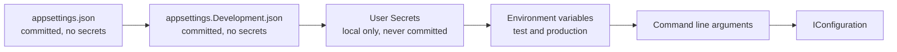

# Onboarding, everything a new member needs

This page takes a new team member from an empty machine to an approved merge request. Read it once from start to finish. After that, use the section you need.

Read three documents first, in this order: [collaborationAgreement.md](collaborationAgreement.md), [codeConventions.md](codeConventions.md) and [definitionOfDone.md](definitionOfDone.md). This page assumes all three.

## 1. What you install

| Tool | Version | Why |
|---|---|---|
| .NET SDK | 10 | The backend of Connect |
| Node.js | 22, at least 22.13 | The frontend of Connect. Vite needs 22.12 or newer, ESLint and the test tools need 22.13 |
| Docker | current | The database and the test site run in containers |
| Git | current | Every change reaches dev through a merge request |
| An editor | Visual Studio, Rider or Visual Studio Code | Any of the three is fine |

Check that each one answers before you go on:

```
dotnet --version
node --version
docker --version
git --version
```

## 2. Get the code

Clone the project and stay on `dev`, which is the default branch.

```
git clone <the project address on GitLab>
cd connect-nine
git switch dev
```

Nobody pushes to `dev` or `main`. Both are protected. Every change starts on its own branch and reaches `dev` through a merge request that a teammate approves.

## 3. Start the database

Connect uses PostgreSQL 16 in a container. `docker-compose.yml` in the root starts it together with pgAdmin, a web page to look inside it, with the same settings on every laptop. The database starts empty: the tables come from the migrations of the server, not from the compose file.

### Once per laptop

1. Install [Docker Desktop](https://docs.docker.com/desktop/) on your device and start it.
2. In the root of the repository, copy `.env.example` and name the copy `.env`. Already have a `.env`? Keep it, so you keep your passwords.
3. Open `.env` and replace `change-me` with a password of your own. `.env` is ignored by Git, so it stays on your laptop. Only Docker Compose reads it. Pick a password that is not an ordinary word, so `git grep "<your password>"` in section 8 finds nothing.

The database and pgAdmin only read the values in `.env` at their very first start. Changed one afterwards? Run `docker compose down -v` and `docker compose up -d`. That empties your local database, see the warning below.

### Start, check and stop

```
docker compose up -d              # start the database and pgAdmin
docker compose ps                 # wait until the database says (healthy)
docker compose stop               # stop both; your data stays
```

Look inside in one of two ways:

- **pgAdmin:** open http://localhost:5050. No login. The server Connect (local) is already on the left. The first time it asks for a password: that is `POSTGRES_PASSWORD` from your `.env`. Tick Save password.
- **psql:** `docker compose exec database psql -U connect -d connect`, and `\q` to leave. Use your own `POSTGRES_USER` and `POSTGRES_DB` if you changed them in `.env`.

The data lives in the volume `connect-data`, so a table you made is still there after `docker compose down` and `docker compose up -d`.

> **Careful with `docker compose down -v`.** The `-v` also removes the volume `connect-data`, and with it every row in your local database. Use it only when you want to start from an empty database on purpose. Afterwards the migrations build the tables again.

### Port 5432 or 5050 is busy

When `docker compose up` says `port is already allocated` or `address already in use`, another program already listens on that port of your laptop: another PostgreSQL on 5432, or another pgAdmin on 5050, for example the one of the database design in `docs/Gurpreet/dataModel/postgres`. Find it:

```
docker ps --filter publish=5432   # another container, for example of another project
docker ps --filter publish=5050
```

On Windows, `netstat -ano | findstr :5432` shows the process id, and Task Manager shows which program it is. On macOS and Linux, use `lsof -i :5432`.

There are two fixes:

1. **Stop the other one.** Stop that container with `docker stop <name>`, or stop the locally installed PostgreSQL service, and run `docker compose up -d` again. A container that has a restart policy starts again with Docker Desktop, so stop it again after a restart, or switch its restart policy off with `docker update --restart no <name>`.
2. **Use another port.** Need the other PostgreSQL to keep running? In `docker-compose.yml`, change `"127.0.0.1:5432:5432"` into `"127.0.0.1:5433:5432"` and run `docker compose up -d` again. The database is then on `localhost:5433`, so use `Port=5433` in your own connection string. Keep this change on your laptop and do not commit it: the rest of the team uses 5432.

The seed accounts and the seed data of the test site are described in the testing folder.

## 4. Configuration and secrets

This is the section to get right. Connect keeps every secret out of Git, and there is one way to do that per environment.
The complete reference is [architecture/configuration.md](../architecture/configuration.md);
the tables and commands below are the onboarding version of the same rules.

### How the server reads settings

The backend uses the normal .NET configuration system. Five sources feed one `IConfiguration`, and each source overrides the one before it.



A value in `appsettings.json` is therefore a default, and an environment variable with the same name wins over it. The application never opens a configuration file itself. It asks `IConfiguration`.

### What lives where

| File or store | In Git | Holds | Used in |
|---|---|---|---|
| `appsettings.json` | yes | shared defaults, no secrets | every environment |
| `appsettings.Development.json` | yes | local settings that are safe to share | local machines |
| User Secrets | no, never | your local passwords, keys and connection strings | local machines |
| `appsettings.Production.json` | yes | production settings that are not secret | production |
| Kubernetes Secrets | no, never | production passwords, keys and connection strings | production on k3s |
| `web/.env` | no, never | local frontend settings | local machines |
| `web/.env.example` | yes | the names of the frontend variables, with no real values | documentation |

A real password, key, token or connection string that carries credentials never goes in a file whose row says yes.

### Set up your local secrets

Once per clone, in the startup project of the backend:

```
dotnet user-secrets init
```

That writes a `<UserSecretsId>` into the project file. Then set a value:

```
dotnet user-secrets set "ConnectionStrings:Default" "Host=localhost;Port=5432;Database=connect;Username=connect;Password=<your local password>"
dotnet user-secrets list
```

Two things to know about User Secrets:

- The file lives outside the repository, at `~/.microsoft/usersecrets/<UserSecretsId>/secrets.json` on Linux and macOS, and at `%APPDATA%\Microsoft\UserSecrets\<UserSecretsId>\secrets.json` on Windows.
- It is plain text. User Secrets keeps a secret out of Git. It does not protect the value on your disk, and it is only read when the environment is Development.

### Production secrets

Production runs on k3s. A production secret is a Kubernetes Secret in the namespace of Connect, and the deployment hands it to the container as an environment variable:

```
kubectl create secret generic connect-backend \
  --namespace connect \
  --from-literal='ConnectionStrings__Default=Host=<host>;Database=connect;Username=connect;Password=<the production password>'
```

A nested setting uses a double underscore in the name of an environment variable, because a colon is not allowed in a variable name outside Windows. `ConnectionStrings__Default` is the same setting as `ConnectionStrings:Default`.

A Kubernetes Secret is base64 encoded, and base64 is not encryption. Anyone allowed to read secrets in the namespace reads the value. Keep that right to the members who deploy, and turn on encryption at rest for etcd on the cluster.

`appsettings.Production.json` is committed and holds only settings that are not secret. Never hand edit it on the server. The container image is rebuilt on every deploy, so the edit disappears with the next release.

### The frontend

`.env` holds the local frontend settings and is ignored by Git. `.env.example` lists every variable the frontend needs, with no real value in it, and is committed. When you add a variable, add it to `.env.example` in the same merge request.

One rule catches people out, so it is worth stating plainly. **A frontend variable is not a secret.** The bundler writes it into the JavaScript that every visitor downloads, so anyone can read it in the browser. Only settings that may be public belong in the frontend `.env`, for example the address of the API or a feature flag. A key that must stay private stays on the server, and the frontend asks the server for what it needs. Which prefix the bundler exposes depends on the bundler, `VITE_` for Vite and `NEXT_PUBLIC_` for Next.js. The team confirms the bundler and its prefix in sprint 1 planning. Owner: the whole team, 1 October 2026.

The ignore rules cover the variants, so `.env.local` and `.env.production` cannot slip in either:

```
.env
.env.*
!.env.example
```

## 5. Run Connect

### Start the server

```
dotnet run --project api/Connect/Connect.csproj
```

The backend has four layers: Presentation handles HTTP, Application holds use
cases and business rules, Domain holds core contracts and entities, and
Infrastructure handles external systems such as the database. Start the server
with `dotnet run --project api/Connect/Connect.csproj`; it listens on
`http://localhost:5000`.

### Start the frontend

The frontend is a React app in the folder `web`, built and served by Vite. It needs Node.js 22, at least 22.13. `web/.nvmrc` says 22, so with nvm you run `nvm use` in that folder.

```
cd web
npm install
npm run dev
```

Open http://localhost:5173. Run `npm install` again after a pull that changed `package.json`.

The frontend never names the address of the server. Every call to `/api` goes to Vite, and Vite passes it on to `http://localhost:5000` (the proxy in `web/vite.config.ts`). The browser only sees one address, so the server needs no CORS settings. Start the server as well when a page needs data. Check the proxy with:

```
curl http://localhost:5173/api/health
```

It answers `{"status":"healthy"}` when the server runs.

The scripts in `web/package.json`:

| Script | What it does |
|---|---|
| `npm run dev` | Starts Vite on http://localhost:5173 and reloads the page on every change |
| `npm run build` | Checks the types and builds the site into `web/dist` |
| `npm run lint` | ESLint with the rules for TypeScript, React hooks and accessibility |
| `npm run format` | Prettier puts every file in the team layout |
| `npm test` | Runs every Vitest test once |

## 6. Run the checks before you push

In the root of the repository:

```
dotnet build
dotnet format --verify-no-changes
dotnet test
```

In the folder `web`:

```
npm run lint
npx prettier --check .
npm test
npm run build
```

The pipeline runs the same checks. A merge request cannot be accepted while any of them is red.

## 7. Your first change

1. Take an issue from the board of the sprint and put it in Doing.
2. Branch from `dev`, named `<type>/<issue number>-<short name>`.
3. Commit as `<type>(<scope>): <what changed> (#<issue number>)`.
4. Open a merge request into `dev` and ask a teammate who did not write it to approve.
5. Walk the Definition of Done of the type of the issue, line by line.

## 8. Check that no secret leaked

Run this before every merge request:

```
git grep -i -E "password|secret|token|connectionstring"
```

Everything it finds has to be a placeholder or the name of a variable. If a real value ever reaches a commit, say so in the team channel at once. Removing it in a later commit is not enough, because the value stays in the history and has to be treated as leaked and replaced.

## 9. The words Connect uses

| Word | What it means in Connect |
|---|---|
| Member | Anyone with an account, whatever their role |
| Young person | A member from Amstelland who uses Connect to find people and chances |
| Organisation | A company or institution around the young people of Amstelland |
| The foundation | The WailSalutem Foundation, the client and the owner of Connect |
| Profile | What a member tells Connect about themselves |
| Opportunity | Something an organisation offers that a young person can take |
| Match | A connection between two members that Connect proposes or confirms |
| Showcase | A project a young person publishes on Connect |
| Challenge | A task an organisation posts for young people to join |
| Event | A gathering with a date, a place and a safe limit on the number of people |
| News item | Something the foundation publishes for everyone |
| Badge | Recognition for taking part |
| Board item | One numbered card of work, with a weight and its own Definition of Done |
| Task | A step of a board item, never with its own Definition of Done |
| Slice | A board item that adds something a person can see and use |
| Epic | A group of board items that belong to one part of Connect |

## 10. The client's server

Issue 09 Every team member on the client's server (task 9.2) prepares the foundation's server for the team.

### The machine

| Fact | Value |
|---|---|
| Provider and country | Strato, Germany |
| CPU | 4 vCPU, AMD EPYC Milan, 2.0 GHz |
| Memory | 7.7 GiB |
| Disk | 240 GB, 232 GB usable, 2.9 GB used |
| Operating system | Ubuntu 24.04.5 LTS, kernel 6.8.0-146-generic |
| IPv4 | 31.70.66.186 |
| Hostname | connect |
| Time zone | Europe/Amsterdam |

The server is IPv4 only today. The client's sheet names an IPv6 address, 2a01:239:4b8:db00::1, but it is not configured on the interface yet.

### How to log in

For now, every team member logs in as root:

```
ssh root@31.70.66.186
```

Send your public ed25519 key to Wesley Oerlemans. Task 9.2 gives every member their own user with their own key, and after that root login and password login go off.

On your first login, check the host key fingerprint against these three:

```
ED25519 SHA256:jZUye4ZjNvmKksJkDOtlQ94+O/jKnpsfWvzAhqj2Nbk
ECDSA SHA256:jFBiJlKA3mGbIo0c5qv3sqeLa3xRRGyXRuGp9mSYLCI
RSA SHA256:CmuGqwCHzubotlbA2rp/Ocg/P4yHMlochwTAXRxr35U
```

### What runs on it today

- Docker 29.8.2, Compose v5.5.1, buildx. `hello-world` ran. No containers, no volumes.
- ufw is active, default deny incoming, and allows only 22/tcp, 80/tcp and 443/tcp, on IPv4 and IPv6.
- fail2ban guards sshd: five failures bans an address for one hour.
- unattended-upgrades is enabled.
- Nothing of Connect is deployed yet.

### How it was received and rebuilt on 2 October 2026

The server had been used before, by an earlier iteration of this project built by other people. It carried Dokploy as a Docker Swarm stack with Traefik, PostgreSQL and Redis, a leftover Strapi volume, container images named sonarqube, young-amstelland-frontend and young-amstelland-backend, six ssh keys that were not the team's, and root logins from six different addresses since May 2026. Ports 3000, 8080 and 8081 were open to the internet.

On 2 October 2026 Wesley Oerlemans removed all of it: left the Docker swarm, removed every container, image and volume, purged and reinstalled Docker, deleted the old Dokploy files and home directories, removed every foreign key from root's authorized_keys, fully upgraded every package, removed old kernels, vacuumed the journal, reset the firewall to 22, 80 and 443, added fail2ban, set the hostname and the time zone, and rebooted. Disk use dropped from 21 GB to 2.9 GB. A copy of the old authorized_keys file stays on the server, in case a key belonged to someone who should keep access. The scripts and the log of the rebuild stay on the server too.

### Who logged in

Run `last` or `journalctl -u ssh` on the server to see every login.

Today every login is root, because personal users come with task 9.2. The list cannot yet show names. Once every member has their own user, this part lists each member by name instead.

### First login per team member

| Name | First login |
|---|---|
| Wesley Oerlemans | 2 October 2026 |
| Bayon Eerhart | |
| Nick Hoebe | |
| Gurpreet Singh | |
| Kelvin van Voorst | |

### What is still to do

- Task 9.1: the client points the DNS record of the test address at the server.
- Task 9.2: every team member gets a personal user with their own key, two members get sudo, then password login and root login go off.
- Task 9.3: check that every container listens on the server itself, not past the firewall.
- Task 9.4: Caddy makes the padlock on the test address.
- Task 9.5: a deploy user and `/srv/connect-test`, with the pipeline's own ssh key.
- Task 9.6: the whole team and the client confirm access and the padlock.

## References

Microsoft. (2026). *Configuration in ASP.NET Core*. Microsoft Learn. https://learn.microsoft.com/en-us/aspnet/core/fundamentals/configuration/

Microsoft. (2026). *Safe storage of app secrets in development in ASP.NET Core*. Microsoft Learn. https://learn.microsoft.com/en-us/aspnet/core/security/app-secrets/

The Kubernetes Authors. (2026). *Secrets*. Kubernetes Documentation. https://kubernetes.io/docs/concepts/configuration/secret/

## AI use declaration

AI was used as a writing support tool while working on this document. We used AI to draft the formulation of sentences, the structure of wording, readability, and clarity from content that we had provided, and to generate the diagrams. The content itself, including our experiences, reflections, learning goals, decisions, self-assessments, and conclusions, is our own. We reviewed the drafts and decided as a team which text to include.