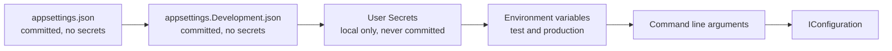

# Onboarding, everything a new member needs

This page takes a new team member from an empty machine to an approved merge request. Read it once from start to finish. After that, use the section you need.

Read three documents first, in this order: [collaborationAgreement.md](collaborationAgreement.md), [codeConventions.md](codeConventions.md) and [definitionOfDone.md](definitionOfDone.md). This page assumes all three.

## 1. What you install

| Tool | Version | Why |
|---|---|---|
| .NET SDK | 10 | The backend of Connect |
| Node.js | 22, at least 22.13 | The frontend of Connect. Vite needs 22.12 or newer, ESLint and the test tools need 22.13 |
| Docker | current | The database and the test site run in containers |
| Git | current | Every change reaches dev through a merge request |
| An editor | Visual Studio, Rider or Visual Studio Code | Any of the three is fine |
| dotnet-ef | matches the Entity Framework Core packages, pinned in `.config/dotnet-tools.json` | Creates and applies database migrations, part 4 |

Check that each one answers before you go on:

```
dotnet --version
node --version
docker --version
git --version
```

You should see four version numbers. `dotnet --version` starts with 10. `node --version` starts with v22. The other two print a line that starts with `Docker version` and `git version`. A line such as `command not found` means the tool is not installed or not on your path.

`dotnet-ef` is not installed by itself: it is a local tool, pinned to one version per repository in `.config/dotnet-tools.json`, and part 4 restores it before the first use.

## 2. Get the code

Clone the project and stay on `dev`, which is the default branch.

```
git clone https://gitlab.fdmci.hva.nl/studio/social-impact-apps/onderwijs/projects/2026-2027-semester-1/projects/project-9-wail-salutem-foundation-project-2/connect-nine.git
cd connect-nine
git switch dev
```

You should see `Cloning into 'connect-nine'...`, and after the last command `Already on 'dev'`.

Nobody pushes to `dev` or `main`. Both are protected. Every change starts on its own branch and reaches `dev` through a merge request that a teammate approves.

Two clones on the same laptop in folders named `connect-nine`? Docker Compose names the containers and the volume after the folder, so a second clone in a folder with the same name shares the containers and the volume of the first instead of getting its own. Clone the second copy into a folder with another name, or start it with `docker compose -p <name> up -d`.

## 3. Start the database

Connect uses PostgreSQL 16 in a container. `docker-compose.yml` in the root starts it together with pgAdmin, a web page to look inside it, with the same settings on every laptop. The database starts empty: the tables come from the migrations of the server, not from the compose file.

### Once per laptop

1. Install [Docker Desktop](https://docs.docker.com/desktop/) on your device and start it.
2. In the root of the repository, copy `.env.example` and name the copy `.env`. Already have a `.env`? Keep it, so you keep your passwords.
3. Open `.env` and replace `change-me` with a password of your own. `.env` is ignored by Git, so it stays on your laptop. Only Docker Compose reads it. Pick a password that is not an ordinary word, so `git grep "<your password>"` in section 8 finds nothing.

The database and pgAdmin only read the values in `.env` at their very first start. Changed one afterwards? Run `docker compose down -v` and `docker compose up -d`. That empties your local database, see the warning below.

### Start, check and stop

```
docker compose up -d              # start the database and pgAdmin
docker compose ps                 # wait until the database says (healthy)
docker compose stop               # stop both; your data stays
```

Look inside in one of two ways:

- **pgAdmin:** open http://localhost:5050. No login. Wait about half a minute after `docker compose ps` says the database is healthy before the page answers: pgAdmin itself still needs to start. The server Connect (local) is already on the left. The first time it asks for a password: that is `POSTGRES_PASSWORD` from your `.env`. Tick Save password.
- **psql:** `docker compose exec database psql -U connect -d connect`, and `\q` to leave. Use your own `POSTGRES_USER` and `POSTGRES_DB` if you changed them in `.env`.

The data lives in the volume `connect-data`, so a table you made is still there after `docker compose down` and `docker compose up -d`.

> **Careful with `docker compose down -v`.** The `-v` also removes the volume `connect-data`, and with it every row in your local database. Use it only when you want to start from an empty database on purpose. Afterwards the migrations build the tables again.

### Port 5432 or 5050 is busy

When `docker compose up` says `port is already allocated` or `address already in use`, another program already listens on that port of your laptop: another PostgreSQL on 5432, or another pgAdmin on 5050, for example the one of the database design in `docs/Gurpreet/dataModel/postgres`. Find it:

```
docker ps --filter publish=5432   # another container, for example of another project
docker ps --filter publish=5050
```

On Windows, `netstat -ano | findstr :5432` shows the process id, and Task Manager shows which program it is. On macOS and Linux, use `lsof -i :5432`.

On Windows, the message can instead be `bind: An attempt was made to access a socket in a way forbidden by its access permissions`. That is not another program on the port: Windows itself reserves a range of ports for Hyper-V and WinNAT. Check the reserved ranges with `netsh interface ipv4 show excludedportrange protocol=tcp`. Windows can reserve a range such as 5358 to 5457, so 5432 or a nearby port can fall inside it.

There are two fixes:

1. **Stop the other one.** Stop that container with `docker stop <name>`, or stop the locally installed PostgreSQL service, and run `docker compose up -d` again. A container that has a restart policy starts again with Docker Desktop, so stop it again after a restart, or switch its restart policy off with `docker update --restart no <name>`.
2. **Use another port.** Need the other PostgreSQL to keep running, or did Windows reserve 5432 for itself? In `docker-compose.yml`, change `"127.0.0.1:5432:5432"` into `"127.0.0.1:15432:5432"` and run `docker compose up -d` again. The database is then on `localhost:15432`, so use `Port=15432` in your own connection string. Keep this change on your laptop and do not commit it: the rest of the team uses 5432.

The seed accounts and the seed data of the test site are described in the testing folder.

## 4. Configuration and secrets

This is the section to get right. Connect keeps every secret out of Git, and there is one way to do that per environment.
The complete reference is [architecture/configuration.md](../architecture/configuration.md);
the tables and commands below are the onboarding version of the same rules.

### How the server reads settings

The backend uses the normal .NET configuration system. Five sources feed one `IConfiguration`, and each source overrides the one before it.



A value in `appsettings.json` is therefore a default, and an environment variable with the same name wins over it. The application never opens a configuration file itself. It asks `IConfiguration`.

### What lives where

| File or store | In Git | Holds | Used in |
|---|---|---|---|
| `appsettings.json` | yes | shared defaults, no secrets | every environment |
| `appsettings.Development.json` | yes | local settings that are safe to share | local machines |
| User Secrets | no, never | your local passwords, keys and connection strings | local machines |
| `appsettings.Production.json` | yes | production settings that are not secret | production |
| Kubernetes Secrets | no, never | production passwords, keys and connection strings | production on k3s |
| `web/.env` | no, never | local frontend settings | local machines |
| `web/.env.example` | yes | the names of the frontend variables, with no real values | documentation |

A real password, key, token or connection string that carries credentials never goes in a file whose row says yes.

### Set up your local secrets

Once per clone, in the startup project of the backend (`api/Connect/Connect.csproj`):

```
dotnet user-secrets init
```

That writes a `<UserSecretsId>` into the project file. Then set a value. The server reads the
`ConnectionStrings:DefaultConnection` setting:

```
dotnet user-secrets set "ConnectionStrings:Default" "Host=localhost;Port=5432;Database=connect;Username=connect;Password=<your local password>"
dotnet user-secrets list
```

For this repository, the complete command is:

```
dotnet user-secrets set "ConnectionStrings:DefaultConnection" "Host=localhost;Port=5432;Database=connect;Username=connect;Password=your-local-password"
```

Use `ConnectionStrings:DefaultConnection` for this repository; older examples using
`ConnectionStrings:Default` are obsolete.

Two things to know about User Secrets:

- The file lives outside the repository, at `~/.microsoft/usersecrets/<UserSecretsId>/secrets.json` on Linux and macOS, and at `%APPDATA%\Microsoft\UserSecrets\<UserSecretsId>\secrets.json` on Windows.
- It is plain text. User Secrets keeps a secret out of Git. It does not protect the value on your disk, and it is only read when the environment is Development.

### Create and apply migrations

Once per clone, before the first `dotnet ef` command, restore the pinned tool:

```
dotnet tool restore
```

You should see `Tool 'dotnet-ef' (version '10.0.12') was restored.` and then `Restore was successful.`

The database context is in `api/Connect.Infrastructure`, while `api/Connect` is the startup
project that loads the connection string. Create a migration with both projects specified:

```
dotnet ef migrations add <MigrationName> \
  --project api/Connect.Infrastructure/Connect.Infrastructure.csproj \
  --startup-project api/Connect/Connect.csproj \
  --output-dir Persistence/Migrations
```

You should see `Build succeeded.` and then `Done. To undo this action, use 'ef migrations remove'`. EF Core adds two new files for your migration under `Persistence/Migrations` and updates the model snapshot.

Apply all pending migrations to the local PostgreSQL database:

```
dotnet ef database update \
  --project api/Connect.Infrastructure/Connect.Infrastructure.csproj \
  --startup-project api/Connect/Connect.csproj
```

You should see `Applying migration '<name>'.` for each migration not yet applied, one line per migration, ending with `Done.`

List migrations before changing database state:

```
dotnet ef migrations list \
  --project api/Connect.Infrastructure/Connect.Infrastructure.csproj \
  --startup-project api/Connect/Connect.csproj
```

You should see every migration printed on its own line, oldest first, for example `20261009065814_AddAccountTable`.

To go back one migration, use the migration immediately before the current one from that list.
Never put a fixed old migration name in a shared command:

```
dotnet ef database update <MigrationBeforeYours> \
  --project api/Connect.Infrastructure/Connect.Infrastructure.csproj \
  --startup-project api/Connect/Connect.csproj
```

You should see `Reverting migration '<name>'.` for each migration undone back to the one you chose, ending with `Done.`

Do not edit a migration already on `dev`; add a new migration instead. The local test factory
runs `Database.Migrate()` once when its host starts. Infrastructure table tests use PostgreSQL,
because InMemory cannot enforce PostgreSQL indexes, check constraints or PostgreSQL error codes.

### Production secrets

Production runs on k3s. A production secret is a Kubernetes Secret in the namespace of Connect, and the deployment hands it to the container as an environment variable:

```
kubectl create secret generic connect-backend \
  --namespace connect \
  --from-literal='ConnectionStrings__DefaultConnection=Host=<host>;Database=connect;Username=connect;Password=<the production password>'
```

You should see `secret/connect-backend created`.

A nested setting uses a double underscore in the name of an environment variable, because a colon is not allowed in a variable name outside Windows. `ConnectionStrings__DefaultConnection` is the same setting as `ConnectionStrings:DefaultConnection`.

A Kubernetes Secret is base64 encoded, and base64 is not encryption. Anyone allowed to read secrets in the namespace reads the value. Keep that right to the members who deploy, and turn on encryption at rest for etcd on the cluster.

`appsettings.Production.json` is committed and holds only settings that are not secret. Never hand edit it on the server. The container image is rebuilt on every deploy, so the edit disappears with the next release.

### The frontend

`.env` holds the local frontend settings and is ignored by Git. `.env.example` lists every variable the frontend needs, with no real value in it, and is committed. When you add a variable, add it to `.env.example` in the same merge request.

One rule catches people out, so it is worth stating plainly. **A frontend variable is not a secret.** The bundler writes it into the JavaScript that every visitor downloads, so anyone can read it in the browser. Only settings that may be public belong in the frontend `.env`, for example the address of the API or a feature flag. A key that must stay private stays on the server, and the frontend asks the server for what it needs. Which prefix the bundler exposes depends on the bundler, `VITE_` for Vite and `NEXT_PUBLIC_` for Next.js. The team confirms the bundler and its prefix in sprint 1 planning. Owner: the whole team, 1 October 2026.

The ignore rules cover the variants, so `.env.local` and `.env.production` cannot slip in either:

```
.env
.env.*
!.env.example
```

## 5. Run Connect

### Start the server

The backend has four layers: Presentation handles HTTP, Application holds use
cases and business rules, Domain holds core contracts and entities, and
Infrastructure handles external systems such as the database. The start project
`api/Connect` connects them, see `docs/decisions/002-layeredArchitecture.md`.

```
dotnet run --project api/Connect/Connect.csproj
```

You should see `Now listening on: http://localhost:5000`. Open http://localhost:5000/api/health in a browser: you should see `{"status":"healthy"}`. Stop the server with Ctrl+C.

### Start the frontend

The frontend is a React app in the folder `web`, built and served by Vite. It needs Node.js 22, at least 22.13. `web/.nvmrc` says 22, so with nvm you run `nvm use` in that folder.

```
cd web
npm install
npm run dev
```

You should see a line with `Local:` and an address such as http://localhost:5173. Open it. Run `npm install` again after a pull that changed `package.json`.

The frontend never names the address of the server. Every call to `/api` goes to Vite, and Vite passes it on to `http://localhost:5000` (the proxy in `web/vite.config.ts`). The browser only sees one address, so the server needs no CORS settings. Start the server as well when a page needs data. Check the proxy with:

```
curl http://localhost:5173/api/health
```

It answers `{"status":"healthy"}` when the server runs.

The scripts in `web/package.json`:

| Script | What it does |
|---|---|
| `npm run dev` | Starts Vite on http://localhost:5173 and reloads the page on every change |
| `npm run build` | Checks the types and builds the site into `web/dist` |
| `npm run lint` | ESLint with the rules for TypeScript, React hooks and accessibility |
| `npm run format` | Prettier puts every file in the team layout |
| `npm test` | Runs every Vitest test once |

## 6. Run the checks before you push

In the root of the repository:

```
dotnet build api/Connect.slnx
dotnet format api/Connect.slnx --verify-no-changes
dotnet test api/Connect.slnx
```

You should see `Build succeeded` with `0 Warning(s)` and `0 Error(s)`, no output from the format check, and `Passed!` with `Failed: 0` for the tests.

In the folder `web`:

```
npm run lint
npx prettier --check .
npm test
npm run build
```

You should see no lint errors, `All matched files use Prettier code style!` and every test passed.

The pipeline runs the same checks. A merge request cannot be accepted while any of them is red.

## 7. Your first change

1. Take an issue from the board of the sprint and drag it to the list In progress.
2. Branch from `dev`, named `<type>/<issue number>-<short name>`:

   ```
   git switch dev
   git pull
   git switch -c feature/14-create-an-account
   ```

   You should see `Switched to a new branch 'feature/14-create-an-account'`.
3. Commit as `<type>(<scope>): <what changed> (#<issue number>)`:

   ```
   git add <the files you changed>
   git commit -m "feat(backend): add account endpoint (#14)"
   ```

   You should see a line such as `[feature/14-create-an-account 3f2a1b9] feat(backend): add account endpoint (#14)` and how many files changed.
4. Push the branch with `git push -u origin <your branch>`. You should see a line with a link to make a merge request.
5. Open the link, choose `dev` as the target and ask a teammate who did not write it to approve. The template fills the description: start it with `Relates to #<issue number>`. You should see the merge request page with your title and the template in the description.
6. Wait for the pipeline of the merge request. Green means you can ask for the review. Red: click the red run, then the red job, and read the last lines of its log. They say what failed. The part Pipeline of [gitlabSetup.md](gitlabSetup.md) explains each job. You should see a green check next to the pipeline of the merge request when every job passed.
7. Walk the Definition of Done of the type of the issue, line by line. You should see every line of the list in the issue ticked before you ask for the merge.

## 8. Check that no secret leaked

Run this before every merge request:

```
git grep -i -E "password|secret|token|connectionstring"
```

You should see only lines where the word is a name, a placeholder or an explanation, such as `POSTGRES_PASSWORD=` in `.env.example`. Everything it finds has to be a placeholder or the name of a variable. If a real value ever reaches a commit, say so in the team channel at once. Removing it in a later commit is not enough, because the value stays in the history and has to be treated as leaked and replaced.

## 9. The words Connect uses

| Word | What it means in Connect |
|---|---|
| Member | Anyone with an account, whatever their role |
| Young person | A member from Amstelland who uses Connect to find people and chances |
| Organisation | A company or institution around the young people of Amstelland |
| The foundation | The WailSalutem Foundation, the client and the owner of Connect |
| Profile | What a member tells Connect about themselves |
| Opportunity | Something an organisation offers that a young person can take |
| Match | A connection between two members that Connect proposes or confirms |
| Showcase | A project a young person publishes on Connect |
| Challenge | A task an organisation posts for young people to join |
| Event | A gathering with a date, a place and a safe limit on the number of people |
| News item | Something the foundation publishes for everyone |
| Badge | Recognition for taking part |
| Board item | One numbered card of work, with a weight and its own Definition of Done |
| Task | A step of a board item, never with its own Definition of Done |
| Slice | A board item that adds something a person can see and use |
| Epic | A group of board items that belong to one part of Connect |

## 10. The client's server

Issue 09 Every team member on the client's server (task 9.2) prepares the foundation's server for the team. How the foundation gets in without the team, and what changes at the handover, is in [serverHandover.md](../client/serverHandover.md).

### The machine

| Fact | Value |
|---|---|
| Owner | The WailSalutem Foundation, the client (director Rachid Kherrazi) |
| Provider and country | Strato, Germany |
| CPU | 4 vCPU, AMD EPYC Milan, 2.0 GHz |
| Memory | 7.7 GiB |
| Disk | 240 GB, 232 GB usable, 2.9 GB used |
| Operating system | Ubuntu 24.04.5 LTS, kernel 6.8.0-146-generic |
| IPv4 | 31.70.66.186 |
| Hostname | connect |
| Time zone | Europe/Amsterdam |

The facts above come from these commands, run on the server on 9 October 2026:

```
$ nproc
4
$ free -h
               total        used        free      shared  buff/cache   available
Mem:           7.7Gi       833Mi       5.9Gi       1.0Mi       1.2Gi       6.9Gi
Swap:             0B          0B          0B
$ df -h /
Filesystem      Size  Used Avail Use% Mounted on
/dev/vda1       232G  3.1G  229G   2% /
$ head -4 /etc/os-release
PRETTY_NAME="Ubuntu 24.04.5 LTS"
NAME="Ubuntu"
VERSION_ID="24.04"
VERSION="24.04.5 LTS (Noble Numbat)"
```

The server is IPv4 only today. The client's sheet names an IPv6 address, 2a01:239:4b8:db00::1, but it is not configured on the interface yet.

### Logging in

Every team member has a user of their own, named after their first name in lower case, reachable only with their own ssh key. On 9 October 2026 the keys were copied once from each member's GitLab profile (User settings, SSH keys). A key you add to GitLab after that date does not reach the server by itself: send it to an admin, see A new laptop or a new key below.

Your first login, step by step:

1. Check that you have a key. `ls ~/.ssh` lists a file that ends in `.pub`, such as `id_ed25519.pub`. The same command works in PowerShell on Windows. No such file? Make one with `ssh-keygen -t ed25519` and press Enter to keep the default file name. Give it a passphrase: whoever copies a key without one can log in as you.
2. Log in with your own first name in lower case:

   ```
   ssh <your first name>@31.70.66.186
   ```

3. The first time, ssh shows a fingerprint and asks `Are you sure you want to continue connecting (yes/no/[fingerprint])?`. Compare the fingerprint with these three. It must match one of them exactly, then type `yes`. This proves you reached the client's server and not a machine in between.

   ```
   ED25519 SHA256:jZUye4ZjNvmKksJkDOtlQ94+O/jKnpsfWvzAhqj2Nbk
   ECDSA SHA256:jFBiJlKA3mGbIo0c5qv3sqeLa3xRRGyXRuGp9mSYLCI
   RSA SHA256:CmuGqwCHzubotlbA2rp/Ocg/P4yHMlochwTAXRxr35U
   ```

4. You should see a prompt such as `nick@connect:~$`. Type `exit` to leave.
5. Write your date in First login per team member below, through a small merge request.

Your key has another file name? Point ssh at it: `ssh -i ~/.ssh/<file> <your first name>@31.70.66.186`.

When the login fails:

- `Permission denied (publickey)`: the server does not know the key on this laptop. Most often it is a new laptop, or a key made after 9 October 2026. Send the content of your public key (`cat ~/.ssh/id_ed25519.pub`) to an admin, a member of the group sudo named below. A public key is not a secret, so the team chat is fine. Never send the file without `.pub`: that is your private key. The admin adds it with the steps of A new laptop or a new key.
- `WARNING: REMOTE HOST IDENTIFICATION HAS CHANGED!`: the server answered with another fingerprint than the one your laptop saved. Do not log in. Tell the team, because either the server was reinstalled or something sits in between. Only after the team knows why, remove the old fingerprint with `ssh-keygen -R 31.70.66.186` and start again at step 2.

How access works on this server:

- Password login is off for everyone: `/etc/ssh/sshd_config.d/10-connect.conf` sets `PasswordAuthentication no` and `KbdInteractiveAuthentication no`. A try with a password answers `Permission denied (publickey)` (tried on 9 October 2026).
- Why no password login: the team decided this for security (#237). A password can be guessed or leaked, a key cannot be guessed. The client does not log in to the server during the project: he has the Strato customer login, where he can reset the whole server, and the server holds no real data. In the last sprint, when the project is done, the team switches password login back on, step 6 of At the handover in [serverHandover.md](../client/serverHandover.md).
- Root never logs in over ssh: the same file sets `PermitRootLogin no` since 9 October 2026, checked with `sshd -t` before `systemctl reload ssh`. A try answers `root@31.70.66.186: Permission denied (publickey).`
- Every team member is an admin: the group sudo holds wesley, gurpreet, bayon, nick and kelvin. They become root with `sudo -i` after logging in with their own key, without a password (`/etc/sudoers.d/20-connect-admins`). Wesley decided this for wesley and gurpreet on 9 October 2026 and for the whole team on 10 October 2026. Every user has a locked password, so the ssh key is the only way in, and whoever holds a member's key is root. Guard that key.
- Add an admin with `sudo usermod -aG sudo <name>` and a line `<name> ALL=(ALL) NOPASSWD:ALL` in that file through `sudo visudo -f /etc/sudoers.d/20-connect-admins`.

### New team member

On the server, as a member of the group sudo, with the new member's first name and their public key from their GitLab profile:

```
sudo adduser --disabled-password --gecos "" <name>
sudo install -d -m 700 -o <name> -g <name> /home/<name>/.ssh
sudo nano /home/<name>/.ssh/authorized_keys   # paste only their public key
sudo chown <name>:<name> /home/<name>/.ssh/authorized_keys
sudo chmod 600 /home/<name>/.ssh/authorized_keys
```

You should see no output from the last two commands. The new member then logs in with `ssh <name>@31.70.66.186`.

### A new laptop or a new key

A member who already has a user sends their public key, the line that starts with `ssh-ed25519`. On the server, as a member of the group sudo:

```
sudo nano /home/<name>/.ssh/authorized_keys   # paste the key on a new line, keep the old lines
```

You should see nano open with the file already on screen, keeping every line that is there. Press Ctrl+O then Enter to write the file, and Ctrl+X to close nano.

Save, and the member logs in with the new key. Delete the line of a laptop the member no longer has, so a lost laptop is no way in.

### Someone leaves

```
sudo deluser --remove-home <name>
```

You should see `Removing user '<name>'`. Their key and home folder are gone, and a login with their name answers `Permission denied (publickey)`.

Then remove their line from `/etc/sudoers.d/20-connect-admins` with `sudo visudo -f /etc/sudoers.d/20-connect-admins`. Otherwise a new user who later gets the same name is root from the first login.

### Who logged in

`sudo journalctl -u ssh --since "7 days ago" | grep Accepted` lists every login with the user name, the key type and the time. `last` only lists logins with a terminal. Since 9 October 2026 the list shows personal first names instead of root.

### First login per team member

Each member writes their own line after their first login with their own user.

| Name | First login with own user |
|---|---|
| Wesley Oerlemans | 9 October 2026 |
| Bayon Eerhart | |
| Nick Hoebe | |
| Gurpreet Singh | |
| Kelvin van Voorst | |

### Open ports

```
sudo ufw status verbose
```

You should see `Default: deny (incoming), allow (outgoing)` and only these, for IPv4 and IPv6:

| Port | Why |
|---|---|
| 22/tcp | The secure login (ssh) |
| 80/tcp | Web visits, which Caddy sends on to https |
| 443/tcp | Web visits with the padlock |

The output on 9 October 2026:

```
Status: active
Logging: on (low)
Default: deny (incoming), allow (outgoing), deny (routed)
New profiles: skip

To                         Action      From
--                         ------      ----
22/tcp                     ALLOW IN    Anywhere
80/tcp                     ALLOW IN    Anywhere
443/tcp                    ALLOW IN    Anywhere
22/tcp (v6)                ALLOW IN    Anywhere (v6)
80/tcp (v6)                ALLOW IN    Anywhere (v6)
443/tcp (v6)               ALLOW IN    Anywhere (v6)
```

- A scan from outside on 9 October 2026 found only 22 answering. 80 and 443 answer since Caddy runs.
- Docker 29.8.2 with Compose 5.5.1 comes from Docker's own package source (download.docker.com). Checked on 9 October 2026: `docker --version` answers `Docker version 29.8.2, build 7fc2dff`, `docker compose version` answers `Docker Compose version v5.5.1`, and `docker run --rm hello-world` prints `Hello from Docker!`.
- The programs on the server and their licence, so hosting costs no licence money (NFR3): Docker Engine (Apache 2.0, github.com/moby/moby), the Docker Compose plugin (Apache 2.0, github.com/docker/compose), Caddy (Apache 2.0, github.com/caddyserver/caddy) and ufw (GPL 3.0, launchpad.net/ufw).
- Docker opens ports past ufw. So every container publishes its port only on 127.0.0.1, for example `"127.0.0.1:8080:8080"`. That holds for the database and the test mailbox of #39 as well, which are reached only through Caddy with a login.
- The group docker equals full administrator rights on the server. Only the user deploy is in it, a team member only when needed.
- `/srv/connect-test` holds the test site, owned by deploy.

### The test address

The test site is at https://31-70-66-186.sslip.io until the foundation sets the DNS record of the real test address (task 9.1, #236). sslip.io is a free name service that points a name with the IP address in it at that address. When the real address comes, only the first line of `deploy/Caddyfile` changes.

- Caddy 2.11.7 runs as a system service, installed from its own package source on 9 October 2026. Its settings file is `deploy/Caddyfile` in Git and `/etc/caddy/Caddyfile` on the server.
- The certificate comes from Let's Encrypt and Caddy renews it by itself. http answers with a redirect to https.
- Change the file in Git first. After the merge: `scp deploy/Caddyfile <your name>@31.70.66.186:/tmp/Caddyfile`, then `sudo cp /tmp/Caddyfile /etc/caddy/Caddyfile`, `caddy validate --config /etc/caddy/Caddyfile` (you should see `Valid configuration`) and `sudo systemctl reload caddy`.
- The log: `sudo journalctl -u caddy`. The end date of the certificate: `echo | openssl s_client -connect 31-70-66-186.sslip.io:443 -servername 31-70-66-186.sslip.io 2>/dev/null | openssl x509 -noout -enddate`.
- Caddy writes no log of every visit, because the Caddyfile has no log directive.
- Until the Connect server runs on 127.0.0.1:8080 (task 3.9, #267), the address answers 502 with the padlock. See the Caddy documentation on automatic https: https://caddyserver.com/docs/automatic-https

### The pipeline on the server

- The user deploy has no password, is in the group docker, owns `/srv/connect-test` and accepts only the deploy key of the pipeline. Nobody logs in as deploy by hand.
- Three protected GitLab variables, under Settings, CI/CD, Variables: SSH_PRIVATE_KEY (the private deploy key, base64 on one line, masked), SSH_KNOWN_HOSTS (the host keys above) and TEST_SERVER_HOST. Protected means only dev and main get them, so a run on another branch gets no key.
- The job ssh-check in `.gitlab-ci.yml` starts by hand on dev, or in a pipeline started with the variable RUN_SSH_CHECK set to yes. It logs in as deploy and prints the name of the server, `connect`.
- The secret settings of the test site are in `/srv/connect-test/.env` on the server, rights 600, owner deploy. The database password was made on the server with `openssl rand -hex 24` and is not written anywhere else. `deploy/.env.example` lists every name.
- **A new deploy key after a leak.** Make a new pair with `ssh-keygen -t ed25519`, put the public part in `/home/deploy/.ssh/authorized_keys` instead of the old one, the private part base64 encoded in SSH_PRIVATE_KEY, delete the private part from your laptop, and run ssh-check.
- **Change the database password.** Change POSTGRES_PASSWORD and the password inside ConnectionStrings__DefaultConnection in `/srv/connect-test/.env` together. The database keeps its first password on its volume, so also change it in PostgreSQL itself, or start the test database over.

## 11. The security scan

Every merge request, every run on dev and main, and once a week on dev, the pipeline checks the packages of the server and the screen against the public lists of known holes (issue #22).

- **Threshold.** High and critical stop the pipeline. Low and moderate do not, so the team is not stopped by every small advisory, while a serious hole never gets in.
- **backend-scan.** `dotnet restore` with NuGet audit from `api/Directory.Build.props`, then `dotnet list package --vulnerable --include-transitive`. Red on NU1903 (high) or NU1904 (critical), or on High or Critical in the list. An advisory the client accepted (a NuGetAuditSuppress line, see `docs/security/securityExceptions.md`) is skipped, and the log names it under "Skipped, accepted by the client".
- **frontend-scan.** `npm ci`, then `npm audit --audit-level=high`. It only runs once `web/package.json` exists.
- **The same on your laptop.**

  ```
  cd api
  dotnet restore
  dotnet list package --vulnerable --include-transitive
  ```

  You should see "has no vulnerable packages" for every project. An advisory the client accepted still shows as High in this list; only the pipeline skips it. For the screen: `cd web`, `npm ci`, `npm audit --audit-level=high`, and you should see "found 0 vulnerabilities".
- **When it is red.** Open the red job and read the package and the advisory link. Update the package to the version the advisory names as fixed, and push. Is there no fixed version, then tell the stand up the same day. Only the client may accept the risk, see `docs/security/securityExceptions.md`.
- **The weekly run.** Build, Pipeline schedules, every Monday morning on dev. Only the two scan jobs run, nothing is deployed. One member per sprint reads the result on Monday and tells the stand up when it is red. Proposal: sprint 2 Wesley Oerlemans, sprint 3 Kelvin van Voorst, sprint 4 Nick Hoebe, sprint 5 Gurpreet Singh, decided at each sprint planning.
- **Proof that it stops a change.** On 8 October 2026 the closed merge request !31 added `Newtonsoft.Json` 12.0.3 to the server on purpose. backend-scan turned red with NU1903 and the advisory GHSA-5crp-9r3c-p9vr (pipeline 583877), and turned green again after the package was removed. The screen half of this test follows once `web/package.json` exists.

## References

Microsoft. (2026). *Configuration in ASP.NET Core*. Microsoft Learn. https://learn.microsoft.com/en-us/aspnet/core/fundamentals/configuration/

Microsoft. (2026). *Safe storage of app secrets in development in ASP.NET Core*. Microsoft Learn. https://learn.microsoft.com/en-us/aspnet/core/security/app-secrets/

The Kubernetes Authors. (2026). *Secrets*. Kubernetes Documentation. https://kubernetes.io/docs/concepts/configuration/secret/

## AI use declaration

AI was used as a writing support tool while working on this document. We used AI to draft the formulation of sentences, the structure of wording, readability, and clarity from content that we had provided, and to generate the diagrams. The content itself, including our experiences, reflections, learning goals, decisions, self-assessments, and conclusions, is our own. We reviewed the drafts and decided as a team which text to include.