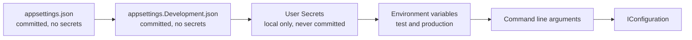

# Onboarding, everything a new member needs

This page takes a new team member from an empty machine to an approved merge request. Read it once from start to finish. After that, use the section you need.

Read three documents first, in this order: [collaborationAgreement.md](collaborationAgreement.md), [codeConventions.md](codeConventions.md) and [definitionOfDone.md](definitionOfDone.md). This page assumes all three.

## 1. What you install

| Tool | Version | Why |
|---|---|---|
| .NET SDK | 10 | The backend of Connect |
| Node.js | current LTS | The frontend of Connect |
| Docker | current | The database and the test site run in containers |
| Git | current | Every change reaches dev through a merge request |
| An editor | Visual Studio, Rider or Visual Studio Code | Any of the three is fine |

Check that each one answers before you go on:

```
dotnet --version
node --version
docker --version
git --version
```

## 2. Get the code

Clone the project and stay on `dev`, which is the default branch.

```
git clone <the project address on GitLab>
cd connect-nine
git switch dev
```

Nobody pushes to `dev` or `main`. Both are protected. Every change starts on its own branch and reaches `dev` through a merge request that a teammate approves.

## 3. Start the database

Connect uses PostgreSQL 16 in a container.

```
docker compose up -d database
```

The seed accounts and the seed data of the test site are described in the testing folder.

## 4. Configuration and secrets

This is the section to get right. Connect keeps every secret out of Git, and there is one way to do that per environment.
The complete reference is [architecture/configuration.md](../architecture/configuration.md);
the tables and commands below are the onboarding version of the same rules.

### How the server reads settings

The backend uses the normal .NET configuration system. Five sources feed one `IConfiguration`, and each source overrides the one before it.



A value in `appsettings.json` is therefore a default, and an environment variable with the same name wins over it. The application never opens a configuration file itself. It asks `IConfiguration`.

### What lives where

| File or store | In Git | Holds | Used in |
|---|---|---|---|
| `appsettings.json` | yes | shared defaults, no secrets | every environment |
| `appsettings.Development.json` | yes | local settings that are safe to share | local machines |
| User Secrets | no, never | your local passwords, keys and connection strings | local machines |
| `appsettings.Production.json` | yes | production settings that are not secret | production |
| Kubernetes Secrets | no, never | production passwords, keys and connection strings | production on k3s |
| `web/.env` | no, never | local frontend settings | local machines |
| `web/.env.example` | yes | the names of the frontend variables, with no real values | documentation |

A real password, key, token or connection string that carries credentials never goes in a file whose row says yes.

### Set up your local secrets

Once per clone, in the startup project of the backend:

```
dotnet user-secrets init
```

That writes a `<UserSecretsId>` into the project file. Then set a value:

```
dotnet user-secrets set "ConnectionStrings:Default" "Host=localhost;Port=5432;Database=connect;Username=connect;Password=<your local password>"
dotnet user-secrets list
```

Two things to know about User Secrets:

- The file lives outside the repository, at `~/.microsoft/usersecrets/<UserSecretsId>/secrets.json` on Linux and macOS, and at `%APPDATA%\Microsoft\UserSecrets\<UserSecretsId>\secrets.json` on Windows.
- It is plain text. User Secrets keeps a secret out of Git. It does not protect the value on your disk, and it is only read when the environment is Development.

### Production secrets

Production runs on k3s. A production secret is a Kubernetes Secret in the namespace of Connect, and the deployment hands it to the container as an environment variable:

```
kubectl create secret generic connect-backend \
  --namespace connect \
  --from-literal='ConnectionStrings__Default=Host=<host>;Database=connect;Username=connect;Password=<the production password>'
```

A nested setting uses a double underscore in the name of an environment variable, because a colon is not allowed in a variable name outside Windows. `ConnectionStrings__Default` is the same setting as `ConnectionStrings:Default`.

A Kubernetes Secret is base64 encoded, and base64 is not encryption. Anyone allowed to read secrets in the namespace reads the value. Keep that right to the members who deploy, and turn on encryption at rest for etcd on the cluster.

`appsettings.Production.json` is committed and holds only settings that are not secret. Never hand edit it on the server. The container image is rebuilt on every deploy, so the edit disappears with the next release.

### The frontend

`.env` holds the local frontend settings and is ignored by Git. `.env.example` lists every variable the frontend needs, with no real value in it, and is committed. When you add a variable, add it to `.env.example` in the same merge request.

One rule catches people out, so it is worth stating plainly. **A frontend variable is not a secret.** The bundler writes it into the JavaScript that every visitor downloads, so anyone can read it in the browser. Only settings that may be public belong in the frontend `.env`, for example the address of the API or a feature flag. A key that must stay private stays on the server, and the frontend asks the server for what it needs. Which prefix the bundler exposes depends on the bundler, `VITE_` for Vite and `NEXT_PUBLIC_` for Next.js. The team confirms the bundler and its prefix in sprint 1 planning. Owner: the whole team, 1 October 2026.

The ignore rules cover the variants, so `.env.local` and `.env.production` cannot slip in either:

```
.env
.env.*
!.env.example
```

## 5. Run Connect

```
dotnet run --project api/Connect/Connect.csproj
npm install
npm run dev
```

## 6. Run the checks before you push

```
dotnet build
dotnet format --verify-no-changes
dotnet test
npm run lint
npx prettier --check .
npm test
```

The pipeline runs the same checks. A merge request cannot be accepted while any of them is red.

## 7. Your first change

1. Take an issue from the board of the sprint and put it in Doing.
2. Branch from `dev`, named `<type>/<issue number>-<short name>`.
3. Commit as `<type>(<scope>): <what changed> (#<issue number>)`.
4. Open a merge request into `dev` and ask a teammate who did not write it to approve.
5. Walk the Definition of Done of the type of the issue, line by line.

## 8. Check that no secret leaked

Run this before every merge request:

```
git grep -i -E "password|secret|token|connectionstring"
```

Everything it finds has to be a placeholder or the name of a variable. If a real value ever reaches a commit, say so in the team channel at once. Removing it in a later commit is not enough, because the value stays in the history and has to be treated as leaked and replaced.

## 9. The words Connect uses

| Word | What it means in Connect |
|---|---|
| Member | Anyone with an account, whatever their role |
| Young person | A member from Amstelland who uses Connect to find people and chances |
| Organisation | A company or institution around the young people of Amstelland |
| The foundation | The WailSalutem Foundation, the client and the owner of Connect |
| Profile | What a member tells Connect about themselves |
| Opportunity | Something an organisation offers that a young person can take |
| Match | A connection between two members that Connect proposes or confirms |
| Showcase | A project a young person publishes on Connect |
| Challenge | A task an organisation posts for young people to join |
| Event | A gathering with a date, a place and a safe limit on the number of people |
| News item | Something the foundation publishes for everyone |
| Badge | Recognition for taking part |
| Board item | One numbered card of work, with a weight and its own Definition of Done |
| Task | A step of a board item, never with its own Definition of Done |
| Slice | A board item that adds something a person can see and use |
| Epic | A group of board items that belong to one part of Connect |

## 10. The client's server

Issue 09 Every team member on the client's server (task 9.2) prepares the foundation's server for the team.

### The machine

| Fact | Value |
|---|---|
| Provider and country | Strato, Germany |
| CPU | 4 vCPU, AMD EPYC Milan, 2.0 GHz |
| Memory | 7.7 GiB |
| Disk | 240 GB, 232 GB usable, 2.9 GB used |
| Operating system | Ubuntu 24.04.5 LTS, kernel 6.8.0-146-generic |
| IPv4 | 31.70.66.186 |
| Hostname | connect |
| Time zone | Europe/Amsterdam |

The server is IPv4 only today. The client's sheet names an IPv6 address, 2a01:239:4b8:db00::1, but it is not configured on the interface yet.

### Logging in

Every team member has a user of their own, named after their first name in lower case, reachable only with their own ssh key. The keys came from each member's GitLab profile (User settings, SSH keys) on 9 October 2026, so a key you added on GitLab is a key that works here.

```
ssh <your first name>@31.70.66.186
```

You should see a prompt such as `nick@connect:~$`. On your first login, check the host key fingerprint against these three:

```
ED25519 SHA256:jZUye4ZjNvmKksJkDOtlQ94+O/jKnpsfWvzAhqj2Nbk
ECDSA SHA256:jFBiJlKA3mGbIo0c5qv3sqeLa3xRRGyXRuGp9mSYLCI
RSA SHA256:CmuGqwCHzubotlbA2rp/Ocg/P4yHMlochwTAXRxr35U
```

- Password login is off for everyone: `/etc/ssh/sshd_config.d/10-connect.conf` sets `PasswordAuthentication no` and `KbdInteractiveAuthentication no`. A try with a password answers `Permission denied (publickey)` (tried on 9 October 2026).
- Root may still log in, but only with a key (`PermitRootLogin prohibit-password`), until a member of the group sudo has a sudo password. Then the same file gets `PermitRootLogin no`, checked with `sudo sshd -t` before `sudo systemctl reload ssh`.
- The group sudo holds wesley. The second member of the group sudo is still to be chosen by the team. Each of the two sets their own sudo password in person on the server, never in a chat or a file.

### New team member

On the server, as a member of the group sudo, with the new member's first name and their public key from their GitLab profile:

```
sudo adduser --disabled-password --gecos "" <name>
sudo install -d -m 700 -o <name> -g <name> /home/<name>/.ssh
sudo nano /home/<name>/.ssh/authorized_keys   # paste only their public key
sudo chown <name>:<name> /home/<name>/.ssh/authorized_keys
sudo chmod 600 /home/<name>/.ssh/authorized_keys
```

You should see no output from the last two commands. The new member then logs in with `ssh <name>@31.70.66.186`.

### Someone leaves

```
sudo deluser --remove-home <name>
```

You should see `Removing user '<name>'`. Their key and home folder are gone, and a login with their name answers `Permission denied (publickey)`.

### Who logged in

`sudo journalctl -u ssh --since "7 days ago" | grep Accepted` lists every login with the user name, the key type and the time. `last` only lists logins with a terminal. Since 9 October 2026 the list shows personal first names instead of root.

### First login per team member

Each member writes their own line after their first login with their own user.

| Name | First login with own user |
|---|---|
| Wesley Oerlemans | 9 October 2026 |
| Bayon Eerhart | |
| Nick Hoebe | |
| Gurpreet Singh | |
| Kelvin van Voorst | |

### Open ports

```
sudo ufw status verbose
```

You should see `Default: deny (incoming), allow (outgoing)` and only these, for IPv4 and IPv6:

| Port | Why |
|---|---|
| 22/tcp | The secure login (ssh) |
| 80/tcp | Web visits, which Caddy sends on to https |
| 443/tcp | Web visits with the padlock |

- A scan from outside on 9 October 2026 found only 22 answering. 80 and 443 answer since Caddy runs.
- Docker 29.8.2 with Compose 5.5.1 comes from Docker's own package source (download.docker.com).
- Docker opens ports past ufw. So every container publishes its port only on 127.0.0.1, for example `"127.0.0.1:8080:8080"`. That holds for the database and the test mailbox of #39 as well, which are reached only through Caddy with a login.
- The group docker equals full administrator rights on the server. Only the user deploy is in it, a team member only when needed.
- `/srv/connect-test` holds the test site, owned by deploy.

### The test address

The test site is at https://31-70-66-186.sslip.io until the foundation sets the DNS record of the real test address (task 9.1, #236). sslip.io is a free name service that points a name with the IP address in it at that address. When the real address comes, only the first line of `deploy/Caddyfile` changes.

- Caddy 2.11.7 runs as a system service, installed from its own package source on 9 October 2026. Its settings file is `deploy/Caddyfile` in Git and `/etc/caddy/Caddyfile` on the server.
- The certificate comes from Let's Encrypt and Caddy renews it by itself. http answers with a redirect to https.
- Change the file in Git first. After the merge: `scp deploy/Caddyfile <your name>@31.70.66.186:/tmp/Caddyfile`, then `sudo cp /tmp/Caddyfile /etc/caddy/Caddyfile`, `caddy validate --config /etc/caddy/Caddyfile` (you should see `Valid configuration`) and `sudo systemctl reload caddy`.
- The log: `sudo journalctl -u caddy`. The end date of the certificate: `echo | openssl s_client -connect 31-70-66-186.sslip.io:443 -servername 31-70-66-186.sslip.io 2>/dev/null | openssl x509 -noout -enddate`.
- Caddy writes no log of every visit, because the Caddyfile has no log directive.
- Until the Connect server runs on 127.0.0.1:8080 (task 3.9, #267), the address answers 502 with the padlock. See the Caddy documentation on automatic https: https://caddyserver.com/docs/automatic-https

### The pipeline on the server

- The user deploy has no password, is in the group docker, owns `/srv/connect-test` and accepts only the deploy key of the pipeline. Nobody logs in as deploy by hand.
- Three protected GitLab variables, under Settings, CI/CD, Variables: SSH_PRIVATE_KEY (the private deploy key, base64 on one line, masked), SSH_KNOWN_HOSTS (the host keys above) and TEST_SERVER_HOST. Protected means only dev and main get them, so a run on another branch gets no key.
- The job ssh-check in `.gitlab-ci.yml` starts by hand on dev, or in a pipeline started with the variable RUN_SSH_CHECK set to yes. It logs in as deploy and prints the name of the server, `connect`.
- The secret settings of the test site are in `/srv/connect-test/.env` on the server, rights 600, owner deploy. The database password was made on the server with `openssl rand -hex 24` and is not written anywhere else. `deploy/.env.example` lists every name.
- **A new deploy key after a leak.** Make a new pair with `ssh-keygen -t ed25519`, put the public part in `/home/deploy/.ssh/authorized_keys` instead of the old one, the private part base64 encoded in SSH_PRIVATE_KEY, delete the private part from your laptop, and run ssh-check.
- **Change the database password.** Change POSTGRES_PASSWORD and the password inside ConnectionStrings__Connect in `/srv/connect-test/.env` together. The database keeps its first password on its volume, so also change it in PostgreSQL itself, or start the test database over.

## 11. The security scan

Every merge request, every run on dev and main, and once a week on dev, the pipeline checks the packages of the server and the screen against the public lists of known holes (issue #22).

- **Threshold.** High and critical stop the pipeline. Low and moderate do not, so the team is not stopped by every small advisory, while a serious hole never gets in.
- **backend-scan.** `dotnet restore` with NuGet audit from `api/Directory.Build.props`, then `dotnet list package --vulnerable --include-transitive`. Red on NU1903 (high) or NU1904 (critical), or on High or Critical in the list.
- **frontend-scan.** `npm ci`, then `npm audit --audit-level=high`. It only runs once `web/package.json` exists.
- **The same on your laptop.**

  ```
  cd api
  dotnet restore
  dotnet list package --vulnerable --include-transitive
  ```

  You should see "has no vulnerable packages" for every project. For the screen: `cd web`, `npm ci`, `npm audit --audit-level=high`, and you should see "found 0 vulnerabilities".
- **When it is red.** Open the red job and read the package and the advisory link. Update the package to the version the advisory names as fixed, and push. Is there no fixed version, then tell the stand up the same day. Only the client may accept the risk, see `docs/security/securityExceptions.md`.
- **The weekly run.** Build, Pipeline schedules, every Monday morning on dev. Only the two scan jobs run, nothing is deployed. One member per sprint reads the result on Monday and tells the stand up when it is red. Proposal: sprint 2 Wesley Oerlemans, sprint 3 Kelvin van Voorst, sprint 4 Nick Hoebe, sprint 5 Gurpreet Singh, decided at each sprint planning.
- **Proof that it stops a change.** On 8 October 2026 the closed merge request !31 added `Newtonsoft.Json` 12.0.3 to the server on purpose. backend-scan turned red with NU1903 and the advisory GHSA-5crp-9r3c-p9vr (pipeline 583877), and turned green again after the package was removed. The screen half of this test follows once `web/package.json` exists.

## References

Microsoft. (2026). *Configuration in ASP.NET Core*. Microsoft Learn. https://learn.microsoft.com/en-us/aspnet/core/fundamentals/configuration/

Microsoft. (2026). *Safe storage of app secrets in development in ASP.NET Core*. Microsoft Learn. https://learn.microsoft.com/en-us/aspnet/core/security/app-secrets/

The Kubernetes Authors. (2026). *Secrets*. Kubernetes Documentation. https://kubernetes.io/docs/concepts/configuration/secret/

## AI use declaration

AI was used as a writing support tool while working on this document. We used AI to draft the formulation of sentences, the structure of wording, readability, and clarity from content that we had provided, and to generate the diagrams. The content itself, including our experiences, reflections, learning goals, decisions, self-assessments, and conclusions, is our own. We reviewed the drafts and decided as a team which text to include.