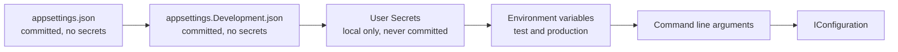

# Onboarding, everything a new member needs

This page takes a new team member from an empty machine to an approved merge request. Read it once from start to finish. After that, use the section you need.

Read three documents first, in this order: [collaborationAgreement.md](collaborationAgreement.md), [codeConventions.md](codeConventions.md) and [definitionOfDone.md](definitionOfDone.md). This page assumes all three.

## 1. What you install

| Tool | Version | Why |
|---|---|---|
| .NET SDK | 10 | The backend of Connect |
| Node.js | current LTS | The frontend of Connect |
| Docker | current | The database and the test site run in containers |
| Git | current | Every change reaches dev through a merge request |
| An editor | Visual Studio, Rider or Visual Studio Code | Any of the three is fine |

Check that each one answers before you go on:

```
dotnet --version
node --version
docker --version
git --version
```

## 2. Get the code

Clone the project and stay on `dev`, which is the default branch.

```
git clone <the project address on GitLab>
cd connect-nine
git switch dev
```

Nobody pushes to `dev` or `main`. Both are protected. Every change starts on its own branch and reaches `dev` through a merge request that a teammate approves.

## 3. Start the database

Connect uses PostgreSQL 16 in a container.

```
docker compose up -d database
```

The seed accounts and the seed data of the test site are described in the testing folder.

## 4. Configuration and secrets

This is the section to get right. Connect keeps every secret out of Git, and there is one way to do that per environment.
The complete reference is [architecture/configuration.md](../architecture/configuration.md);
the tables and commands below are the onboarding version of the same rules.

### How the server reads settings

The backend uses the normal .NET configuration system. Five sources feed one `IConfiguration`, and each source overrides the one before it.



A value in `appsettings.json` is therefore a default, and an environment variable with the same name wins over it. The application never opens a configuration file itself. It asks `IConfiguration`.

### What lives where

| File or store | In Git | Holds | Used in |
|---|---|---|---|
| `appsettings.json` | yes | shared defaults, no secrets | every environment |
| `appsettings.Development.json` | yes | local settings that are safe to share | local machines |
| User Secrets | no, never | your local passwords, keys and connection strings | local machines |
| `appsettings.Production.json` | yes | production settings that are not secret | production |
| Kubernetes Secrets | no, never | production passwords, keys and connection strings | production on k3s |
| `frontend/.env` | no, never | local frontend settings | local machines |
| `frontend/.env.example` | yes | the names of the frontend variables, with no real values | documentation |

A real password, key, token or connection string that carries credentials never goes in a file whose row says yes.

### Set up your local secrets

Once per clone, in the startup project of the backend:

```
dotnet user-secrets init
```

That writes a `<UserSecretsId>` into the project file. Then set a value:

```
dotnet user-secrets set "ConnectionStrings:Default" "Host=localhost;Port=5432;Database=connect;Username=connect;Password=<your local password>"
dotnet user-secrets list
```

Two things to know about User Secrets:

- The file lives outside the repository, at `~/.microsoft/usersecrets/<UserSecretsId>/secrets.json` on Linux and macOS, and at `%APPDATA%\Microsoft\UserSecrets\<UserSecretsId>\secrets.json` on Windows.
- It is plain text. User Secrets keeps a secret out of Git. It does not protect the value on your disk, and it is only read when the environment is Development.

### Production secrets

Production runs on k3s. A production secret is a Kubernetes Secret in the namespace of Connect, and the deployment hands it to the container as an environment variable:

```
kubectl create secret generic connect-backend \
  --namespace connect \
  --from-literal='ConnectionStrings__Default=Host=<host>;Database=connect;Username=connect;Password=<the production password>'
```

A nested setting uses a double underscore in the name of an environment variable, because a colon is not allowed in a variable name outside Windows. `ConnectionStrings__Default` is the same setting as `ConnectionStrings:Default`.

A Kubernetes Secret is base64 encoded, and base64 is not encryption. Anyone allowed to read secrets in the namespace reads the value. Keep that right to the members who deploy, and turn on encryption at rest for etcd on the cluster.

`appsettings.Production.json` is committed and holds only settings that are not secret. Never hand edit it on the server. The container image is rebuilt on every deploy, so the edit disappears with the next release.

### The frontend

`.env` holds the local frontend settings and is ignored by Git. `.env.example` lists every variable the frontend needs, with no real value in it, and is committed. When you add a variable, add it to `.env.example` in the same merge request.

One rule catches people out, so it is worth stating plainly. **A frontend variable is not a secret.** The bundler writes it into the JavaScript that every visitor downloads, so anyone can read it in the browser. Only settings that may be public belong in the frontend `.env`, for example the address of the API or a feature flag. A key that must stay private stays on the server, and the frontend asks the server for what it needs. Which prefix the bundler exposes depends on the bundler, `VITE_` for Vite and `NEXT_PUBLIC_` for Next.js. The team confirms the bundler and its prefix in sprint 1 planning. Owner: the whole team, 1 October 2026.

The ignore rules cover the variants, so `.env.local` and `.env.production` cannot slip in either:

```
.env
.env.*
!.env.example
```

## 5. Run Connect

```
dotnet run --project api/Connect/Connect.csproj
npm install
npm run dev
```

## 6. Run the checks before you push

```
dotnet build
dotnet format --verify-no-changes
dotnet test
npm run lint
npx prettier --check .
npm test
```

The pipeline runs the same checks. A merge request cannot be accepted while any of them is red.

## 7. Your first change

1. Take an issue from the board of the sprint and put it in Doing.
2. Branch from `dev`, named `<type>/<issue number>-<short name>`.
3. Commit as `<type>(<scope>): <what changed> (#<issue number>)`.
4. Open a merge request into `dev` and ask a teammate who did not write it to approve.
5. Walk the Definition of Done of the type of the issue, line by line.

## 8. Check that no secret leaked

Run this before every merge request:

```
git grep -i -E "password|secret|token|connectionstring"
```

Everything it finds has to be a placeholder or the name of a variable. If a real value ever reaches a commit, say so in the team channel at once. Removing it in a later commit is not enough, because the value stays in the history and has to be treated as leaked and replaced.

## 9. The words Connect uses

| Word | What it means in Connect |
|---|---|
| Member | Anyone with an account, whatever their role |
| Young person | A member from Amstelland who uses Connect to find people and chances |
| Organisation | A company or institution around the young people of Amstelland |
| The foundation | The WailSalutem Foundation, the client and the owner of Connect |
| Profile | What a member tells Connect about themselves |
| Opportunity | Something an organisation offers that a young person can take |
| Match | A connection between two members that Connect proposes or confirms |
| Showcase | A project a young person publishes on Connect |
| Challenge | A task an organisation posts for young people to join |
| Event | A gathering with a date, a place and a safe limit on the number of people |
| News item | Something the foundation publishes for everyone |
| Badge | Recognition for taking part |
| Board item | One numbered card of work, with a weight and its own Definition of Done |
| Task | A step of a board item, never with its own Definition of Done |
| Slice | A board item that adds something a person can see and use |
| Epic | A group of board items that belong to one part of Connect |

## References

Microsoft. (2026). *Configuration in ASP.NET Core*. Microsoft Learn. https://learn.microsoft.com/en-us/aspnet/core/fundamentals/configuration/

Microsoft. (2026). *Safe storage of app secrets in development in ASP.NET Core*. Microsoft Learn. https://learn.microsoft.com/en-us/aspnet/core/security/app-secrets/

The Kubernetes Authors. (2026). *Secrets*. Kubernetes Documentation. https://kubernetes.io/docs/concepts/configuration/secret/

## AI use declaration

AI was used as a writing support tool while working on this document. We used AI to draft the formulation of sentences, the structure of wording, readability, and clarity from content that we had provided, and to generate the diagrams. The content itself, including our experiences, reflections, learning goals, decisions, self-assessments, and conclusions, is our own. We reviewed the drafts and decided as a team which text to include.