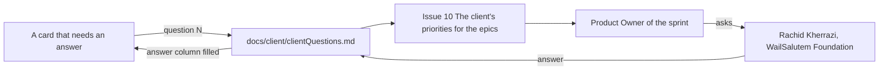

# Open items register, Young Amstelland Connect

This document serves the HvA level 3 criterion Management & Collaboration (MS).

This is the team's single register of what is still open across the document set, so the team
knows what needs deciding, what needs asking, and what needs planning without checking every
document separately. It gathers the open points the team's documents and the board already
carry. It raises nothing new beyond what those documents and the board already carry, except
where noted.

Since 27 September 2026 most open points have a home on the board: an issue decides them, or a
question of `docs/client/clientQuestions.md` does. This register names that issue by its board
number and title, for example issue 11 The team agrees on the layered architecture. The GitLab
number of each board number is in `boardNumbers.md`. The board has 227 issues in 21 epics,
spread over five sprints:

| Sprint | Dates |
| --- | --- |
| Sprint 1 | 21 September to 9 October 2026 |
| Sprint 2 | 19 October to 6 November 2026 |
| Sprint 3 | 9 to 27 November 2026 |
| Sprint 4 | 30 November to 18 December 2026 |
| Sprint 5 | 4 to 8 January 2027 |

## Needs deciding

Decisions the team, or the team with the client, still has to make.

| Decision | Owner | Where it is decided | Source |
| --- | --- | --- | --- |
| Finish the final version of the collaboration agreement, starting from draft 1.12 (sprint dates, stack, commit format, branches, Definition of Done), and sign it. It is a draft and not signed yet, the five signatures are empty | Whole team | A team moment before Sprint Review 1, Friday 9 October 2026 | `collaborationAgreement.md` |
| Who holds the Scrum Master and Product Owner roles in sprint 5. The roles table of the collaboration agreement covers sprints 0 to 4, and the board added sprint 5 (4 to 8 January 2027). New in this register | Whole team | Before sprint 5 | `collaborationAgreement.md` section 5, `gitlabSetup.md` |
| Where the live version of Connect runs, on which web address, from which mail account it sends email and who gets its warnings. The shape is decided (see Closed below), the client's yes is not | Whole team, with the client | Issue 91 The director agrees where production runs, sprint 4, client questions 111 to 116 | `docs/architecture/infrastructure.md` |
| Who runs and pays for Connect after January 2027, and the grant of Microsoft for Nonprofits | The client | Issue 10 The client's priorities for the epics, client question 6 | `docs/architecture/infrastructure.md` |
| The component diagram and the other architecture drawings | Whole team | Issue 102 The architecture drawn in layers, parts and places, sprint 4 | `docs/architecture/architecture.md` |
| The design patterns Connect uses, at least three, including the third one if Strategy is not the team's pick | Whole team | Issue 103 The design patterns Connect uses, where and why, sprint 4 | `docs/architecture/architecture.md` |
| The code quality tool that stops a change, and the line it stops at, also for tested new code (the coverage ambition) | Whole team | Issue 88 The team picks the code quality tool and issue 89 A change that lowers code quality is stopped, both sprint 4 | `docs/testing/testingStrategy.md` |
| Whether pre-commit hooks are worth the setup time. No issue on the board holds this yet | Whole team | Open, no issue yet | The old code conventions document |
| The learning outcomes and success criteria each student proves in the DevOps advanced track, which replaces the earlier question about the optional study-points path | Each student, with the DevOps teacher | Issue 84 The DevOps learning outcomes agreed with the teacher, sprint 1 stretch | `docs/architecture/infrastructure.md` |
| The order of the epics as the client sees it, which may move issues between sprints. Every issue already has a MoSCoW priority and a sprint on the board | Whole team, with the client | Issue 10 The client's priorities for the epics, client question 1 | `docs/project/requirements.md` |
| Whether Connect gets a webshop this semester (FR10 is not confirmed by the client) | The client | Issue 10, client question 2 | `docs/project/requirements.md` |
| Numeric page speed and uptime targets | Whole team, with the client | Issue 10, client question 5 | `docs/project/requirements.md`, `docs/project/productVision.md` |
| Success measures for Connect, for the client and for the team. No issue on the board holds this yet | Whole team, with the client | Open, no issue yet | `docs/project/productVision.md`, `docs/project/problemAnalysis.md` |
| How long backups are kept and where inside the European Union | The client | Client question 28 (issue 172 A backup of the project pictures) and question 117 (issue 174 A backup of the live database) | `docs/architecture/infrastructure.md` |
| Real data of young people on the test site, and on the live version from its first day | The client | Client question 3 (issue 10) and question 114 (issue 91) | `docs/architecture/infrastructure.md` |
| The web address of the live version | The client | Issue 10 task 10.6, confirmed in issue 91, client question 113 | `docs/architecture/infrastructure.md` |
| One line of the Definition of Done is still a proposal to confirm with the client: every button and link on a phone is at least 44 by 44 pixels | Whole team, with the client | Issue 10, no question number yet | `definitionOfDone.md` |
| Clarify one unreadable entry in the skills inventory, recorded as "lid low" | Bayon Eerhart | Open, no issue | `docs/architecture/techStack.md` |
| A temporary test address with a padlock before the client's DNS record: a wildcard DNS name such as sslip.io, a free dynamic DNS name, an own domain, or a Let's Encrypt certificate for the bare IP address. In use since 9 October 2026: https://31-70-66-186.sslip.io, to be confirmed by the team | Whole team | A stand up in sprint 1, owner Nick Hoebe, inside issue 09 task 9.4 | `docs/architecture/infrastructure.md` |

## Needs asking

### The client

Issue 10 The client's priorities for the epics (epic Decisions, sprint 1) asks the client, Rachid
Kherrazi at the WailSalutem Foundation, every open question. `docs/client/clientQuestions.md`
holds them all, 134 on 27 September 2026, with an empty answer column. Questions 1 to 8 come
from issue 10 itself, questions 9 and up from the other cards. Owner: the Product Owner of the
sprint, who keeps the contact with the client (Nick Hoebe in sprint 1). Due: the first eight by
the Sprint 1 review, Friday 9 October 2026. A card that waits for an answer says "issue 10,
question N".

The picture below shows how a client question travels from a card to the client and back.

The six questions of the earlier register, and where they are now:

| Earlier question, in short | Now |
| --- | --- |
| Who owns the code and the intellectual property once the project ends | Not yet in `docs/client/clientQuestions.md`. Still open, to be added to issue 10 |
| Whether development, and later production, uses real personal data or test data only | Question 3 (test site) and question 114 (live version) |
| Whether the team may show the work in a portfolio, in Portflow, and in an R&D report | Not yet in `docs/client/clientQuestions.md`. Question 4 covers only the projects of young people. Still open, to be added to issue 10 |
| Whether the webshop module is in scope for this semester, and if so, its priority | Question 2 |
| What happens to the platform's hosting and the platform itself after the project ends | Question 6 |
| Whether the WailSalutem Foundation is a formally registered nonprofit in the Netherlands | Part of question 6, which asks about the grant of Microsoft for Nonprofits |

### The coach

Four questions for team coach Karthik Srinivasan. Owner for all four: Wesley Oerlemans. They
were to be asked by Thursday 24 September 2026. No answer is recorded yet.

- The exact Portflow due dates for the research proposal and the R&D report. Issue 106 Each
  student's research topic approved (sprint 1) plans the proposal review, but not its date.
- What the sprint 3 and sprint 4 Custom Datapoints should each review. Issue 85 The coach sees
  per student which issue proves which workshop (sprint 1) builds the table the coach uses for
  this.
- The exact days for knowledge test 1, in the week of 26 October 2026, and knowledge test 2, in
  the week of 14 December 2026. Both weeks are confirmed. Neither day is. The knowledge tests
  are individual and have no issue on the board.
- The date of the Decision Committee and the Portflow portfolio submission, which carries no due
  date in the course's own assignment list.

## Needs planning

Dated items the team has to schedule.

- **Issue 09 Every team member on the client's server waits on the DNS record and the team.** The
  first login arrived from the client on 2 October 2026. On 9 October 2026 every member got a
  personal user, password login went off, Caddy runs with a padlock on the interim address
  https://31-70-66-186.sslip.io, and the user deploy and the secret settings of the test site are
  ready (merge request !34). Later that day the three GitLab variables of the pipeline were made
  and ssh-check went green on dev, root stopped logging in over ssh, and wesley and gurpreet
  became the two admins. Still open: the DNS record of the real test address (task 9.1, the
  client sends the domain), the first login of each member and the check with the client
  (task 9.6). Issue 03 Create an account puts Connect on that
  server for the first time. Owner: the Product Owner of sprint 1, Nick Hoebe, with the client.
- **Kelvin van Voorst's Security requirements and risk framing datapoint.** The security
  requirements, key assets and main risks of the project. On the board as issue 12 Inventory of
  the personal data per module and issue 13 The role table per module (sprint 1), and issue 18
  Data flow diagram of profile creation and issue 19 GDPR notes on minors' data (sprint 1
  stretch). Owner: Kelvin van Voorst. Running now, weeks of 21 and 28 September 2026.
- **Wesley Oerlemans's research draft to the learning group teacher.** Owner: Wesley Oerlemans.
  Date: by 5 October 2026. The review and approval of every student's proposal is issue 106 Each
  student's research topic approved (sprint 1).
- **Sprint 1 review minimum set.** The final version of the collaboration agreement agreed and signed, the sprint 1 issues done
  and the sprint 1 board up to date, and each team member's own evidence collection gathered
  toward their individual datapoints. The sprint 1 issues are 01 The repository, the pipeline
  and the team rules, 09 Every team member on the client's server, 10 The client's priorities
  for the epics, 11 The team agrees on the layered architecture, 12 Inventory of the personal
  data per module, 13 The role table per module, 03 Create an account, 04 Log in with email and
  password, 05 Log out, 06 Move between the five tabs of Connect, 07 Create a profile and 08 See
  my own profile page. Twelve more issues are sprint 1 stretch. Owner: whole team. Date: Friday
  9 October 2026.

## Closed since the earlier register

Kept here so the history stays findable.

- **GitLab repository.** The project connect-nine on gitlab.fdmci.hva.nl was set up on 27
  September 2026, with dev and main protected, labels, one milestone and one board per sprint,
  and the issue and merge request templates, see `gitlabSetup.md`. The seven portfolio labels of
  the issue mapping document are on every task (outcome, level and direction), never on the
  issue.
- **Database provider.** Decided on 22 September 2026 for Microsoft SQL Server, changed on 26
  September 2026 to PostgreSQL 16 with EF Core and Npgsql, see `docs/architecture/techStack.md`.
- **Layered architecture and CQRS.** Four backend projects, Presentation, Application, Domain
  and Infrastructure, with CQRS by functionality as the data access pattern, decided by the team
  on 1 October 2026, over the repository pattern and over one project with four folders, see
  `docs/architecture/architecture.md` (issue 11 The team agrees on the layered architecture, task
  11.2).
- **Hosting and container orchestration.** The test site runs with docker compose on the
  client's server (issue 09 Every team member on the client's server). Production runs on k3s
  with Terraform on the client's server (issue 92 k3s and Terraform for production, compose for
  test). What the client still has to agree to is issue 91, under Needs deciding.
- **Linter and formatter picks, naming conventions and project layout.** ESLint with
  typescript-eslint, eslint-plugin-react-hooks and eslint-plugin-jsx-a11y plus Prettier for the
  frontend, the built-in .NET analyzers with dotnet format for the backend, and no separate SQL
  linter, because EF Core migrations leave almost no SQL written by hand. Names, folders and
  layout per layer are in `codeConventions.md`. Issue 01 records the choices in
  `docs/decisions/001-codeConventions.md`.
- **Testing tools and plan.** React Testing Library is used for the screen tests. The
  module-by-module test plan is replaced by the Definition of Done of a slice, which asks the
  same tests of every slice. The end to end tests run after every deploy to the test site, see
  `docs/testing/testingStrategy.md`.
- **Dependency scan gate.** A package with a high or critical advisory stops the change (issue
  16 A security scan in the pipeline).
- **Rollback.** On the test site with the Rollback button of GitLab (issue 17 A health check and
  structured logs). On production it is practised in issue 97 Going back to the previous version
  is practised.
- **Research schedule.** On 27 September 2026 the research issues moved earlier, closer to the
  level 3 datapoint sheet: 85 and 106 in sprint 1, 110 and 111 in sprint 2, 107 in sprint 3,
  and 108, 109 and 112 in sprint 4. Issues 108 and 109 stay in sprint 4 because they measure
  features built in sprint 4: 63 Browse all showcases, 61b Add an image to my project and 64
  Open a project page.
- **Secrets handling.** Secrets on a laptop go in dotnet user-secrets, on a server they come from
  environment variables and GitLab variables, never from Git, see `codeConventions.md`.

## AI use declaration

AI was used as a writing support tool while working on this document. We used AI to draft
the formulation of sentences, the structure of wording, readability, and clarity from
content that we had provided. The content itself, including our experiences, reflections,
learning goals, decisions, self-assessments, and conclusions, is our own. We reviewed the
drafts and decided as a team which text to include.
