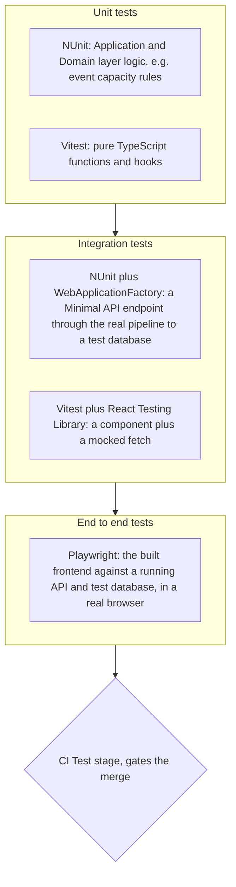

# Testing strategy, Young Amstelland Connect

This document serves the HvA level 3 criteria Analysis & Advice (AA) and Design & Realisation
(OR). The test plan is a proposal, the tools are decided. It is grounded in the Testing
workshop's example repository, in `codeConventions.md`, `infrastructure.md`, and live sources
fetched and read on 23 September 2026, listed in References, and fills gap 6 of
`workshopCoverage.md`. The team decided the testing tools on 2026-09-24, NUnit,
FluentValidation, Vitest, and Playwright, sourced against each tool's own documentation
fetched and read the same day. The module-by-module test plan, React Testing Library, the
coverage ambition, and the E2E pipeline timing stay a proposal, for the team to confirm at
sprint 1 planning, week of 21 September 2026.

## Why this document exists

`workshopCoverage.md`'s Testing section confirmed the gap: `codeConventions.md` requires "Unit
tests for new code" without naming a framework, and `infrastructure.md`'s CI Test stage runs
"linter, npm test, dotnet test" as a placeholder with no real content behind it. The workshop's
own material carries no slide deck, only a working example repository, `testing-example.zip`, a
small Next.js todo app whose own `README.md` states the point directly: it demonstrates "three
layers of testing: **Unit tests**... test pure logic functions in isolation, no DOM, no
network. **Integration tests** test pieces wired together... **End-to-end tests**... drive the
real app in a real browser against the real dev server." This document maps those three layers
onto Connect's actual stack, React and ASP.NET Core, rather than onto Next.js.

## The three layers, mapped to Connect's stack

**Unit tests.** Pure logic, no database, no network, no browser. On the backend, this is the
Application and Domain layers `architecture.md` proposes: the business rules inside a service,
for example whether an event still has an open spot, tested against a fake repository rather
than a real database. **NUnit** is decided, not xUnit, with `dotnet new nunit -o TestProject1`
scaffolding a test project directly from the .NET SDK (NUnit, n.d.). On the frontend, this is
pure TypeScript functions and hooks with no DOM involved, the same category
`testing-example`'s `lib/todos.ts` occupies. **Vitest** is decided, since it is already the
tool the course's own example repository uses, and its own documentation frames it as built for
exactly this kind of fast, isolated test (Vitest, n.d.).

**Integration tests.** Pieces wired together, still without a real browser. On the backend,
Microsoft's own guidance for this layer is direct: integration tests "evaluate an app's
components on a broader level than unit tests," using "the actual components that the app uses
in production," such as the database, and ASP.NET Core supports this "using a unit test
framework with a test web host and an in-memory test server" (Microsoft, n.d.-a). This is
`WebApplicationFactory`, run through NUnit, exercising a Minimal API endpoint through the real
request pipeline against a test database rather than a fake repository. On the frontend, this
is a React component plus a mocked `fetch`, the same shape `testing-example`'s `TodoList`
component test takes, using Vitest together with **React Testing Library**, whose own guiding
principle is that "the more your tests resemble the way your software is used, the more
confidence they can give you" (Testing Library, n.d.), which fits testing a component the way a
user's browser would drive it rather than reaching into its internals.

**End-to-end tests.** The real app, in a real browser, against a real running server.
`testing-example` uses Cypress for this layer. This document confirms **Playwright**, decided
by the team on 2026-09-24, for two reasons. First, Microsoft's own integration testing
guidance names it directly: "For testing SPAs, we recommend a tool such as Playwright for
.NET, which can automate a browser"
(Microsoft, n.d.-a). Second, Playwright drives the browser against whatever is running,
regardless of which side, React or ASP.NET Core, serves a given request, so one E2E suite
covers the whole platform end to end the way the workshop's third layer is meant to, without
needing a `.NET`-specific test runner tied to the backend framework. Connect's E2E tests would
run against the built frontend and a running API and test database, driving real user flows,
for example registering for an event and seeing the confirmation.

*Figure: the three testing layers Connect proposes, each mapped to a concrete tool, feeding one
CI gate.*

## What gets tested where, for Connect's real modules

- **Event capacity and registration (FR6).** Unit: the capacity rule itself, in isolation.
  Integration: the registration endpoint against a real test database, since this is exactly
  the kind of concurrency-sensitive logic `advancedProgramming.md` names, and a fake repository
  cannot demonstrate a database-level fix. E2E: a user registering for an event through the UI.
- **Matching (FR2).** Unit: each `IMatchStrategy` implementation `architecture.md` proposes,
  tested against fixed profile data. Integration: the matching endpoint returning results
  shaped correctly. E2E not proposed as a priority here, since matching's UI is not yet
  designed.
- **Authorization (NFR1).** Unit: authorization rules in isolation, once Kelvin van Voorst's
  design lands. Integration: a request from a role that should be denied actually is denied
  against the real pipeline, since authorization is exactly the kind of logic that is easy to
  get right in isolation and wrong once middleware and routing are involved.
- **Profiles (FR1), admin dashboard (FR3).** Unit and integration for the CRUD logic and
  authorization checks. E2E for the core flow, creating and editing a profile, once the UI
  exists.

## How this gates the merge request flow

`infrastructure.md`'s proposed CI pipeline already runs a Test stage on every merge request,
currently "linter, npm test, dotnet test" as a placeholder. This proposal gives it concrete
content: `dotnet test` runs the NUnit unit and integration suites, `npm test` (or the
Vitest-specific script) runs the frontend unit and integration suites, and the Playwright E2E
suite runs against the shared test environment after a merge into `dev`, rather than on every
merge request, since it needs a real running deployment and is slower than the other two
layers. A merge request that fails any of the three does not merge, which is the same
Definition of Done `codeConventions.md` and `collaborationAgreementV1.md` already require,
"unit tests that pass," now enforced by the pipeline rather than only read by a reviewer.

## Request validation and FluentValidation

`architecture.md`'s layered shape keeps a request's own shape checking, is this field present,
is this string the right length, is this date not in the past, out of the Domain layer's
business rules and out of the Minimal API endpoint handler itself. **FluentValidation** is
decided for this, by the team on 2026-09-24: a validator class per request model, built on
what the library's own documentation calls "a fluent interface and lambda expressions for building validation rules"
(FluentValidation, n.d.). A registration request's validator, for example, checks the shape of
the incoming data before the endpoint ever calls the capacity rule the unit tests above cover,
so a malformed request never reaches business logic at all.

Each validator is itself a unit under test, in plain NUnit. A test calls `Validate()` against a
request object built for the case under test, valid, missing a required field, a string over
its length limit, and asserts on the returned `ValidationResult`'s `IsValid` property and
`Errors` collection with NUnit's own constraints, the same `Assert.That` model the rest of the
backend suite uses. No FluentValidation-specific test helper is added for this.

**No FluentAssertions.** Assertions across the backend suite, business logic and validators
alike, stay NUnit's own constraint-based model, `Assert.That(actual, Is.EqualTo(expected))`,
rather than adding FluentAssertions as a second assertion syntax, decided by the team on
2026-09-24: one way to write an assertion is easier for a five-person team to read consistently
than two side by side in the same codebase.

## A realistic coverage ambition

No blanket percentage target is proposed. Microsoft's own guidance on this is direct: "Setting
an overly ambitious code coverage percentage goal can be counterproductive," since "a high code
coverage percentage isn't an indicator of success" and does not by itself "imply high code
quality" (Microsoft, n.d.-b). For a five-person team new to most of this stack, chasing a
percentage across the whole codebase risks tests written to move a number rather than to test
something that matters. The proposed ambition instead: the Application and Domain layer logic
behind each functional requirement above, event capacity, matching, authorization, has unit
test coverage by the sprint review it lands in, which is what the Definition of Done's "unit
tests for new code" already asks for, made concrete per module rather than left as a general
rule.

## What stays open

Whether the team adopts **React Testing Library** as proposed for frontend integration tests,
or swaps it for an alternative, whether the E2E suite runs on every merge into `dev` or on a
schedule instead, and `codeConventions.md`'s own "Test framework" line, filled in now that
NUnit, FluentValidation, Vitest, and Playwright are decided, all stay open, along with the
module-by-module test plan and the coverage ambition above. Owned by the whole team and due at
sprint 1 planning, week of 21 September 2026.

## References

FluentValidation. (n.d.). *Installation*. FluentValidation documentation. Retrieved September
24, 2026, from https://docs.fluentvalidation.net/en/latest/installation.html

Hogeschool van Amsterdam. (n.d.). *Testing-example* [Course document, example repository].

Microsoft. (n.d.-a). *Integration tests in ASP.NET Core*. Microsoft Learn. Retrieved September
23, 2026, from https://learn.microsoft.com/en-us/aspnet/core/test/integration-tests

Microsoft. (n.d.-b). *Unit testing best practices for .NET*. Microsoft Learn. Retrieved
September 23, 2026, from https://learn.microsoft.com/en-us/dotnet/core/testing/unit-testing-best-practices

NUnit. (n.d.). *Installation*. NUnit documentation. Retrieved September 24, 2026, from
https://docs.nunit.org/articles/nunit/getting-started/installation.html

Testing Library. (n.d.). *React Testing Library*. Retrieved September 23, 2026, from
https://testing-library.com/docs/react-testing-library/intro/

Vitest. (n.d.). *Getting started*. Retrieved September 23, 2026, from https://vitest.dev/guide/

## AI use declaration

AI was used as a writing support tool while working on this document. We used AI to draft
the formulation of sentences, the structure of wording, readability, and clarity from
content that we had provided, and to generate the diagrams. The content itself, including
our experiences, reflections, learning goals, decisions, self-assessments, and
conclusions, is our own. We reviewed the drafts and decided as a team which text to
include.
