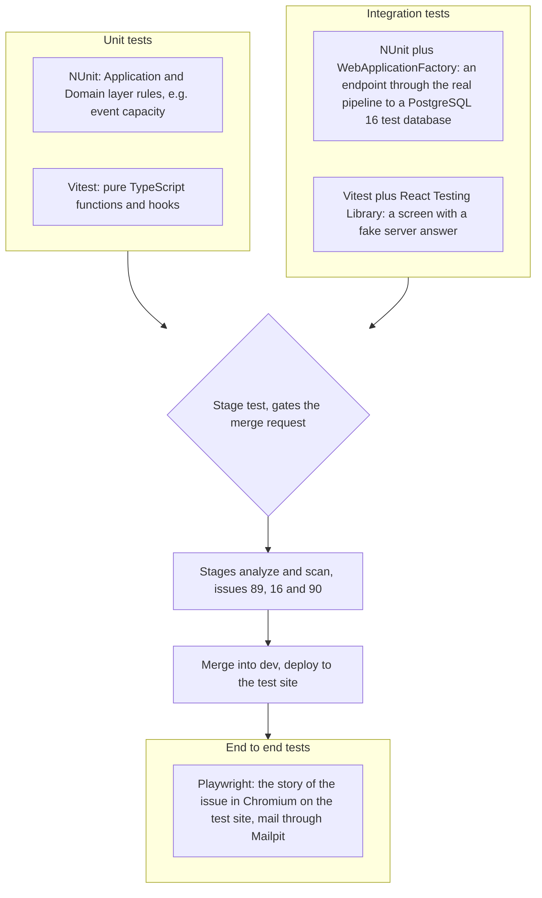

# Testing strategy, Young Amstelland Connect

This document serves the HvA level 3 criteria Analysis & Advice (AA) and Design & Realisation
(OR). It is grounded in the Testing workshop's example repository, in
`docs/team/codeConventions.md`, `docs/team/definitionOfDone.md`,
`docs/architecture/infrastructure.md`, and live sources fetched and read on 23 and 24 September
2026, listed in References, and fills gap 6 of `docs/school/workshopCoverage.md`.

The team decided the testing tools on 2026-09-24: NUnit, FluentValidation, Vitest and
Playwright. The board, finished on 27 September 2026, settled what was still a proposal then:
React Testing Library is used for the screen tests, the Definition of Done of a slice replaces
the module-by-module test plan, and the end to end tests run after every deploy to the test site.
The coverage line stays open, see What stays open. Issues are named by their board number and
title. The GitLab number of each is in `docs/team/boardNumbers.md`.

## Why this document exists

`docs/school/workshopCoverage.md`'s Testing section confirmed the gap: the first code conventions
required "Unit tests for new code" without naming a framework, and the CI Test stage of
`docs/architecture/infrastructure.md` ran "linter, npm test, dotnet test" as a placeholder with no
real content behind it. The workshop's own material carries no slide deck, only a working example
repository, `testing-example.zip`, a small Next.js todo app whose own `README.md` states the point
directly: it demonstrates "three layers of testing: **Unit tests**... test pure logic functions
in isolation, no DOM, no network. **Integration tests** test pieces wired together...
**End-to-end tests**... drive the real app in a real browser against the real dev server." This
document maps those three layers onto Connect's actual stack, React with TypeScript and ASP.NET
Core on .NET 10 with PostgreSQL 16, rather than onto Next.js.

## The three layers, mapped to Connect's stack

**Unit tests.** Pure logic, no database, no network, no browser. On the backend, this is the
Application and Domain layers of the four backend projects that issue 11 The team agrees on the
layered architecture records: the business rules inside a handler, for example whether an event
still has an open spot, unit tested with an in-memory SQLite AppDbContext, and a rule in Domain
unit tested without any database. **NUnit**
is decided, not xUnit, with `dotnet new nunit -o TestProject1` scaffolding a test project
directly from the .NET SDK (NUnit, n.d.). The tests live in the project Connect.Tests, in the
folders Domain, Application, Infrastructure, Presentation and Fixtures, and are named
Method_Situation_ExpectedResult with the three parts Arrange, Act and Assert
(`docs/team/codeConventions.md`). On the frontend, this is pure TypeScript functions and hooks
with no DOM involved, the same category `testing-example`'s `lib/todos.ts` occupies. **Vitest**
is decided, since it is already the tool the course's own example repository uses, and its own
documentation frames it as built for exactly this kind of fast, isolated test (Vitest, n.d.). A
test file sits next to the file it tests, for example `MemberCard.test.tsx`.

**Integration tests.** Pieces wired together, still without a real browser. On the backend,
Microsoft's own guidance for this layer is direct: integration tests "evaluate an app's
components on a broader level than unit tests," using "the actual components that the app uses
in production," such as the database, and ASP.NET Core supports this "using a unit test
framework with a test web host and an in-memory test server" (Microsoft, n.d.-a). This is
`WebApplicationFactory`, run through NUnit, exercising a Minimal API endpoint through the real
request pipeline against a real PostgreSQL 16 test database rather than an in-memory SQLite
AppDbContext. In the
pipeline the job backend-test gets a service postgres:16 under the name database, and the
factory applies the EF Core migrations before the tests (issue 03 Create an account, task 3.8).
On the frontend, this is a React component plus a fake server answer, the same shape
`testing-example`'s `TodoList` component test takes, using Vitest together with **React Testing
Library**, whose own guiding principle is that "the more your tests resemble the way your
software is used, the more confidence they can give you" (Testing Library, n.d.), which fits
testing a component the way a user's browser would drive it rather than reaching into its
internals.

**End-to-end tests.** The real app, in a real browser, against a real running server.
`testing-example` uses Cypress for this layer. The team uses **Playwright**, decided on
2026-09-24, for two reasons. First, Microsoft's own integration testing guidance names it
directly: "For testing SPAs, we recommend a tool such as Playwright for .NET, which can automate
a browser" (Microsoft, n.d.-a). Second, Playwright drives the browser against whatever is
running, regardless of which side, React or ASP.NET Core, serves a given request, so one E2E
suite covers the whole platform end to end the way the workshop's third layer is meant to. The
tests live in `web/e2e/<name>.spec.ts` and run in Chromium against the test site, driving
real user flows, for example making an account and seeing "Your account is made". Emails in
those flows, such as the confirmation link, are read from the test mailbox Mailpit. Playwright
logs in with `page.request.post` or `context.request.post`, so the page gets the cookie
(`docs/team/codeConventions.md`).

The diagram below shows which tool tests which layer, and where each layer runs in the pipeline.

*Figure: the three testing layers of Connect, each mapped to a concrete tool. Unit and
integration tests gate every merge request. The end to end tests run after the deploy to the
test site.*

**Stand-ins and the test database.** What a class gets through its constructor is replaced in a
unit test by a substitute of **NSubstitute**, never by a stand-in written by hand, and the
database is never replaced by a substitute. The tests reach the real test database through
`ConnectionStrings:TestsConnection`, never through the connection string of the database the
server runs on (`docs/team/codeConventions.md`, part Tests and mocking).

## What every slice tests

The earlier version of this document proposed a test plan per module. The board replaced it with
the Definition of Done of a slice (`docs/team/definitionOfDone.md`), which asks the same tests of
every vertical slice, so no module can skip one:

- **Unit.** Every rule in Application or Domain has an NUnit test, and every frontend function
  without a screen has a Vitest test.
- **Integration.** Every server address has a test with WebApplicationFactory for one correct
  request, one wrong input and one person who is not allowed (401 or 403). For an address that
  is open to everyone, the third case shows that it works without logging in.
- **Screen.** Every new or changed screen has React Testing Library tests for loading, empty
  (where a list can be empty), filled and error.
- **End to end.** The story of the issue is tested once from start to finish in a real browser,
  on the test site after the merge.
- **Proof that a test works.** The merge request names one test and shows that it fails when
  its rule is removed.
- **Nothing skipped.** All tests pass in the pipeline, and none is marked skip or ignore or is
  commented out.
- **Accessibility.** The checker axe finds no problems on every changed screen.

Some modules get extra attention on the board:

- **Event capacity and registration (FR6).** Issue 68 Register for an event and issue 68b A full
  event refuses a place fairly: a young person never gets a place when there is none, also when
  many people register at the same moment. This is concurrency-sensitive logic that an
  in-memory SQLite AppDbContext cannot prove, so it is tested against the real test database. Issue 107 Three ways
  to give out the last event place, measured compares three ways to do it.
- **Matching (FR2).** Issue 37 See suggested matches with the reason: unit tests for the rules
  of the suggestions, and an end to end test that a confirmed member sees suggestions with the
  reason on the test site.
- **Authorization (NFR1).** The Definition of Done asks for the "not allowed" case on every
  server address, and `docs/architecture/api.md` names the role for every address. Authorization
  is exactly the kind of logic that is easy to get right in isolation and wrong once middleware
  and routing are involved, so it is tested through the real pipeline.
- **Profiles (FR1) and admin (FR3).** The same slice tests, starting with issue 07 Create a
  profile and issue 08 See my own profile page in sprint 1, and the epic Admin in sprint 3.

Test accounts, seed data and items with a date in the past, so no check has to "wait a day", are
described in `docs/testing/testData.md`.

## How this gates the merge request flow

Issue 03 Create an account (task 3.8) fills the pipeline with real checks. On every merge request
the stage build runs `dotnet build` and `dotnet format --verify-no-changes` for the backend and
`npm run build` for the frontend. The stage test runs `dotnet test` for the NUnit unit and
integration tests (job backend-test), `npm run lint` and `npx prettier --check .` (job
frontend-lint) and `npm test` for the Vitest unit and screen tests (job frontend-test). A merge
request that fails any job does not merge.

After a merge into `dev`, the job deploy-test puts Connect on the test site, and the job
e2e-test runs the Playwright tests against it, in the Playwright image of exactly the version of
`@playwright/test` in the project (issue 03, task 3.9). The end to end tests run after the merge
rather than on every merge request, because they need a real running deployment and are slower
than the other two layers. Slow tests run in their own Playwright project after the main one.
Issue 16 A security scan in the pipeline adds a stage scan between test and deploy.

This is the same Definition of Done that `docs/team/collaborationAgreement.md` section 7
requires, now enforced by the pipeline rather than only read by a reviewer.

## Request validation and FluentValidation

The layered shape of `docs/architecture/architecture.md` keeps a request's own shape checking, is
this field present, is this string the right length, is this date not in the past, out of the
Domain layer's business rules and out of the Minimal API endpoint handler itself.
**FluentValidation** is decided for this, by the team on 2026-09-24: a validator class per request
model, built on what the library's own documentation calls "a fluent interface and lambda
expressions for building validation rules" (FluentValidation, n.d.-a). Input is checked with
FluentValidation before it reaches Application (`docs/team/codeConventions.md`). An id and a page
number in the address are bound as text and parsed in the validator, so a wrong value gets a
ProblemDetails with a message. A registration request's validator, for example, checks the shape
of the incoming data before the endpoint ever calls the capacity rule the unit tests above cover,
so a malformed request never reaches business logic at all.

Each validator is itself a unit under test, with the test extensions FluentValidation ships in
`FluentValidation.TestHelper`. A test calls `TestValidate()` on a request object built for the
case under test, valid, missing a required field, a string over its length limit, and checks
the result with `ShouldHaveValidationErrorFor(...)` and `WithErrorMessage(...)`, or with
`ShouldNotHaveAnyValidationErrors()` for a request that is right. The library's guide
recommends "treating validators as ‘black boxes’ - provide input to them and then assert
whether the validation results are correct or incorrect" (FluentValidation, n.d.-b). Decided
by the team on 21 October 2026, the way Nick Hoebe writes .NET code, which the team agreed sets
the way: a test then reads as one sentence. The rule is code conventions, Tests and mocking,
rule 8.

**No FluentAssertions.** Assertions across the backend suite stay NUnit's own constraint-based
model, `Assert.That(actual, Is.EqualTo(expected))`, rather than adding FluentAssertions as a
second assertion syntax, decided by the team on 2026-09-24: one way to write an assertion is
easier for a five-person team to read consistently than two side by side in the same codebase.
Validators are the one exception, with the test extensions of FluentValidation above.

## A realistic coverage ambition

No blanket percentage target is set. Microsoft's own guidance on this is direct: "Setting an
overly ambitious code coverage percentage goal can be counterproductive," since "a high code
coverage percentage isn't an indicator of success" and does not by itself "imply high code
quality" (Microsoft, n.d.-b). For a five-person team new to most of this stack, chasing a
percentage across the whole codebase risks tests written to move a number rather than to test
something that matters. The ambition instead is the Definition of Done of a slice: every rule has
a unit test, every server address has its three integration cases, and every screen has its four
states, by the sprint review the slice lands in.

The board adds one measured line in sprint 4, because the DevOps workshop asks for a quality
gate that really blocks a merge. Issue 89 A change that lowers code quality is stopped makes the
test jobs write a coverage report (coverlet for the backend, Vitest coverage for the frontend)
and gives it to the code quality tool that issue 88 The team picks the code quality tool
chooses. That tool has a rule on tested new code. The number of that rule is decided in issue 88.

## Two end to end tools, measured

Issue 111 Two end to end test tools compared on one flow (sprint 2) is the research of one
student: Playwright and Cypress on the same flows of Connect, compared on run time and flaky
failures in the pipeline. The Cypress version lives on the branch test/111-cypress-flows, which
is never merged. Until that research is done, Playwright is the end to end tool of the
product.

## What stays open

- The coverage number of the quality gate and the tool that checks it: issue 88 The team picks
  the code quality tool (sprint 4).
- Which end to end tool the foundation keeps after the comparison: issue 111 Two end to end test
  tools compared on one flow (sprint 2).

## References

FluentValidation. (n.d.-a). *Installation*. FluentValidation documentation. Retrieved September
24, 2026, from https://docs.fluentvalidation.net/en/latest/installation.html

FluentValidation. (n.d.-b). *Test extensions*. FluentValidation documentation. Retrieved October
21, 2026, from https://docs.fluentvalidation.net/en/latest/testing.html

Hogeschool van Amsterdam. (n.d.). *Testing-example* [Course document, example repository].

Microsoft. (n.d.-a). *Integration tests in ASP.NET Core*. Microsoft Learn. Retrieved September
23, 2026, from https://learn.microsoft.com/en-us/aspnet/core/test/integration-tests

Microsoft. (n.d.-b). *Unit testing best practices for .NET*. Microsoft Learn. Retrieved
September 23, 2026, from https://learn.microsoft.com/en-us/dotnet/core/testing/unit-testing-best-practices

NUnit. (n.d.). *Installation*. NUnit documentation. Retrieved September 24, 2026, from
https://docs.nunit.org/articles/nunit/getting-started/installation.html

Testing Library. (n.d.). *React Testing Library*. Retrieved September 23, 2026, from
https://testing-library.com/docs/react-testing-library/intro/

Vitest. (n.d.). *Getting started*. Retrieved September 23, 2026, from https://vitest.dev/guide/

## AI use declaration

AI was used as a writing support tool while working on this document. We used AI to draft
the formulation of sentences, the structure of wording, readability, and clarity from
content that we had provided, and to generate the diagrams. The content itself, including
our experiences, reflections, learning goals, decisions, self-assessments, and
conclusions, is our own. We reviewed the drafts and decided as a team which text to
include.
