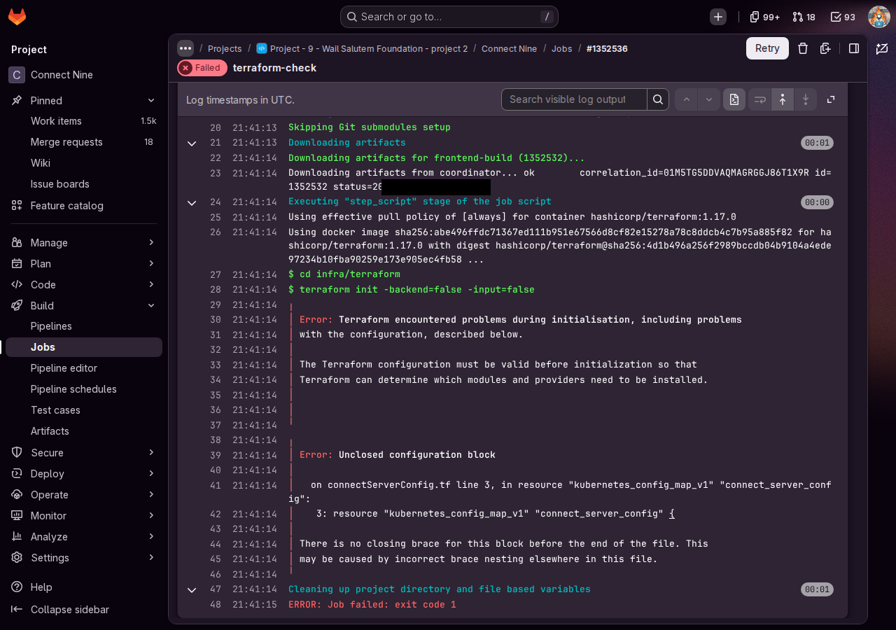
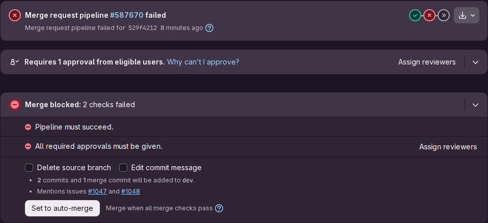

# Proof: task 94.2 The plan on the merge request and the apply on main (#1048)

Merge request !109, branch `chore/1048-plan-and-apply`, built on !108 (issue 95). The red merge request with a broken file: !106, closed without merging. Issue: 94 Every production change shown as a plan first (#158). Files: the jobs `.terraform-production`, `terraform-plan` and `terraform-apply` in `.gitlab-ci.yml`, image-push also on main, and `docs/team/onboarding.md` (part 14 Changing production, Plan, review, apply).
Profile: Full Stack Software Developer, level 3. Portflow: Managing and Collaborating MS1 and MS4.

A point that needs someone else is marked TODO with who and what.

## MS1 Seeing risks early and keeping the work transferable

School asks: "You anticipate risks and bottlenecks in the process before they become problems and ensure that the work remains transparent and transferable."

1. **Each job its own login, and what goes wrong when they are swapped.**
   - `terraform-check` uses no login at all. It only lays out and validates the files, so a mistake in a file is found without touching production.
   - `terraform-plan` uses `gitlab-planner`, which may only read and never a Secret. A plan runs on branches nobody reviewed yet, so with the deployer login there, any branch could change production before a review.
   - `terraform-apply` uses `gitlab-deployer`, which may change things in `connect-production` and is a protected variable, so only the pipelines of dev and main get it. With the planner login there, the apply would fail at the first change, which is safe but stops every release.
2. **The gate blocks, shown on purpose.** In !106 I removed the closing brace of the resource in `connectServerConfig.tf`. `terraform-check` turned red with "Error: Unclosed configuration block" (job 1352536), and the merge widget said "Merge blocked: 2 checks failed", the first one "Pipeline must succeed." I closed it without merging.

   

   

3. **The two first checks, and what I changed because of them.**
   - Could the plan on a branch reach the server? No: `PRODUCTION_SERVER_HOST` was protected, and a protected variable only reaches the pipelines of dev and main. I made it not protected on 25 October 2026, because the address of the server is no secret, it is in the guide and in the address of the test site, and what a branch then gets, the tunnel key and the read only token, can only read the parts of production that hold no secret. `KUBE_DEPLOYER_TOKEN` stays protected.
   - May the person who starts the apply write the state? The job reaches the state with the job token of whoever starts it, and locking and writing needs the role Maintainer. All five of us have it.
4. **Two risks I removed before they happened.**
   - A plan needs the production server. If it ran on every merge request, a server that is away for a moment would turn every merge request of the team red. So `terraform-plan` runs only on a merge request that changes `infra/` or `.gitlab-ci.yml`.
   - A plan with the version of the merge request would show the server and the migrations Job replaced on every merge request, which hides the real change. So the plan keeps the version that runs now, and says which in its log.
5. **Tried before it runs.** I ran the jobs `terraform-plan` and `terraform-apply` exactly as the merged pipeline file gives them, in the image `hashicorp/terraform:1.17.0` with the project's own variables, from my computer, with my own GitLab token in place of the job token. The plan said "0 to add, 1 to change, 0 to destroy" and the report for the merge request `{"create": 0, "update": 1, "delete": 0}`. The apply wrote the three Secrets ("unchanged") and ended with "Apply complete! Resources: 0 added, 1 changed, 0 destroyed": the wait before the server stops (#1051). A script found none of the secret values and no token in either log. Then the pipeline of !109 itself ran `terraform-plan` on the HvA runners (job 1352590): the tunnel opened, the state was read with the job token, and the plan said "0 to add, 1 to change, 0 to destroy". The one change was the time limit on the rollout that !110 adds and that I had applied with the files of !110. The plan of !110 (job 1352616) said "No changes. Your infrastructure matches the configuration." So the plan shows exactly the difference between a branch and production. Both logs held no secret value either.
6. **Transferable.** The part Plan, review, apply of the getting started guide gives the four steps, where the plan is on the merge request, what a reviewer looks for (a `-` or `-/+` on the database is a stop sign), who may press play, how to unlock a state after a stopped apply, and the answers of the two checks above.

## MS4 Making the work fit with the work of the team

School asks: "You ensure that your work aligns with that of others and contributes to the joint result."

1. **The stages and branch rules of #1.** `terraform-check` sits in stage test, so it waits for the build like every test job. `terraform-plan` and `terraform-apply` sit in stage deploy, after the scan. Every job skips the weekly scan pipeline with the same first rule as all the others, and the apply only runs on main, which only takes merge requests from dev.
2. **The images.** image-push now also runs on main, so the version that goes to production has images with its own commit id.
3. **Replacing terraform-apply.** The owner of #162, which turns this job into `deploy-production`, is me, so that is planned in task 96.1 (#1058) and its merge request !110, built on this one.
4. **Who may start the apply.** Every member with the role Maintainer, which all five of us have. The guide says so, and all five are reviewers of this merge request.

## TODO

- [x] Wesley: the first `terraform-plan` on the pipeline of !109 itself (job 1352590), pasted in #158, 25 October 2026.
- [ ] Wesley: the first apply after the merge into main, and a later change to the ConfigMap that shows one line to update. The state already holds production since 25 October 2026, so that first apply shows the new image version instead of "1 added".
- [ ] A teammate who did not build issue 94: task 94.3 (#1049), a change through a merge request, its plan read and applied after the merge.

## AI use

AI was used as a writing support tool while working on this document. We used AI to improve the formulation of sentences, the structure of wording, readability, and clarity of text that we had written. The content itself, including our experiences, reflections, learning goals, decisions, self-assessments, and conclusions, is our own. We reviewed the suggested changes and decided as a team which improvements to include.
