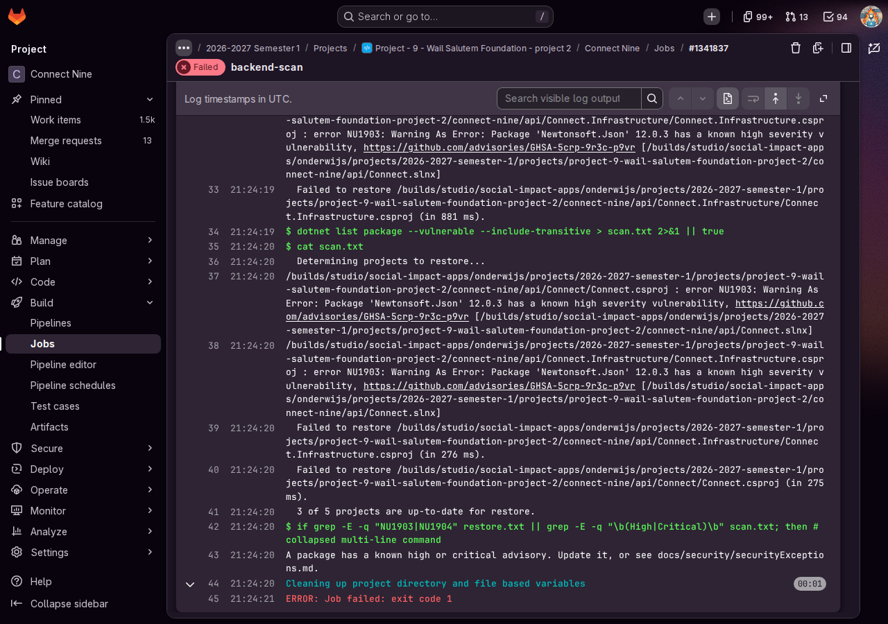
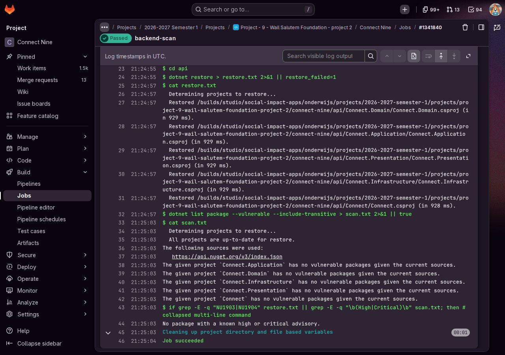
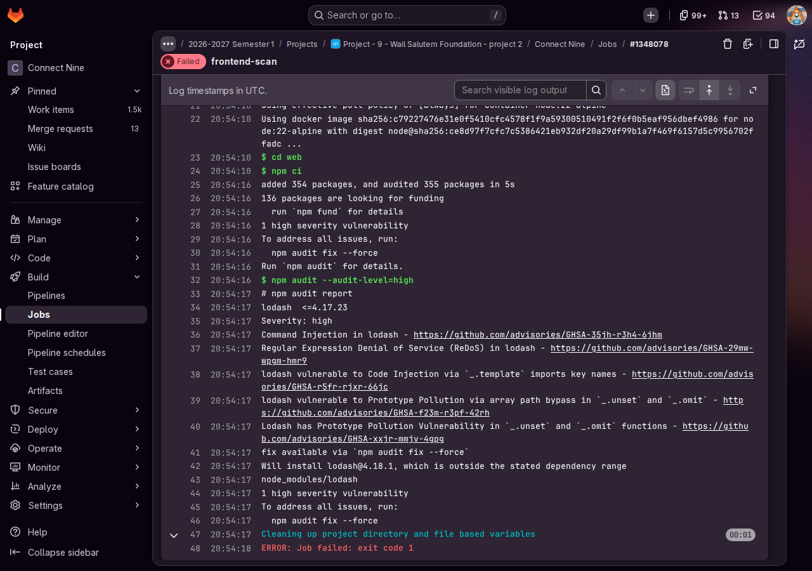
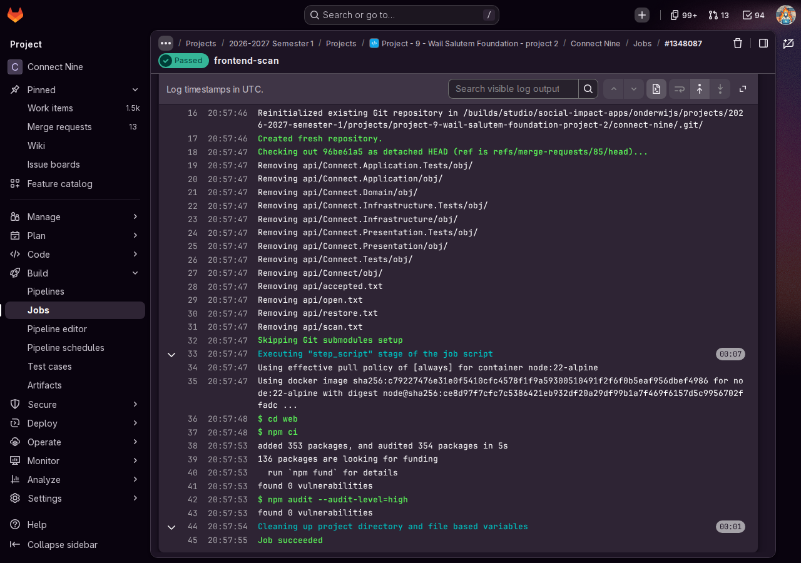

# Proof: task 16.1 The security scan (#308) and task 16.2 The red scan on purpose (#309)

Merge request !30, branch `chore/22-dependency-scan` (#308). Closed merge request !31, branch `test/16-red-scan`, deleted (#309). Closed merge request !85, branch `test/16-red-scan-screen`, deleted (#309, the screen half). Merge request !86 brought the screen half and the weekly run into this proof, and !100 the time of both scans. Issue: 16 A known security hole stopped before it enters Connect (#22).

A point that needs someone else is marked TODO with who and what.

## What was built

- Stage scan between test and deploy. backend-scan: `dotnet restore` with NuGet audit (`api/Directory.Build.props`, mode all, level high), then `dotnet list package --vulnerable --include-transitive`, red on NU1903, NU1904, High or Critical. An advisory with a NuGetAuditSuppress line is skipped in both and named in the log. frontend-scan: `npm ci` and `npm audit --audit-level=high`, only once `web/package.json` exists.
- The weekly scheduled pipeline runs only the two scan jobs. Every other job starts with the rule that skips a scheduled pipeline, so it never deploys.
- `docs/security/securityExceptions.md`: only the client accepts a risk, for at most 30 days.
- `docs/team/onboarding.md`, part 11 The security scan.

## Measured

1. **Pipeline time.** Before: 4 seconds (pipeline 583862 of !24, 8 October 2026). After: 21 seconds (pipeline 583876 of !30, 8 October 2026), backend-scan 17 seconds. 17 seconds slower, the limit is two minutes. That was the server scan alone. Since frontend-scan joined it (#309), both run at the same time in the stage scan, which takes as long as the slower one: 20 seconds, backend-scan 20 and frontend-scan 11 (pipeline 587414 of 24 October 2026). Gurpreet Singh pointed out in his review of !86 that the first number came from before frontend-scan existed, and part 11 of the onboarding guide says it since !100.
2. **Green on a normal change.** Pipeline 583876: "No package with a known high or critical advisory." for all five projects.
3. **Red on purpose (#309).** `Newtonsoft.Json` 12.0.3 added to `api/Connect.Infrastructure`. Pipeline 583877: backend-scan failed with `error NU1903: Warning As Error: Package 'Newtonsoft.Json' 12.0.3 has a known high severity vulnerability, https://github.com/advisories/GHSA-5crp-9r3c-p9vr`. After removing the package the scan turned green again, in pipeline 583878.

   Screenshots of the two job pages in GitLab, taken on 24 October 2026:

   

   

4. **Tried on a laptop first.** .NET SDK 10.0.401 on 8 October 2026: no vulnerable package on dev, and `System.Text.Json` 8.0.4 stopped the restore with NU1903 and GHSA-8g4q-xg66-9fp4.
5. **What went wrong and what changed.** The review of !30 on 9 October 2026 found that a risk the client accepts could never pass. With `Newtonsoft.Json` 12.0.3 and its NuGetAuditSuppress line the restore was clean, but `dotnet list package --vulnerable` does not read that line. It still listed GHSA-5crp-9r3c-p9vr as High in 2 projects, so backend-scan stayed red. backend-scan now reads the advisory addresses of the NuGetAuditSuppress lines and takes only those lines out of the list before the check. The same job script with the .NET SDK 10.0.401 on 9 October 2026:

   | Case | Restore | High in the list after the skip | backend-scan |
   |---|---|---|---|
   | dev, no change | 0 × NU1903 | 0 | green |
   | `Newtonsoft.Json` 12.0.3 | 2 × NU1903 | 2 | red |
   | `Newtonsoft.Json` 12.0.3 plus its NuGetAuditSuppress line | 0 × NU1903 | 0 | green, the advisory named under "Skipped, accepted by the client" |
   | The same plus `System.Text.Json` 8.0.4 | 1 × NU1903, GHSA-8g4q-xg66-9fp4 | 0 | red |

   The last row shows that the skip covers only the accepted advisory.
6. **The screen half of the red run (#309).** Once `web/package.json` was on dev, I added `lodash` 4.17.20 to the screen with `npm install --save-exact` on a branch of its own, on 21 October 2026. Pipeline 586192: frontend-scan failed with "lodash <=4.17.23, Severity: high, Command Injection in lodash - https://github.com/advisories/GHSA-35jh-r3h4-6jhm" and every other job was green. After removing the package again, pipeline 586193: frontend-scan green, "found 0 vulnerabilities". The merge request was closed without a merge and its branch removed, so nothing of it is on dev.

   Screenshots of the two job pages in GitLab, taken on 24 October 2026:

   

   

7. **The weekly run.** The schedule Weekly security scan of dev (#22) runs every Monday at 07:00, Europe/Amsterdam, on dev, made on 21 October 2026. Run once by hand the same day: pipeline 586191 held only backend-scan and frontend-scan, both green, and no deploy job.

## TODO

- [x] Wesley: make the schedule after the merge (Build, Pipeline schedules, Monday 07:00, Europe/Amsterdam, dev), run it once by hand and write here that only backend-scan ran. Done on 21 October 2026, point 7: both scan jobs ran, because the screen has a `package.json` now.
- [x] Wesley: screenshots of the red and the green run in !31 and in !85. Done on 24 October 2026 in this file, points 3 and 6: screenshots of the four job pages, here because the two merge requests are closed.
- [x] Wesley: the npm half of the red run once #263 is merged. Done in !85, point 6.
- [ ] Reviewer of !30: run `dotnet restore` and `dotnet list package --vulnerable --include-transitive` in `api` on your laptop and write whether you saw the same.
- [ ] Reviewer of !30: repeat the test with `Newtonsoft.Json` 12.0.3 and its NuGetAuditSuppress line on a throwaway branch, and write whether backend-scan turned green and named the advisory under "Skipped, accepted by the client".
- [ ] A teammate who built nothing of #22: task 16.3 (#310). A first part is done: Gurpreet Singh, who built nothing of #22, read part 11 of the onboarding guide in his review of !86 on 23 October 2026 and wrote that it is clear what to do when frontend-scan goes red.

## AI use

AI was used as a writing support tool while working on this document. We used AI to improve the formulation of sentences, the structure of wording, readability, and clarity of text that we had written. The content itself, including our experiences, reflections, learning goals, decisions, self-assessments, and conclusions, is our own. We reviewed the suggested changes and decided as a team which improvements to include.
