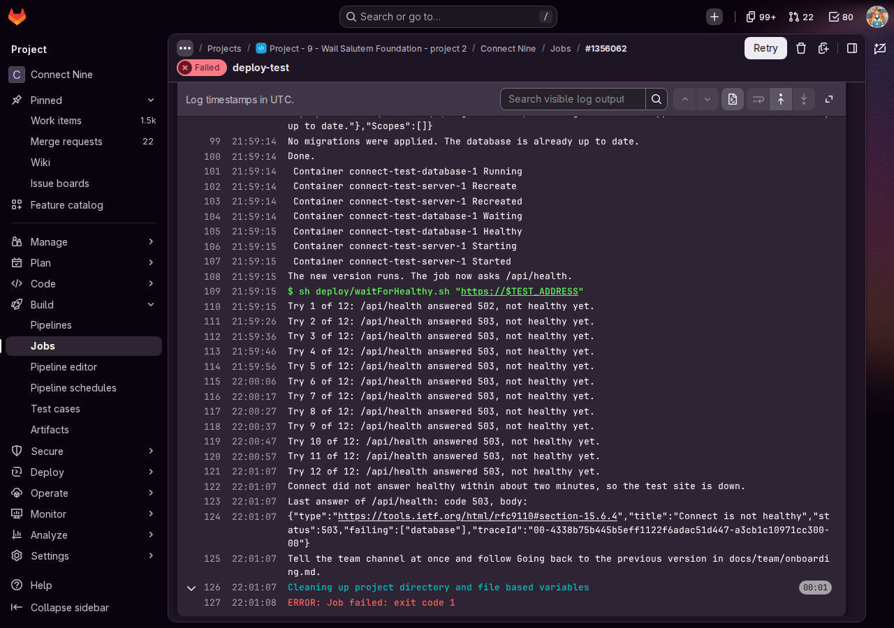
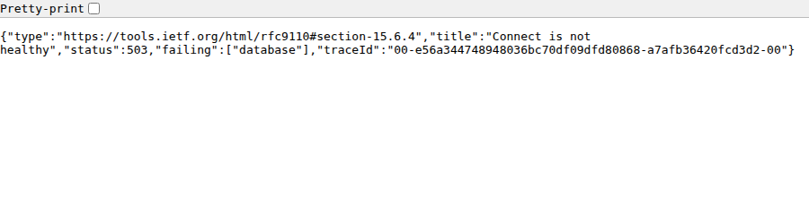
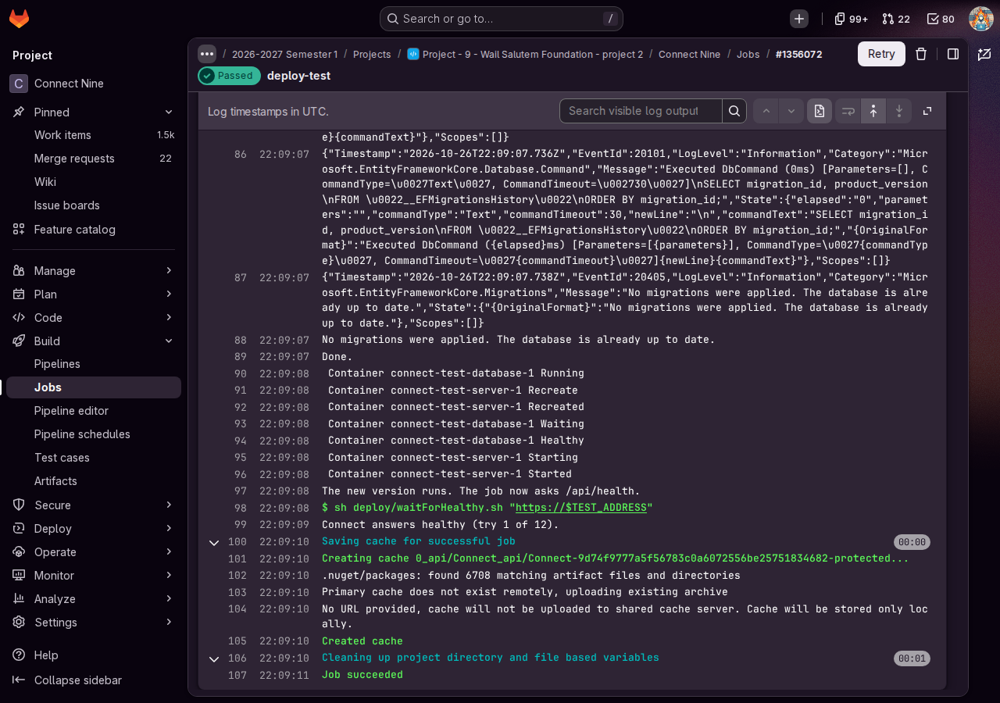
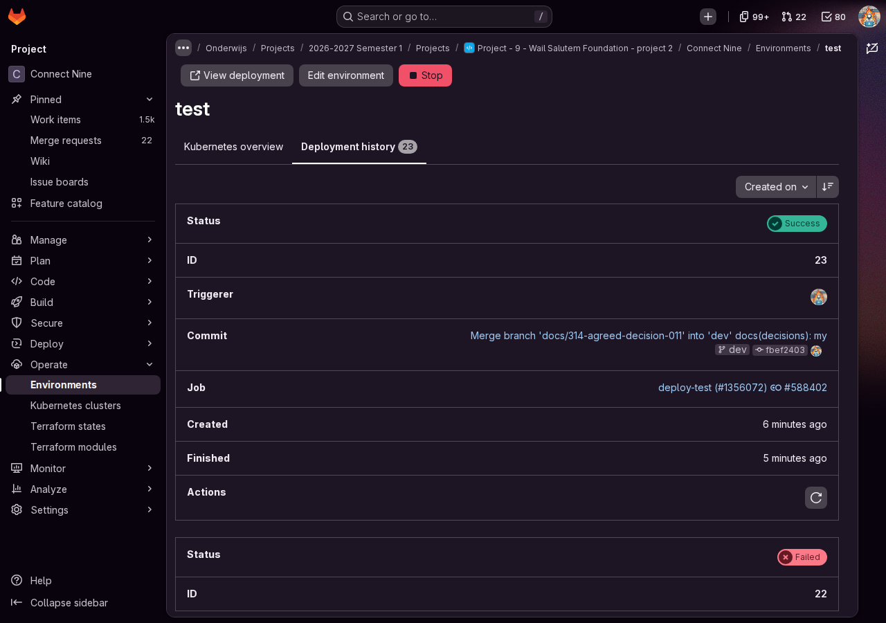
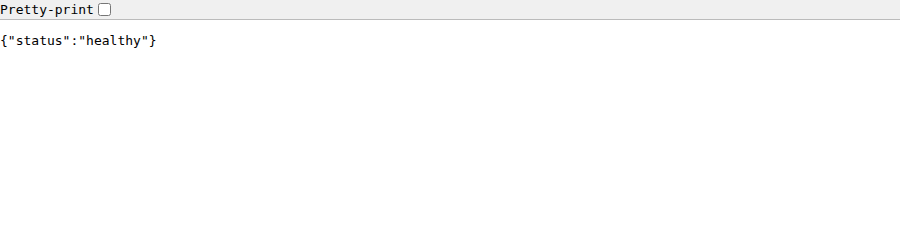

# Proof: I practised the way back to the previous version (#314)

Merge request !124, branch `docs/314-practised-way-back`. Issue: 17 A health check and structured logs, task 17.4 The way back to the previous version (#314) of Gurpreet Singh, where I am the teammate who did not write the steps. Files: this proof, its screenshots in `images/` and its row in `docs/wesley/README.md`.
Profile: Full Stack Software Developer, level 3. Portflow: Managing and Collaborating MS1 and MS4.

A point that needs someone else is marked TODO with who and what.

## MS1 Seeing risks early and keeping the work transferable

School asks: "You anticipate risks and bottlenecks in the process before they become problems and ensure that the work remains transparent and transferable."

1. **The risk.** When a merge breaks the test site, only its author knows how to get it back. Gurpreet wrote the way back in `docs/team/onboarding.md`, part Going back to the previous version (!121). The real test is whether someone else gets the site back with only that part.
2. **The break.** Gurpreet merged a version that is broken on purpose (!123) on 26 October 2026: the server looks for its database on the wrong port. A first run that evening at 22:51 went through GitLab's API in about a minute. That tested the steps but not a person, so I ran the deploy-test of !123 once more and did the way back myself. It turned red at 23:01 (job 1356062), after twelve tries of `/api/health answered 503` with `"failing":["database"]`.
3. **The way back.** In my browser, with a stopwatch and only that part of the onboarding, I found the first green row under the red one, fbef2403, checked that !123 adds no migration, and pressed Rollback environment on its row at 23:08. Its deploy-test said `No migrations were applied. The database is already up to date.` and was green at 23:09 with `Connect answers healthy (try 1 of 12).` (job 1356072).
4. **The time.** 10 minutes and 10 seconds on my stopwatch for all the steps, just over the ten minutes of the goal. The site itself was healthy again 8 minutes after it went red.
5. **The data stayed.** Before the practice I made a check account on Make an account. Afterwards the same email got the answer "This email address already has an account", so the test database still held its accounts. The database was never put back and no volume was deleted.
6. **What was unclear.** Two steps. Step 1 says to tell the team channel, but not what exactly to send, so I skipped it: Gurpreet had already told the group that we were doing the practice. My time is without that message. In step 2 I had to click the name test on the page Environments before I saw the list of the current and earlier deploys. The step says "then the name test", but it is easy to miss that the list is behind it. For both I proposed a change to Gurpreet: the exact message to copy in step 1, and a sentence for step 2.

## MS4 Making the work fit with the work of the team

School asks: "You ensure that your work aligns with that of others and contributes to the joint result."

1. **The shared test site.** Gurpreet told the team's WhatsApp group that we were doing the practice. Dev stays closed until the revert of !123 is merged and green, because every merge into dev deploys dev again, broken change included.
2. **Checked before the practice.** I reviewed the steps (!121) and the broken version (!123) before we started. The break only changes the address the server uses for its database, so the migrations and the data stay as they are, and the version to go back to keeps its screen for 30 days.
3. **Back to the author.** My time and what was unclear went to Gurpreet on #314 (notes 2016359 and 2016383). He writes them in part Practised of the onboarding and rewrites the steps I stumbled on.

## Evidence per step

| Step of onboarding | What I did and saw | Evidence |
|---|---|---|
| 1 Say so in the team channel | Skipped: Gurpreet had told the group about the practice, and the step does not say what exactly to send | My proposal for the message on #314, note 2016383 |
| 2 Open Operate, Environments, test | The list of deploys only showed after I clicked the name test | The first screenshot below |
| 3 Find the last healthy deployment | The top row fc86ec50 red, the first green row under it fbef2403 | Job 1356062 |
| 4 Press Rollback | !123 adds no migration, so the database stays as it is. Rollback environment on the row of fbef2403 at 23:08 | Job 1356072 |
| 5 Wait for green on a healthy answer | Green at 23:09, with `Connect answers healthy (try 1 of 12).` | Job 1356072, and the health address below |
| 6 The check account | "This email address already has an account" | Make an account |
| 7 Write it in the issue | What happened, the version, the times, the green job and what was unclear | Comments on #314, notes 2016359 and 2016383 |

## TODO

- [ ] Gurpreet: my name, the date, the minutes and what was unclear in part Practised of `docs/team/onboarding.md`, in his revert merge request. No change to this branch for it.
- [ ] Gurpreet: the box of the practice on #314. No change to this branch for it.

## AI use

AI was used as a writing support tool while working on this document. We used AI to improve the formulation of sentences, the structure of wording, readability, and clarity of text that we had written. The content itself, including our experiences, reflections, learning goals, decisions, self-assessments, and conclusions, is our own. We reviewed the suggested changes and decided as a team which improvements to include.
