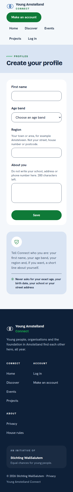
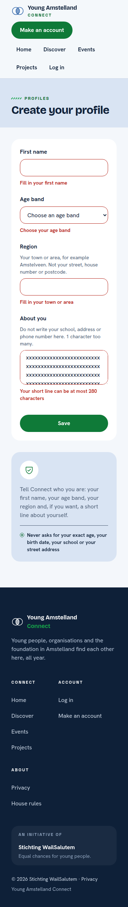
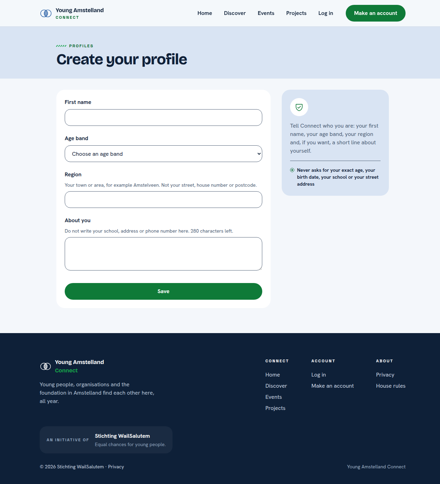
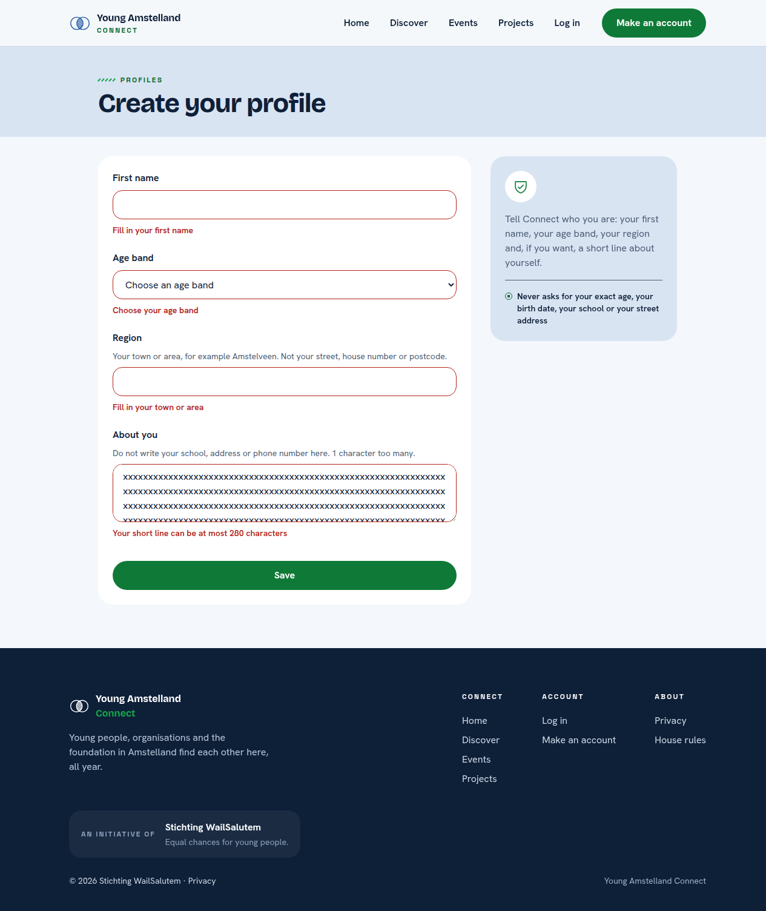
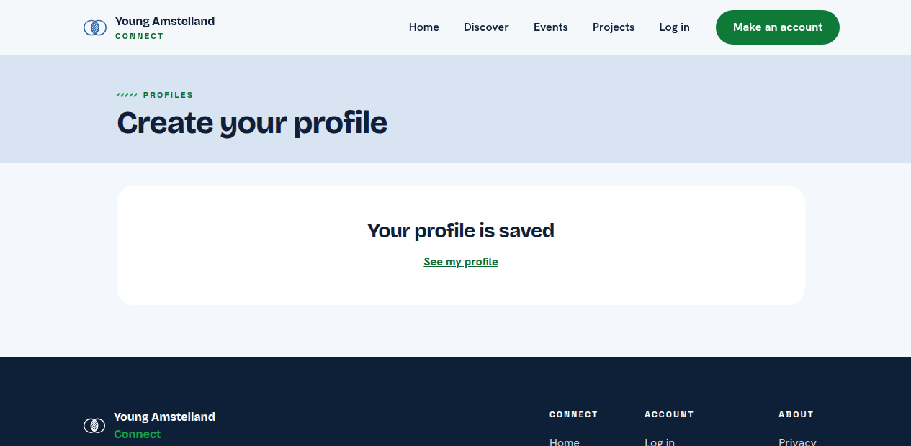
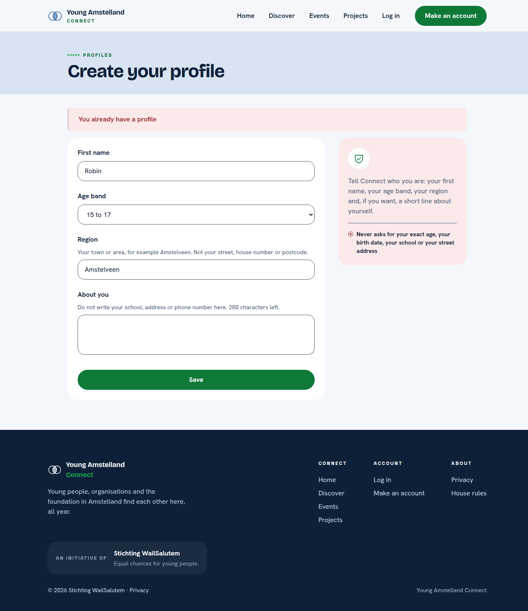

# Proof: task 7.3 The page Create your profile (#322)

Merge request !69, branch `feature/322-create-profile-page`. Issue: 07 Create a profile (#25). Files: `web/src/pages/CreateProfile.tsx`, `CreateProfile.module.css` and `CreateProfile.test.tsx`, `web/src/hooks/useCreateProfile.ts`, `web/src/api/memberProfiles.ts` and its test, `web/src/App.tsx` and `web/src/vite-env.d.ts`, and in Nick Hoebe's files `web/src/components/FormField.tsx` and its CSS, `web/src/api/client.ts` and `web/src/api/accounts.ts`.
Profile: Full Stack Software Developer, level 3. Portflow: Designing and Realising OR1, OR3, OR4 and OR5.

A point that needs someone else is marked TODO with who and what.

## OR1 Designing and building to a plan

School asks: "You design and implement systematically, justify choices in relation to alternatives, and adapt based on new insights."

1. **The four fields and the states.** First name, age band, region and About you. The page has the states empty, busy, wrong fields, already has a profile, not reachable, not logged in and saved. The typed values live in the hook `useCreateProfile`, so they stay when the server says no or cannot be reached.
2. **The look of the frame.** The title sits in a band with the eyebrow Profiles, the form in a white card, and beside it a panel that says what Connect never asks for. Each hint sits between its label and its field, a wrong field turns red with its message under it, and a conflict or a lost connection shows a red message above the form.
3. **The page does not call the server itself.** `web/src/api/memberProfiles.ts` sends the form through `request()` of `client.ts` and turns every answer into one of five outcomes, the hook `useCreateProfile` holds the state, and the page only shows it. So the page is tested with a fake, and the address is tested on its own.
4. **The alternatives I weighed.** A form library such as react-hook-form lost to plain React state, because four fields do not need it, four of us are new to React and a new package is one more thing to learn and to keep safe. One page for making and changing a profile lost to a page of its own, because the edit page of #64 starts from a saved profile and answers differently.
5. **Log in does not exist yet.** The route `/profile/new` is a plain route until `RequireLogin` of #15 exists, and there is no link from My account yet. Until then the page says who you are with the temporary header of task 7.2, set with `VITE_TEMPORARY_ACCOUNT_ID` in Development only.
6. **What I changed after Nick's review of 24 October 2026.** Nick Hoebe reviewed the page in !70, which carries it. I took every point over, and each is now a rule of the code conventions, so the next page starts that way:
   - `memberProfiles.ts` calls the server through `request()` of his `client.ts` instead of `fetch` (frontend rule 14), and reads the messages of a wrong form through one shared type `ValidationProblem` in `client.ts`, which his `accounts.ts` now uses too (frontend rule 15).
   - The state and the call to the server moved from the page into the hook `useCreateProfile`, the way his `useCreateAccount` does it (frontend rule 13).
   - Every field is his `FormField`, which now also draws a hint, a select and a textarea, so the page has no field markup of its own (frontend rule 12). His Create account page renders the same as before, and its tests pass unchanged.
   - The band with the title is a `div`, because `TopBar` already holds the one `header` of the site (frontend rule 16).
   - The fields now have the corners and the red of `FormField`, the same as Create account, so the two forms of Connect look alike. The Save button is full width, as frame G01 and Create account draw it. It sets its own width and margin, because the element selector `button` of his `CreateAccount.module.css` also reaches this page, and that point is on the list for the stand up.
- TODO Wesley: what I changed after a teammate used it on a phone.

## OR3 Involving stakeholders and weighing their feedback

School asks: "You proactively involve multiple stakeholders with diverse interests, coordinate systematically, and consciously weigh their feedback in your choices."

1. **A teammate's feedback on the design.** In his review of !69 on 22 October 2026, Gurpreet Singh held the page next to the prototype frame G01 Create your profile. The page differs from the frame, and he judged the page the better one: the hint not to write a school, address or phone number and the panel about what Connect never asks for help with the privacy rules. He asked to put both into the frame, so the design matches the page again. On 24 October 2026 I did that in Figma: G01 now has the panel What Connect asks beside a white form card, and the hint under About you. The privacy note that sat on top of the card in G01 is hidden, not deleted, because the panel says the same. I kept the page as it was, since we both judged it the better design, and the frame now follows it ([G01 Create your profile](https://www.figma.com/design/SAVxDf3rlsWz22qlzTEYte/Young-Amstelland-Connect--team-workspace?node-id=1019-1964)).

- TODO Wesley: the words, with the date and who, of a teammate and of one person outside the team, such as the client on a Friday, who tried the page on a phone, also whether the hints about school and address are clear and not scary. Then what I changed and what I did not, and why.

## OR4 Validating the solution

School asks: "You systematically validate that the solution does what it should, and draw conclusions for improvement."

1. **The tests.** `CreateProfile.test.tsx` checks the three age bands with none chosen, the counter and the characters too many, the busy button, the saved message with See my profile, the field messages with the focus on the first wrong field, the region hint linked to its field, the panel beside the form, the conflict of the server, not reachable and not logged in with every value kept, and 0 axe problems on the empty form and with field messages. `memberProfiles.test.ts` checks the body and headers that are sent and every answer, also the title of a 409. 44 tests of the screen pass, and lint, Prettier and the build are clean.
2. **In a real browser against the real server.** With the address of task 7.2 running in Development and the temporary account, I filled the page in Chrome at 360 and 1280 pixels wide. An empty form with a bio of 281 characters got the four messages of the server under their fields, with the focus on First name. A valid form saved the profile, with `" Robin "` stored as `Robin`, and a second save showed You already have a profile. axe in the browser, colour contrast included, found 0 problems at both widths in every state. On 26 October 2026, after the changes of Nick's review, I ran it again the same way against the server of !68: the four messages under their fields with the focus on First name at both widths, the profile saved, You already have a profile on the second save, and 0 axe problems in every state. The screenshots below are of that run.
3. **A test broken on purpose.** With the line that moves the focus to First name taken out, the test of the field messages failed, and it passed again once the line was put back.
4. **What I changed after the first run.** An answer that is not JSON now counts as not reachable instead of breaking the page, and the counter says 1 character left instead of 1 characters left.
5. **What I changed after checking the Figma frame and the page document.** The first version was one plain column. I compared it with the frame Create your profile and with `docs/pages/CreateProfile.md`, and changed: the band with the eyebrow, the card and the panel beside it, the hints above the fields, the full region hint "Your town or area, for example Amstelveen. Not your street, house number or postcode.", red for a wrong field and for the message above the form, the message above the form as an alert with the title the server sends (so the organisation case of #67 needs no new code), the link See my profile after saving, the message "Your short line can be at most 280 characters" from the page document (in !68), and the counter saying how many characters are too many. The red colours come from the design and are now tokens in `web/src/styles/tokens.css`.
6. **Where I did not follow the frame, and why.** The fields have the corners and the red of `FormField` since 26 October 2026 (OR1 point 6), and frames G01, G02 and H01 in Figma got the same corners, line and hint above the field that day, so the design and the page match again. The borders of the fields are darker than in the frame, because the light line of the frame has a contrast of about 1.4 to 1 with white, and WCAG 2.2 asks 3 to 1 for the border of a field. The panel shows the shield icon the site already has instead of a person icon. The saved message has no drawing yet, because the site has no such picture.
7. **What is not covered yet.** The question younger than 16 and the address of a parent come with #40 (task 130.5), with the second line of the panel, "Under 16? We ask for a parent's email once, only to ask permission". The message for a street in Region comes with #26. The link from My account and the page behind log in come with #1538.

## OR5 Impact on users and society

School asks: "In your design and implementation, you consciously take into account the broader impact on end users and society, while forming your own ethical judgment."

1. **How the page protects a minor.** Three age bands and no field for a date or an age, a region that asks for a town or area, and the hint "Do not write your school, address or phone number here." right under About you.
2. **My judgment on the region.** Free text is the weakest choice, because a young person can type a small village or even a street (#26). I advise a short list of the larger areas of Amstelland, which question 19 of #11 asks the client. For 15 to 17 the region is never shown to other members (#30), so I keep asking it of every age band and let the list solve the rest.

## TODO

- [ ] Wesley: the OR1 and OR3 lines above, after a teammate and one person outside the team tried the page on a phone, before anyone approves !69.
- [x] Wesley: frame G01 in Figma gets the corners and the red of `FormField`, so the design matches the page again. Done on 26 October 2026 in G01, G02 and H01, read back by export.
- [ ] Wesley: after the merge, tick the boxes of #322 with the evidence in a comment. No change to this branch for it.

## AI use

AI was used as a writing support tool while working on this document. We used AI to improve the formulation of sentences, the structure of wording, readability, and clarity of text that we had written. The content itself, including our experiences, reflections, learning goals, decisions, self-assessments, and conclusions, is our own. We reviewed the suggested changes and decided as a team which improvements to include.
