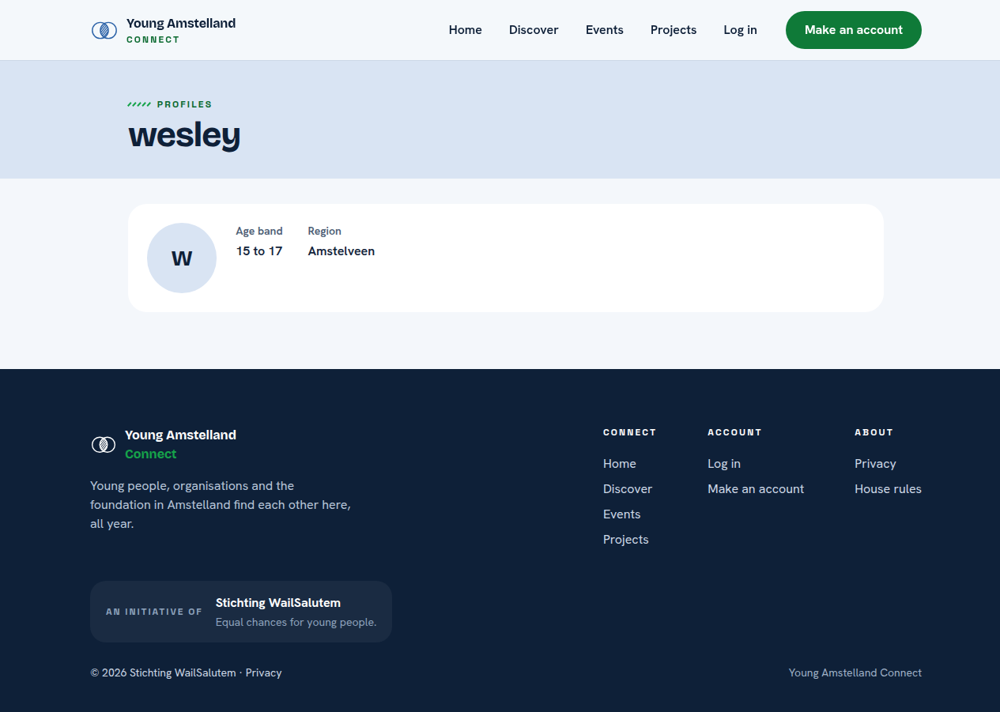
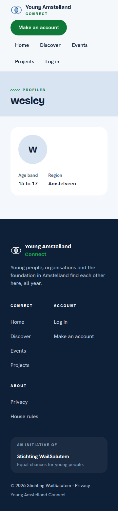

# Proof: tasks 8.1 to 8.3 My own profile page (#330, #331, #332)

Merge request !70, branch `feature/27-my-profile`. Issue: 08 See my own profile page (#27). Files: the query of `GET /api/member-profiles/current` in `api/Connect.Application/Profiles/GetCurrentProfile/`, the endpoint in `api/Connect.Presentation/Profiles/Endpoints/MemberProfileEndpoints.cs`, the page `web/src/pages/MyProfile.tsx` with `web/src/components/ProfileDetails.tsx`, their tests and `docs/architecture/api.md`.
Profile: Full Stack Software Developer, level 3. Portflow: Designing and Realising OR1, OR2, OR3, OR4 and OR5.

A point that needs someone else is marked TODO with who and what.

## OR1 Designing and building to a plan

School asks: "You design and implement systematically, justify choices in relation to alternatives, and adapt based on new insights."

1. **Which layer does what.** The query in Application finds the profile of the account through the unique index on `account_id`, without tracking and without loading the account. The endpoint takes the account from the session and has no id in its address, so a member can only ever ask for their own profile. The page shows what came back and does nothing else.
2. **The alternative I weighed.** `GET /api/member-profiles/{id}` for the own profile as well lost to a separate address `current`, because with an id in the address a mistake in the check would show someone else's profile. With `current` there is nothing to get wrong.
3. **Following the code of the team.** The names and folders are those of Nick Hoebe's account code: `GetCurrentProfileQuery` and its handler, `IAppDbContext.Profiles`, the DTO in `Profiles/DTO`. I added `IQueryHandler` next to his `ICommandHandler`, because the code conventions name query handlers and this is the first query.

## OR2 Choosing standards and methods

School asks: "You independently select relevant standards and methods from the field and substantiate why they fit the context."

1. **HTTP and problem details.** 200 with the profile, 401 without a login, 404 "You have no profile yet" as a problem details answer, and 503 when the database cannot be reached (RFC 9110, RFC 9457).
2. **Reading without tracking.** EF Core does not track an entity it only reads with `AsNoTracking()`, and a `Select` into a record reads only the columns the record needs.
3. **What I took from BoKSA.** The article API implementation asks for clear resource addresses and the same JSON shape with a fitting status code every time. I kept the resource `member-profiles` and put `current` where the id would be, and every answer with a body is either `data` with `meta` or a problem details body.
4. **What I took from BoKSA.** The article Database integration says to understand what the ORM does underneath. I looked at the SQL of the query with EXPLAIN ANALYZE and saw that it uses the unique index that already exists, so I did not add one.

## OR3 Involving stakeholders and weighing their feedback

School asks: "You proactively involve multiple stakeholders with diverse interests, coordinate systematically, and consciously weigh their feedback in your choices."

- TODO Wesley: the words, with the date and who, of a teammate and one person outside the team who opened My profile on a phone, and what I changed or did not, and why.

## OR4 Validating the solution

School asks: "You systematically validate that the solution does what it should, and draw conclusions for improvement."

1. **The query plan.** With a thousand profiles in a test database, the query of the own profile uses the existing unique index, so no new index and no migration:

```
                                                               QUERY PLAN                                                               
----------------------------------------------------------------------------------------------------------------------------------------
 Limit  (cost=0.28..8.29 rows=1 width=61) (actual time=0.019..0.019 rows=1 loops=1)
   ->  Index Scan using ix_profile_account_id on profile p  (cost=0.28..8.29 rows=1 width=61) (actual time=0.018..0.018 rows=1 loops=1)
         Index Cond: (account_id = '9796cb36-afe2-4382-864c-84e2a8171f76'::uuid)
 Planning Time: 0.259 ms
 Execution Time: 0.042 ms
(5 rows)
```

2. **The tests.** Database tests for found, not found and never another account's profile, handler tests on SQLite for a profile, no profile and a database that cannot be reached, endpoint tests on PostgreSQL for 200 with exactly the profile values, 404, 401, two members who each get only their own, and 503 without error text, and screen tests for each state of the page.
3. **A test broken on purpose.** With the filter on the account of the session taken out of the query, the test where two members each get their own profile failed, and it passed again once the filter was back.
4. **In a real browser.** With the server running in Development, My profile showed the saved profile at 360 and 1280 pixels, and axe in the browser, colour contrast included, found 0 problems.




## OR5 Impact on users and society

School asks: "In your design and implementation, you consciously take into account the broader impact on end users and society, while forming your own ethical judgment."

1. **Only the own profile.** The address has no id, the account comes from the session, and the answer holds no email address, id, account id or date.
2. **My judgment.** A young person should see everything Connect keeps about them, on one page. Today that is the first name, the age band, the region and the short line, and the page shows all of it. Changing it comes with #64 and deleting the account with #33. I think both must work without asking anyone, because it is their data and the privacy law gives them that right. This means #33 is as important as this page, because it is the only way to leave Connect.

## TODO

- [ ] Wesley: the OR3 lines above, after a teammate and one person outside the team tried the page on a phone.
- [ ] Wesley: after the merge, tick the boxes of the tasks with the evidence in a comment.

## AI use

AI was used as a writing support tool while working on this document. We used AI to improve the formulation of sentences, the structure of wording, readability, and clarity of text that we had written. The content itself, including our experiences, reflections, learning goals, decisions, self-assessments, and conclusions, is our own. We reviewed the suggested changes and decided as a team which improvements to include.
