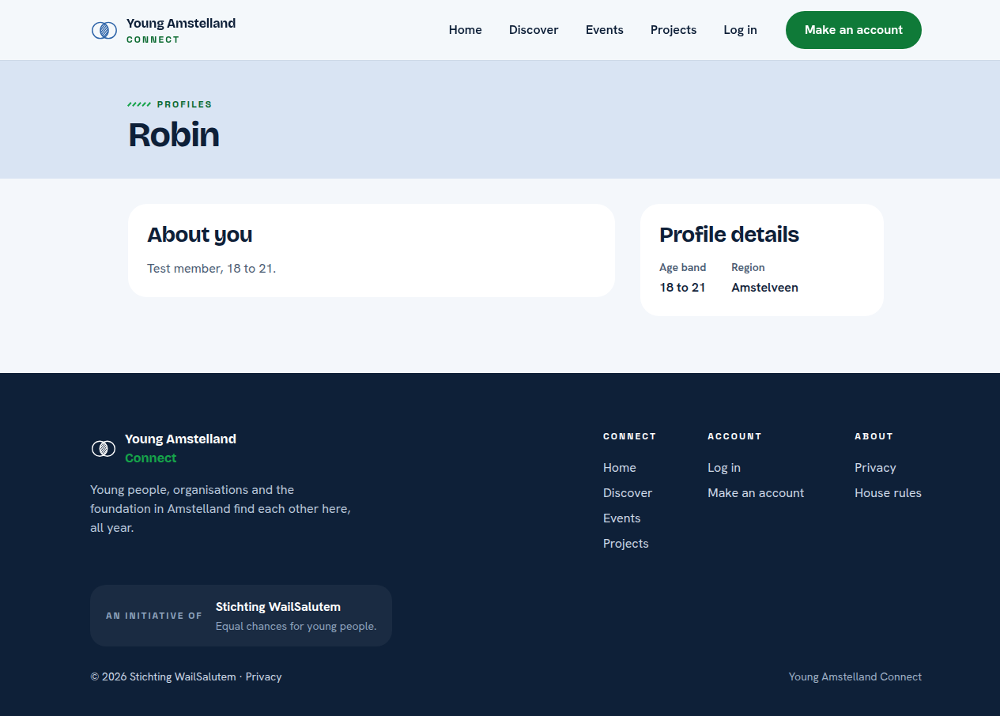
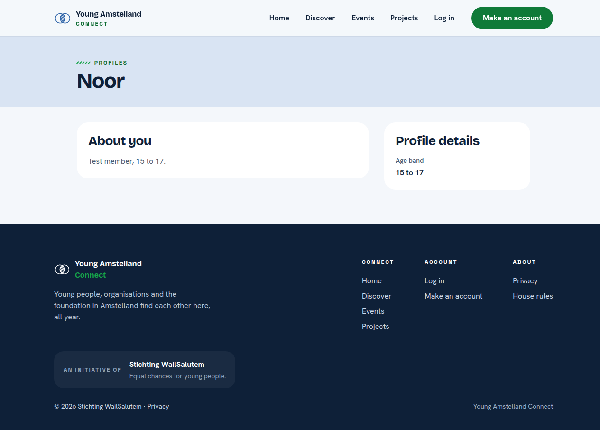
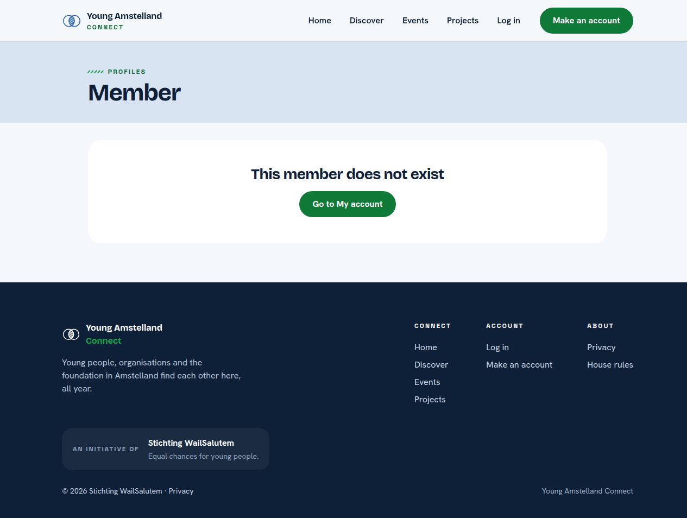
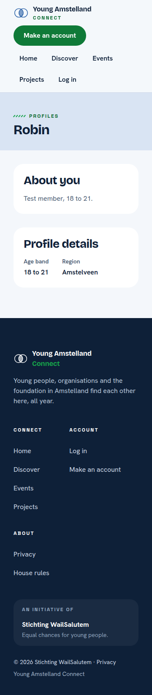

# Proof: tasks 14.1, 14.3 and 14.4 The page of another member (#341, #343, #344)

Merge request !71, branch `feature/30-member-profile`. Issue: 14 View another member's profile (#30). Files: `PublicMemberProfile` and `ProfileVisibility` in `api/Connect.Domain/Users/`, the query in `api/Connect.Application/Profiles/GetPublicProfile/`, the endpoint `GET /api/member-profiles/{id}`, the page `web/src/pages/MemberProfile.tsx`, their tests and `docs/architecture/api.md`.
Profile: Full Stack Software Developer, level 3. Portflow: Designing and Realising OR1, OR2, OR3, OR4 and OR5.

A point that needs someone else is marked TODO with who and what.

## OR1 Designing and building to a plan

School asks: "You design and implement systematically, justify choices in relation to alternatives, and adapt based on new insights."

1. **The public part as its own record.** `PublicMemberProfile` holds only first name, age band, region and short line. The query selects into it inside the database query, so the account, the id and the dates are never read.
2. **The rule for minors in one place.** `ProfileVisibility` decides what another member may see: never the region of a young person of 15 to 17. The handler applies it, the endpoint and the screen never repeat it.
3. **An id as text.** The id in the address is read as text and parsed in the endpoint, so `abc` and an unknown id both answer "This member does not exist" and never a server error.

## OR2 Choosing standards and methods

School asks: "You independently select relevant standards and methods from the field and substantiate why they fit the context."

1. **Leaving out instead of null.** A hidden or empty value is left out of the answer, so the screen cannot show an empty row by mistake and a client of the address cannot tell hidden from empty.
2. **HTTP and problem details.** 200, 401, 404 and 503 as before (RFC 9110, RFC 9457).
- TODO Wesley: one line each on what I took from the BoKSA articles API implementation and Authentication and authorization basics.

## OR3 Involving stakeholders and weighing their feedback

School asks: "You proactively involve multiple stakeholders with diverse interests, coordinate systematically, and consciously weigh their feedback in your choices."

- TODO Wesley: the words, with the date and who, of a teammate and one person outside the team who opened the page of another member on a phone.

## OR4 Validating the solution

School asks: "You systematically validate that the solution does what it should, and draw conclusions for improvement."

1. **What the query reads.** A database test records the SQL EF Core sends and checks it names only the four public columns. With a thousand profiles the query uses the primary key:

```
                                                         QUERY PLAN                                                          
-----------------------------------------------------------------------------------------------------------------------------
 Limit  (cost=0.28..8.29 rows=1 width=61) (actual time=0.032..0.032 rows=1 loops=1)
   ->  Index Scan using pk_profile on profile p  (cost=0.28..8.29 rows=1 width=61) (actual time=0.031..0.031 rows=1 loops=1)
         Index Cond: (id = '5d47ca86-6053-4ad2-91fc-fdd5f05e0c67'::uuid)
 Planning Time: 0.294 ms
 Execution Time: 0.055 ms
(5 rows)
```

2. **The tests.** `ProfileVisibilityTests` for every age band, handler tests for an adult, a young person without the region, an unknown id and a database that cannot be reached, and endpoint tests on PostgreSQL for an adult, a minor without the key region, an empty short line left out, an unknown id and `abc`, the own id, 401 and 503, and screen tests for each state.
3. **A test broken on purpose.** With `ShowsRegion` letting the region of a young person of 15 to 17 through, the endpoint test for a minor failed, and it passed again once the rule was back.
4. **In a real browser.** The pages of an adult (Robin), a young person (Noor) and an id that does not exist, at 360 and 1280 pixels, axe 0 problems.
5. **Not covered yet.** The two seeded test members of task 14.2 (#342) need the seeder of #276 and #277, which does not exist yet, so the tests make their own members.






## OR5 Impact on users and society

School asks: "In your design and implementation, you consciously take into account the broader impact on end users and society, while forming your own ethical judgment."

1. **A young person of 15 to 17.** Their region is never sent, so another member cannot combine a first name, an age band and a village to find them.
- TODO Wesley: my own judgment on what else a young person's page should hide, as input for the role table of #28.

## TODO

- [ ] Wesley: the TODO lines above.
- [ ] Wesley: after the merge, tick the boxes of the tasks with the evidence in a comment.

## AI use

AI was used as a writing support tool while working on this document. We used AI to improve the formulation of sentences, the structure of wording, readability, and clarity of text that we had written. The content itself, including our experiences, reflections, learning goals, decisions, self-assessments, and conclusions, is our own. We reviewed the suggested changes and decided as a team which improvements to include.
