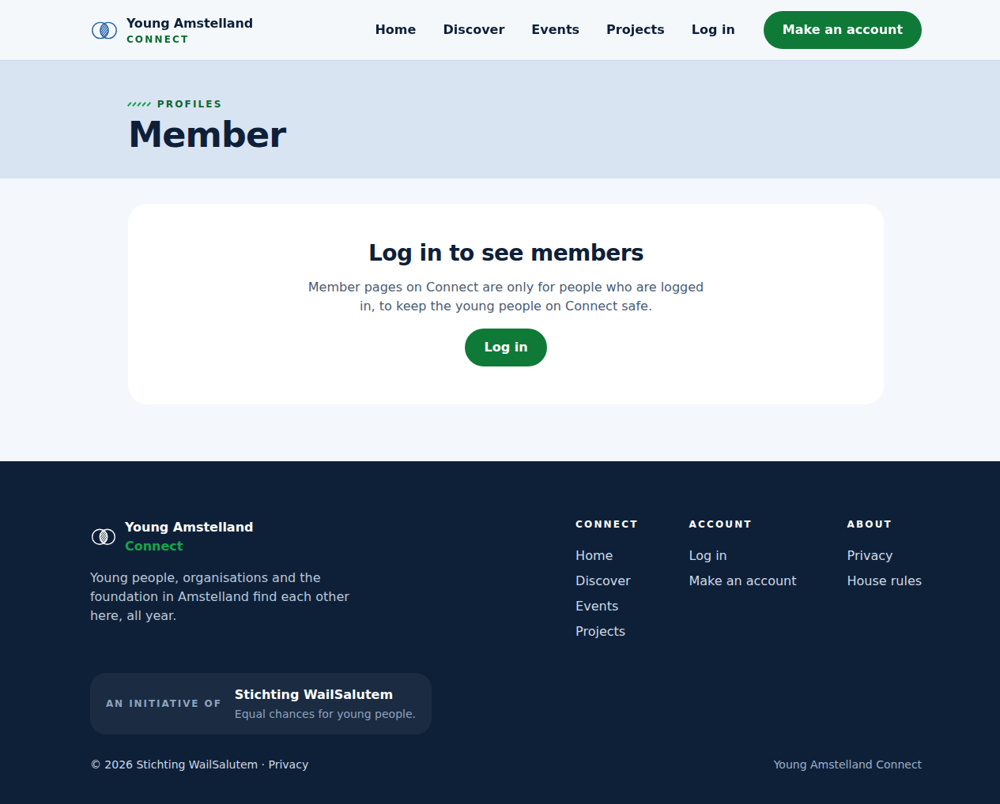
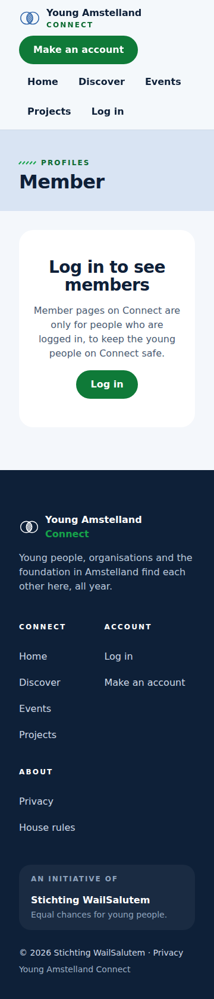

# Proof: tasks 15.1 to 15.3 A visitor on a member page (#347, #348, #349)

Merge request !75, branch `feature/31-visitor-member-page`. Issue: 15 A visitor is told to log in on a member's page (#31). Files: `api/Connect.Tests/Profiles/Endpoints/VisitorDatabaseTests.cs` and `VisitorMemberProfileEndpointTests.cs`, `web/src/components/LoggedOutMessage.tsx` on the page of another member, their tests and `docs/architecture/api.md`.
Profile: Full Stack Software Developer, level 3. Portflow: Designing and Realising OR1, OR2, OR3, OR4 and OR5.

A point that needs someone else is marked TODO with who and what.

## OR1 Designing and building to a plan

School asks: "You design and implement systematically, justify choices in relation to alternatives, and adapt based on new insights."

1. **The door before the data.** A visitor is stopped by the guard before the handler runs, so the query on the table `profile` never starts. This needed no new server code, only tests that keep it that way.
2. **One recorder, never a copy.** The whole-server test uses the `DatabaseCommandRecorder` of #341, so Connect.Tests now references the database test project instead of having its own copy.
3. **Log in does not exist yet.** Log in (#15) does not exist yet. As in !68, every address sits behind the guard, and until #15 adds the session the account comes from the header `X-Temporary-Account-Id`, which only Development accepts. #1538 takes it out. So the page learns from the 401 that nobody is logged in and shows the message in its place. Once #15 adds `RequireLogin`, the message moves there and the page never asks the server.
4. **Built again on the code of the team, 26 October 2026.** The first version of 20 October 2026 was built on the profile code from before Nick Hoebe's `IAppDbContext` of !50. I built it again on !73: the recorder of the whole-server test now uses the test database of `TestsConnection` instead of `DefaultConnection`, as the tests and mocking rules of the code conventions say, the state of the page stays in the hook `useMemberProfile` (frontend rule 13), and `LoggedOutMessage` sits in `components/`, because every page behind log in will use it (frontend rule 7).

## OR2 Choosing standards and methods

School asks: "You independently select relevant standards and methods from the field and substantiate why they fit the context."

1. **One answer for every address.** A visitor gets the same 401 without a body for a known member, an unknown id and `abc`, so trying links tells nobody which members exist (OWASP Authentication Cheat Sheet, generic error messages).
2. **No id rule on the route.** Without `{id:guid}` on the route, `abc` reaches the same guard as a real id. With it, routing would answer `abc` differently.
3. **A safe way back.** Only a path that starts with `/members/` goes into `next`, encoded with `encodeURIComponent`, so the Log in link can never send a visitor to another site (OWASP Unvalidated Redirects and Forwards Cheat Sheet).

## OR3 Involving stakeholders and weighing their feedback

School asks: "You proactively involve multiple stakeholders with diverse interests, coordinate systematically, and consciously weigh their feedback in your choices."

- TODO Wesley: the words, with the date and who, of a teammate who did not build this and of one person outside the team who opened a member link without logging in on a phone (#351), and what I changed or did not.

## OR4 Validating the solution

School asks: "You systematically validate that the solution does what it should, and draw conclusions for improvement."

1. **The tests.** `VisitorDatabaseTests` on PostgreSQL: a visitor opening a known id, an unknown id and `abc` causes no command on the table `profile`, and a logged in member opening the known id causes at least one, so the recorder is shown to work. `VisitorMemberProfileEndpointTests`: the three visitor answers are the same in status, content type and body, a logged in member still gets 200 and 404 "This member does not exist". Screen tests for `LoggedOutMessage` (the heading, the sentence, the encoded link, a path outside /members never in next, axe) and the 401 case of the member page.
2. **Tests broken on purpose, again on 26 October 2026.** With `AllowAnonymous()` on the address, 4 tests of Connect.Tests failed, among them `Visitor_OpeningKnownUnknownOrMalformedId_NeverCausesACommandOnProfile`, because the handler then reads `profile` for a visitor. With `{id:guid}` on the route, 3 failed, two of them in `VisitorMemberProfileEndpointTests`. All 58 passed again once the code was back.
3. **In a real browser, on 20 October 2026.** Without the temporary account, the page of a member showed "Log in to see members" and nothing of the member at 360 and 1280 pixels, and axe in the browser found 0 problems.
4. **Not covered yet.** A made up cookie (#347) waits for the session of #15. The seeded member Robin waits for #342. The browser test on the test site (#350) waits for the test site.

## OR5 Impact on users and society

School asks: "In your design and implementation, you consciously take into account the broader impact on end users and society, while forming your own ethical judgment."

1. **Nothing of a member for a visitor.** No name, age band, region or short line reaches the browser of someone who is not logged in, and the database is not even asked.
2. **My judgment.** I think one plain sentence about safety is better than a silent jump to Log in. A person who got the link from a friend otherwise thinks the link is broken, and now learns why member pages are closed.

## TODO

- [ ] Wesley: the OR3 line above, after the phone check of #351, before anyone approves !75.
- [ ] Wesley: after the merge, tick the boxes of the tasks with the evidence in a comment. No change to this branch for it.

## AI use

AI was used as a writing support tool while working on this document. We used AI to improve the formulation of sentences, the structure of wording, readability, and clarity of text that we had written. The content itself, including our experiences, reflections, learning goals, decisions, self-assessments, and conclusions, is our own. We reviewed the suggested changes and decided as a team which improvements to include.
