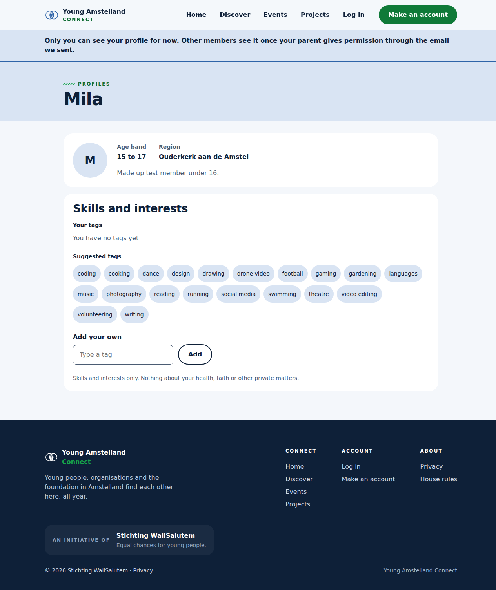
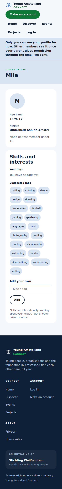

# Proof: tasks 130.1, 130.4 and 130.6 A parent's permission, a pending profile and the banner (#392, #395, #397)

Merge request !76, branch `feature/40-parent-permission`. Issue: 130 A young person under 16 asks a parent for permission (#40), since 23 October 2026 under 18. Files: `ParentConsent` and `ParentConsentVisibility` in `api/Connect.Domain/ParentConsents/`, `ResetToken` in `api/Connect.Application/PasswordResets/`, the table `parent_consent` with the migration `AddParentConsentTable`, the two profile queries, `web/src/components/profile/ParentConsentBanner.tsx` on My profile, their tests, `docs/architecture/api.md` and the page documents `docs/pages/CreateProfile.md` and `ParentConsent.md`.
Profile: Full Stack Software Developer, level 3. Portflow: Designing and Realising OR1, OR2, OR3, OR4 and OR5.

A point that needs someone else is marked TODO with who and what.

## OR1 Designing and building to a plan

School asks: "You design and implement systematically, justify choices in relation to alternatives, and adapt based on new insights."

1. **The request next to the profile.** A table `parent_consent` with one row per profile of a young person under 18, the rules of such a request in Domain (`IsUsable`, `Give`) and the rule who may see a waiting profile as one expression, so the query applies it before it selects anything.
2. **Built in the order that is safe.** First what keeps a young person out of sight: the table, the hiding and the banner. The form question and the email to the parent (#394, #396) need the mail sender of #387 and the token of #388, which do not exist yet, so the form cannot make a waiting profile yet. I made only the small `ResetToken` now, where #388 will use it.
3. **Following the code of the team.** Nick Hoebe's names and patterns: `profile_id` on his table `profile`, ids and dates from his `Entity`, the configuration inline in `ConnectDbContext`, the queries `GetPublicProfileQueryHandler` and `GetCurrentProfileQueryHandler` of #30 and #27 extended.
4. **What the client decided, and Gurpreet's review.** In the meeting with the client on 23 October 2026 the foundation decided that Connect asks a parent for every young person under 18, so the whole age band 15 to 17, and keeps a parent's address one month at most (questions 135 and 20 of `docs/client/clientQuestions.md`, notes by Gurpreet Singh). Gurpreet named both in his review of !76. A request now ends one month after it is made, as the constant `ParentConsent.KeepMonths`, which `Profile.AskParentConsent` uses, instead of a number of days each caller passes. The texts that said under 16 and the 14 days in the tests now follow the decision, and so do the page documents.
5. **Built again on the code of the team, 26 October 2026.** The first version of 20 October 2026 was built on the profile code from before Nick Hoebe's `IAppDbContext` of !50. I built it again on !75: the queries run through `IAppDbContext` with `AsNoTracking`, the database tests use the shared helpers of backend rule 20, the answer records have no `JsonPropertyName` (backend rule 21), and the banner sits in `components/profile/` (frontend rule 7).

## OR2 Choosing standards and methods

School asks: "You independently select relevant standards and methods from the field and substantiate why they fit the context."

1. **Only a hash of the token.** The table keeps the SHA-256 hash of the token and never the token itself (OWASP Forgot Password Cheat Sheet), with a unique index and a check of 64 characters.
2. **The same answer as an unknown member.** Another member who opens a waiting profile gets exactly the 404 "This member does not exist" of an unknown id, so nobody can tell that the profile exists.
3. **The law behind it.** The GDPR (article 8) and the Dutch UAVG (article 5) ask the permission of a parent before Connect may keep and show the profile of a young person under 16. The foundation asks it under 18, which is stricter and allowed.

## OR3 Involving stakeholders and weighing their feedback

School asks: "You proactively involve multiple stakeholders with diverse interests, coordinate systematically, and consciously weigh their feedback in your choices."

- TODO Wesley: the words, with the date and who, of a teammate who did not build this and of one person outside the team who saw the banner on a phone (#399), and the rules of #24 by Kelvin van Voorst once they are written.

## OR4 Validating the solution

School asks: "You systematically validate that the solution does what it should, and draw conclusions for improvement."

1. **The migration, made again after the rebase.** The first migration was made on 20 October 2026, so its name `20261020105652_AddParentConsentTable` sorted before `AddMemberDetailsToProfile` and `AddTagTables` of the profile and tag branches, as Gurpreet found in his review. I measured it on 26 October 2026: with the old files on a new database, `dotnet ef database update` ran the request table third, before the tag migration that creates the extension `citext`, and stopped with `42704: type "citext" does not exist`. Its designer file also still held the old shape of `profile_tag`. I removed it and made it again with `dotnet ef migrations add` on the newest model, as database rule 12 now says: `20261026053226_AddParentConsentTable` with the same `Up` and `Down`. On a new database all five migrations apply in order, it goes back to `AddTagTables` and applies again, and `has-pending-model-changes` finds no change.
2. **The tests.** `ParentConsentTests` (usable one second before the end and not at the end, after permission, with an empty address, permission twice keeps the first date), `ResetTokenTests`, database tests on PostgreSQL (profile and request saved together, a second request refused, the stored hash is not the token, deleting the profile deletes the request, a waiting profile found by its owner only and by everyone after permission), handler tests and `PendingProfileEndpointTests` on the whole server, and screen tests of the banner.
3. **Tests broken on purpose, again on 26 October 2026.** Without the rule in the public query, the handler test and the two endpoint tests where another member opens a waiting profile failed. With `/current` always saying pending, 2 handler tests and 3 endpoint tests failed. With the banner always shown, 3 screen tests failed. All passed again once the code was back.
4. **On the real server, on 20 October 2026.** With one waiting profile in the database, the owner got `"parentConsent":"pending"` and the banner, another member got the 404 body of an unknown id, and a visitor got 401. axe in the browser found 0 problems on My profile with the banner at 360 and 1280 pixels.
5. **Not covered yet.** The form question and the email (#394, #396), the seeded members Mila and Daan (#393), the browser test (#398) and the check by hand (#399).

## OR5 Impact on users and society

School asks: "In your design and implementation, you consciously take into account the broader impact on end users and society, while forming your own ethical judgment."

1. **Out of sight until a parent agrees.** A waiting profile is seen by its owner only, and no answer holds the address of the parent, the token or a date.
2. **My judgment.** I think hiding the whole profile, and not only the region, is right until a parent agrees, because the law asks permission before Connect may show it at all. The cost is that a young person of 15 to 17 has to wait. Until #387 can send the email nobody can give permission, so the form must not make such a profile before the email works.

## TODO

- [ ] Wesley: the OR3 line above, after the phone check of #399 and the rules of #24, before anyone approves !76.
- [ ] Wesley: after the merge, tick the boxes of the tasks with the evidence in a comment. No change to this branch for it.

## AI use

AI was used as a writing support tool while working on this document. We used AI to improve the formulation of sentences, the structure of wording, readability, and clarity of text that we had written. The content itself, including our experiences, reflections, learning goals, decisions, self-assessments, and conclusions, is our own. We reviewed the suggested changes and decided as a team which improvements to include.
