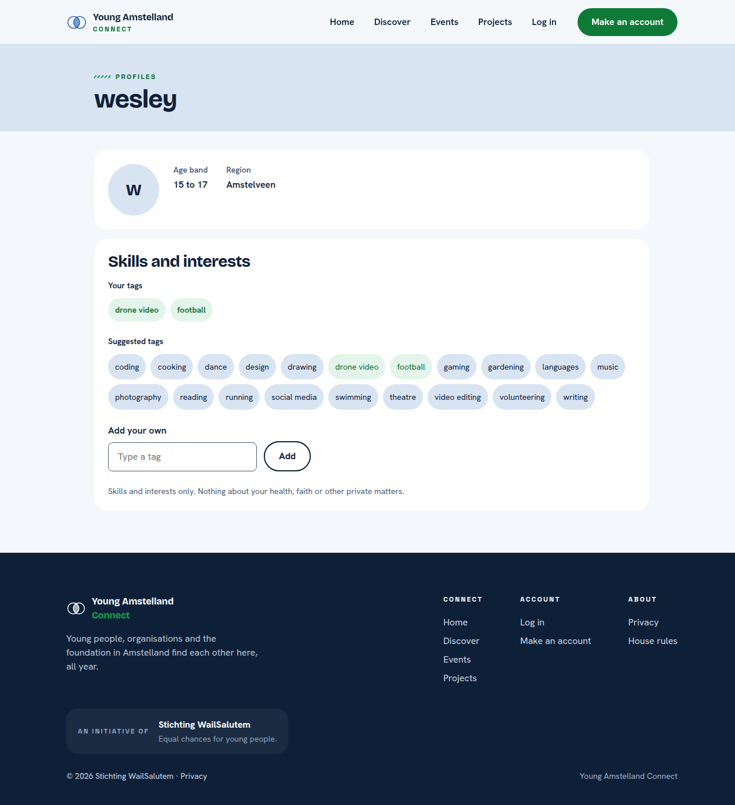
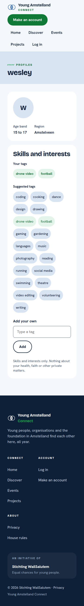

# Proof: tasks 36.1 to 36.3 Skills and interests as tags (#565, #566, #567)

Merge request !72, branch `feature/69-profile-tags`. Issue: 36 Add skills and interests as tags (#69). Files: `Tag`, `TagRules` and `ProfileTag` in `api/Connect.Domain`, the tables `tag` and `profile_tag` with the migration `AddTagTables`, the handlers in `api/Connect.Application/Profiles/ListSuggestedTags/` and `AddProfileTag/`, the endpoints `TagEndpoints.cs` and `MemberProfileTagEndpoints.cs`, the part Skills and interests on My profile with `web/src/components/TagInput.tsx`, their tests and `docs/architecture/api.md`.
Profile: Full Stack Software Developer, level 3. Portflow: Designing and Realising OR1, OR2, OR3, OR4 and OR5.

A point that needs someone else is marked TODO with who and what.

## OR1 Designing and building to a plan

School asks: "You design and implement systematically, justify choices in relation to alternatives, and adapt based on new insights."

1. **One tag model.** A table `tag` with one row per name and a link table `profile_tag` on Nick Hoebe's table `profile`. Football and football are the same tag, because the name is `citext` with a unique index. A tag stays when a profile is deleted, the link goes with it.
2. **Normalised before every check.** `TagRules.Normalize` takes the spaces off, turns every run of spaces into one and makes it small letters, before the validator and before the lookup, so "  Drone   Video " and "drone video" are one tag.
3. **Two members at the same moment.** When two members add the same new tag at once, the second insert hits the unique index and reads the tag the first one made, so nobody gets an error.
4. **The starter list.** Twenty suggested tags, only skills and interests, in small letters, nothing about health, faith, sexuality, politics or origin. It is a draft until the team agrees on it (question 9 of #11).

## OR2 Choosing standards and methods

School asks: "You independently select relevant standards and methods from the field and substantiate why they fit the context."

1. **Idempotent adding.** A tag the profile already has answers 200 with the same tag and changes nothing, a new link 201, so pressing twice is safe.
2. **Paging as text.** `page` and `pageSize` are read as text and checked, so `page=abc` gives a plain 400 and never a server error.
3. **An allow list for the length.** The database refuses a name over 30 characters with a check, the validator says so first in plain words.
- TODO Wesley: one line each on what I took from the BoKSA articles Database integration and Input validation and secure coding.

## OR3 Involving stakeholders and weighing their feedback

School asks: "You proactively involve multiple stakeholders with diverse interests, coordinate systematically, and consciously weigh their feedback in your choices."

- TODO Wesley: the team's answer on the starter list (question 9), with the date, and the words of a teammate and one person outside the team who added tags on a phone.

## OR4 Validating the solution

School asks: "You systematically validate that the solution does what it should, and draw conclusions for improvement."

1. **The migration.** On an empty database it applied, went back to `AddMemberDetailsToProfile` and applied again, and a second `migrations add` found no change:

```
$ dotnet ef database update
Applying migration '20261009065814_AddAccountTable'.
Applying migration '20261019205815_AddMemberDetailsToProfile'.
Applying migration '20261020075551_AddTagTables'.
Done.
$ dotnet ef database update AddMemberDetailsToProfile
Reverting migration '20261020075551_AddTagTables'.
Done.
$ dotnet ef database update
Applying migration '20261020075551_AddTagTables'.
Done.
```

2. **The tests.** `TagRulesTests`, database tests on PostgreSQL (FOOTBALL next to football refused, 31 characters refused, the starter list, a link twice refused, a used tag cannot be deleted, deleting a profile removes its links and keeps the tags), handler tests on SQLite, validator tests, and endpoint tests on PostgreSQL (201 then 200 with one link, two members typing the same new tag at once share one row, no profile 404, every address 401 without a login, `page=abc` 400, the own profile holds the tags sorted, 503 without the typed tag), and screen tests for TagInput and My profile.
3. **A test broken on purpose.** Without the catch of the unique index, the test of two members at the same moment failed in 6 runs out of 6, and passed again once the catch was back.
4. **In a real browser.** Tapping football and typing "Drone   Video" saved both, sorted, with Saved in a status area, axe 0 problems.




## OR5 Impact on users and society

School asks: "In your design and implementation, you consciously take into account the broader impact on end users and society, while forming your own ethical judgment."

1. **No sensitive tags in the list.** The hint says "Skills and interests only. Nothing about your health, faith or other private matters.", and the starter list holds none.
- TODO Wesley: my own judgment on tags a young person types themselves, which other members can read: should the foundation see new tags first?

## TODO

- [ ] Wesley: the TODO lines above.
- [ ] Wesley: after the merge, tick the boxes of the tasks with the evidence in a comment.

## AI use

AI was used as a writing support tool while working on this document. We used AI to improve the formulation of sentences, the structure of wording, readability, and clarity of text that we had written. The content itself, including our experiences, reflections, learning goals, decisions, self-assessments, and conclusions, is our own. We reviewed the suggested changes and decided as a team which improvements to include.
