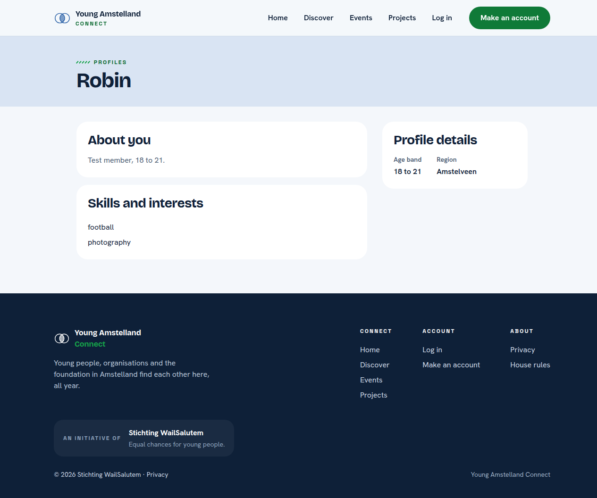

# Proof: tasks 36c.1 to 36c.3 The tags on the page of another member (#582, #583, #584)

Merge request !73, branch `feature/72-member-tags`. Issue: 36c See the tags on the page of another member (#72). Files: the public query and `ProfileVisibility.ShowsTags`, the field `tags` of `GET /api/member-profiles/{id}`, `web/src/components/TagList.tsx` on the page of another member, their tests and `docs/architecture/api.md`.
Profile: Full Stack Software Developer, level 3. Portflow: Designing and Realising OR1, OR2, OR3, OR4 and OR5.

A point that needs someone else is marked TODO with who and what.

## OR1 Designing and building to a plan

School asks: "You design and implement systematically, justify choices in relation to alternatives, and adapt based on new insights."

1. **One query.** The public query of #30 also reads the tag names of that profile, sorted by name, inside the same query, and never the ids or the link rows.
2. **The same rule as the short text.** `ProfileVisibility.ShowsTags` gives the same answer as the rule for the short text for every age band, so tags and short line are shown or hidden together.
3. **Built again on the code of the team, 26 October 2026.** The first version of 20 October 2026 was built on the profile code from before Nick Hoebe's `IAppDbContext` of !50. I built it again on !72: the query runs through `IAppDbContext` with `AsNoTracking`, the tests use the shared helpers of backend rule 20, the answer record has no `JsonPropertyName` (backend rule 21), and the screen reads the tags through `request()` of `client.ts` and the hook `useMemberProfile` (frontend rules 13 and 14). `TagList` stays in `components/`, because organisation profiles and opportunities will show tags too (frontend rule 7).

## OR2 Choosing standards and methods

School asks: "You independently select relevant standards and methods from the field and substantiate why they fit the context."

1. **Names only.** The answer holds the names of the tags and never their ids, because another member has nothing to do with an id.
2. **What I took from BoKSA.** The article API implementation asks for JSON with the same structure every time. The tags are one more field `tags` in the same `data` of the answer: a list of names, empty when there are none.

## OR3 Involving stakeholders and weighing their feedback

School asks: "You proactively involve multiple stakeholders with diverse interests, coordinate systematically, and consciously weigh their feedback in your choices."

- TODO Wesley: the words of a teammate who checked the tags of another member on a phone.

## OR4 Validating the solution

School asks: "You systematically validate that the solution does what it should, and draw conclusions for improvement."

1. **The tests.** Database tests for two tags sorted and never the tag of another profile, handler tests for tags passed on, a young person whose tags show like the short line and an empty list, endpoint tests on PostgreSQL where member B sees the sorted tag names of member A without ids, and screen tests for TagList and the member page.
2. **A test broken on purpose.** On 26 October 2026, without the filter on the own profile in the query, 2 of the 4 endpoint tests of the tags failed on PostgreSQL, and the 6 handler tests of the public profile failed on SQLite. All passed again once the filter was back. The screenshot is of the first version of 20 October 2026, and the page has looked the same since.
3. **Not covered yet.** The tags of the two seeded test members of task 36c.1 wait for the seeder of #276, #277 and #342.

## OR5 Impact on users and society

School asks: "In your design and implementation, you consciously take into account the broader impact on end users and society, while forming your own ethical judgment."

1. **Shown like the short text.** For a young person of 15 to 17 the tags show exactly when the short line shows.
2. **My judgment on the tags of a young person.** I would not hide them from adults. Tags are what Connect is for: someone who shares a skill finds a young person through them. A young person becomes findable through a name together with a place, and the region of 15 to 17 is already hidden. I would hide the tags only together with the whole profile, for a young person under 16 without permission (#40). The rule then stays the same as for the short line.

## TODO

- [ ] Wesley: the OR3 lines above, after a teammate and one person outside the team tried the page on a phone, before anyone approves !73.
- [ ] Wesley: after the merge, tick the boxes of the tasks with the evidence in a comment. No change to this branch for it.

## AI use

AI was used as a writing support tool while working on this document. We used AI to improve the formulation of sentences, the structure of wording, readability, and clarity of text that we had written. The content itself, including our experiences, reflections, learning goals, decisions, self-assessments, and conclusions, is our own. We reviewed the suggested changes and decided as a team which improvements to include.
