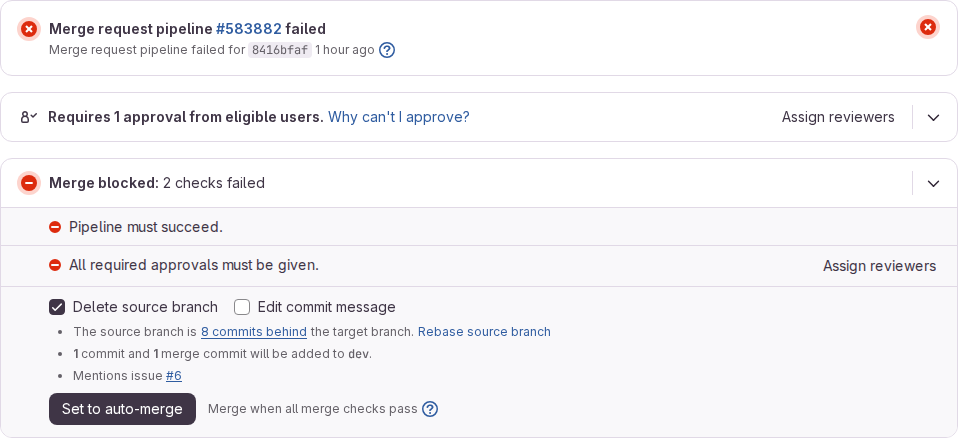

# Proof: task 1.4 The first pipeline (#5) and task 1.5 The red pipeline on purpose (#6)

Merge request !24, branch `chore/5-pipeline-build-and-test` (#5). Closed merge request !25, branch `test/1-red-pipeline`, deleted (#6). Issue: 01 The repository, the pipeline and the team rules (#1).
Profile: Full Stack Software Developer, level 3. Portflow: Managing and Collaborating MS1 and MS4 (#5), Organising and Realising OR4 (#6).

A point that needs someone else is marked TODO with who and what.

## MS1 Seeing risks early and keeping the work transferable

School asks: "You anticipate risks and bottlenecks in the process before they become problems and ensure that the work remains transparent and transferable."

1. **The risks the pipeline removes.** A committed `.env` with a password, caught by env-file-check, and a merge into main that skips dev, caught by branch-flow. Both need no code of the server or the screen, so they work from the first commit, before #266 adds the builds and tests.
2. **A risk found while checking.** `docs/team/gitlabSetup.md` said Pipelines must succeed was switched on after branch-flow was merged. The project settings, read through the GitLab API on 8 October 2026, said it was off. The team had read its role as Developer, but a test through the API the same day showed the five students are Maintainer, so I switched Pipelines must succeed on that evening. The document now says it is on, and code conventions rule 11 adds the reviewer rule on top of it.
3. **The bottleneck watched for: a slow pipeline.** The pipeline of !24 took 4 seconds, plus 2 seconds waiting for a runner (pipeline 583862, 8 October 2026). The limit in the task is ten minutes.
4. **Checked before the push.** The file was valid in the GitLab CI lint of the project (the same check as Build, Pipeline editor) before the first push.

## MS4 Making the work fit with the work of the team

School asks: "You ensure that your work aligns with that of others and contributes to the joint result."

1. **The stages and the branch flow.** Every merge request gets one pipeline, and dev and main run once more after a merge, so the merged result is checked too. A push to a branch with an open merge request starts no second pipeline. branch-flow only runs on merge requests, because it reads the merge request branches.
2. **What #266 adds.** backend-build and frontend-build go into stage build, backend-test, frontend-lint and frontend-test into stage test. The comment on top of `.gitlab-ci.yml` says so, so the file grows without being rewritten.
3. **The part Pipeline in `docs/team/gitlabSetup.md`.** When it runs, what each job checks, the reviewer rule, and three steps for a red run.
4. **A teammate who read a pipeline log with only the part Pipeline.**
   - TODO reviewer of !24: read a red log with only the part Pipeline, and write in the review whether it was clear.

## OR4 Validating the solution (#6)

School asks: "You systematically validate that the solution does what it should, and draw conclusions for improvement."

1. **Expected before the push.** env-file-check red with `./.env` in its log, branch-flow green, no approval, then green after `git rm --cached .env`.
2. **What happened.** Pipeline 583863: env-file-check failed after 4 seconds with "Env files must not be committed:" and `./.env`, branch-flow green. Pipeline 583865: green. No approval on !25. The merge request was closed without merging and the branch deleted.
3. **The difference.** The task expects to see the merge blocked. The merge request was a draft, and Pipelines must succeed was still off, so this run does not prove that GitLab locks the button on red. It proves the check finds the file. A second red run on 9 October 2026, after the setting was on, closes that gap: merge request !32 (pipeline #583882, dotenv-check red on ./.env) shows "Merge blocked: 2 checks failed" with "Pipeline must succeed." first, and no Merge button. The merge checks of the API list CI_MUST_PASS as FAILED apart from NOT_APPROVED, so the red pipeline alone blocks the merge. The screenshot is in the description of !32, which was closed without merging.

   

4. **Not covered yet.** The builds and tests of the server and the screen (#266).
5. **Improvement made.** Pipelines must succeed is switched on since 8 October 2026, written in `docs/team/gitlabSetup.md`.
   - TODO reviewer of !32, who did not do #5: confirm in a comment on !32 that the red run could not be merged and got no approval.
   - TODO Wesley: add the screenshots of the red run with the log open and of the green run to !25.
   - TODO reviewer of !25, who did not do #5: confirm in a comment on !25 that the red run got no approval.

## TODO

- [ ] Reviewer of !24: read a red log with only the part Pipeline and write whether it was clear.
- [x] Wesley: after the merge of !24, add the link of the first run on dev here. The first run on dev is pipeline 583948 of 9 October 2026: https://gitlab.fdmci.hva.nl/studio/social-impact-apps/onderwijs/projects/2026-2027-semester-1/projects/project-9-wail-salutem-foundation-project-2/connect-nine/-/pipelines/583948
- [ ] Wesley: screenshots in !25.
- [ ] Reviewer of !25: confirm that the red run got no approval.
- [x] Wesley: switch on Pipelines must succeed (done 8 October 2026).
- [x] Wesley: one more red run with a screenshot of the locked Merge button (!32, 9 October 2026).
- [ ] Reviewer of !32: confirm that the red run could not be merged and got no approval.

## AI use

AI was used as a writing support tool while working on this document. We used AI to improve the formulation of sentences, the structure of wording, readability, and clarity of text that we had written. The content itself, including our experiences, reflections, learning goals, decisions, self-assessments, and conclusions, is our own. We reviewed the suggested changes and decided as a team which improvements to include.
