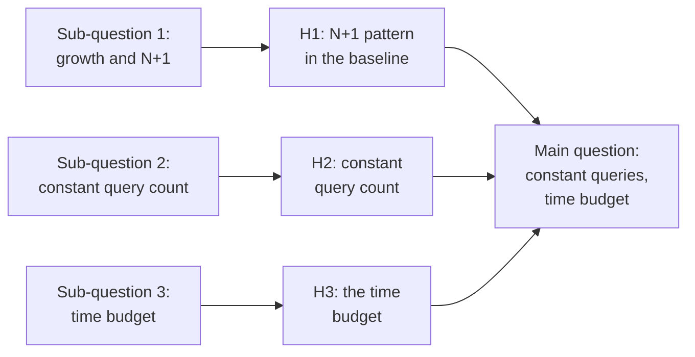
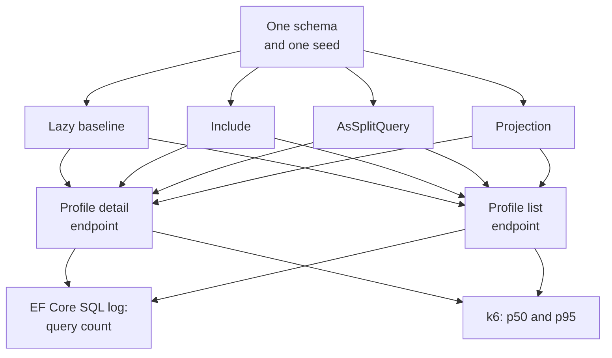
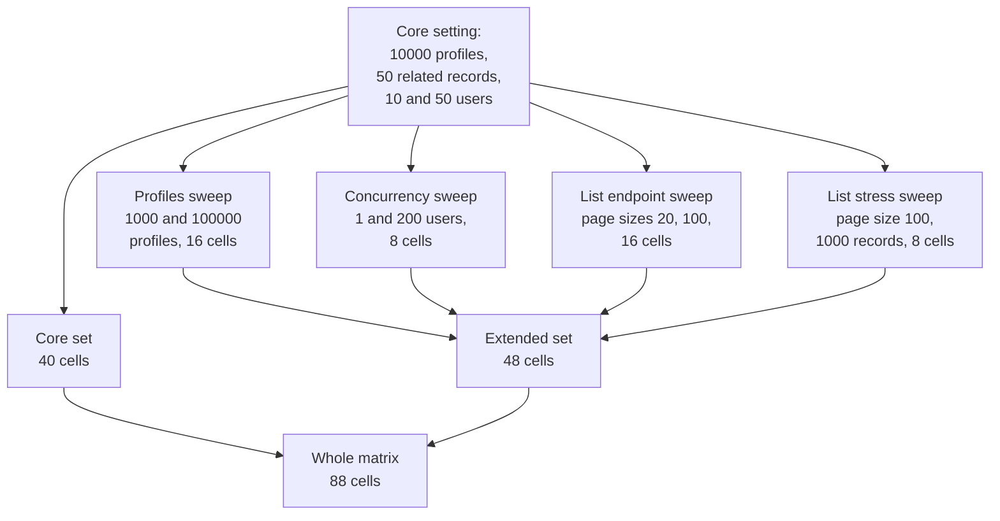
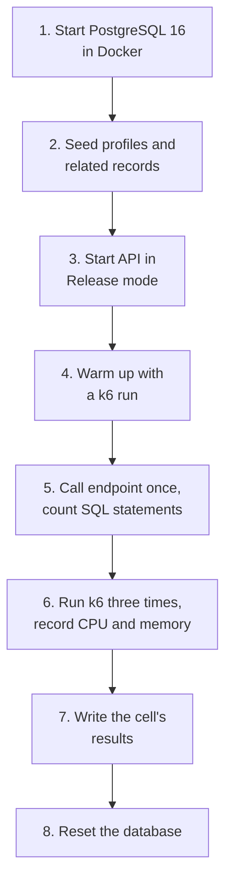

# Research plan: keeping the profile endpoints of Young Amstelland Connect fast as related data, data volume and users grow

## Table of Contents

- [1. Introduction](#1-introduction)
- [2. Terms and identifiers used](#2-terms-and-identifiers-used)
- [3. Current situation](#3-current-situation)
- [4. Problem definition](#4-problem-definition)
- [5. Main question and sub-questions](#5-main-question-and-sub-questions)
- [6. Research method](#6-research-method)
- [7. Validity and reliability](#7-validity-and-reliability)
- [8. Why several ranges and which](#8-why-several-ranges-and-which)
- [9. Method per sub-question](#9-method-per-sub-question)
- [10. Acceptance criteria for the research](#10-acceptance-criteria-for-the-research)
- [11. What this research produces as evidence](#11-what-this-research-produces-as-evidence)
- [12. Global planning](#12-global-planning)
- [13. Risks and limits](#13-risks-and-limits)
- [14. Conclusion](#14-conclusion)
- [References](#references)
- [Appendix A: Experiment matrix and measurement protocol](#appendix-a-experiment-matrix-and-measurement-protocol)
- [AI use declaration](#ai-use-declaration)

## 1. Introduction

I am Wesley Oerlemans, Full Stack Software Developer at level 3 in the Social Impact Apps
studio. This is the first version of my research plan, my Plan van Aanpak, for the Research &
Design datapoint of sprint 1, named in the course's own level 3 datapoint sheet. It is dated 5
October 2026.

Our team builds Young Amstelland Connect, where users find and connect with other users,
organizations and opportunities, per the team's product vision. My experiment design gives
profiles related data to load, which is why I expect the profile endpoints to be the first
place slow data access shows.

This plan supersedes my research proposal of 23 September 2026 on two points. The database is
PostgreSQL 16 and not SQL Server, as I decided on 26 September 2026. I decided on 5 October
2026 that the main question is a design question and not a comparison, because a comparison of
two options is not real research.

## 2. Terms and identifiers used

This section gives the plain meaning of every requirement code, acceptance criterion,
hypothesis, learning outcome code and abbreviation used below, so each one is readable on its
own and not only next to its full definition.

| Term or code | Meaning | Source |
| --- | --- | --- |
| FR1 | Profiles: users and organizations can create and maintain a profile | requirements document |
| FR2 | Community interaction and matching | requirements document |
| FR9 | Badges and achievements | requirements document |
| NFR2 | GDPR footing: processing personal data of users, some of them minors, carries GDPR obligations | requirements document |
| NFR4 | Responsiveness, proposed, no numeric target yet | requirements document |
| NFR5 | Availability, proposed, no numeric target yet | requirements document |
| AC1 | N+1 pattern reproduced in the baseline | this document |
| AC2 | Identical conditions for every variant | this document |
| AC3 | Query counts from the logs | this document |
| AC4 | Response times from k6 | this document |
| AC5 | Core matrix complete | this document |
| AC6 | Recommendation follows the data | this document |
| AC7 | Every hypothesis decided by the data | this document |
| AC8 | Validity controls applied and logged | this document |
| AC9 | Synthetic data only | this document |
| AC10 | Advice in two forms | this document |
| AC11 | Stakeholder feedback recorded | this document |
| AC12 | Changes of approach recorded | this document |
| H1 | Hypothesis for sub-question 1: the N+1 pattern in the baseline | this document |
| H2 | Hypothesis for sub-question 2: a constant query count | this document |
| H3 | Hypothesis for sub-question 3: the time budget | this document |
| AA1 | Analysing & Advising, level 3: independently determine a research approach that suits the issue and adapt it based on what comes up | BoKSA |
| AA2 | Analysing & Advising, level 3: a critical attitude that questions sources, AI results, the problem statement and one's own assumptions | BoKSA |
| AA3 | Analysing & Advising, level 3: analyse issues from multiple perspectives and weigh the societal and ethical consequences | BoKSA |
| AA4 | Analysing & Advising, level 3: well-founded advice that weighs alternatives, identifies risks and makes a substantiated recommendation | BoKSA |
| AA5 | Analysing & Advising, level 3: adapt communication to different target groups in form and language | BoKSA |
| OR1 | Designing & Realising, level 3: design and implement systematically, justify choices against alternatives and adapt on new insights | BoKSA |
| OR2 | Designing & Realising, level 3: select relevant standards and methods and substantiate why they fit the context | BoKSA |
| OR3 | Designing & Realising, level 3: involve multiple stakeholders and weigh their feedback in the choices | BoKSA |
| OR4 | Designing & Realising, level 3: systematically validate the solution, evaluate its quality and draw conclusions for improvement | BoKSA |
| OR5 | Designing & Realising, level 3: take the broader impact on end users and society into account and form a personal ethical judgement | BoKSA |
| BoKSA | Body of Knowledge, Skills & Attitude: the shared knowledge base of the studio profiles, which gives the learning outcomes per level | BoKSA |
| N+1 | The query pattern where one query loads a record and a separate query runs for each related record | this document |
| ORM | Object-relational mapping: a library that maps program objects to database tables, Entity Framework Core here | this document |
| API | Application programming interface | this document |
| SQL | Structured Query Language | this document |
| JSON | JavaScript Object Notation | this document |
| JIT | Just-in-time compilation: code compiled while the program runs | this document |
| NAT | Network address translation | this document |
| CPU | Central processing unit | this document |
| GDPR | General Data Protection Regulation, the AVG in Dutch | requirements document |
| p50 | Median response time | this document |
| p95 | 95th percentile response time | this document |
| k6 | A load testing tool | this document |
| R&D | Research and development, as in the course's R&D report | this document |
| TBD | To be decided | this document |

## 3. Current situation

We are a team of five, per the team's tech stack document. Four of us take the Full Stack
Software Developer profile, and of those four only Nick Hoebe has worked with .NET and Entity
Framework Core before this semester. The other three, me included, have not. Kelvin van
Voorst, on the Security Specialist profile, knows C# and .NET, but Entity Framework Core is not
in his skill inventory. I read this as meaning our data access design rests on one person's
experience.

Per the team's tech stack document, the frontend is React, the backend is ASP.NET Core on .NET
with Entity Framework Core for data access, and the database is PostgreSQL 16 through the
`Npgsql.EntityFrameworkCore.PostgreSQL` provider (Npgsql, n.d.-b), run in Docker from the
`postgres:16` image.

Per the requirements document, FR1 (profiles) says users and organizations can create and
maintain a profile, and FR9 (badges) names badges. I based the experiment's own schema on
both: Profile linked to Skill, Organization and Badge is my design, not one the requirements
document specifies. I expect matching under FR2 (matching) to read many profiles in one
request, which is why the list endpoint is in the experiment. NFR4 (responsiveness) is proposed
in that same document and asks for a responsive platform, but it sets no response time. So
nobody can say yet when a profile endpoint is fast enough.

### The business case

Per the team's product vision, the business case for Connect is impact, not revenue. The
WailSalutem Foundation is a nonprofit organization, which the team's product vision records.
Three threads follow from that, per the team's product vision: visibility, motivating young
people and showing the collaboration with the HvA. No funding model and no success numbers
are set yet, per the team's product vision.

### Stakeholders and their interests

Per the team's problem analysis, these are the seven stakeholder groups named in the client's
brief, with their interest in Connect in the project's own words. The third column is my
assessment of what this research means for each group.

| Stakeholder group | Their interest in Connect | What this research means for them |
| --- | --- | --- |
| Young people, nominees, winners, and YAA alumni | A place to stay visible and keep finding opportunities after the gala, not only during it | This group reads and holds the profiles my experiment measures. The profile endpoint's response time bears on them directly. |
| Jury members, ambassadors, mentors, and experts | A way to stay connected to the talent they judge or advise, beyond the one evening they meet it | This group browses the related records on a profile, skills, organizations and badges in my experiment's schema. The loading design is meant to keep exactly that fast. |
| Municipalities and youth work | A partner platform that reaches young people across Amstelland year-round | This group's reach grows with the number of profiles on the platform. My experiment steps through that same profile count. |
| Schools and educational institutions | A channel connecting students to real showcases and opportunities | A showcase would sit on a profile the same way the skills, organizations and badges in my experiment do, so the same response time bears on it, even though showcases are outside my schema. |
| Companies and entrepreneurs | A way to find and support the talent the awards surface | Finding talent means browsing the profile list endpoint my experiment measures. Its response time bears on how usable that search feels. |
| Social, cultural, and sports organizations | A community layer that reaches young members and volunteers | This group's activity grows the number of profiles and related records over time. My experiment's ranges step through that same growth. |
| Partners, funds, and other organizations offering opportunities | A platform to publish and match opportunities to the right young people | My experiment's schema does not model opportunities directly, but a faster profile endpoint still serves a match, since a match surfaces the same profile data my experiment measures. |

### Business interests this research serves

In my reasoning, a measured loading design and a numeric NFR4 (responsiveness) target serve
the business case above. Visibility and motivating young people both depend on profiles
staying fast as the platform grows, which sub-questions 2 and 3 test directly. Showing the
collaboration with the HvA is served by a number the research itself produces, not a guessed
one.

## 4. Problem definition

I define the problem through the W-questions.

The Who row rests on the team's tech stack document for team composition. The Where row rests
on the same document for the stack, and names my own experiment's endpoints. The When row
rests on the team's delivery plan. The Why row carries its own citations in the table. The
What and How rows are my own framing of the problem and method.

| W-question | Answer |
| --- | --- |
| Who | The team building Connect, with me as researcher. Only Nick Hoebe knows Entity Framework Core, so the rest of us need measured ground. |
| What | A straightforward Entity Framework Core implementation can send a separate query for every set of related records. We do not know how fast query count and response time grow, or which technique contains them. |
| Where | The profile detail and profile list endpoints, on ASP.NET Core and Entity Framework Core against PostgreSQL 16. |
| When | Now, before the pattern spreads to more endpoints in sprints 2 and 3. Later, as related records, profiles and users grow. |
| Why | Microsoft warns: "Lazy loading can cause unneeded extra database roundtrips to occur (the so-called N+1 problem), and care should be taken to avoid this" (Microsoft, n.d.-d). Even in a defense of object-relational mapping tools, Fowler concedes that such systems often perform badly because of naive interactions with the underlying database (Fowler, 2012). |
| How | Through the number of SQL (Structured Query Language) queries per request and the response time a user waits for. Neither is measured on this stack yet. |

My purpose is a measured design for both endpoints, and a numeric target for NFR4 (responsiveness).

The techniques themselves are known from Microsoft's documentation. What is unknown is how
they behave on this stack and at these ranges, not whether a technique exists. That is what I
research.

## 5. Main question and sub-questions

**Main question:** How can the profile endpoints of Young Amstelland Connect, built with ASP.NET
Core and Entity Framework Core on PostgreSQL 16, be designed so that their number of SQL queries
stays constant and their response time stays within a defined user-facing budget as the number
of related records per profile, the number of profiles in the database and the number of
concurrent users grow?

The 200 millisecond budget I use in sub-question 3 is a design requirement I set and then
test, not an assumed answer, so the research can also show that no technique holds it.

**Sub-question 1:** To what extent do the number of SQL queries and the response time of a
straightforward implementation of the profile detail endpoint and the profile list endpoint
grow across these ranges, and does that growth show the N+1 pattern (one query plus one extra
query per related record) that Entity Framework Core's documentation warns about?

I design this sub-question to prove the problem exists on our stack and how fast it grows, so
the main question rests on a measured problem.

**Sub-question 2:** Which of Entity Framework Core's data loading techniques, eager loading with
Include, split queries with AsSplitQuery, and projection with Select into a data transfer
object, if any, keep the query count of both endpoints constant across the same ranges?

I design this sub-question to keep only the techniques that meet the first half of the main
question, a constant query count.

**Sub-question 3:** Which of those techniques, if any, keeps the response time within the 0.1
second and 1.0 second limits and within the proposed 200 millisecond budget at each concurrency
level, and at which combination of related records, profiles and concurrent users does each
technique first cross each limit, if it crosses it at all?

I design this sub-question to test the second half, the time budget, so the answer is the
technique that passes sub-questions 2 and 3, or the finding that none does.

It is a design question and not a comparison because the course's research topic rubric marks
exploratory what-is questions unsatisfactory and wants sub-questions that each imply an
experiment, and because the answer is a measured recommendation for Connect.

### Hypotheses

I state one hypothesis per sub-question before any data exists. Each is phrased so the data
can reject it.

- **H1, the N+1 pattern in the baseline.** The lazy baseline's query count per request rises
  with every related record step on the detail endpoint and with the page size on the list
  endpoint, and its p95 rises with it. Microsoft warns that lazy loading can cause "unneeded
  extra database roundtrips" (Microsoft, n.d.-d). Chen et al. (2014) describe the same shape as
  the one-by-one processing anti-pattern. The data rejects H1 if the baseline's query count
  stays the same across the related record steps.
- **H2, a constant query count.** Include, AsSplitQuery and projection each keep the query
  count per request the same at every related record step. Include can load related data from
  several relationships "in a single query" (Microsoft, n.d.-b). Split queries "generate an
  additional SQL query for each included collection navigation" (Microsoft, n.d.-e), so per
  collection and not per record. For projection I expect the same as for Include. The data
  rejects H2 for a technique if its query count changes between related record steps.
- **H3, the time budget.** At 50 concurrent users in the core set, projection holds p95 within
  the 200 millisecond budget up to a higher related record step than Include and AsSplitQuery,
  and Include crosses it first. When sibling collections are joined in one query, relational
  databases return a cross product, and Microsoft warns that this "cartesian explosion" can
  "cause huge amounts of data to unintentionally get transferred to the client" (Microsoft,
  n.d.-e). Projection pulls back only the needed columns (Microsoft, n.d.-c). Chen et al.
  (2016) found that resolving redundant data problems could improve the response time of the
  systems they studied by 17% on average. The data rejects H3 if projection does not hold the
  budget longest, or if Include is not the first to cross it.

The diagram below shows how the three sub-questions and their hypotheses feed the main
question.

## 6. Research method

I classify this research as a quantitative experiment with desk research for the baseline, and
not as field research. My desk research comes first, so my experiment tests a problem the
literature already names.

### Theoretical framework

My experiment sits in two bodies of work. The first is how object-relational mapping (ORM)
tools behave. An ORM maps program objects to database tables, and Fowler (2012) calls this
work "synchronizing between two quite different representations of data". I read the N+1
pattern as one result of that gap. Chen et al. (2014) name two ORM performance anti-patterns.
Excessive data retrieves data the code does not use. One-by-one processing repeats similar
database operations in a loop. In their case studies, fixing the anti-patterns they detected
could improve response time by up to 98% (Chen et al., 2014).

The second body of work is the response time limits a user experiences (Nielsen, 1993). The
first frame tells me which query patterns to expect. The second tells me when a pattern starts
to matter to a user. This means I read my query counts against the ORM anti-patterns and my
response times against Nielsen's limits.

### The experiment

I will build a minimal ASP.NET Core Web API (application programming interface) against a
seeded PostgreSQL 16 database in Docker, with Profile linked to Skill, Organization and Badge.
The experiment must:

- Expose `GET /profiles/{id}` and `GET /profiles?page=&size=`.
- Build both endpoints in four variants on one schema and one seed.
- Return the same JSON (JavaScript Object Notation) shape from every variant.
- Count SQL queries per request through Entity Framework Core's logging.
- Measure response time with k6 (a load testing tool) as p50 and p95 (median and 95th
  percentile response time), the median of three runs, with the spread of the three.

The four variants:

- straightforward lazy loading, the baseline (Microsoft, n.d.-d)
- eager loading with Include (Microsoft, n.d.-b)
- split queries with AsSplitQuery (Microsoft, n.d.-e)
- projection with Select into a data transfer object (Microsoft, n.d.-c)

The diagram below shows the experiment set-up. One schema and one seed feed all four
variants. Both endpoints run against each variant, and the Entity Framework Core SQL log
and k6 measure both.

### Data and ethics

My experiment uses only synthetic data, generated by my seed script. It holds no personal data
of real users. Per the team's requirements document, Connect's user base spans ages 15 to 30,
so some users are minors. That document's NFR2 (GDPR footing) says that processing their
personal data carries GDPR (General Data Protection Regulation) obligations. Keeping real data
out of my experiment means no user's data, and no minor's data, is at risk in my runs.

The users also matter for how I read my results. In my reasoning, a slow endpoint adds to
whatever an older phone or a weak connection already costs, so the slowest responses weigh
heaviest for the users with the least. My lab machine measures neither of those. This is why I
hold p95, and not only p50, against the limits.

### Decision points

I decide now what I will do when the research meets something this plan does not expect. Every
change of approach goes into a change log in the R&D report, with its date and its reason.

- **The baseline shows no N+1 pattern.** If H1 (the N+1 pattern in the baseline) is rejected, I
  first check the logged SQL against my schema and my lazy loading setup. If the setup is
  right, I report the missing pattern as a finding, and the research continues on response
  time alone.
- **A seed does not fit.** If the first seed run shows that a step does not fit in Docker
  locally, I report its cells as not run, as section 13 says, and record the step in the change
  log.
- **No technique holds the budget.** If no technique stays within 200 milliseconds, I report
  each technique's crossing points. My advice then names the technique that holds the budget up
  to the highest step, and the NFR4 (responsiveness) target the data does support.

## 7. Validity and reliability

A difference between two variants only counts if the variants differ in nothing but their
loading technique. The table names each threat to that, why it matters and the control I will
apply. I apply every control in every measured cell and note it in that cell's run record, and
AC8 (Validity controls applied and logged) checks this.

| Threat | Why it matters | My control |
| --- | --- | --- |
| Warm-up and JIT compilation | .NET first generates code quickly and generates optimized code later in the background (Microsoft, n.d.-a). Georges et al. (2007) describe for Java how JIT (just-in-time) compilation makes execution time differ from run to run, and I expect the same on .NET. | A k6 warm-up run before every measured run, of the same fixed duration in every cell, that is not recorded. The API runs in Release mode. |
| Database and connection pool caching | PostgreSQL holds data in shared memory buffers (PostgreSQL Global Development Group, n.d.-a), and Npgsql pools connections by default (Npgsql, n.d.-a). In my reasoning, a first request pays costs that a later one does not. | The warm-up run fills the buffers and the pool, so every variant is measured warm. I reset the database before every new profile or related record step, per Appendix A.2, and my report states that its times are warm times. |
| Background noise on the machine | By default a container has no resource constraints and can use as much of a resource as the host's kernel scheduler allows (Docker Inc., n.d.). So in my reasoning, every other process on the machine competes with the run. | I close other applications, run every cell on the same machine and record CPU (central processing unit) and memory use during each run. |
| Docker overhead | Felter et al. (2015) measured Docker close to native performance, with the difference approaching 2% at higher concurrency. They also found that Docker's NAT (network address translation) adds overhead for workloads with high packet rates. | Every variant runs against the same container with the same network settings, so the overhead is the same for all four. I compare the variants with each other and do not read my absolute times as test site times, per section 13. |
| Synthetic data shape | In my reasoning, generated values can differ from real profiles in text length and in how related records spread over profiles. That changes how much data each query moves. | My seed script fixes the number of related records per profile for each step. I describe the seed's shape beside the results and claim nothing about real data. |
| k6 on the same machine as the API | The k6 documentation advises monitoring the load generator's CPU, memory and network, and notes that errors k6 logs can indicate limitations of the load generator machine (Grafana Labs, n.d.). | I record CPU and memory during each run. A run where the machine itself is the limit is marked in the results and not used for a crossing point. |
| Run-to-run variance | Georges et al. (2007) found that execution time differs from run to run, and they use confidence intervals to tell random fluctuation from a real difference. Papadopoulos et al. (2021) ask for repeated experiments and for every aggregated value to be reported with the variation around it. | Three runs per cell. I report the median and the spread, the lowest and highest of the three, for p50 and p95. In my judgement, a difference smaller than the spread is no difference. |
| PostgreSQL planner and SQL Server documentation | PostgreSQL devises a query plan for each query it receives, and choosing the right plan for the query and the data is critical for good performance (PostgreSQL Global Development Group, n.d.-b). Microsoft's documentation names SQL Server in places (Microsoft, n.d.-e). | I measure on PostgreSQL 16 itself and read no SQL Server example as a PostgreSQL result. Where two variants differ in a way their query counts do not explain, I look at their plans with EXPLAIN. |
| Reproducibility | Papadopoulos et al. (2021) ask for a description of the hardware and software setup, including software versions, and for the software, data and scripts of an experiment to be made available. | A fixed random seed in the seed script. I record the exact versions of PostgreSQL, .NET, Entity Framework Core, Npgsql and k6 and the machine's hardware in my report. I publish the experiment code, seed script, k6 scripts and results together, so another student can repeat a cell. |

Two of my checks are about sources and not about the machine. Microsoft's guidance is partly
written against SQL Server, so I test it on PostgreSQL before I rely on it.

## 8. Why several ranges and which

### Why I chose these ranges

The requirements document sets no numeric scale target for NFR4 (responsiveness) or NFR5
(availability). I judge that one
range would prove one point and would not show where a design breaks. So I step every
dimension over a wide range and report, per limit, the first combination where a technique
crosses it.

| Dimension | Steps |
| --- | --- |
| Related records per profile | 1, 10, 50, 200, 1000 |
| Profiles in the database | 1000, 10000, 100000 |
| Concurrent virtual users | 1, 10, 50, 200 |
| List page size | 20, 100 |

The step of 1000 is my deliberate stress point, chosen to find where a design breaks. The
requirements set no scale target, so this is not a number Connect is known to need.

### The response time limits

Of the three limits Nielsen (1993) describes, I use two. At 0.1 second a user feels that the
system reacts instantaneously (Nielsen, 1993). At 1.0 second the user's flow of thought stays
uninterrupted, though the user notices the delay (Nielsen, 1993). Between them I set a working
budget of 200 milliseconds. I propose it to the team as the numeric target NFR4 (responsiveness)
lacks. I hold p50 and p95 against all three.

### What runs first

At the 4 hours a week I spend on this, the full matrix may not fit. My core set runs first: the
detail endpoint at 10000 profiles, all related record steps, 10 and 50 users and all four
variants, 40 cells. My extended set follows as four sweeps, each moving one dimension away from
the core setting of 10000 profiles, 50 related records and 10 and 50 users while holding the
rest fixed: a profiles sweep at 1000 and 100000 profiles, a concurrency sweep at 1 and 200
users, a list endpoint sweep at page sizes 20 and 100, and a list endpoint stress sweep at page
size 100 with 1000 related records. That is 48 extended cells, 88 in total, each run three
times, for 264 runs.

The diagram below shows the core set and the four sweeps around it, with the cell counts
from this section.

A full cross product of every step on every dimension would be 720 cells, and its largest cell
would seed 100000 profiles with 1000 related records each, 100 million rows, which four hours a
week cannot carry. I run one dimension at a time, which still shows where each variant breaks
on that dimension, at the cost of not seeing interactions between two dimensions moving
together, which section 13 names as a limit.

## 9. Method per sub-question

| Sub-question | Method | What is measured or read | Ranges | Output |
| --- | --- | --- | --- | --- |
| 1 | Desk research, experiment | Query log and k6 times of the lazy baseline | All steps, core set first | Growth per step, checked for N+1 |
| 2 | Experiment | Query log of the other three variants | As sub-question 1 | Variants with a constant query count |
| 3 | Experiment | k6 p50 and p95 per variant at each concurrency level | As sub-question 1 | Crossing point per limit for each variant that crosses one |

## 10. Acceptance criteria for the research

These are my acceptance criteria for this research, and I check each one before I call a phase
done.

| ID | Criterion | How I check it | BoKSA level 3 outcome | BoKSA article |
| --- | --- | --- | --- | --- |
| AC1 | **N+1 pattern reproduced in the baseline.** The lazy baseline's query count per request rises with every related record step on the detail endpoint and with the page size on the list endpoint. | I read the query count per step from the Entity Framework Core log into the results file and compare it across the five related record steps and the two page sizes. | AA2, critical attitude: I test the problem statement before I build on it | Scalability & performance advisory (Hogeschool van Amsterdam, n.d.-g): diagnose which layer (app, database, network) is the likely bottleneck for a given performance problem |
| AC2 | **Identical conditions for every variant.** The four variants of a cell run on the same seed script and random seed, the same machine, the same PostgreSQL 16 container settings, the same Release build and the same k6 script. | The run record of every cell names the random seed, the image version, the commit of the experiment code and the k6 script. I compare them across the four variants before I analyse the cell. | OR1, systematic design and implementation | Performance & compatibility assessment (Hogeschool van Amsterdam, n.d.-e): show a measurable improvement in load time |
| AC3 | **Query counts from the logs.** Every query count in the results is read from Entity Framework Core's SQL log, never estimated. | Each count in the results file points to the saved log of its request, and I recount one cell per variant by hand from that log. | OR4, systematic validation | Database integration (Hogeschool van Amsterdam, n.d.-b): explain what an ORM is and why it's used |
| AC4 | **Response times from k6.** Every response time is a k6 p50 and p95, the median of three runs, reported with the spread of the three. | The k6 summaries of all three runs of every cell are saved. The results file holds the median, the lowest and the highest value for p50 and p95. | OR2, relevant standards and methods | Performance & compatibility assessment (Hogeschool van Amsterdam, n.d.-e): show a measurable improvement in load time |
| AC5 | **Core matrix complete.** All 40 cells of the core set are run three times and reported, with the crossing point per limit for each variant that crosses one. | The core results file has 40 rows of three runs each, and any cell not run is listed with its reason. | OR1, systematic design and implementation | Scalability & performance advisory (Hogeschool van Amsterdam, n.d.-g): diagnose which layer (app, database, network) is the likely bottleneck for a given performance problem |
| AC6 | **Recommendation follows the data.** The recommendation names one technique and a numeric target for NFR4 (responsiveness), weighs the technique against the other three with their risks, and points to the cells it rests on. | I trace every claim in the Advice document to a row in the results files, and I remove a claim that has no row. | AA4, well-founded advice | Non-functional requirements & quality attribute analysis (Hogeschool van Amsterdam, n.d.-d): express non-functional requirements as concrete, measurable quality attribute scenarios, and communicate trade-offs with a clear, justified recommendation |
| AC7 | **Every hypothesis decided by the data.** H1 (the N+1 pattern in the baseline), H2 (a constant query count) and H3 (the time budget) are each confirmed or rejected with the data, in the wording of section 5, never reworded after the results. | The report gives one verdict per hypothesis with the cells that decide it. I compare its hypothesis wording with section 5 of this plan. | AA2, critical attitude: I question my own assumptions | Technical architecture decision making (Hogeschool van Amsterdam, n.d.-j): justify a choice using structured argumentation, not just preference |
| AC8 | **Validity controls applied and logged.** Every control in section 7 is applied in every measured cell and noted in its run record. | I check each cell's run record for the warm-up, the versions, the CPU and memory readings and the three runs. A cell that misses one is rerun or marked. | OR4, systematic validation | Scalability & performance advisory (Hogeschool van Amsterdam, n.d.-g): diagnose which layer (app, database, network) is the likely bottleneck for a given performance problem |
| AC9 | **Synthetic data only.** The seed holds only generated values and no personal data of real users. | I read the seed script before the first run and check a sample of seeded rows against it. | OR5, impact on end users and society, and AA3, societal and ethical consequences | Secure coding practices (Hogeschool van Amsterdam, n.d.-h): apply Privacy by Design, minimising data collection |
| AC10 | **Advice in two forms.** The advice exists as a technical version for the team and a plain version for the WailSalutem Foundation. | The team version holds the numbers and the code pattern. The plain version has no Entity Framework Core terms, and I ask a reader outside the team to tell me what it means for users. | AA5, communication adapted to target groups | Stakeholder engagement & presentation (Hogeschool van Amsterdam, n.d.-i): adjust the level of detail to the audience, technical or non-technical |
| AC11 | **Stakeholder feedback recorded.** Each feedback step in section 12 happened, and its feedback is recorded with what I changed because of it. | The feedback log in the report names who, when, what they said, and what I changed or why I did not. | OR3, stakeholders involved and feedback weighed | R&D: Technology exploration & validation (Hogeschool van Amsterdam, n.d.-f): the research topic is reviewed by a teacher, who advises on whether it is suitable |
| AC12 | **Changes of approach recorded.** Every change of approach during the research is recorded with its date and its reason. | I check the change log in the report against the decision points in section 6 and against this plan. | AA1, research approach determined and adapted | Technical architecture decision making (Hogeschool van Amsterdam, n.d.-j): write a decision record with a clear context, decision and consequences section |

### How this plan covers the level 3 outcomes

The outcome codes and their level 3 wording come from the two BoKSA profile pages (Hogeschool
van Amsterdam, n.d.-a, n.d.-c).

| Outcome | Where this plan shows it | What only the report can show |
| --- | --- | --- |
| AA1, research approach determined and adapted | Section 6 chooses the approach and fixes my decision points. Section 1 records two changes against my earlier proposal. | What actually changed during the research, AC12 (Changes of approach recorded) |
| AA2, critical attitude | Section 3 questions NFR4 (responsiveness) for its missing target. Section 5 states my hypotheses so the data can reject them. Section 7 says how I check sources. | The verdict per hypothesis, AC7 (Every hypothesis decided by the data) |
| AA3, societal and ethical consequences | Section 3, stakeholders and their interests, and section 6, data and ethics | That the seed stayed synthetic, AC9 (Synthetic data only) |
| AA4, well-founded advice | Section 8 weighs my core and sweep design against a full cross product and names what it costs | The advice itself, AC6 (Recommendation follows the data) |
| AA5, communication adapted to target groups | Section 3 names the stakeholder groups, and section 11 plans the advice in two forms | Both versions, AC10 (Advice in two forms) |
| OR1, systematic design and implementation | Sections 6 and 8 and Appendix A: four variants on one schema and one seed, with a fixed protocol | The built experiment, AC5 (Core matrix complete) |
| OR2, relevant standards and methods | Sections 6 and 7: Microsoft's loading techniques, k6, Nielsen's limits and the principles of Papadopoulos et al. (2021) | Their use in every run, AC4 (Response times from k6) |
| OR3, stakeholders involved and feedback weighed | Section 12 plans who gives feedback on what, and when | The feedback and what I changed, AC11 (Stakeholder feedback recorded) |
| OR4, systematic validation | Section 7 and my acceptance criteria AC1 to AC12 set how I validate | The validation and my conclusions for improvement, AC3 (Query counts from the logs) and AC8 (Validity controls applied and logged) |
| OR5, impact on end users and society | Section 6, data and ethics | What the choice means for users, in the plain advice of AC10 (Advice in two forms) |

A plan can show my approach, my design and my reasoning. The results, the validation of the
chosen technique and the advice can only exist in the later report. So for AA4 (well-founded
advice), OR3 (stakeholders involved and feedback weighed) and OR4 (systematic validation), this
plan shows the set-up and the report has to show the rest.

## 11. What this research produces as evidence

I keep the proof in four documents and one report. The datapoint names in the table below are
the course's own, per its level 3 datapoint sheet.

| Output | Learning outcome | Datapoint | Document |
| --- | --- | --- | --- |
| This plan and the baseline results | Analysing & Advising | Research & Design, sprint 1, and Sprint Review 1, whose content is project analysis, advice and design | Analysis |
| The design of the variants and the experiment | Designing & Realising | Sprint Review 2 | Design |
| The built experiment, seed, k6 scripts and results, applied to Connect's profile module | Designing & Realising, the datapoint's own outcome is variable | Review of R&D Report, sprint 3. DevOps & Testing, sprint 2, if the k6 run goes into the pipeline | Realisation |
| The recommended technique and NFR4 (responsiveness) target, given to the team | Analysing & Advising | Sprint Review and R&D report | Advice |
| The full research | Variable, this report carries Analysing & Advising and Designing & Realising evidence together | Review of R&D Report, sprint 3, peer reviewed | R&D report |

I will write the advice in two forms, because its two readers need different things. For the
team, a technical advice: the query counts and the p50 and p95 per cell, the chosen technique
against its alternatives and their risks, and the code pattern it needs. For the WailSalutem
Foundation, whose platform Connect is per the team's product vision, a short advice in plain
language. It says what the choice means for a user waiting on a profile page, without Entity
Framework Core terms. This follows the BoKSA point that I adjust the level of detail to a
technical or a non-technical audience (Hogeschool van Amsterdam, n.d.-i).

## 12. Global planning

I spend 4 hours a week on this research. Dates are in 2026, from the team's delivery plan and
the course calendar, which also names coach Karthik Srinivasan as the contact for the two TBD
(to be decided) rows below.

| Week | Activity | Hours |
| --- | --- | --- |
| 5 to 9 Oct, sprint 1 review week | Plan feedback in the learning group on 6 October. Revised plan into the Analysis document for Sprint Review 1 on 9 October | 4 |
| 12 to 17 Oct, autumn break | Baseline desk research | up to 4 |
| 19 to 23 Oct, sprint 2 | Build the API, schema and seed. Start the Design document | 4 |
| 26 to 30 Oct, sprint 2 | Build the four variants and the k6 scripts. Finish the Design document | 4 |
| 2 to 6 Nov, sprint 2 | Core matrix runs. Design document to Sprint Review 2 on 5 November | 4 |
| 9 to 13 Nov, sprint 3 | Extended matrix runs. Analysis of the core results | 4 |
| 16 to 20 Nov, sprint 3 | Analysis of the extended results. Realisation and Advice documents | 4 |
| 23 to 27 Nov, sprint 3 | R&D report writing | 4 |
| TBD, sprint 3 | Peer review, to settle with coach Karthik Srinivasan | TBD |
| TBD | Final hand-in, to settle with coach Karthik Srinivasan | TBD |

### Who I involve

I involve these people at points where their feedback can still change my work:

- I will ask Nick Hoebe to review my four variants before the core matrix runs in the week of
  2 November. Per the team's tech stack document, he is the one of us with Entity Framework
  Core experience.
- The learning group and its teacher give feedback on this plan on 6 October.
- I will ask coach Karthik Srinivasan for feedback on this plan and on the R&D report.
- I will give the team my advice, and the team decides the NFR4 (responsiveness) target from
  it.

I record each piece of feedback in a feedback log in the report, with what I changed because
of it or why I did not.

## 13. Risks and limits

- **One machine and synthetic data.** My runs share one machine and a generated seed. My
  results compare techniques and indicate crossing points. They do not predict test site times.
  The experiment runs in Docker on one local machine, and its absolute times do not carry
  over to the k3s deployment that Connect runs on, per *Architecture of Young Amstelland
  Connect*, which is why I compare the variants with each other.
- **No interaction between dimensions.** My extended set moves one dimension at a time around
  the core setting, so it does not measure two dimensions moving together, for example a high
  profile count and high concurrency at once.
- **Seed size in Docker locally.** I expect the largest seed to stay feasible in Docker
  locally: 100000 profiles at 50 related records is 5 million related rows, and 10000 profiles
  at 1000 related records is 10 million rows. I will confirm this in the first seed run before
  the core matrix starts. A cell that does not fit, or that I do not reach in the time
  available, is reported as not run.
- **Three runs per cell.** Three runs show the spread. In my judgement they are too few for a
  confidence interval of the kind Georges et al. (2007) use to tell random fluctuation from a
  real difference, so I report the spread and name this as a limit of my results.
- **Dependence on Nick Hoebe.** I will ask Nick to check my first Entity Framework Core setup in
  the week of 19 October. If he has no time, my build slips.
- **PostgreSQL.** Microsoft's documentation names SQL Server in places, for example on buffering
  with split queries (Microsoft, n.d.-e). The PostgreSQL planner may behave differently, so I
  measure on PostgreSQL itself.

## 14. Conclusion

My plan turns data loading into a design question with numbers attached. I will measure four
variants of both profile endpoints over wide ranges, core set first, so a result exists in
sprint 2. I expect this to give the team two things by the end of sprint 3: a loading technique
for the profile module chosen on measured data, and a numeric target for NFR4 (responsiveness).

## References

Chen, T.-H., Shang, W., Jiang, Z. M., Hassan, A. E., Nasser, M., & Flora, P. (2014). Detecting
performance anti-patterns for applications developed using object-relational mapping. In
*Proceedings of the 36th International Conference on Software Engineering* (pp. 1001–1012).
Association for Computing Machinery. https://doi.org/10.1145/2568225.2568259

Chen, T.-H., Shang, W., Jiang, Z. M., Hassan, A. E., Nasser, M., & Flora, P. (2016). Finding
and evaluating the performance impact of redundant data access for applications that are
developed using object-relational mapping frameworks. *IEEE Transactions on Software
Engineering, 42*(12), 1148–1161. https://doi.org/10.1109/TSE.2016.2553039

Docker Inc. (n.d.). *Resource constraints*. Docker Docs. Retrieved October 5, 2026, from
https://docs.docker.com/engine/containers/resource_constraints/

Felter, W., Ferreira, A., Rajamony, R., & Rubio, J. (2015). An updated performance comparison
of virtual machines and Linux containers. In *2015 IEEE International Symposium on Performance
Analysis of Systems and Software* (pp. 171–172). IEEE.
https://doi.org/10.1109/ISPASS.2015.7095802

Fowler, M. (2012). *OrmHate*. martinfowler.com. https://martinfowler.com/bliki/OrmHate.html

Georges, A., Buytaert, D., & Eeckhout, L. (2007). Statistically rigorous Java performance
evaluation. In *Proceedings of the 22nd Annual ACM SIGPLAN Conference on Object-Oriented
Programming Systems, Languages, and Applications* (pp. 57–76). Association for Computing
Machinery. https://doi.org/10.1145/1297027.1297033

Grafana Labs. (n.d.). *Running large tests*. Grafana k6 documentation. Retrieved October 5,
2026, from https://grafana.com/docs/k6/latest/testing-guides/running-large-tests/

Hogeschool van Amsterdam. (n.d.-a). *Analysing & advising*. BoKSA. Retrieved October 5, 2026,
from https://boksa.hbo-ict-hva.nl/profiles/full-stack-developer/analyse-and-advice/

Hogeschool van Amsterdam. (n.d.-b). *Database integration*. BoKSA. Retrieved October 5, 2026,
from https://boksa.hbo-ict-hva.nl/profiles/full-stack-developer/design-and-realise/database-integration/

Hogeschool van Amsterdam. (n.d.-c). *Designing & realising*. BoKSA. Retrieved October 5, 2026,
from https://boksa.hbo-ict-hva.nl/profiles/full-stack-developer/design-and-realise/

Hogeschool van Amsterdam. (n.d.-d). *Non-functional requirements & quality attribute
analysis*. BoKSA. Retrieved October 5, 2026, from
https://boksa.hbo-ict-hva.nl/profiles/full-stack-developer/analyse-and-advice/non-functional-requirements-and-quality-attributes/

Hogeschool van Amsterdam. (n.d.-e). *Performance & compatibility assessment*. BoKSA. Retrieved
October 5, 2026, from
https://boksa.hbo-ict-hva.nl/profiles/full-stack-developer/analyse-and-advice/performance-and-compatibility-assessment/

Hogeschool van Amsterdam. (n.d.-f). *R&D: Technology exploration & validation*. BoKSA.
Retrieved October 5, 2026, from
https://boksa.hbo-ict-hva.nl/profiles/full-stack-developer/analyse-and-advice/technology-exploration-and-validation/

Hogeschool van Amsterdam. (n.d.-g). *Scalability & performance advisory*. BoKSA. Retrieved
October 5, 2026, from
https://boksa.hbo-ict-hva.nl/profiles/full-stack-developer/analyse-and-advice/scalability-and-performance-advisory/

Hogeschool van Amsterdam. (n.d.-h). *Secure coding practices*. BoKSA. Retrieved October 5,
2026, from
https://boksa.hbo-ict-hva.nl/profiles/full-stack-developer/design-and-realise/secure-coding-practices/

Hogeschool van Amsterdam. (n.d.-i). *Stakeholder engagement & presentation*. BoKSA. Retrieved
October 5, 2026, from
https://boksa.hbo-ict-hva.nl/profiles/full-stack-developer/analyse-and-advice/stakeholder-engagement-and-presentation/

Hogeschool van Amsterdam. (n.d.-j). *Technical architecture decision making*. BoKSA. Retrieved
October 5, 2026, from
https://boksa.hbo-ict-hva.nl/profiles/full-stack-developer/analyse-and-advice/technical-architecture-decision-making/

Microsoft. (n.d.-a). *Compilation config settings*. Microsoft Learn. Retrieved October 5, 2026,
from https://learn.microsoft.com/en-us/dotnet/core/runtime-config/compilation

Microsoft. (n.d.-b). *Eager loading of related data*. Microsoft Learn. Retrieved October 5,
2026, from https://learn.microsoft.com/en-us/ef/core/querying/related-data/eager

Microsoft. (n.d.-c). *Efficient querying*. Microsoft Learn. Retrieved October 5, 2026, from
https://learn.microsoft.com/en-us/ef/core/performance/efficient-querying

Microsoft. (n.d.-d). *Lazy loading of related data*. Microsoft Learn. Retrieved October 5,
2026, from https://learn.microsoft.com/en-us/ef/core/querying/related-data/lazy

Microsoft. (n.d.-e). *Single vs. split queries*. Microsoft Learn. Retrieved October 5, 2026,
from https://learn.microsoft.com/en-us/ef/core/querying/single-split-queries

Nielsen, J. (1993). *Response times: The 3 important limits*. Nielsen Norman Group. Retrieved
October 5, 2026, from https://www.nngroup.com/articles/response-times-3-important-limits/

Npgsql. (n.d.-a). *Connection string parameters*. Npgsql Documentation. Retrieved October 5,
2026, from https://www.npgsql.org/doc/connection-string-parameters.html

Npgsql. (n.d.-b). *Npgsql Entity Framework Core provider*. Retrieved October 5, 2026, from
https://www.npgsql.org/efcore/index.html

Papadopoulos, A. V., Versluis, L., Bauer, A., Herbst, N., von Kistowski, J., Ali-Eldin, A.,
Abad, C. L., Amaral, J. N., Tůma, P., & Iosup, A. (2021). Methodological principles for
reproducible performance evaluation in cloud computing. *IEEE Transactions on Software
Engineering, 47*(8), 1528–1543. https://doi.org/10.1109/TSE.2019.2927908

PostgreSQL Global Development Group. (n.d.-a). *Resource consumption*. PostgreSQL
documentation. Retrieved October 5, 2026, from
https://www.postgresql.org/docs/current/runtime-config-resource.html

PostgreSQL Global Development Group. (n.d.-b). *Using EXPLAIN*. PostgreSQL documentation.
Retrieved October 5, 2026, from https://www.postgresql.org/docs/current/using-explain.html

### Possible further sources, not yet read

These come from the course reading list. Its Microsoft page on eager loading is in the
references above.

ICT Research Methods. (n.d.). *ICT research methods*. https://www.ictresearchmethods.nl/

Why relevant, not yet read: a website aimed at research methods for ICT projects.

*Het ontwerpen van een onderzoek*. (2015). Boom uitgevers Amsterdam.
https://www-boomportaal-nl.rps.hva.nl/boek/9789462365070

Why relevant, not yet read: the Dutch edition of the same research design text.

Verschuren, P., Doorewaard, H., & Mellion, M. J. (2010). *Designing a research project* (2nd
ed., rev. and ed. by M. J. Mellion). Boom uitgevers Amsterdam.
https://www-boomportaal-nl.rps.hva.nl/boek/9789059315723

Why relevant, not yet read: a general text on designing a research project.

# Appendix A: Experiment matrix and measurement protocol

## A.1 Experiment matrix

My extended set does not cross every dimension against every other. It sweeps one dimension at
a time around the core setting of 10000 profiles, 50 related records and 10 and 50 concurrent
users, with the other dimensions held at that core setting unless the row says it is the swept
one.

| Dimension | Steps | Core set | Profiles sweep | Concurrency sweep | List endpoint sweep | List stress sweep |
| --- | --- | --- | --- | --- | --- | --- |
| Endpoint | detail, list | detail | detail | detail | list | list |
| Variant | lazy, Include, AsSplitQuery, projection | all four | all four | all four | all four | all four |
| Related records per profile | 1, 10, 50, 200, 1000 | all five | 50 | 50 | 50 | 1000 |
| Profiles in the database | 1000, 10000, 100000 | 10000 | 1000, 100000 | 10000 | 10000 | 10000 |
| Concurrent virtual users | 1, 10, 50, 200 | 10, 50 | 10, 50 | 1, 200 | 10, 50 | 10, 50 |
| List page size | 20, 100 | not used | not used | not used | 20, 100 | 100 |
| Cells | | 40 | 16 | 8 | 16 | 8 |

The core set has 40 cells: 5 related record steps by 2 concurrency levels by 4 variants. The
profiles sweep has 16 cells: 2 profile counts by 2 concurrency levels by 4 variants. The
concurrency sweep has 8 cells: 2 concurrency levels by 4 variants. The list endpoint sweep has 16
cells: 2 page sizes by 2 concurrency levels by 4 variants. The list stress sweep has 8 cells: 2
concurrency levels by 4 variants. The extended set totals 48 cells, and the whole matrix is 88
cells. Each cell runs three times, for 264 runs.

## A.2 Measurement protocol

My measurement protocol for each cell is:

1. Start PostgreSQL 16 in Docker from `postgres:16`, with the same settings for every run.
2. Seed the cell's profiles and related records from one script with a fixed random seed.
3. Start the API in Release mode with the variant under test and SQL logging on.
4. Warm up with a k6 run of the same fixed duration in every cell, not recorded, so the JIT
   (just-in-time) compilation, the connection pool and the database buffers are warm, as
   section 7 explains.
5. Call the endpoint once and count the SQL statements in the log.
6. Run k6 with the cell's virtual users for a fixed duration, three times, while recording CPU
   and memory use, and keep the median p50 and p95 with the spread of the three.
7. Write the cell's results, with its seed, versions and machine readings, as one row in that
   endpoint's results file, kept with the experiment code.
8. Reset the database before the next profile or related record step.

The diagram below shows the eight steps of this protocol in sequence.

## A.3 Requirement-to-proof traceability

| Sub-question | Acceptance criteria | Measurement | Document that carries the proof |
| --- | --- | --- | --- |
| 1 | AC1 (N+1 pattern reproduced in the baseline), AC3 (Query counts from the logs), AC4 (Response times from k6), AC7 (Every hypothesis decided by the data) | Query count and k6 p50 and p95 of the lazy baseline | Analysis, Realisation |
| 2 | AC2 (Identical conditions for every variant), AC3 (Query counts from the logs), AC7 (Every hypothesis decided by the data) | Query count of Include, AsSplitQuery and projection | Design, Realisation |
| 3 | AC4 (Response times from k6), AC5 (Core matrix complete), AC7 (Every hypothesis decided by the data), AC8 (Validity controls applied and logged) | k6 p50 and p95 per variant and concurrency level, with crossing points | Realisation, R&D report |
| Main question | AC6 (Recommendation follows the data), AC10 (Advice in two forms) | All of the above | Advice, R&D report |
| The research as a whole | AC9 (Synthetic data only), AC11 (Stakeholder feedback recorded), AC12 (Changes of approach recorded) | Seed script, feedback log and change log | R&D report |

## AI use declaration

AI was used as a writing support tool while working on this document. I used AI to draft
the formulation of sentences, the structure of wording, readability, and clarity from
content that I had provided, and to generate the diagrams. The content itself, including
my experiences, reflections, learning goals, decisions, self-assessments, and
conclusions, is my own. I reviewed the drafts and decided which text to include.
