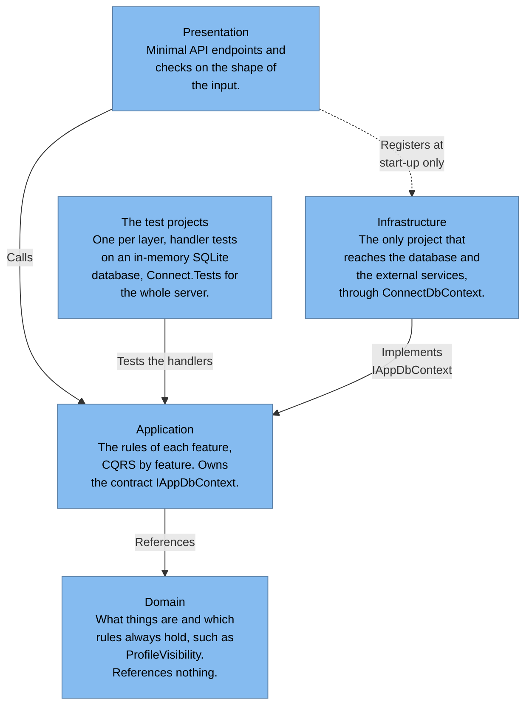
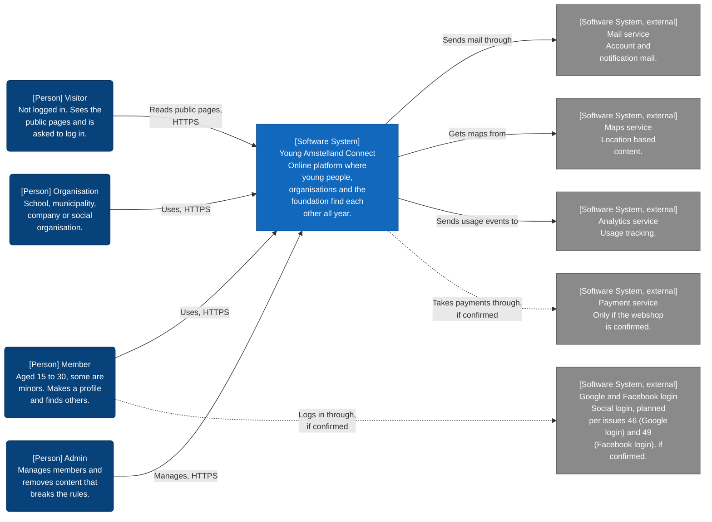
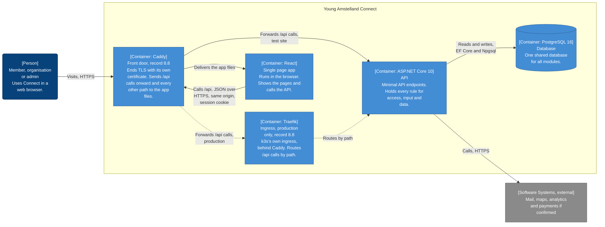
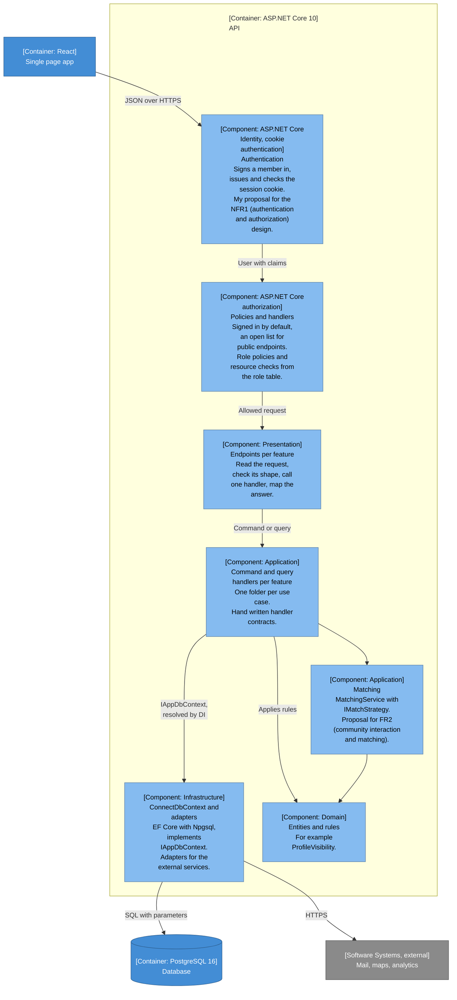
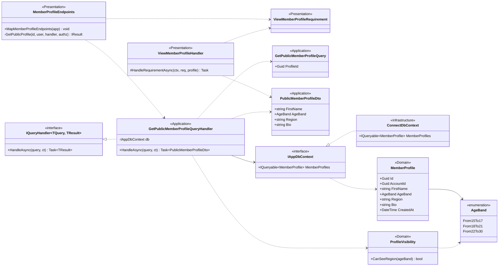
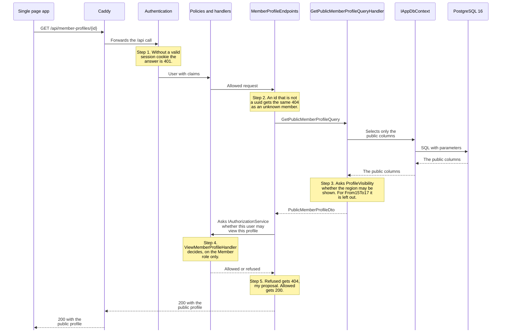
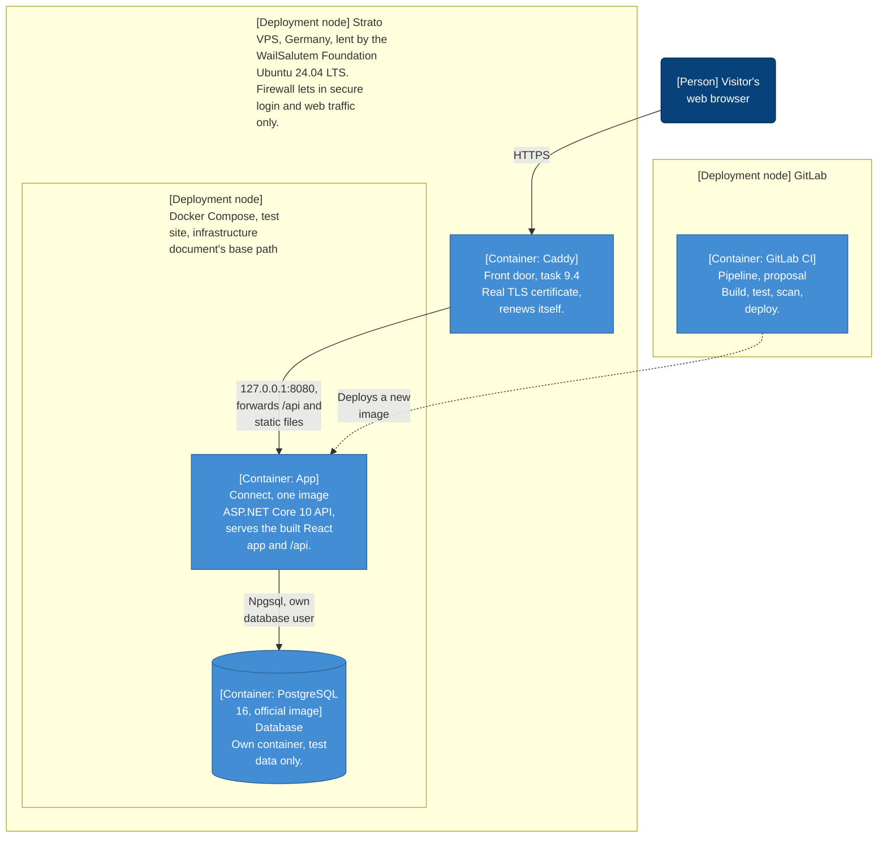
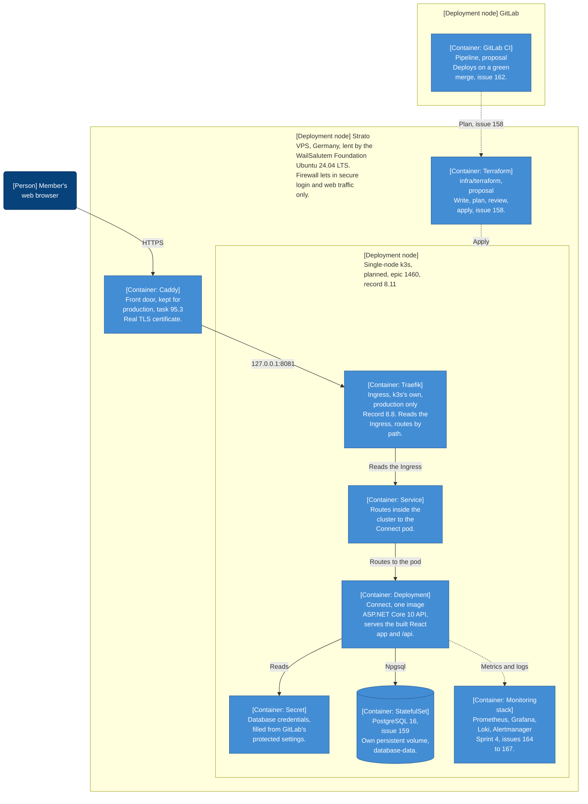
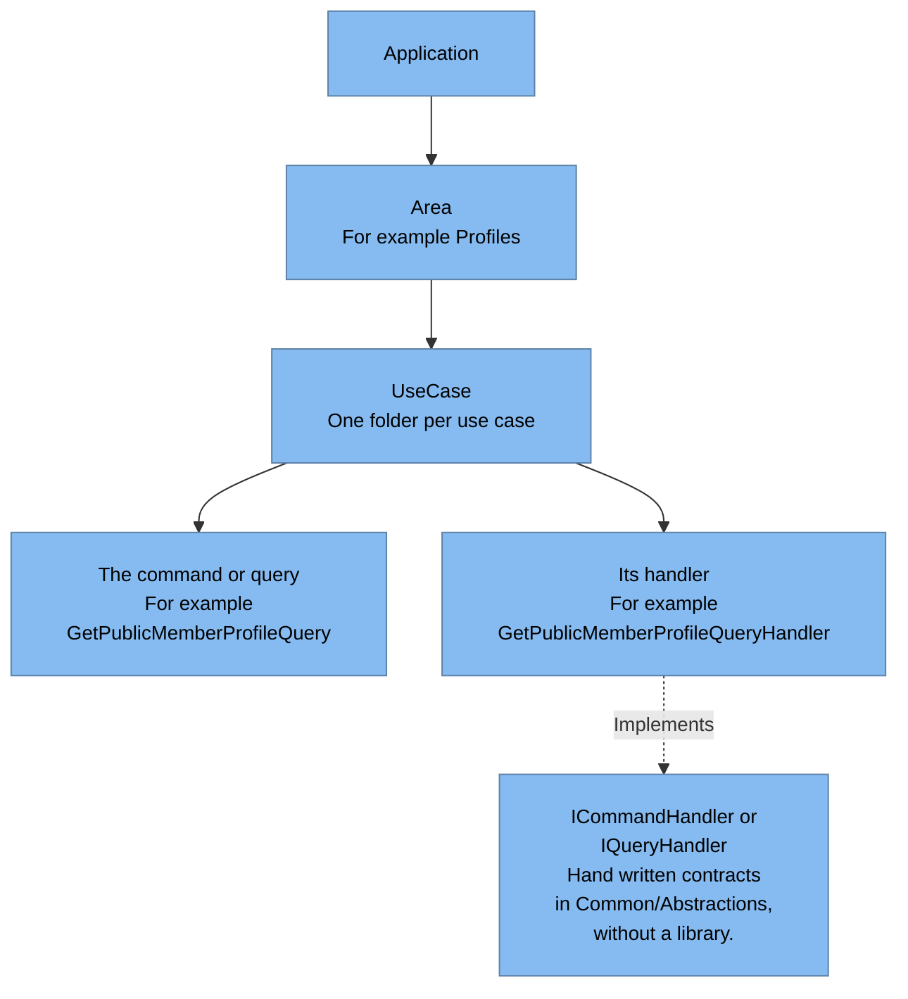

# Architecture of Young Amstelland Connect: structure, C4 model, patterns and decisions

## Table of Contents

- [1. Introduction](#1-introduction)
- [2. Terms and identifiers used](#2-terms-and-identifiers-used)
- [3. Current situation](#3-current-situation)
- [4. Architectural drivers](#4-architectural-drivers)
- [5. Architecture style and why](#5-architecture-style-and-why)
- [6. The C4 model of Connect](#6-the-c4-model-of-connect)
- [7. Design patterns](#7-design-patterns)
- [8. Architecture decision records](#8-architecture-decision-records)
- [9. Keeping the architecture in sync with the code](#9-keeping-the-architecture-in-sync-with-the-code)
- [10. Acceptance criteria](#10-acceptance-criteria)
- [11. Planning](#11-planning)
- [12. Is this enough for sprint 1](#12-is-this-enough-for-sprint-1)
- [13. Conclusion](#13-conclusion)
- [References](#references)
- [Appendix A: Issues and asks traced to sections](#appendix-a-issues-and-asks-traced-to-sections)
- [AI use declaration](#ai-use-declaration)

## 1. Introduction

I am Wesley Oerlemans, Full Stack Software Developer at level 3 in the Social Impact Apps studio of the HvA (Hogeschool van Amsterdam). Per the team's product vision, our team builds Young Amstelland Connect, the online platform where young people from Amstelland, the organisations around them and the WailSalutem Foundation find each other all year.

This document is the architecture half of my evidence for the Security & Architecture datapoint of sprint 1. The course's level 3 datapoint sheet gives that datapoint the content security & access fundamentals and design patterns, under the learning outcome Designing & Realising, with feedback from the learning group teacher. The security half is my document *Security and access fundamentals: applied to Young Amstelland Connect*, from here on my security document. I show both in the learning group of 6 October 2026.

The learning group teacher's message to our group asked us to show that we understand the subject, can explain it and can apply it. For the architecture of Connect I do that with:

- the requirements, constraints and quality attributes that drive the architecture
- the architecture style, compared with a modular monolith and with microservices
- a C4 (context, containers, components and code) model from the system context to the code of one feature, plus its deployment
- three design patterns, where they live in Connect and why
- a decision record for every architecture decision, in the form BoKSA (Body of Knowledge, Skills and Attitudes) asks for

On 6 October 2026 the repository holds only an example solution structure for authentication in `api/`, added on 2 October, and no slice of Connect yet, so this document is design. A team decision names who took it, when, and the team document that records it. Anything the team has not decided is written as my advice or my proposal, with its owner and the moment it gets decided. Section 12 says plainly what is covered and what is not.

## 2. Terms and identifiers used

This section explains every requirement code, acceptance criterion, GitLab issue number and abbreviation in this document. In the text, a code or issue number carries its short meaning in brackets, and an abbreviation is spelled out where it first appears. An abbreviation that appears only in a diagram, a quotation, a heading or a reference title is explained here only.

| Term or code | Meaning | Source |
| --- | --- | --- |
| FR | Functional requirement | Requirements document |
| FR1 | Profiles | Requirements document |
| FR2 | Community interaction and matching | Requirements document |
| FR3 | Admin dashboard | Requirements document |
| FR10 | Webshop, named but not prioritised | Requirements document |
| NFR | Non-functional requirement | Requirements document |
| NFR1 | Authentication and authorization | Requirements document |
| NFR2 | GDPR footing | Requirements document |
| NFR3 | Hosting within a student budget | Requirements document |
| NFR4 | Responsiveness, proposed, no numeric target yet | Requirements document |
| NFR5 | Availability, proposed, no numeric target yet | Requirements document |
| NFR6 | Definition of Done met continuously | Requirements document |
| AC | Acceptance criterion, a check this document sets for itself | This document, section 10 |
| AC1 | Architecture style explained and justified | This document, section 10 |
| AC2 | Every C4 level drawn | This document, section 10 |
| AC3 | Three patterns explained and placed | This document, section 10 |
| AC4 | Patterns checked against over-engineering | This document, section 10 |
| AC5 | Architecture decisions recorded | This document, section 10 |
| AC6 | Quality attributes written as scenarios | This document, section 10 |
| AC7 | Design explained to two audiences | This document, section 10 |
| AC8 | Diagrams compared with the code | This document, section 10 |
| AC9 | Feedback recorded with what I changed | This document, section 10 |
| AC10 | Every statement traceable | This document, section 10 |
| AC11 | Deployment on Kubernetes verified end to end | This document, section 10 |
| AC12 | Containerization and CI fundamentals shown | This document, section 10 |
| Issue 10 | A personal server login per team member | GitLab issues |
| Issue 12 | One clear structure for new developers | GitLab issues |
| Issue 22 | Stopping building blocks with known security holes | GitLab issues |
| Issue 23 | A plain health answer and a clear error diary | GitLab issues |
| Issue 46 | Google login | GitLab issues |
| Issue 49 | Facebook login | GitLab issues |
| Epic 1460 | Production, the epic that plans the live version on k3s, in Terraform, with backups | GitLab issues |
| Issue 155 | The director agrees where production runs | GitLab issues |
| Issue 156 | The choice for k3s and Terraform on production, compose on the test site | GitLab issues |
| Issue 157 | k3s installed on the production server by a written script | GitLab issues |
| Issue 158 | Every production change shown as a plan in the merge request | GitLab issues |
| Issue 159 | The server, the database and their secrets described in Terraform | GitLab issues |
| Issue 161 | A nightly backup of the live database and the pictures | GitLab issues |
| Issue 162 | Every green merge into main goes to production | GitLab issues |
| Issue 163 | A broken production version replaced within ten minutes | GitLab issues |
| Issue 164 | Metrics collected with Prometheus | GitLab issues |
| Issue 165 | A monitoring dashboard in Grafana | GitLab issues |
| Issue 166 | Alerts within five minutes through Alertmanager | GitLab issues |
| Issue 167 | Central logging with Loki | GitLab issues |
| Issue 169 | The DevOps teacher's live demo with a rollback | GitLab issues |
| Issue 239 | Caddy at the front door with a self-renewing certificate | GitLab issues |
| Issue 253 | One real request through the four projects | GitLab issues |
| Issue 254 | Recording the chosen server structure | GitLab issues |
| Issue 255 | Recording the .NET 10 choice | GitLab issues |
| Issue 259 | An empty server with the four layers | GitLab issues |
| Issue 260 | The same PostgreSQL database on every laptop | GitLab issues |
| Issue 262 | Saving a new account | GitLab issues |
| Issue 311 | A health answer that checks the database | GitLab issues |
| Issue 313 | A deploy that waits for the healthy answer | GitLab issues |
| Issue 337 | Confirming the role table | GitLab issues |
| Issue 343 | Viewing another member's public profile | GitLab issues |
| Issue 353 | One command that starts all of Connect | GitLab issues |
| ADR | Architecture decision record | Cited reference (Hogeschool van Amsterdam) |
| AI | Artificial intelligence | This document |
| API | Application programming interface | This document |
| BoKSA | Body of Knowledge, Skills and Attitudes, the knowledge base of the course | Course material |
| C4 | Context, containers, components and code, the four diagram levels of the C4 model | Cited reference (Brown) |
| CI | Continuous integration | This document |
| CQRS | Command query responsibility segregation | This document, section 7.1 |
| DI | Dependency injection | This document, section 7.2 |
| DTO | Data transfer object | This document |
| EF Core | Entity Framework Core | Cited reference (Microsoft) |
| GDPR | General Data Protection Regulation | Requirements document |
| HTTP | Hypertext Transfer Protocol | This document |
| HTTPS | Hypertext Transfer Protocol Secure, HTTP over an encrypted connection | This document |
| HvA | Hogeschool van Amsterdam | Cited reference (Hogeschool van Amsterdam) |
| JSON | JavaScript Object Notation | This document |
| JWT | JSON Web Token | This document |
| LTS | Long-term support | This document |
| MVC | Model, view and controller, a pattern for one presentation layer | Team's architecture document |
| OWASP | Open Worldwide Application Security Project | This document |
| R&D | Research and development | Course material |
| SQL | Structured Query Language | This document |
| TLS | Transport Layer Security | This document |
| UI | User interface | This document |
| UML | Unified Modeling Language | Cited reference (Brown) |
| uuid | Universally unique identifier | This document |
| VPS | Virtual private server | This document |
| WCAG | Web Content Accessibility Guidelines | This document |

## 3. Current situation

The team has five members, per the team's README. The README lists Wesley Oerlemans, Nick Hoebe, Gurpreet Singh and Bayon Eerhart under the Full Stack profile, and Kelvin van Voorst as the Security Specialist. Per the team's architecture document, only Nick Hoebe already knows .NET, so four of the five developers are new to it.

The table lists the architecture decisions taken so far, who took them, when, and the team document that records each one. Section 8 gives every decision as a record.

| Choice | Who | When | Recorded in |
| --- | --- | --- | --- |
| React frontend, .NET backend | Wesley Oerlemans | 22 September 2026 | The team's tech stack document |
| A layered structure, microservices rejected, for the team to confirm | Wesley Oerlemans | 24 September 2026 | The team's architecture document |
| ASP.NET Core Minimal APIs (application programming interfaces), not controllers | Wesley Oerlemans | 24 September 2026 | The team's architecture and stack research documents |
| EF Core (Entity Framework Core) for data access | Wesley Oerlemans | 24 September 2026 | The team's tech stack document |
| PostgreSQL 16 through Npgsql in Docker, replacing SQL Server, Microsoft's SQL (Structured Query Language) database | Wesley Oerlemans | 26 September 2026 | The team's tech stack and stack research documents |
| CQRS (command query responsibility segregation) by functionality over the repository pattern, in four projects | The whole team | 1 October 2026 | The team's architecture document |
| A Strato VPS (virtual private server) in Germany, lent by the foundation | The foundation | Received 2 October 2026 | The team's infrastructure and onboarding documents |

Per the team's architecture document, the backend is layered in four projects, Presentation, Application, Domain and Infrastructure, with one test project per layer and Connect.Tests for the tests across projects. Per the team's onboarding guide (`docs/team/onboarding.md`, section 10), the server runs Ubuntu 24.04 LTS (long-term support) with Docker and Docker Compose and has no containers yet. Per the team's infrastructure document (`docs/architecture/infrastructure.md`), Caddy is already chosen as the front door for both environments, task 9.4 for the test site and kept for production by task 95.3, and issue 239 (Caddy at the front door with a self-renewing certificate) asks for its self-renewing certificate. Records 8.8 and 8.11 add that production now plans to run Traefik, k3s's own reverse proxy, behind Caddy. Neither is set up on the server yet.

Two points that touch the architecture are open. Per the team's delivery plan, the authorization design for NFR1 (authentication and authorization) is owned by Kelvin van Voorst and due at the latest at the sprint 1 review, week of 5 October 2026. Per the requirements document, it includes whether minors' profiles are restricted differently from adults' profiles. The role table per module still has to be confirmed by the team in issue 337 (confirming the role table). Per the requirements document, our users are 15 to 30, so some of them are minors, and NFR2 (GDPR footing) adds GDPR (General Data Protection Regulation) obligations for their data.

## 4. Architectural drivers

I read the architecture of Connect against four kinds of drivers: the business case and stakeholders behind it, the requirements that shape it, the constraints it has to live with and the quality attributes it has to reach.

### 4.1 Business case and stakeholders

Per the team's product vision, the business case for Connect is impact, not revenue. The WailSalutem Foundation is a nonprofit organization, which the team's product vision records. Three threads follow from that, per the same document: visibility, motivating young people and showing the collaboration with the HvA. No funding model and no success numbers are set yet, per the same document.

The table lists the seven stakeholder groups from the team's problem analysis, with their interest in Connect in the project's own words. The third column is my assessment of what each interest asks of the architecture.

| Stakeholder group | Their interest in Connect | What it asks of the architecture |
| --- | --- | --- |
| Young people, nominees, winners, and YAA alumni | A place to stay visible and keep finding opportunities after the gala, not only during it | Minors are part of this group, so this interest asks for the access rules of NFR1 (authentication and authorization) and the ProfileVisibility rule of section 6.4 |
| Jury members, ambassadors, mentors, and experts | A way to stay connected to the talent they judge or advise, beyond the one evening they meet it | This interest asks the profile endpoint to stay fast as the community grows, the performance driver of NFR4 and the scenario of section 4.4 |
| Municipalities and youth work | A partner platform that reaches young people across Amstelland year-round | A partner platform asks for availability, NFR5 and the scenario of section 4.4, since the single server has to stay reachable around events, challenge deadlines and the awards cycle, per NFR5 (availability) |
| Schools and educational institutions | A channel connecting students to real showcases and opportunities | A channel only works if the platform stays open and visible, which FR1 (profiles) and the architecture style of section 5 build toward |
| Companies and entrepreneurs | A way to find and support the talent the awards surface | Finding talent means browsing a profile list that has to stay fast as the number of profiles grows, the same performance driver as NFR4 and section 4.4 |
| Social, cultural, and sports organizations | A community layer that reaches young members and volunteers | A community layer that keeps running after the team leaves asks for the structure a later developer can follow, issue 12 (one clear structure for new developers) and section 5.1 |
| Partners, funds, and other organizations offering opportunities | A platform to publish and match opportunities to the right young people | A platform partners keep trusting has to keep running on what the foundation can afford, the low-cost choices of NFR3 and records 8.5 and 8.7 |

**Business interests the architecture serves.** Visibility and showing the collaboration with the HvA are why I judge the C4 diagrams of section 6 worth keeping in plain words for the foundation as well as in technical form for the team, the plain-words and technical communication I plan, as AC7 (design explained to two audiences) in section 10 sets. Motivating young people depends on the platform staying open and fast as more of them join, which is what the layered structure of section 5.1 and the performance scenario of section 4.4 are built to carry. In my assessment, no funding model and no success numbers being set yet make the one deployable unit of section 5 and the low-cost choices of records 8.5 and 8.7, PostgreSQL with no licence and the foundation's own server, a business decision and not only a technical one. In my assessment, the minors among the young people stakeholder group turn NFR1 and the access rules of section 6.4 from a security concern into a business one, since the foundation's reputation rests on protecting them.

### 4.2 Requirements that shape the architecture

Per the requirements document, nine functional requirements are proposed and prioritised, and the webshop is named but not prioritised. The table lists the functional requirements that shape the structure, and every non-functional requirement. The meaning and the priority come from the requirements document. The last column is my reading of what each one asks of the architecture.

| Code | Meaning | Priority or status | What it asks of the architecture |
| --- | --- | --- | --- |
| FR1 | Profiles: users and organisations create and maintain a profile | Must | The member profile, the feature section 6.4 designs down to the code |
| FR2 | Community interaction and matching: users find and connect with other users, organisations and opportunities | Must | A matching rule that may change, which section 7.3 gives a Strategy |
| FR3 | Admin dashboard: the foundation manages users and content and sees platform statistics | Must | An Admin among the people of section 6.1 |
| FR10 | Webshop, in the concept diagram only, until the client confirms it | Not prioritised | A payment service drawn as a condition in section 6.1 |
| NFR1 | Authentication and authorization, with rules for minors' data | No priority given | Authentication and authorization in front of every endpoint, section 6.3 and record 8.10 |
| NFR2 | GDPR footing: a lawful basis, data minimisation and consent handling for minors | No priority given | Queries that read only the public columns, section 6.4 |
| NFR3 | Hosting within a student budget | No priority given | Free software on one server, records 8.5 and 8.7 |
| NFR4 | Responsive for browsing profiles, showcases and events under normal use, no numeric target | Proposed | The performance scenario of section 4.4 |
| NFR5 | Available around events, challenge deadlines and the awards cycle, no uptime target | Proposed | The availability scenario of section 4.4 |
| NFR6 | Code and documentation meet the Definition of Done continuously | No priority given | Decision records kept with the code, section 8 |

In my design, the other six functional requirements, from opportunities to badges and achievements, each become a feature with its own folder in Application, in the layout section 7.1 describes. Per the requirements document, the Definition of Done behind NFR6 (Definition of Done met continuously) asks for documentation of the architecture with significant choices recorded. Section 8 is where I record them.

### 4.3 Constraints

The source column names where each constraint comes from. The last column is my reading.

| Constraint | Source | What it means for the architecture |
| --- | --- | --- |
| A team of five students | The team's README | One codebase the whole team can review |
| Four of five developers new to .NET | The team's architecture document | A structure a beginner can follow, the ask of issue 12 (one clear structure for new developers) |
| No client budget, hosting on a student budget | The team's infrastructure document | Free software and no paid platform, records 8.5 and 8.7 |
| One server, the foundation's Strato VPS in Germany | The team's infrastructure and onboarding documents | One deployable unit next to its database, section 6.5 |
| One shared database for every module | The team's architecture document, after the client's concept diagram | No database per module |
| Project completion in the week of 4 January 2027, then handover | The requirements document | A structure a later developer can keep, the other half of issue 12 (one clear structure for new developers) |
| Container orchestration, verified end to end on a real local cluster, with a rollback and monitoring shown in a screen recording and a live demo | Level 3 DevOps Advanced Track workshop (Hogeschool van Amsterdam, 2026b), the team's GitLab backlog, epic 1460 | Kubernetes in some form, record 8.11, and the rollback and monitoring sprint 4 plans in section 11 |

### 4.4 Quality attribute scenarios

BoKSA asks me to express non-functional requirements as concrete, measurable quality attribute scenarios, built from a stimulus, an environment, a response and a measurable value (Hogeschool van Amsterdam, n.d.-f). The quality attribute workshop method of the Software Engineering Institute at Carnegie Mellon University adds the source of the stimulus, the entity that generated it, and calls the measurable value the response measure (Barbacci et al., 2003). The table uses those five parts. The same method also names the artifact that is stimulated (Barbacci et al., 2003). I name it inside the stimulus, so the table stays readable. The attribute names follow BoKSA's list (Hogeschool van Amsterdam, n.d.-e).

| Attribute | Source | Stimulus | Environment | Response | Response measure |
| --- | --- | --- | --- | --- | --- |
| Performance, NFR4 (responsiveness) | A signed-in member | Opens another member's profile at the endpoint of issue 343 (viewing another member's public profile) | Normal use, while the members and their related data grow | The API answers with the public profile | No team target yet, see below |
| Availability, NFR5 (availability) | Many members at once | Visit Connect around an event, a challenge deadline or the awards cycle | Production, on the foundation's one server | Connect stays reachable, and its health address answers healthy only when the server and the database both work, the ask of issue 311 (a health answer that checks the database) | No team target yet, see below |
| Reliability | A merge by a developer | A broken new version reaches the server | A deploy to the test site | The deploy job waits for the healthy answer and records the deploy, the ask of issue 313 (a deploy that waits for the healthy answer) | The working version is back within ten minutes, the target of issue 23 (a plain health answer and a clear error diary) |
| Security, NFR1 (authentication and authorization) | A visitor who is not signed in | Calls the endpoint of issue 343 (viewing another member's public profile) | Normal operation | The API refuses before any profile data is read | The answer is 401, as issue 343 (viewing another member's public profile) expects in its own tests |
| Security, NFR2 (GDPR footing) | A signed-in member | Opens the profile of a member aged 15 to 17 | Normal operation | The answer leaves the region out | The region is absent from every such answer, the rule of issue 343 (viewing another member's public profile) |
| Maintainability, issue 12 (one clear structure for new developers) | A developer new to .NET | Uses Infrastructure from inside Domain by mistake | Development, before a merge | The build refuses the line | The compiler fails with error CS0234, the proof issue 254 (recording the chosen server structure) asks for |
| Maintainability, NFR6 (Definition of Done met continuously) | A later developer, after the handover | Adds a use case to a feature | The code base after January 2027 | Finds the feature folder and adds a command or query with its handler there | Every merge meets the Definition of Done: a passing linter, no compile errors, passing unit tests and documentation, per the requirements document |
| Portability | A developer or the client at the foundation | Starts Connect on another computer | Any computer with Docker | Docker Compose starts the database, runs the migrations and starts the server in the right order | One command, the target of issue 353 (one command that starts all of Connect) |

Two measures have no team target. Per the requirements document, no recorded document gives Connect a response time or an uptime target, and the whole team sets them with the client. For performance my research plan, *Research plan: keeping the profile endpoints of Young Amstelland Connect fast as related data, data volume and users grow*, measures four loading variants on the profile endpoints (Oerlemans, 2026). Its results are where NFR4 (responsiveness) can get its number. Scalability has no row of its own. The performance scenario already grows the data and the users, and section 5.2 says how each style would scale.

BoKSA also asks me to communicate trade-offs between quality attributes, with a justified recommendation (Hogeschool van Amsterdam, n.d.-f). The trade-off I see in this design is between performance and security. In my design every profile request runs the authorization check of section 6.4, step 4, before it answers. I recommend keeping that cost. NFR1 (authentication and authorization) and the rule for minors are requirements, while NFR4 (responsiveness) has no number yet.

BoKSA names external standards such as OWASP, WCAG and Core Web Vitals as a source of non-functional requirements (Hogeschool van Amsterdam, n.d.-f). In this sprint I use one of them. My security document holds Connect against the OWASP (Open Worldwide Application Security Project) Top 10. WCAG (Web Content Accessibility Guidelines) and Core Web Vitals wait until the screens of the React app are designed.

## 5. Architecture style and why

BoKSA asks me to select an architecture style for a given context and justify the choice in a clear architecture decision record (ADR) (Hogeschool van Amsterdam, n.d.-b). This section gives the style, the comparison and what the choice gains and gives up. Section 8 holds the decision records.

### 5.1 Layered, in four projects, with CQRS by feature

Per the team's architecture document, the backend is a layered architecture with four projects. The list below is my description of what each project holds:

- **Presentation**: the Minimal API endpoints and the checks on the shape of the input.
- **Application**: the rules of each feature, as CQRS by feature, with one folder per use case.
- **Domain**: what things are and which rules always hold, such as ProfileVisibility, the rule for minors.
- **Infrastructure**: the only project that reaches the database and the external services, through ConnectDbContext.

In my design the dependencies point inward: Domain references nothing, Application references Domain and owns the contract IAppDbContext, and Infrastructure implements it. Presentation calls Application and, in my design, registers Infrastructure at start-up only. A layered architecture lets an application enforce which layers may communicate with which (Microsoft, 2021). In my design the project references do that, so a reference the design forbids does not compile. That is what issue 12 (one clear structure for new developers) asks for: a structure four new developers can follow and a later developer can keep.

The diagram below draws this rule for the four projects and their test projects of record 8.2. Each arrow points from the project that holds the reference to the project it depends on. Every solid arrow points inward, towards Domain.

Key: a solid arrow is a project reference, the dotted arrow is a registration at start-up only.

Inside Application the whole team chose CQRS by feature on 1 October 2026, and the endpoints in Presentation are Minimal APIs, per the team's architecture document. Section 7.1 explains CQRS. Records 8.3 and 8.6 hold both decisions.

### 5.2 Monolith, modular monolith or microservices

BoKSA asks me to compare a monolith, a modular monolith and microservices against a given context: team size, scale, deadline and complexity (Hogeschool van Amsterdam, n.d.-h). The team's architecture document weighs microservices but not a modular monolith, so that column is my own comparison. The second column is Connect's context, from the source each cell names.

| Factor | Connect's context | Monolith in layers | Modular monolith | Microservices |
| --- | --- | --- | --- | --- |
| Team size and skill | Five students, four of them new to .NET, per the team's README and architecture document | One codebase, deployed as a single unit (Microsoft, 2021) | Modules developed and tested independently, while the application deploys as a single unit (Garg, 2023). In my assessment that adds module boundaries for a team still learning the layers | Microservices are highly distributed systems, so a team should check that it has the skills and experience (Microsoft, 2025c). Fowler (2015b) advises against starting with them without reasonable experience of building them in the team |
| Scale | One server lent by the foundation, per the team's onboarding guide. Per the requirements document, no recorded document gives a response time or uptime target | To scale out, the whole application is typically duplicated across servers (Microsoft, 2021) | Deployed as a single unit (Garg, 2023), so in my assessment it scales the way the monolith does | Services scale independently, with an orchestrator such as Kubernetes (Microsoft, 2025c) |
| Deadline | Project completion in the week of 4 January 2027, per the requirements document, and the sprint 4 review on 8 January 2027, per the team's delivery plan | Fowler (2015b) argues for building a new application as a monolith first, so the first phase can prioritise speed | Early in development the natural functional boundaries may not be clear yet (Microsoft, 2021). In my assessment, module boundaries drawn now would be guesses | Microservices bring a premium that can slow development down considerably (Fowler, 2015a) |
| Complexity | Nine prioritised functional requirements and a webshop that waits for the client, per the requirements document, on one shared database, per the team's architecture document | Layers keep a growing codebase organised by responsibility, so developers can find where functionality lives (Microsoft, 2021) | Well-defined modules make a later move to microservices easier once modules grow (Garg, 2023) | Each service is simpler, but the system as a whole is more complex, and each service owns its data and schema (Microsoft, 2025c) |

I place Connect in the first column, a monolith in layers. Every row points the same way. The team is small and mostly new to .NET, and Connect runs on one server. The deadline leaves no room for the premium Fowler (2015a) describes. The modules share one database, where microservices give each service its own (Microsoft, 2025c).

In my assessment, a modular monolith is the nearest alternative. It deploys as one unit like the layered monolith, but it is built from well-defined modules, each with a business capability boundary (Garg, 2023). Early in development those boundaries may not be clear yet (Microsoft, 2021). For Connect the client has not confirmed every module either: per the requirements document, the webshop waits for the client. In my assessment CQRS by feature already keeps the code of each feature in its own folder. If clear module boundaries show once the features exist, the team can draw them then. Microsoft (2021) describes the same path for a monolith whose boundaries only show later.

### 5.3 Why microservices lost

Microservices need a management component that schedules and deploys services across nodes, detects failures and scales on demand (Microsoft, 2025c). A container orchestration platform such as Kubernetes typically provides it (Microsoft, 2025c). Record 8.11 plans Connect on single-node k3s for production, per the team's GitLab backlog, epic 1460, so the team no longer lacks a cluster. What still rules out microservices is the rest of the comparison. Connect has one server, and its modules share the one database the client's concept diagram draws. Fowler (2015a) names the price too: microservices bring a complexity premium of their own, against a team mostly new to .NET and a deadline in January, per the requirements document. In my assessment, with four of five developers new to .NET, one deployable unit with clear layers is what we can build, test and hand over. Kubernetes now runs that one unit. It gives Connect an orchestrator. It does not decide whether what runs inside it is a monolith or a set of services.

### 5.4 What the style gains and what it gives up

In my assessment the style gains:

- one deployable unit that five students can build, test and hand over
- a compiler that refuses a wrong reference between layers, the proof issue 254 (recording the chosen server structure) asks for
- one database, without the data consistency problem of services that each persist their own data (Microsoft, 2025c)

It gives up:

- scaling one part on its own, because a monolith scales by duplicating the whole application (Microsoft, 2021)
- simplicity of files, with four project files to keep in step
- a second server. In my assessment the single server is a single point of failure, which NFR5 (availability) will have to weigh once it has a target

## 6. The C4 model of Connect

I draw the architecture with the C4 model of Simon Brown: the system context, the containers, the components of one container and the code of one component, plus a deployment diagram (Brown, n.d.-a). C4 prescribes no notation, but it asks for a key on every diagram (Brown, n.d.-f). I write the C4 type in each box, for example [Person] or [Container: PostgreSQL 16], and put a key under each diagram. None of this exists as code yet. The repository holds only an example solution structure for authentication.

BoKSA's article on system and data modeling lists the C4 model among its starting points, and asks that I can explain why I made a particular modelling choice (Hogeschool van Amsterdam, n.d.-g). I chose C4 because its levels let one model serve two kinds of reader. The system context is for anyone, the foundation included, and the components and the code are for the team.

### 6.1 Level 1: System context

A system context diagram shows the system as a box in the centre, surrounded by its users and the other systems it interacts with (Brown, n.d.-g). Connect sits between four kinds of people and a few external services.

Key: dark blue rounded boxes are people, the blue box is the system in scope, grey boxes are external systems. A dotted arrow depends on a decision.

| Element | Responsibility | Status |
| --- | --- | --- |
| The four people | Visitor, Member, Organisation, Admin | My proposed starting set for the role table, unconfirmed until issue 337 (confirming the role table) |
| Mail service | Account and notification mail | Named in the client's concept diagram, provider not chosen |
| Maps and analytics | Location based content, usage tracking | Named in the client's concept diagram, providers not chosen |
| Payment service | Webshop payments | If confirmed. The webshop is an open scope question, owned by Nick Hoebe |
| Google and Facebook login | Social login for a person new to Connect | Planned per the GitLab issues plan, issues 46 (Google login) and 49 (Facebook login), not yet confirmed |

### 6.2 Level 2: Containers

In C4 a container is an application or a data store (Brown, n.d.-d). Connect has four containers, plus Traefik inside the production path. In my design the React app and the API share one origin behind Caddy. Section 3.2 of my security document explains why that matters for the session cookie.

Key: light blue boxes are containers, the cylinder is a data store, the grey box stands for the external systems of level 1. The dotted arrows are the production-only path through Traefik.

| Container | Responsibility | Status |
| --- | --- | --- |
| Caddy | TLS (Transport Layer Security) with a real certificate that renews itself, the front door for both environments | Chosen, record 8.8 |
| Traefik, production only | Routing by path inside k3s, behind Caddy | Chosen, record 8.8, not set up yet |
| React app | Pages and forms, convenience checks only | Decided 22 September 2026 |
| API, ASP.NET Core on .NET 10 | Authentication, authorization, validation, rules, data access | Minimal APIs decided. Issue 255 (recording the .NET 10 choice) writes down .NET 10 |
| PostgreSQL 16 | All data, one database for every module | Decided 26 September 2026 |

Section 8.5 records why the database is PostgreSQL 16 and not SQL Server. Section 3.9 of my security document describes how the deployment is secured, from TLS at Caddy to the database user.

### 6.3 Level 3: Components of the API

A component diagram zooms in on one container and shows the components inside it (Brown, n.d.-c). A request passes the components of the API from top to bottom.

Key: the lightest boxes are components of the API, the others are its neighbours. An arrow follows a request.

| Component | Project | Status |
| --- | --- | --- |
| Authentication, policies and handlers | Presentation, at start-up | My proposal, decided in the NFR1 (authentication and authorization) design by Kelvin van Voorst |
| Endpoints per feature | Presentation | Minimal APIs decided |
| Command and query handlers, matching | Application | CQRS decided 1 October 2026, matching is a proposal |
| Entities and rules | Domain | Part of the layered structure in the team's architecture document |
| ConnectDbContext and adapters | Infrastructure | Decided with EF Core and CQRS |

Section 6.4 follows one real request, a member viewing another member's profile, through these components and the four projects. That is the walk issue 253 (one real request through the four projects) asks the team to do together.

In my design, the authentication and authorization components stay in this diagram, because every request passes them before it reaches an endpoint. How they work is in sections 3.1, 3.2 and 3.4 of my security document.

### 6.4 Level 4: Code for one feature

At this level C4 shows a component as code, with a UML (Unified Modeling Language) class diagram or something similar (Brown, n.d.-b). I take one feature: a member views the public part of another member's profile, issue 343 (viewing another member's public profile). The issue asks for GET /api/member-profiles/{id}, for logged in members only. Per the issue, for a member aged 15 to 17, another member never sees the region. A hidden value is left out of the answer completely. Issue 343 (viewing another member's public profile) was written before the team chose CQRS and still names a service. In my CQRS design the same work is one query with its handler. This diagram is my design, with names that follow the team's use case convention.

Key: the stereotype of each class names its project. A dotted arrow is a use, a solid arrow is a field, a hollow triangle is an implementation. Region and Bio may be empty. The diagram leaves every relationship unlabelled so no line is drawn through its own text, and this list carries the names instead, source to target.

- MemberProfileEndpoints to GetPublicMemberProfileQueryHandler: calls.
- MemberProfileEndpoints to ViewMemberProfileRequirement: checks through IAuthorizationService.
- ViewMemberProfileHandler to ViewMemberProfileRequirement: handles.
- ViewMemberProfileHandler to PublicMemberProfileDto: resource.
- GetPublicMemberProfileQueryHandler to IQueryHandler: implements.
- GetPublicMemberProfileQueryHandler to GetPublicMemberProfileQuery: handles.
- GetPublicMemberProfileQueryHandler to PublicMemberProfileDto: returns.
- GetPublicMemberProfileQueryHandler to IAppDbContext: reads through.
- GetPublicMemberProfileQueryHandler to ProfileVisibility: applies.
- ConnectDbContext to IAppDbContext: implements.

In my design a request runs through five steps:

1. Without a valid session cookie the answer is 401, as issue 343 (viewing another member's public profile) expects in its own tests.
2. The endpoint checks that the id is a uuid (universally unique identifier), as issue 343 (viewing another member's public profile) asks. A wrong id gets the same 404 as an unknown member.
3. The query handler selects only the public columns through IAppDbContext, so the email address, the account id and the dates never enter the DTO (data transfer object). It then asks ProfileVisibility whether the region may be shown, and for From15To17 it is left out.
4. The endpoint asks IAuthorizationService whether this user may view this profile. ViewMemberProfileHandler decides. In my design it checks the Member role only. When NFR1 (authentication and authorization) decides that minors' profiles are restricted differently, that rule goes here, in one place.
5. The answer is 200 with the public profile. My proposal is that a refused check also gets 404, so the answer never tells whether a profile exists.

| Class | Project | Status |
| --- | --- | --- |
| MemberProfileEndpoints, the requirement and its handler | Presentation | Design. The address and the answers come from issue 343 (viewing another member's public profile), the resource check is my proposal |
| The query, its handler and the DTO | Application | Design, in the CQRS shape |
| IAppDbContext, ConnectDbContext, ProfileVisibility, AgeBand | Application, Infrastructure, Domain | Named in the team's architecture document and in issue 343 (viewing another member's public profile) |

The sequence below follows this request through the components of section 6.3 and the classes above. The notes carry the five steps of the list above.

Key: a solid arrow is a call, a dashed arrow is an answer.

### 6.5 Deployment on the Strato VPS: the test site and production

A deployment diagram shows how containers are deployed on to the infrastructure of one environment (Brown, n.d.-e). Per the team's onboarding guide, the foundation lends the team one Strato VPS in Germany, with Ubuntu 24.04 LTS, Docker and Docker Compose, and a firewall that lets in only secure login and web traffic. The team's GitLab backlog, epic 1460 Production ("School requirement: the live version on k3s, described in Terraform, with backups."), plans two environments on that one server. The test site keeps the infrastructure document's base path, Docker Compose. Production moves to single-node k3s, described in Terraform, per record 8.11. Per the team's infrastructure document, Caddy is the front door chosen for the test site, task 9.4, and kept for production, task 95.3, so one front door answers every visit on ports 80 and 443 and passes it on to either environment. Neither environment is set up on the server yet, so both diagrams below are a proposal. Per record 8.11 the four projects of section 5.1 still build into one container image, so the same image runs in both environments.

**Test site, Docker Compose**

Key: frames are deployment nodes, boxes are containers. A solid arrow is runtime traffic, the dotted arrow is a deployment.

| Element | Status |
| --- | --- |
| Strato VPS with firewall and protection against guessed logins | Received and rebuilt clean on 2 October 2026, per the team's onboarding guide |
| Caddy, the front door | Chosen for the test site, task 9.4, not set up yet |
| Docker Compose, with the App container and PostgreSQL | Proposal in the team's infrastructure document, not set up yet |
| GitLab CI (continuous integration) with build, test, scan and deploy | Proposal in the team's infrastructure document |

**Production, single-node k3s**

Key: frames are deployment nodes, boxes are containers. A solid arrow is runtime traffic, the dotted arrow is a build or a deploy step.

| Element | Status |
| --- | --- |
| Strato VPS with firewall and protection against guessed logins | Received and rebuilt clean on 2 October 2026, per the team's onboarding guide |
| Caddy, the front door | Kept for production, task 95.3, not set up yet |
| Terraform, infra/terraform | Planned, issue 158 (the plan shown in the merge request) and issue 159 (the server, the database and their secrets), not set up yet |
| Single-node k3s | Planned by the team, epic 1460, Sprint 4, issue 157 installs it by a written script, not set up yet |
| Traefik, k3s's own ingress | Record 8.8, scoped to production, not set up yet |
| The Connect Deployment, one image, with a Service and a Secret | Planned, epic 1460, not set up yet |
| PostgreSQL 16, a StatefulSet with its own persistent volume | Planned, issue 159, not set up yet |
| A nightly backup of the database and the pictures, locked with a key, kept inside the European Union | Planned, issue 161. The number of days and the exact place inside the EU are open, owner the client, question 117 |
| A rollback to the previous image within ten minutes | Planned, issue 163, to be rehearsed once per that issue |
| Monitoring: Prometheus, Grafana, Loki and Alertmanager | Planned, Sprint 4, issues 164 to 167 |
| GitLab CI deploying every green merge into main | Planned, issue 162 |

Records 8.7, 8.8 and 8.11 say why Connect runs on the foundation's server, why Caddy is the front door for both environments, and why production now plans to run inside k3s, described in Terraform. Section 3.9 of my security document describes how the deployment is secured.

## 7. Design patterns

The architecture workshop asks for at least three meaningful patterns, with where each is used and why it fits (Hogeschool van Amsterdam, 2026a). BoKSA adds a warning I take seriously: "The real skill isn't memorising the pattern catalogue, it's judgment: recognising when a pattern actually improves coupling and testability, and when it's over-engineering a problem that didn't need it." (Hogeschool van Amsterdam, n.d.-b). So for each pattern I give the problem in Connect, where it lives, why it fits and what it costs. The repository holds no slice of Connect yet, only an example solution structure for authentication, so all three are designed, not built.

### 7.1 CQRS by feature

**Problem.** As I see it, Connect reads far more than it writes. In my design a read needs only the public columns, fast, and a write needs validation and rules. Microsoft names the catch of one model for both: the read and write representations of data often differ, and fields a write needs can be unnecessary for a read (Microsoft, 2025a).

**Where.** Per the team's architecture document, in Application, in the layout Area/UseCase, with the command or query, its handler and its result in one folder. The document gives CreateAccountCommand beside CreateAccountCommandHandler in Accounts/CreateAccount as its example, the way the account code of the team has it, and mine is GetPublicMemberProfileQuery beside its handler in Profiles. In the same document the contracts ICommandHandler and IQueryHandler are hand written in Common/Abstractions, without a library. Both sides use the same database.

The tree below draws this layout, with my example in one use case folder.

Key: a solid arrow points from a project or folder to what it holds, the dotted arrow is an implementation.

**Why it fits.** In my assessment a beginner finds a use case in one folder, and a query that selects only public columns keeps private fields in the database.

**Cost.** I see two costs: more files per feature, and two shapes to learn. BoKSA names CQRS together with the outbox pattern (Hogeschool van Amsterdam, n.d.-b). I judge that Connect needs no outbox, because both sides share one database and send no messages.

**Simpler option.** One model for both reads and writes. It lost on the catch under Problem: the read and write representations of data often differ (Microsoft, 2025a). In my design a profile read needs only the public columns, and a separate query keeps the private fields in the database.

### 7.2 Dependency injection

**Problem.** In my design a handler must reach the data without depending on EF Core, a test must swap in something else, and an endpoint must get its handler without building it.

**Where.** In the built-in service container of ASP.NET Core (Microsoft, 2026c). In my design each project registers its own parts at start-up with one method, for example AddApplication. That follows the convention of one Add extension method per group of related services (Microsoft, 2026c). In my design the container resolves IAppDbContext to ConnectDbContext and puts each handler into its endpoint.

**Why I chose it.** ASP.NET Core provides it as its built-in container (Microsoft, 2026c), so there is nothing extra for us to maintain. In my design it keeps the projects apart: Application asks for IAppDbContext and never sees Infrastructure. Per the team's architecture document, a handler test gets an in-memory SQLite database, and an integration test a real PostgreSQL.

**Cost.** In my assessment the compiler does not catch a missing registration, so it only shows when the app runs. AddDbContext registers a DbContext with a scoped lifetime by default (Microsoft, 2025b), and the framework creates a scope per request that stays valid as long as the request is active (Microsoft, 2026c). This means, in my assessment, that a longer-living service must not hold one.

**Simpler option.** A handler that builds its own ConnectDbContext with new. Per the team's architecture document, that lost because only constructor injection makes a handler swappable in a test, against an in-memory SQLite database behind IAppDbContext. In my assessment, a handler that builds its own context always reaches the real database, so its test needs one too.

### 7.3 Strategy for matching

**Problem.** Per the requirements document, the functional requirement FR2 (community interaction and matching) lets users find and connect with other users, organisations and opportunities. Per the team's architecture document, how matches are made is not designed yet. In my assessment the rule may change.

**Where.** In Application. In my design, an IMatchStrategy interface is injected into a MatchingService, with InterestOverlapStrategy, matching on shared interests, as the first implementation.

**Why I chose it.** With Strategy the context does not depend on the concrete strategies, so a new algorithm can be added without changing the context or the other strategies (Refactoring.Guru, n.d.). For Connect this means a new rule is a new class, tested on its own, without touching MatchingService or the endpoints.

**Cost.** With one strategy this is close to the over-engineering BoKSA warns about (Hogeschool van Amsterdam, n.d.-b). In my judgement, it earns its place when a second rule arrives. It is still a proposal that the team confirms or drops when matching is planned.

**Simpler option.** One method in MatchingService that holds the shared-interests rule itself. The team's architecture document does not compare the two, so this reason is my own. Per that document the matching design is still open, and Strategy lets the team swap one rule for another without rewriting the module each time. In my assessment, a single method would be rewritten, with its tests, the first time the rule changes. If the team plans matching with one fixed rule, the single method wins and the interface goes.

### 7.4 The repository pattern, the option that lost

In the repository pattern, repositories are classes that hold the logic to access the data, one repository per aggregate (Microsoft, 2018). It was the first proposal in the team's architecture document. Since the team chose CQRS on 1 October 2026, there are no repository classes or interfaces. I accept that for two reasons:

- EF Core's DbContext already gives a handler one typed set per table, so a repository on top mostly passes calls through.
- General repository methods tend to load whole entities, where a query handler selects exactly the columns it needs.

The price is that a handler test uses an in-memory SQLite database, as the team's architecture document plans, and not a hand written fake repository.

## 8. Architecture decision records

BoKSA asks for an ADR with a clear context, decision and consequences section (Hogeschool van Amsterdam, n.d.-h). Nygard (2011), whose blog post describes the form, adds a title and a status. A record is proposed while the stakeholders have not agreed with it, and accepted once they have (Nygard, 2011). Each record below has those parts, plus who decided and when, and the options that lost with the reason a team document gives. Where no team document records a comparison, the record says so.

The table is the summary, and the records follow it.

| Record | Decision | Options that lost | Who, when | Status |
| --- | --- | --- | --- | --- |
| 8.1 | A monolith in layers | Microservices, event-driven, MVC (model, view and controller) on its own, hexagonal or full Clean Architecture, a modular monolith | Wesley Oerlemans, 24 September 2026 | Proposed by me on 24 September 2026, per the team's architecture document, team confirmation not recorded |
| 8.2 | Four projects | One project with four folders | Wesley Oerlemans, 24 September 2026 | Proposed by me on 24 September 2026, per the team's architecture document, team confirmation not recorded, decision file open |
| 8.3 | Minimal APIs | Controllers | Wesley Oerlemans, 24 September 2026 | Accepted, team confirmation not recorded |
| 8.4 | EF Core for data access | None compared | Wesley Oerlemans, 24 September 2026 | Accepted |
| 8.5 | PostgreSQL 16 | SQL Server | Wesley Oerlemans, 26 September 2026 | Accepted |
| 8.6 | CQRS by feature | The repository pattern | The whole team, 1 October 2026 | Accepted |
| 8.7 | The foundation's server | A cloud platform, a single Linux server rented by the team | Settled by the foundation's offer, 2 October 2026 | Accepted |
| 8.8 | Caddy as the front door, Traefik inside production k3s | Nginx with certbot, a deploy platform, a tunnel service | Wesley Oerlemans, 6 October 2026 | Chosen per the team's infrastructure document (task 9.4, kept for production by task 95.3), Traefik behind it per issues 156, 157 and 159 |
| 8.9 | .NET 10 | .NET 8, .NET 9 | Not decided yet | Proposed |
| 8.10 | Cookie authentication and policy-based authorization | A JWT (JSON Web Token) in the browser, role checks inside each endpoint | Proposed by me, decided by Kelvin van Voorst | Proposed |
| 8.11 | Production on single-node k3s with Terraform, the test site on Docker Compose | A managed cloud cluster | The team, GitLab backlog epic 1460, Sprint 4, confirmed by Wesley Oerlemans on 6 October 2026 | Planned by the team, epic 1460, issue 156 still open |

Two neighbouring decisions have no record here. The React and .NET stack, which I confirmed on 22 September 2026, is the frame these records work in. Per the team's tech stack document, it was chosen for learning, not for the fastest route to a working platform. The dependency check of issue 22 (stopping building blocks with known security holes) is a control in the pipeline, not a part of the structure. Section 3.9 of my security document covers it.

### 8.1 A monolith in layers, not microservices

**Status.** Proposed by me on 24 September 2026, per the team's architecture document, team confirmation not recorded. Per `openItems.md`, confirming or redirecting the proposed layered architecture is still listed under Needs deciding. The whole team's decision of 1 October 2026, per the same document, settled CQRS over the repository pattern only.

**Context.** Five students, four of them new to .NET, one server lent by the foundation and modules that share one database, as section 4.3 lists. Section 5.2 weighs them against team size, scale, deadline and complexity.

**Decision.** Connect is one deployable application in four layers, with the dependency rule of section 5.1.

**Options that lost.** The team's architecture document weighs the styles the architecture workshop names:

- **Microservices.** Per that document, which cites the infrastructure document here, the modules share one database, and Fowler (2015a) names the complexity premium microservices bring against a team mostly new to .NET and a deadline in January, per the requirements document. Record 8.11, planned in the team's GitLab backlog, epic 1460, runs Connect on single-node k3s for production, so a missing cluster is no longer the reason this option lost. Section 5.3 adds the sources.
- **Event-driven.** Per that document, nothing in the requirements asks for decoupling through a message broker, and a broker would be one more unfamiliar piece of infrastructure.
- **MVC on its own.** Per that document, it organises the request handling of one presentation layer and does not describe how a whole system with a separate React frontend divides into layers.
- **Hexagonal or full Clean Architecture.** Per that document, it was set aside for the discipline it demands across every project boundary, from a team where four of five members have never built an ASP.NET Core app. It stays an option to revisit.
- **A modular monolith.** No team document weighs it. My comparison in section 5.2 places it as the nearest alternative.

**Consequences.** In my design, Connect is built, tested and deployed as one unit. A layer can only use the layers the dependency rule of section 5.1 allows. To scale out, the whole application is duplicated (Microsoft, 2021). In my assessment the single server is a single point of failure, which NFR5 (availability) will weigh once it has a target.

**In plain words, for the foundation.** Connect is one program on one server. Inside, its code is split into four parts with one job each, so whoever looks after Connect after us can find their way.

### 8.2 Four projects, not one project with four folders

**Status.** Proposed by me on 24 September 2026, per the team's architecture document, team confirmation not recorded. Per `openItems.md`, confirming or redirecting the proposed layered architecture is still listed under Needs deciding. Issue 254 (recording the chosen server structure) asks for the decision file with the compiler proof, and it is still open.

**Context.** Per the team's architecture document, four of five developers are new to .NET. Issue 12 (one clear structure for new developers) asks for a structure they can follow and a later developer can keep.

**Decision.** Four projects, Presentation, Application, Domain and Infrastructure, plus a test project per layer and Connect.Tests for the tests across projects, with the references of section 5.1.

**Options that lost.** One project with four folders. The team's architecture document first proposed it, as realistic for the skill level of the team. Issue 254 (recording the chosen server structure) gives the reason it lost. In my assessment, a project can only use another project through a reference in its project file, so the compiler refuses a wrong dependency. In my assessment, with one project and four folders only a reviewer would notice that mistake, and a beginner under time pressure would not. Issue 253 (one real request through the four projects) asks the team to compare the options side by side while walking one real request through the projects. Sections 6.3 and 6.4 give the same kind of walk for the profile request of issue 343 (viewing another member's public profile).

**Consequences.** In my assessment the price is four project files to keep in step, small for a rule the compiler checks. Per the GitLab issues, issue 259 (an empty server with the four layers) builds the empty projects before the first feature.

### 8.3 Minimal APIs, not controllers

**Status.** Accepted. I decided it on 24 September 2026, for the team to confirm at sprint 1 planning, per the team's architecture document. The team documents do not record that confirmation.

**Context.** In my design with CQRS an endpoint only reads the request, calls one handler and maps the answer.

**Decision.** Presentation uses ASP.NET Core Minimal APIs. Per the team's architecture document, the endpoint handlers stay thin and call into Application directly.

**Options that lost.** Controllers. The team's architecture document records no reason they lost, only that the choice changes the shape of the top layer and nothing else. My reason: a controller class would add structure the handlers already give. Minimal APIs declare routes and actions without unnecessary controllers (Microsoft, 2026a), and they still support the authentication and authorization of ASP.NET Core (Microsoft, 2026b). Per the team's stack research document, the same decision keeps SignalR out, because its persistent hub connection needs infrastructure the stack does not otherwise need.

**Consequences.** Per the team's architecture document, only the shape of the top layer changes. In my assessment this means a later move to controllers would only touch Presentation.

### 8.4 EF Core for data access

**Status.** Accepted. I decided it on 24 September 2026 for the team to confirm, per the team's tech stack document. The whole team's CQRS decision of 1 October 2026 builds on it: per the team's architecture document, a handler reaches the data through ConnectDbContext, the EF Core implementation.

**Context.** In my design the handlers need one layer between them and PostgreSQL that a handler test can replace.

**Decision.** EF Core is the data access layer, and it reaches PostgreSQL through the Npgsql provider, per the team's tech stack document.

**Options that lost.** None. The team never compared EF Core with another way to reach the data, such as SQL written by hand.

**Consequences.** Per the team's architecture document, a handler reaches the data through IAppDbContext, which ConnectDbContext in Infrastructure implements, and there are no repository classes. A handler test runs against an in-memory SQLite database. Section 3.6 of my security document shows what EF Core means for SQL injection.

### 8.5 PostgreSQL 16, not SQL Server

**Status.** Accepted. I decided it on 26 September 2026, and the team's tech stack document calls the database provider decision closed.

**Context.** Per the requirements document, NFR3 (SQL Server licence cost within a student budget) asks that production hosting works within a student budget.

**Decision.** PostgreSQL 16, run in Docker from the official postgres:16 image, per the team's tech stack document.

**Options that lost.** SQL Server. Per the team's stack research document, the licence is SQL Server's clearest cost. The only free edition meant to serve a small application, Express, is capped at the lesser of one socket or four cores. Every edition without that cap costs four figures at least. That clashes with hosting on a student budget, and PostgreSQL has no paid edition and no such cap. The team documents compare no other database engine.

**Consequences.** Per the team's infrastructure document, a stock postgres:16 Docker image needs no edition choice. It runs the same locally, on the test site and on the server, and EF Core reaches it through the Npgsql provider. Issue 260 (the same PostgreSQL database on every laptop) gives every developer that database with one command. The cost, per the stack research document, is familiarity: Nick Hoebe has used SQL Server, while PostgreSQL is new to the team on this project.

### 8.6 CQRS by feature, not the repository pattern

**Status.** Accepted by the whole team on 1 October 2026, relayed by me, per the team's architecture document.

**Context.** The team's architecture document first proposed the repository pattern, one repository per aggregate behind an interface.

**Decision.** CQRS by feature in Application. Per the team's architecture document, each use case has one folder with its command or query and its handler, and the handler contracts are hand written, without a library. Section 7.1 explains the pattern.

**Options that lost.** The repository pattern. The team's architecture document grants it a real strength: EF Core's DbContext already does much of what a repository does, so a thin interface would have cost little. The same document names the price of CQRS, two models to maintain where the repository pattern has one. What tipped the balance, per that document, is Nick Hoebe's interest in CQRS. Section 7.4 gives my own reasons to accept the choice.

**Consequences.** Per the team's architecture document, there are no repository classes or interfaces, and a handler is unit tested against an in-memory SQLite database behind IAppDbContext. In my assessment the cost is more files per feature and two shapes to learn, as section 7.1 says.

### 8.7 Hosting on the foundation's server

**Status.** Accepted. Per the team's infrastructure document, the question was settled by the foundation's offer of its own Strato VPS in Germany, received on 2 October 2026.

**Context.** Per the team's infrastructure document, no client budget is named, and the team's hosting experience was still unknown.

**Decision.** Connect runs on the foundation's server, in the setup section 6.5 draws. Most of that setup is still a proposal.

**Options that lost.** Per the team's infrastructure document, events settled the question, not the comparison. Before the offer, that document weighed a cloud platform against a single Linux server the team would rent itself. It proposed the single server, because it asks the least of a team whose hosting experience was still unknown. The cloud route depended on one member's personal student credit, or on a grant the foundation first had to register and be validated for. The team could not schedule that work.

**Consequences.** Per the team's onboarding guide, one server carries Connect's containers, rebuilt clean on 2 October 2026. The personal logins of issue 10 (a personal server login per team member) are still open.

### 8.8 Caddy as the front door, Traefik inside production k3s

**Status.** Chosen per the team's infrastructure document (task 9.4, kept for production by task 95.3), Traefik behind it per issues 156, 157 and 159. Per the team's infrastructure document, Caddy is the front door on ports 80 and 443 for both environments, chosen for the test site at task 9.4 and kept for production at task 95.3. Issues 156, 157 and 159 each describe Traefik, k3s's own ingress, running behind Caddy and reachable only from the server itself, so Traefik never faces the internet directly. Record 8.11 plans Connect on k3s for production, per the team's GitLab backlog, epic 1460, and k3s deploys Traefik by default when a server node starts (K3s, n.d.-b). Neither environment is set up on the server yet.

**Context.** In my design of section 6.2, one server needs one front door that ends TLS and routes by path. Record 8.11 adds that production now plans to run inside k3s, with Traefik as the cluster's own Ingress, behind Caddy. Issues 156 and 157 give the same shape: Caddy passes the visit to Traefik inside k3s, which only listens on the server itself. Per issue 159, Caddy passes a production visit to Traefik on 127.0.0.1:8081, where Traefik reads the Ingress and passes it to the Service.

**Decision.** Caddy is the front door for both environments and keeps the real certificate that renews itself, the ask of issue 239 (Caddy at the front door with a self-renewing certificate). For production, Traefik, the ingress controller k3s deploys by default (K3s, n.d.-b), reads the Ingress inside the cluster and routes to the Service, per issues 156, 157 and 159. The test site has no Traefik in its path.

**Options that lost.** Per the team's infrastructure document (`docs/architecture/infrastructure.md`), section The front door and the test address, the team compared the front doors for the test server. Three lost:

- **Nginx with certbot.** Per the infrastructure document, the certificate needs a second tool and a timer, one more thing that can break quietly, and the team already runs Caddy.
- **A deploy platform such as Dokploy or Coolify.** Per the infrastructure document, that is what was wiped from this server, and it hides the pipeline.
- **A tunnel service such as Cloudflare Tunnel.** Per the infrastructure document, it puts a third party in the data path, a GDPR concern.

Caddy itself is not an option that lost. Per the infrastructure document, it is chosen for the test site at task 9.4 and kept for production at task 95.3. What issues 156, 157 and 159 add inside the k3s cluster is Traefik, which the infrastructure document already places inside k3s for production and the K3s documentation names as k3s's own default ingress (K3s, n.d.-b).

**Consequences.** TLS ends at Caddy for every visit. For production, Caddy forwards to Traefik on 127.0.0.1:8081, which stays closed to the internet and only reads the cluster's Ingress, as section 3.9 of my security document describes. For the test site, Caddy forwards straight to the compose containers, with no Traefik in that path.

### 8.9 .NET 10 as the platform version

**Status.** Proposed. Issue 255 (recording the .NET 10 choice) asks for a decision file the team agrees to, and it is still open.

**Context.** Per issue 255 (recording the .NET 10 choice), Microsoft gives each .NET version security fixes for a fixed time, and .NET 10 is the long-term support version.

**Decision.** Every project of Connect targets .NET 10, per issue 255 (recording the .NET 10 choice).

**Options that lost.** .NET 8 and .NET 9. Issue 255 (recording the .NET 10 choice) asks for the support end of each from Microsoft's support policy page, and why each lost. That comparison is not recorded yet, so I give no reason here.

**Consequences.** Per issue 255 (recording the .NET 10 choice), the decision file tells a later developer by when the next upgrade must be planned.

### 8.10 Authentication and authorization in the API

**Status.** Proposed by me. Kelvin van Voorst decides it in the NFR1 (authentication and authorization) design, due at the sprint 1 review per the team's delivery plan.

**Context.** Per the requirements document, NFR1 (authentication and authorization) asks for an authentication scheme covering every role, with authorization rules that include minors' data.

**Decision, proposed.** Cookie authentication through ASP.NET Core Identity, signed in by default, with role policies and a resource check for a member's profile.

**Options that lost.** A token kept in the browser, against the cookie, and role checks inside each endpoint, against policies with resource checks. Sections 3.2 and 3.4 of my security document give the reasons.

**Consequences.** The authentication and authorization components of section 6.3 run before every endpoint, and the rule for minors lives in one handler, as section 6.4 shows. The React app and the API share one origin behind Caddy, and behind Traefik as well for the production path, and section 3.2 of my security document explains why.

### 8.11 Production on single-node k3s with Terraform, the test site on Docker Compose

**Status.** Planned by the team in the GitLab backlog, epic 1460, Sprint 4. The written choice, issue 156 (the choice for k3s and Terraform on production, and docker compose on the test site, written down with the options), is still open. On 6 October 2026 I confirmed that Kubernetes is part of the project.

**Context.** The course's Level 3 DevOps Advanced Track asks for container orchestration, verified end to end on a real local cluster, with a rollback and monitoring shown in a screen recording and a live demo (Hogeschool van Amsterdam, 2026b). The team's GitLab backlog plans this in epic 1460, Production, whose own description reads: "School requirement: the live version on k3s, described in Terraform, with backups." The epic links issue 155 (the director agrees where production runs), issue 156, issue 157 (k3s installed on the production server by a written script), issue 158 (every production change shown as a plan in the merge request), issue 159 (the server, the database and their secrets of the production version described in Terraform), issue 161 (a copy of the live database and the pictures made every night), issue 162 (every merge into main puts that version on production after every gate is green) and issue 163 (a broken production version replaced by the previous one within ten minutes), all on the Sprint 4 milestone. Issue 169, the DevOps teacher's live demo, names the same split: production running on k3s with Terraform, while the test site stays simpler. Per the team's infrastructure document, Docker Compose on its own is the complete answer that document sizes to a team our shape, and single-node k3s is its optional demonstration step for the team that wants the Advanced Track's own evidence, and the same document names Kubernetes and k3s manifests as new to the whole team. k3s calls itself "Lightweight Kubernetes. Easy to install, half the memory, all in a binary of less than 100 MB," and names homelabs, single-board computers, and development machines among what it is built for, not only multi-node production clusters (K3s, n.d.-a). Per `openItems.md`, confirming or declining that optional path, and which of the two steps the team commits to, was listed under Needs deciding at sprint 1 planning.

**Decision.** Two environments on the one server. The test site runs on Docker Compose, the infrastructure document's base path. Production runs on single-node k3s on the foundation's server, described in Terraform, as the backlog's epic 1460 plans. The monolith stays one container image: section 5.1's four projects still build into one deployable unit, and Kubernetes does not turn Connect into microservices. k3s runs that one unit with a Deployment, a Service and a Secret, with Traefik as the Ingress, record 8.8. Issue 159 describes the server, the database and their secrets of production in Terraform, with PostgreSQL 16 running inside the cluster as the connect-database StatefulSet, on its own persistent volume.

**Options that lost.**

- **A managed cloud cluster.** The team's infrastructure document's hosting comparison never considered a managed cluster. My reasoning is cost: a managed Kubernetes cluster is priced on top of the budget the team already keeps to, so I ruled it out without asking the team to price it.

**Consequences.** Kubernetes, k3s and Terraform are new to the whole team, per the team's infrastructure document, on top of a stack four of five members are already learning from zero. Sprint 4's own issues build the rest of the epic: issue 157 installs k3s by a written script, issue 158 shows every production change as a plan in the merge request first, issue 159 describes the server, the database and their secrets in Terraform, issue 161 backs up the database and the pictures every night inside the European Union, issue 162 deploys every green merge into main to production, and issue 163 rehearses a rollback that replaces a broken version with the previous one within ten minutes. The same milestone adds the monitoring stack: Prometheus (issue 164), Grafana (issue 165), Alertmanager (issue 166) and Loki (issue 167), and issue 169 is the DevOps teacher's live demo of the pipeline with a rollback. Record 8.8 changes with it, scoped to production: Traefik is k3s's own ingress inside the cluster, behind Caddy, which stays the front door for both environments.

**In plain words, for the foundation.** Connect still runs as one program. The test version the team shows while building runs the simple way, in Docker. The live version for visitors runs inside a small tool, k3s, that can restart it if it crashes and can switch back to the last working version within ten minutes if a new one breaks, with a nightly copy of its data kept safe inside the European Union.

## 9. Keeping the architecture in sync with the code

The architecture workshop asks that the architecture stays roughly in sync with the code (Hogeschool van Amsterdam, 2026a). The team's architecture document plans the same for its own diagram, once the code exists. The repository holds no slice of Connect to be in sync with yet, only an example solution structure for authentication. Per the GitLab issues, the first code comes from two sprint 1 issues. Issue 259 (an empty server with the four layers) builds the empty projects, and issue 262 (saving a new account) sends the first request through them.

From sprint 2 on, I will hold this document against the code at the end of each sprint and fix whichever is wrong. The check covers four things:

- the project references in each project file, against the dependency rule of section 5.1
- the containers in the compose file, against sections 6.2 and 6.5
- the folders and classes in Application, against sections 6.3 and 6.4
- each record of section 8, against what the code does

Every difference goes in the merge request with what I changed, the document or the code. A record whose decision has changed gets the status superseded, with a reference to the record that replaces it, as Nygard (2011) describes.

## 10. Acceptance criteria

These are my acceptance criteria for the architecture half of this datapoint, and I check each one before I show this document.

| ID | Criterion | How I check it | BoKSA level 3 outcome | BoKSA article |
| --- | --- | --- | --- | --- |
| AC1 | **Architecture style explained and justified.** Section 5 names the layered style in four projects and its dependency rule, compares it with a modular monolith and microservices against Connect's context, and says what the style gains and gives up. | I read section 5 for the style, the dependency rule, each losing option with its reason, and the gains and costs. What is missing, I add before I show the document. | OR1, systematic design and implementation | Architecture and design patterns (Hogeschool van Amsterdam, n.d.-b): select an appropriate architecture style for a given context and justify the choice in a clear ADR |
| AC2 | **Every C4 level drawn.** Section 6 holds a diagram for the system context, the containers, the components of the API, the code of one feature and the deployment on the Strato VPS. | I open the document in GitLab and check that all five Mermaid diagrams render, that each has a key, and that each shows what the C4 model asks of its level (Brown, n.d.-a). | OR2, relevant standards and methods | System & data modeling (Hogeschool van Amsterdam, n.d.-g): explain why a particular modelling choice was made |
| AC3 | **Three patterns explained and placed.** Sections 7.1 to 7.3 give CQRS by feature, dependency injection and Strategy for matching each a problem, a place in the code, a reason and a cost. Section 7.4 names the repository pattern as the option that lost. | I read 7.1 to 7.4 for those four parts per pattern, and check that the project, folder and class each pattern names match the level 3 and level 4 diagrams of section 6. | OR1, systematic design and implementation | Architecture and design patterns (Hogeschool van Amsterdam, n.d.-b): apply suitable design patterns to improve clarity, testability and maintainability, not to add unnecessary complexity |
| AC4 | **Patterns checked against over-engineering.** Each pattern in section 7 is weighed against a simpler option, and the document says why the simpler option does not do the job for Connect. Strategy for matching stays a proposal until the team takes it on. | For 7.1 to 7.3 I name the simpler option and the reason it lost, the way 7.4 does for the repository pattern. A pattern without such a reason goes back to the team as a proposal to drop it. | AA2, critical attitude | Architecture and design patterns (Hogeschool van Amsterdam, n.d.-b): identify and critique over-engineered solutions and propose simpler, justified alternatives |
| AC5 | **Architecture decisions recorded.** Every record in section 8 gives its status, who decided and when, the context, the decision, the options that lost with their reason or a plain statement that none were compared, and the consequences. | For each of the eleven records I tick those parts. A proposed record is only met once the team decides it, at the sprint 1 review or in sprint 2, and then I change its status. | AA4, well-founded advice | Technical architecture decision making (Hogeschool van Amsterdam, n.d.-h): write an ADR with a clear context, decision and consequences section |
| AC6 | **Quality attributes written as scenarios.** Section 4.4 writes each quality attribute that shapes Connect as a scenario with a source, a stimulus, an environment, a response and a response measure, and says where a measure has no team target. | I check every row for all five parts, and for a measure that a test or a check can hold. A row without a team target names who sets it, or where its number comes from. | AA4, well-founded advice | Non-functional requirements & quality attribute analysis (Hogeschool van Amsterdam, n.d.-f): express non-functional requirements as concrete, measurable quality attribute scenarios |
| AC7 | **Design explained to two audiences.** The choice for one application in layers is explained in plain words for the WailSalutem Foundation and in technical terms for the team. | Record 8.1 has the plain version in writing. The spoken part waits for a sprint review. I explain the choice to someone at the foundation with the level 1 diagram and no framework terms, and ask them to tell it back in their own words. I explain the same choice to the team with the level 3 diagram and records 8.1 and 8.2. | AA5, communication adapted to target groups | Technical architecture decision making (Hogeschool van Amsterdam, n.d.-h): explain the same architectural decision differently for a technical and a non-technical audience |
| AC8 | **Diagrams compared with the code.** From sprint 2 on, at the end of every sprint, the diagrams of 6.2 to 6.5 and the records of section 8 match the code. Every difference is fixed in the code or corrected in this document. | I run the check of section 9 and note every difference with what I changed. | OR4, systematic validation | Architecture and design patterns (Hogeschool van Amsterdam, n.d.-b): implement a solution that follows a chosen architecture style, with consistent layering and separation of concerns |
| AC9 | **Feedback recorded with what I changed.** The feedback of the learning group teacher on 6 October 2026, and of the team at the sprint reviews, is recorded with what I changed because of it. | The feedback I register with this datapoint in Portflow names who gave it, when, what they said, and what I changed or why I did not. | OR3, stakeholders involved and feedback weighed | Architecture and design patterns (Hogeschool van Amsterdam, n.d.-b): communicate architectural decisions and pattern choices to technical and non-technical stakeholders, including trade-offs and risks |
| AC10 | **Every statement traceable.** Every fact cites a source I read or names the team document, course document or issue it comes from. Every decision names who and when, and Appendix A links each ask and each sprint 1 issue to a section. | I follow every citation to its entry in the references and every entry back to a citation, open each link, and check that each row of A.1 and A.2 points to a section that holds what it claims. | AA2, critical attitude | Technical architecture decision making (Hogeschool van Amsterdam, n.d.-h): justify an architectural choice using structured argumentation, not just preference |
| AC11 | **Deployment on Kubernetes verified end to end, sprint 4.** Record 8.11's single-node k3s cluster runs the image the pipeline built, Terraform's applied plan matches issue 159, a rollback within ten minutes recovers the previous image per issue 163, and the production deployment diagram of section 6.5 matches the cluster. | I compare `kubectl get pods,svc,ingress` on the server against section 6.5, confirm the running pod is built from the image GitLab CI produced, and trigger the rollback of issue 163 in the live demo of issue 169 to confirm the previous image comes back within ten minutes. | OR4, systematic validation | CI/CD & containerization fundamentals (Hogeschool van Amsterdam, n.d.-c): explain what CI/CD means and name the typical pipeline stages in order (lint, test, build, deploy) |
| AC12 | **Containerization and CI fundamentals shown, sprint 2.** The API and the frontend each build from a Dockerfile, the test site runs from the `docker-compose.yml` of record 8.11, and GitLab CI runs tests and a container scan on every merge. | I confirm each image builds locally, `docker compose up` starts the test site, and the pipeline's test and scan stages both run and gate the merge. | OR1, systematic design and implementation | CI/CD & containerization fundamentals (Hogeschool van Amsterdam, n.d.-c): explain what CI/CD means and name the typical pipeline stages in order (lint, test, build, deploy) |

### How this document covers the level 3 outcomes

The outcome codes and their level 3 wording come from the two BoKSA profile pages (Hogeschool van Amsterdam, n.d.-a, n.d.-e). The table is limited to what this document shows.

| Outcome | Where this document shows it | What only sprint 2 or later can show |
| --- | --- | --- |
| AA1, research approach determined and adapted | Section 4 derives the drivers from the requirements, the constraints and BoKSA's quality attribute scenarios, and hands the performance measure to my research plan. Section 12 adapts my plan to the fact that no code exists yet | The corrections after each sync check, AC8 (diagrams compared with the code) |
| AA2, critical attitude | Section 5.2 weighs three styles against Connect's context. Section 7.4 drops a pattern that brings too little, and section 12 marks what is only partly covered | The differences the sync check finds, AC8 (diagrams compared with the code) |
| AA3, societal and ethical consequences | Section 4.1 names minors as part of the young people stakeholder group whose data this architecture has to protect. The privacy scenario of section 4.4 and the code of section 6.4 keep a minor's region out of what others see. My security document weighs the rest | The confirmed rule for minors after the NFR1 (authentication and authorization) design |
| AA4, well-founded advice | Section 8 gives every decision its context and the options that lost with their reason, and section 5.2 compares the styles | The proposed records decided by the team, AC5 (architecture decisions recorded) |
| AA5, communication adapted to target groups | Section 4.1 maps each of the seven stakeholder groups to what it asks of the architecture. Section 6 moves from the system context for any reader to the code of one feature for the team, and record 8.1 has a plain version for the foundation | The spoken explanation to both audiences, AC7 (design explained to two audiences) |
| OR1, systematic design and implementation | Sections 5 to 8: one style, eight diagrams, three patterns and eleven decision records, each with its reason | The design built in the sprint 2 slice |
| OR2, relevant standards and methods | The C4 model in section 6, quality attribute scenarios in section 4.4 and decision records in Nygard's form in section 8 | Those methods held against real code, AC8 (diagrams compared with the code) |
| OR3, stakeholders involved and feedback weighed | Section 4.1 names the stakeholder groups and what each asks of the architecture. Sections 3 and 8 name who decided what and when, and section 12 plans the feedback of the learning group teacher | The feedback and what I changed, AC9 (feedback recorded with what I changed) |
| OR4, systematic validation | Section 9 and my acceptance criteria set how I validate this design | The sync check, AC8 (diagrams compared with the code) |
| OR5, impact on end users and society | Section 4.1's business interests subsection names the minors among the young people stakeholder group. The privacy scenario of section 4.4 and section 6.4 keep a minor's region out of what others see | That the rule holds in running code, which my security document checks |

A design document can show my design and my reasoning. It cannot show that the design works, because no code exists yet. AC8 (diagrams compared with the code) starts at the end of sprint 2, and the spoken part of AC7 (design explained to two audiences) waits for a sprint review. So for OR4 (systematic validation) this document shows the set-up, and the code has to show the rest.

## 11. Planning

The dates come from the course schedule and the team's delivery plan.

| Sprint | Dates | Work | Owner |
| --- | --- | --- | --- |
| 1 | Weeks of 21 September to 5 October 2026, review deadline 9 October | This document and my security document, shown in the learning group of 6 October | Wesley Oerlemans |
| 1 | Week of 5 October 2026 | The NFR1 (authentication and authorization) design, which decides record 8.10 | Kelvin van Voorst |
| 1 | Sprint 1 | The decision files of issues 254 (recording the chosen server structure) and 255 (recording the .NET 10 choice), which decide records 8.2 and 8.9 | The issue owners the team assigns |
| None | 12 to 17 October 2026 | Autumn break | None |
| 2 | Weeks of 19 October to 2 November 2026, review 5 November | The first slice in code, then the first sync check of section 9 at the end of the sprint. The records updated with the decisions the team took | Wesley Oerlemans |
| 2 | Weeks of 19 October to 2 November 2026, review 5 November | The DevOps & Testing datapoint's containerization and CI fundamentals (Hogeschool van Amsterdam, 2026b): a Dockerfile for the API and one for the frontend, the test site on Docker Compose, and a GitLab CI pipeline with tests and a container scan | Wesley Oerlemans |
| 3 | Weeks of 9 to 23 November 2026, review deadline 18 December | The sync check again, and the R&D (research and development) report, whose results can give NFR4 (responsiveness) its number | Wesley Oerlemans |
| 4 | Weeks of 7 and 14 December 2026 and 4 January 2027, review deadline 8 January 2027 | Production on single-node k3s with Terraform, record 8.11: the install script of issue 157, the plan-then-apply flow of issue 158, the server, database and secrets of issue 159, the nightly backup of issue 161, the deploy-on-green-merge of issue 162, the ten-minute rollback of issue 163, the monitoring stack (Prometheus issue 164, Grafana issue 165, Alertmanager issue 166, Loki issue 167) and the live demo for the DevOps teacher, issue 169 | Wesley Oerlemans |
| 4 | Weeks of 7 and 14 December 2026 and 4 January 2027, review deadline 8 January 2027 | The last sync check before the handover issue 12 (one clear structure for new developers) prepares for | Wesley Oerlemans |

## 12. Is this enough for sprint 1

The asks come from the datapoint sheet, the Architecture & Design Patterns workshop (Hogeschool van Amsterdam, 2026a) and the BoKSA articles named in each row.

| Ask | Status | Reason |
| --- | --- | --- |
| Sheet: understand and explain design patterns | Covered | Three patterns with problem, place, reason and cost, plus the option that lost, section 7 |
| Sheet: apply design patterns | Partly covered | Designed with project, folder and class names, not in code, because no slice of Connect exists in the repository yet. Strategy is still a proposal |
| Sheet: Security & Access Fundamentals | In my security document | That document says what it covers |
| Workshop: a clear, documented style that separates UI (user interface), logic and persistence | Covered | Section 5 |
| Workshop: at least one architecture diagram | Covered | Five C4 diagrams, section 6 |
| Workshop: at least three patterns, where each is used and why | Covered | Section 7 |
| Workshop: the architecture roughly in sync with the code | Not yet | The repository holds no slice of Connect yet. The check starts in sprint 2, section 9 |
| BoKSA, technical architecture decision making: ADRs with context, decision and consequences | Covered | Eleven records in section 8, four of them proposed: 8.1, 8.2, 8.9 and 8.10 |
| BoKSA, technical architecture decision making: monolith, modular monolith and microservices compared | Covered | Section 5.2 |
| BoKSA, technical architecture decision making: one decision explained to two audiences | Partly covered | Record 8.1 has a plain version in writing. The spoken part waits for a sprint review |
| BoKSA, non-functional requirements: quality attribute scenarios | Partly covered | Section 4.4. Two measures wait for a team target |
| BoKSA, component architecture: a UI decomposed into reusable components (Hogeschool van Amsterdam, n.d.-d) | Not yet | Section 6.2 draws the React app as one container. Its components get designed with the first screens |
| Containerization and CI fundamentals | Not yet | Planned for sprint 2, record 8.11 |
| Deployment on Kubernetes, production with Terraform | Not yet | Planned for sprint 4, record 8.11, epic 1460 |
| Feedback from the learning group teacher | Not yet | Comes on 6 October 2026 |

Understanding and explanation are covered. Application is designed but not yet realised in code, because no slice of Connect exists in the repository yet. The first sync check at the end of sprint 2 is where the design meets the code.

## 13. Conclusion

Connect is a monolith in layers: four projects, CQRS by feature inside Application, Minimal APIs at the top and dependency injection to wire them, with Strategy proposed for matching. I compared that style with a modular monolith and microservices against Connect's context. Every factor pointed to the monolith: a team mostly new to .NET, one server, a deadline in January and one shared database. The C4 model shows the design from the people around Connect down to the classes of one feature. Eleven decision records say who decided what, when, and why the other options lost.

This shows that I understand the architecture and can explain it. Two quality targets and five decisions are still open, each with an owner. Application is designed and not yet built, and I will close that gap with the first slice and the sync check in sprint 2.

## References

Barbacci, M. R., Ellison, R. J., Lattanze, A. J., Stafford, J. A., Weinstock, C., & Wood, W. (2003). *Quality attribute workshops (QAWs)* (3rd ed., Technical Report CMU/SEI-2003-TR-016). Software Engineering Institute, Carnegie Mellon University. https://www.sei.cmu.edu/documents/716/2003_005_001_14249.pdf

Brown, S. (n.d.-a). *The C4 model for visualising software architecture*. Retrieved October 5, 2026, from https://c4model.com/

Brown, S. (n.d.-b). *Code diagram*. C4 model. Retrieved October 5, 2026, from https://c4model.com/diagrams/code

Brown, S. (n.d.-c). *Component diagram*. C4 model. Retrieved October 5, 2026, from https://c4model.com/diagrams/component

Brown, S. (n.d.-d). *Container diagram*. C4 model. Retrieved October 5, 2026, from https://c4model.com/diagrams/container

Brown, S. (n.d.-e). *Deployment diagram*. C4 model. Retrieved October 5, 2026, from https://c4model.com/diagrams/deployment

Brown, S. (n.d.-f). *Notation*. C4 model. Retrieved October 5, 2026, from https://c4model.com/diagrams/notation

Brown, S. (n.d.-g). *System context diagram*. C4 model. Retrieved October 5, 2026, from https://c4model.com/diagrams/system-context

Fowler, M. (2015a, May 13). *Microservice premium*. martinfowler.com. https://martinfowler.com/bliki/MicroservicePremium.html

Fowler, M. (2015b, June 3). *Monolith first*. martinfowler.com. https://martinfowler.com/bliki/MonolithFirst.html

Garg, R. (2023, June 3). *When (modular) monolith is the better way to build software*. Thoughtworks. https://www.thoughtworks.com/insights/blog/microservices/modular-monolith-better-way-build-software

Hogeschool van Amsterdam. (n.d.-a). *Analysing & advising*. BoKSA. Retrieved October 6, 2026, from https://boksa.hbo-ict-hva.nl/profiles/full-stack-developer/analyse-and-advice/

Hogeschool van Amsterdam. (n.d.-b). *Architecture and design patterns*. BoKSA. Retrieved October 6, 2026, from https://boksa.hbo-ict-hva.nl/profiles/full-stack-developer/design-and-realise/architecture-and-design-patterns/

Hogeschool van Amsterdam. (n.d.-c). *CI/CD & containerization fundamentals*. BoKSA. Retrieved October 6, 2026, from https://boksa.hbo-ict-hva.nl/profiles/full-stack-developer/manage-and-collaborating/cicd-and-containerization-fundamentals/

Hogeschool van Amsterdam. (n.d.-d). *Component architecture & framework basics*. BoKSA. Retrieved October 6, 2026, from https://boksa.hbo-ict-hva.nl/profiles/full-stack-developer/design-and-realise/component-architecture-and-frameworks/

Hogeschool van Amsterdam. (n.d.-e). *Designing & realising*. BoKSA. Retrieved October 6, 2026, from https://boksa.hbo-ict-hva.nl/profiles/full-stack-developer/design-and-realise/

Hogeschool van Amsterdam. (n.d.-f). *Non-functional requirements & quality attribute analysis*. BoKSA. Retrieved October 6, 2026, from https://boksa.hbo-ict-hva.nl/profiles/full-stack-developer/analyse-and-advice/non-functional-requirements-and-quality-attributes/

Hogeschool van Amsterdam. (n.d.-g). *System & data modeling*. BoKSA. Retrieved October 6, 2026, from https://boksa.hbo-ict-hva.nl/profiles/full-stack-developer/design-and-realise/system-and-data-modeling/

Hogeschool van Amsterdam. (n.d.-h). *Technical architecture decision making*. BoKSA. Retrieved October 6, 2026, from https://boksa.hbo-ict-hva.nl/profiles/full-stack-developer/analyse-and-advice/technical-architecture-decision-making/

Hogeschool van Amsterdam. (2026a). *Architecture & design patterns: How they fit in your project* [Course document].

Hogeschool van Amsterdam. (2026b). *Full production DevOps: From commit to a monitored, rolled-back-if-needed production deployment* [Course document].

K3s. (n.d.-a). *K3s - Lightweight Kubernetes*. Retrieved October 6, 2026, from https://docs.k3s.io/

K3s. (n.d.-b). *Networking services*. Retrieved October 6, 2026, from https://docs.k3s.io/networking/networking-services

Microsoft. (2018, October 8). *Designing the infrastructure persistence layer*. Microsoft Learn. https://learn.microsoft.com/en-us/dotnet/architecture/microservices/microservice-ddd-cqrs-patterns/infrastructure-persistence-layer-design

Microsoft. (2021, December 12). *Common web application architectures*. Microsoft Learn. https://learn.microsoft.com/en-us/dotnet/architecture/modern-web-apps-azure/common-web-application-architectures

Microsoft. (2025a, February 20). *CQRS pattern*. Microsoft Learn. https://learn.microsoft.com/en-us/azure/architecture/patterns/cqrs

Microsoft. (2025b, September 30). *DbContext lifetime, configuration, and initialization*. Microsoft Learn. https://learn.microsoft.com/en-us/ef/core/dbcontext-configuration/

Microsoft. (2025c, June 30). *Microservices architecture style*. Microsoft Learn. https://learn.microsoft.com/en-us/azure/architecture/guide/architecture-styles/microservices

Microsoft. (2026a, May 4). *APIs overview*. Microsoft Learn. https://learn.microsoft.com/en-us/aspnet/core/fundamentals/minimal-apis/overview

Microsoft. (2026b, April 28). *Authentication and authorization in Minimal APIs*. Microsoft Learn. https://learn.microsoft.com/en-us/aspnet/core/fundamentals/minimal-apis/security

Microsoft. (2026c, September 22). *Dependency injection in ASP.NET Core*. Microsoft Learn. https://learn.microsoft.com/en-us/aspnet/core/fundamentals/dependency-injection

Nygard, M. (2011, November 15). *Documenting architecture decisions*. Cognitect. https://www.cognitect.com/blog/2011/11/15/documenting-architecture-decisions

Oerlemans, W. (2026). *Research plan: Keeping the profile endpoints of Young Amstelland Connect fast as related data, data volume and users grow* [Unpublished manuscript]. Hogeschool van Amsterdam.

Refactoring.Guru. (n.d.). *Strategy*. Retrieved October 5, 2026, from https://refactoring.guru/design-patterns/strategy

### Possible further sources, not yet read

The two workshops of this datapoint and BoKSA name these books in their reading lists. I have not read them, so nothing in this document rests on them.

- Bass, L., Clements, P., & Kazman, R. (2021). *Software architecture in practice* (4th ed.). Addison-Wesley.
- Fowler, M. (2002). *Patterns of enterprise application architecture*. Addison-Wesley.
- Freeman, E., & Robson, E. (2021). *Head first design patterns* (2nd ed.). O'Reilly Media.
- Gamma, E., Helm, R., Johnson, R., & Vlissides, J. (1994). *Design patterns: Elements of reusable object-oriented software*. Addison-Wesley.
- Gandhi, R., Richards, M., & Ford, N. (2024). *Head first software architecture*. O'Reilly Media.
- Martin, R. C. (2017). *Clean architecture: A craftsman's guide to software structure and design*. Prentice Hall.
- Newman, S. (2019). *Monolith to microservices: Evolutionary patterns to transform your monolith*. O'Reilly Media.
- Richards, M., & Ford, N. (2020). *Fundamentals of software architecture: An engineering approach*. O'Reilly Media.

# Appendix A: Issues and asks traced to sections

## A.1 GitLab sprint 1 issues

The issues below are in the sprint 1 milestone of the GitLab issues, and this document uses them.

| Issue | Short meaning | Section |
| --- | --- | --- |
| 10 | A personal server login per team member | 6.5, 8.7, 8.8 |
| 12 | One clear structure for new developers | 4.3, 4.4, 5.1, 8.2 |
| 22 | Stopping building blocks with known security holes | 8 |
| 23 | A plain health answer and a clear error diary | 4.4 |
| 239 | Caddy at the front door with a self-renewing certificate | 3, 8.8 |
| 253 | One real request through the four projects | 6.3, 8.2 |
| 254 | Recording the chosen server structure | 4.4, 5.4, 8.2 |
| 255 | Recording the .NET 10 choice | 6.2, 8.9 |
| 259 | An empty server with the four layers | 8.2, 9 |
| 260 | The same PostgreSQL database on every laptop | 8.5 |
| 262 | Saving a new account | 9 |
| 311 | A health answer that checks the database | 4.4 |
| 313 | A deploy that waits for the healthy answer | 4.4 |
| 337 | Confirming the role table | 3, 6.1 |
| 343 | Viewing another member's public profile | 4.4, 6.4, 8.2 |
| 353 | One command that starts all of Connect | 4.4 |

## A.2 Datapoint ask to proof

| Ask | Criterion | Proof here | Proof to come |
| --- | --- | --- | --- |
| Design Patterns, explained | AC3 (three patterns explained and placed), AC4 (patterns checked against over-engineering) | 7.1 to 7.4 | Feedback of 6 October 2026 |
| Design Patterns, applied | AC3 (three patterns explained and placed), AC8 (diagrams compared with the code) | 6.3, 6.4, 7 | The patterns in code in sprint 2 |
| A clear architecture with a diagram | AC1 (architecture style explained and justified), AC2 (every C4 level drawn) | 5, 6.1 to 6.5 | The sync check from sprint 2 |
| Architecture decisions | AC5 (architecture decisions recorded) | 8 | The proposed records decided |
| Quality attributes | AC6 (quality attributes written as scenarios) | 4.4 | Team targets for NFR4 (responsiveness) and NFR5 (availability) |
| Explanation to two audiences | AC7 (design explained to two audiences) | 8.1 | A sprint review |
| Traceable facts and sources | AC10 (every statement traceable) | Appendix A, References | None |
| Security & Access Fundamentals | The criteria of my security document | My security document | The demo project, then the sprint 2 slice |

## AI use declaration

AI was used as a writing support tool while working on this document. We used AI to improve the formulation of sentences, the structure of wording, readability, and clarity of text that we had written. The content itself, including our experiences, reflections, learning goals, decisions, self-assessments, and conclusions, is our own. We reviewed the suggested changes and decided as a team which improvements to include.
