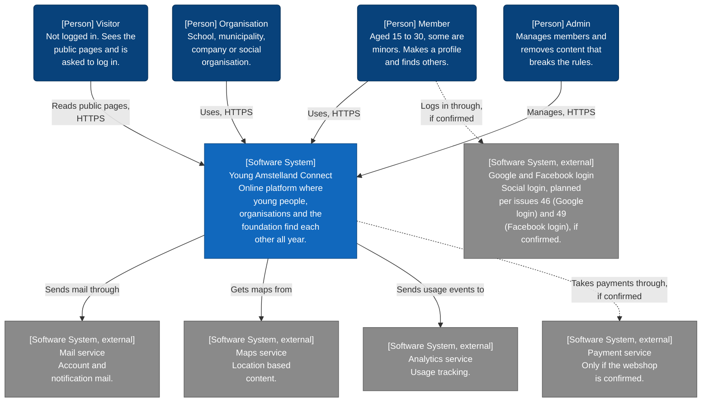
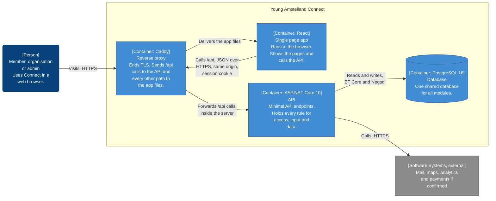

# Security and architecture: sprint 1 evidence for Young Amstelland Connect

## Table of Contents

- [1. Introduction](#1-introduction)
- [2. The project in brief](#2-the-project-in-brief)
- [3. How this evidence meets the datapoint](#3-how-this-evidence-meets-the-datapoint)
- [4. Architecture](#4-architecture)
- [5. Design patterns](#5-design-patterns)
- [6. Architecture decisions](#6-architecture-decisions)
- [7. Security](#7-security)
- [8. What I will demonstrate next](#8-what-i-will-demonstrate-next)
- [9. Honest status for sprint 1](#9-honest-status-for-sprint-1)
- [10. Conclusion](#10-conclusion)
- [11. Where to read more](#11-where-to-read-more)
- [References](#references)
- [AI use declaration](#ai-use-declaration)

## 1. Introduction

I am Wesley Oerlemans, student number 500926596, Full Stack Software Developer at level 3 in the Social Impact Apps studio of the HvA (Hogeschool van Amsterdam), and this is my evidence for datapoint 4 of sprint 1, Security & Architecture, under the learning outcome Designing & Realising. The course's level 3 datapoint sheet sets this criterion:

> With reference to the description above, you provide convincing evidence that you have demonstrated or will demonstrate your competency and knowledge.

The evidence sits in two documents, which this one connects:

- *Architecture of Young Amstelland Connect: structure, C4 model, patterns and decisions*, from here on the architecture document
- *Security and access fundamentals: applied to Young Amstelland Connect*, from here on the security document

Per the server notes, Connect has no code yet, so most of my evidence is design and research. Section 8 says what I will demonstrate next.

## 2. The project in brief

Per the team's product vision, we build Young Amstelland Connect, where young people from Amstelland, local organisations and the WailSalutem Foundation meet all year. The foundation is a nonprofit, and the business case is impact, not revenue: visibility, motivating young people and HvA collaboration. No funding model or success numbers exist yet. Per the requirements document, our users are 15 to 30, so some are minors.

Per the team's README, we are five: Wesley Oerlemans, Nick Hoebe, Gurpreet Singh and Bayon Eerhart in Full Stack, and Kelvin van Voorst as Security Specialist. Per the tech stack and architecture documents, the stack is React with ASP.NET Core Minimal APIs, EF Core and PostgreSQL 16. Whether Connect uses .NET 10 is still open, in issue 255 (recording the .NET 10 choice). Per the infrastructure document and server notes, the foundation lends us one Strato VPS in Germany, received 2 October 2026, with no containers yet.

## 3. How this evidence meets the datapoint

The datapoint description names five kinds of evidence, taken one by one below.

| What the datapoint names | What I have done | What I propose to do next | Where in the full documents |
| --- | --- | --- | --- |
| "you have developed and/or begun to implement an architecture for the project you will be working on" | A monolith in layers with CQRS (command query responsibility segregation) by feature, drawn in the C4 model | Build the first slice in sprint 2 and check the diagrams against the code | Architecture document, sections 5, 6 and 9 |
| "you have evidence of research about possible architectures" | A sourced comparison of a monolith in layers, a modular monolith and microservices | Measure the profile endpoints per my research plan (Oerlemans, 2026), for NFR4 (responsiveness)'s number | Architecture document, sections 4 and 5 |
| "you have thoughts about the security requirements for your project" | The seven BoKSA Security & Access Fundamentals key points applied to Connect, a mini threat model and the OWASP Top 10 | Prove the rule for minors with a test, in my demo project and the sprint 2 slice | Security document, sections 3, 4 and 6 |
| "you have done some design pattern exercises" | No separate exercises. Three patterns designed for Connect, and one that lost | Code the patterns in sprint 2. Strategy waits until the team plans matching | Architecture document, section 7 |
| "any other reasonable evidence of your progress in these topics" | Ten architecture decision records, and acceptance criteria for both documents | Update the records with the team's decisions, and record the learning group teacher's feedback | Architecture document, sections 8, 10 and 12. Security document, section 5 |

## 4. Architecture

### 4.1 The style and why

Per the team's architecture document, the backend is a layered architecture in four projects: Presentation, Application, Domain and Infrastructure, where layers may only talk to those allowed (Microsoft, 2021). My project references enforce that, meeting issue 12 (one clear structure for new developers), so a forbidden reference does not compile. Inside Application the whole team chose CQRS by feature on 1 October 2026.

BoKSA asks me to compare a monolith, a modular monolith and microservices against a given context (Hogeschool van Amsterdam, n.d.-e). The team's document weighs microservices, not a modular monolith, so that column is mine.

| Connect's context | Monolith in layers | Modular monolith | Microservices |
| --- | --- | --- | --- |
| Five students, four new to .NET | One codebase, one deployable unit (Microsoft, 2021) | Module boundaries add work for a team still learning the layers | Fowler (2015b) advises against starting without experience of building them |
| One server | Scales out by duplicating the whole application (Microsoft, 2021) | Also one deployable unit (Garg, 2023), scaling like the monolith | Services scale independently, with an orchestrator such as Kubernetes (Microsoft, 2025b) |
| Completion in the week of 4 January 2027 | A monolith first lets the first phase prioritise speed (Fowler, 2015b) | Early in development the natural boundaries may not be clear yet (Microsoft, 2021) | A premium that can slow development down considerably (Fowler, 2015a) |
| One shared database | Layers keep the code organised by responsibility (Microsoft, 2021) | Well-defined modules ease a later move to microservices (Garg, 2023) | Each service owns its data and schema (Microsoft, 2025b) |

Every row points to the monolith in layers: no hosting option on a student budget ran the cluster microservices need. In my assessment the modular monolith is the nearest alternative, once the team draws its boundaries.

I draw the architecture with Simon Brown's C4 model (Brown, n.d.-a). The architecture document holds five C4 diagrams, the two below come first.

### 4.2 Level 1: System context

A system context diagram shows the system as a box, surrounded by its users and other systems (Brown, n.d.-c).

A dotted arrow depends on a decision.

The four people are my proposed starting set for the role table, unconfirmed until issue 337 (confirming the role table). The client's diagram names the mail, maps and analytics services, with no provider chosen. The payment service waits for the webshop, owned by Nick Hoebe. Google and Facebook login are planned per issues 46 and 49, not yet confirmed.

### 4.3 Level 2: Containers

In C4 a container is an application or a data store (Brown, n.d.-b).

Npgsql is the provider through which EF Core reaches PostgreSQL, per the team's tech stack document.

Caddy ends TLS and routes by path, chosen in the server notes, my proposal for routing. The API holds every rule for access, input and data, sharing one origin with React behind Caddy, which section 3.2 of the security document explains for the session cookie.

## 5. Design patterns

The architecture workshop asks for at least three patterns, where each is used and why (Hogeschool van Amsterdam, 2026). BoKSA warns that "The real skill isn't memorising the pattern catalogue, it's judgment" (Hogeschool van Amsterdam, n.d.-a), so each is weighed against a simpler option. Per the server notes, all three are designed, not yet coded.

| Pattern | Problem in Connect | Where it lives | Why it fits | The simpler option it beat |
| --- | --- | --- | --- | --- |
| CQRS by feature | In my assessment, Connect reads far more than it writes | One folder per use case in Application | In my assessment, a query selecting only public columns keeps private fields safe | One model for reads and writes (Microsoft, 2025a), though a profile read needs fewer columns |
| Dependency injection | A handler must reach the data without depending on EF Core, so tests can swap it | The built-in service container of ASP.NET Core (Microsoft, 2026b) | Built in, nothing extra to maintain (Microsoft, 2026b) | A handler building its own AppDbContext, swappable only via constructor injection |
| Strategy for matching | Matching for FR2 is not designed yet | An IMatchStrategy in Application, injected into a MatchingService | A new algorithm can be added without changing the context (Refactoring.Guru, n.d.), though one strategy risks over-engineering (Hogeschool van Amsterdam, n.d.-a) | One method in MatchingService, rewritten at the first rule change |
| Repository pattern, the option that lost | Data access, with one repository per aggregate holding that logic (Microsoft, 2018) | Nowhere, since the team chose CQRS on 1 October 2026 | I accept that EF Core's DbContext already gives one typed set per table, so a repository passes calls through | It lost to CQRS, at the price of a handler test on an in-memory SQLite database |

## 6. Architecture decisions

BoKSA asks for an ADR (architecture decision record): context, decision, consequences (Hogeschool van Amsterdam, n.d.-e). Per Nygard (2011), a record is proposed until stakeholders agree, accepted once they do. The table gives the architecture document's ten records.

| Record | Decision | Chosen | Who and when | Status |
| --- | --- | --- | --- | --- |
| 8.1 | Architecture style | A monolith in layers, not microservices | Wesley Oerlemans, 24 September 2026 | Proposed by me, team confirmation not recorded |
| 8.2 | Project structure | Four projects, not one project with four folders | Wesley Oerlemans, 24 September 2026 | Proposed by me, team confirmation not recorded, decision file open |
| 8.3 | Endpoint style | Minimal APIs, not controllers | Wesley Oerlemans, 24 September 2026 | Accepted, team confirmation not recorded |
| 8.4 | Data access | EF Core | Wesley Oerlemans, 24 September 2026 | Accepted |
| 8.5 | Database | PostgreSQL 16, not SQL Server, Microsoft's database | Wesley Oerlemans, 26 September 2026 | Accepted |
| 8.6 | Pattern inside Application | CQRS by feature, not the repository pattern | The whole team, 1 October 2026 | Accepted |
| 8.7 | Hosting | The foundation's server | Settled by the foundation's offer, 2 October 2026 | Accepted |
| 8.8 | Reverse proxy | Caddy | The server notes, 2 October 2026 | Proposed |
| 8.9 | Platform version | .NET 10 | Not decided yet | Proposed |
| 8.10 | Authentication and authorization in the API | Cookie authentication and policy-based authorization | Proposed by me, decided by Kelvin van Voorst | Proposed |

Records 8.1, 8.2 and 8.8 to 8.10 are not accepted yet. Kelvin van Voorst decides 8.10 in the NFR1 design, due at the sprint 1 review. For 8.6, the architecture document records Nick Hoebe's CQRS interest as tipping the balance.

## 7. Security

### 7.1 The security requirements

Per the requirements document, NFR1 asks for an authentication scheme covering every role, with authorization for minors' data. Under the GDPR, NFR2 asks for a lawful basis, data minimisation and consent for minors. Issue 343 (viewing another member's public profile) fixes one rule: a member aged 15 to 17 never has their region seen by others.

### 7.2 The seven fundamentals applied to Connect

Each row is one BoKSA Security & Access Fundamentals point (Hogeschool van Amsterdam, n.d.-c). Most open choices belong to Kelvin van Voorst's NFR1 design.

| Key point | How it applies to Connect | My advice where open | Owner where the team decides |
| --- | --- | --- | --- |
| 1. Authentication versus authorization | Who you are versus what you may do (Hogeschool van Amsterdam, n.d.-b). Minors rules run in the API | None open | Not applicable |
| 2. Session versus token | A browser token is readable by any script, unlike an HttpOnly cookie (OWASP Foundation, n.d.-a, n.d.-d) | An HttpOnly, Secure, SameSite Lax cookie, with antiforgery on every change | Kelvin van Voorst (NFR1 design) |
| 3. Hashing and salting passwords | A salt gives equal passwords different hashes (OWASP Foundation, n.d.-c), hashed for us by Identity's PBKDF2 (Microsoft, 2026a) | Never log a password. Turn on Identity's lockout after repeated failures | Kelvin van Voorst (NFR1 design) |
| 4. Role-based access control | Roles reflect what a user may do (Microsoft, 2026e), but one role cannot carry the minors rule | Role policies by default, plus a resource check capping an admin at a member's view (Microsoft, 2026d) | The team, issue 337, and Kelvin van Voorst for a minor's profile |
| 5. Allow-list validation on the server | OWASP asks for a server-side acceptance rule per field, not a deny-list (OWASP Foundation, n.d.-b) | The endpoint checks the shape, the handler checks the rules | The team, for the maximum length of a bio |
| 6. Parameterised queries against SQL injection | A parameterised query keeps code and data apart (OWASP Foundation, n.d.-e), but FromSqlRaw "can be vulnerable to SQL injection attacks, if improperly used." (Microsoft, 2022) | Raw SQL only through FromSql, never FromSqlRaw, checked in every merge request | No owner recorded yet |
| 7. XSS (cross-site scripting) and output encoding | XSS runs scripts in pages other users load (Microsoft, 2026c). React escapes JSX values before rendering (React, n.d.) | Never use dangerouslySetInnerHTML for user content, plus a Content Security Policy header at Caddy | No owner recorded yet |

### 7.3 A mini threat model

Section 3.8 of the security document builds the mini threat model the security workshop asks for (Hogeschool van Amsterdam, n.d.-d), for viewing a member's profile, sorted by STRIDE, Microsoft's model for categorizing threats (Microsoft, 2017), each with a control and a residual risk. The open question, owned by Kelvin van Voorst, is whether an organisation may open a minor's profile at all.

### 7.4 The OWASP Top 10

Section 4 of the security document holds Connect against all ten OWASP Top 10 categories (OWASP Foundation, 2021), each with its control and sprint. In my assessment A01 Broken Access Control is the largest risk, because of minors' data.

## 8. What I will demonstrate next

Application is designed, not yet in code. I will close that gap in two steps.

- **A small demo project of my own**, the smallest step after the learning group, allowed by the teacher's message. It would hold a Minimal API with cookie authentication, one role policy and one resource rule: a minor's region left out, proven by a test.
- **The sprint 2 slice**, with the issue owners the team assigns: cookie authentication, the role policy and the endpoint of issue 343, proven by a test. At sprint 2's end I hold the C4 diagrams and decision records against the code for the first time.

Dates come from the course schedule and the team's delivery plan.

| Sprint | Dates | What I will show |
| --- | --- | --- |
| 1 | Weeks of 21 September to 5 October 2026, review deadline 9 October | Both full documents, in the learning group of 6 October |
| None | 12 to 17 October 2026 | Autumn break |
| 2 | Weeks of 19 October to 2 November 2026, review 5 November | The first slice in code, then the first diagram check against it |
| 3 | Weeks of 9 to 23 November 2026, review deadline 18 December | The check again, and the R&D report |
| 4 | Weeks of 7 and 14 December 2026 and 4 January 2027, review deadline 8 January 2027 | The last check before the handover, and the Review of Security & Testing datapoint |

## 9. Honest status for sprint 1

This table agrees with section 12 of the architecture document and section 6 of the security document. The asks come from the datapoint sheet, the architecture and security workshops (Hogeschool van Amsterdam, 2026, n.d.-d) and BoKSA.

| Ask | Status | Reason |
| --- | --- | --- |
| Understand and explain design patterns | Covered | Three patterns: problem, place, reason, cost and the lost option |
| Apply design patterns | Partly covered | Designed, not in code. Strategy is still a proposal |
| A documented style with architecture diagrams | Covered | The style and five C4 diagrams |
| Decision records with context, decision and consequences | Covered | Ten records. Five are proposed: 8.1, 8.2 and 8.8 to 8.10 |
| One decision explained to two audiences | Partly covered | Record 8.1 is written. The rest waits for a sprint review |
| Quality attribute scenarios | Partly covered | Two measures wait for a team target |
| A UI decomposed into reusable components | Not yet | The React app is one container until the first screens exist |
| The architecture in sync with the code | Not yet | No code yet. The check starts in sprint 2 |
| Understand and explain the security fundamentals | Covered | All seven points in my words, with a Connect example |
| Apply the security fundamentals | Partly covered | Applied in the design, the threat model and OWASP table, not in code |
| Authorization design for NFR1 | Not yet, not mine to decide | Owned by Kelvin van Voorst, due at the sprint 1 review |
| Feedback from the learning group teacher | Not yet | Comes on 6 October 2026 |

Understanding and explanation are covered. Application waits for code, and the sprint 2 check is where design meets it.

## 10. Conclusion

Connect is a monolith in layers: four projects, CQRS by feature in Application, Minimal APIs at the top and dependency injection to wire them, with Strategy proposed for matching. Every factor pointed to that style over a modular monolith and microservices. I applied the seven security fundamentals, tied the threats to controls, with every rule designed to run in the API.

This shows I understand Connect's architecture and security, and can explain both. Five decision records still wait on the team. I will close the gap between design and code with the demo project and the sprint 2 slice, where a test shows whether the rule for minors holds.

## 11. Where to read more

The full documents are the architecture document and the security document named in section 1.

| This summary | Architecture document | Security document |
| --- | --- | --- |
| 2 The project in brief | 1, 3 and 4.1 | 1 |
| 3 How this evidence meets the datapoint | 10 and Appendix A | 5 |
| 4 Architecture | 4, 5 and 6 | 3.2 |
| 5 Design patterns | 7 | None |
| 6 Architecture decisions | 3 and 8 | 3.2 and 3.4 |
| 7 Security | 4.2 | 3 and 4 |
| 8 What I will demonstrate next | 9 and 11 | 6 and 7 |
| 9 Honest status for sprint 1 | 12 | 6 |

## References

Brown, S. (n.d.-a). *The C4 model for visualising software architecture*. Retrieved October 5, 2026, from https://c4model.com/

Brown, S. (n.d.-b). *Container diagram*. C4 model. Retrieved October 5, 2026, from https://c4model.com/diagrams/container

Brown, S. (n.d.-c). *System context diagram*. C4 model. Retrieved October 5, 2026, from https://c4model.com/diagrams/system-context

Fowler, M. (2015a, May 13). *Microservice premium*. martinfowler.com. https://martinfowler.com/bliki/MicroservicePremium.html

Fowler, M. (2015b, June 3). *Monolith first*. martinfowler.com. https://martinfowler.com/bliki/MonolithFirst.html

Garg, R. (2023, June 3). *When (modular) monolith is the better way to build software*. Thoughtworks. https://www.thoughtworks.com/insights/blog/microservices/modular-monolith-better-way-build-software

Hogeschool van Amsterdam. (n.d.-a). *Architecture and design patterns*. BoKSA. Retrieved October 6, 2026, from https://boksa.hbo-ict-hva.nl/profiles/full-stack-developer/design-and-realise/architecture-and-design-patterns/

Hogeschool van Amsterdam. (n.d.-b). *Authentication & authorization basics*. BoKSA. Retrieved October 5, 2026, from https://boksa.hbo-ict-hva.nl/profiles/full-stack-developer/design-and-realise/authentication-and-authorization-basics/

Hogeschool van Amsterdam. (n.d.-c). *Security & access fundamentals*. BoKSA. Retrieved October 5, 2026, from https://boksa.hbo-ict-hva.nl/profiles/full-stack-developer/knowledge/security-and-access-fundamentals/

Hogeschool van Amsterdam. (n.d.-d). *Security for software engineers: An introductory, practical session on building safer software* [Course document]. Hogeschool van Amsterdam.

Hogeschool van Amsterdam. (n.d.-e). *Technical architecture decision making*. BoKSA. Retrieved October 6, 2026, from https://boksa.hbo-ict-hva.nl/profiles/full-stack-developer/analyse-and-advice/technical-architecture-decision-making/

Hogeschool van Amsterdam. (2026). *Architecture & design patterns: How they fit in your project* [Course document].

Microsoft. (2017, August 17). *Microsoft Threat Modeling Tool threats*. Microsoft Learn. https://learn.microsoft.com/en-us/azure/security/develop/threat-modeling-tool-threats

Microsoft. (2018, October 8). *Designing the infrastructure persistence layer*. Microsoft Learn. https://learn.microsoft.com/en-us/dotnet/architecture/microservices/microservice-ddd-cqrs-patterns/infrastructure-persistence-layer-design

Microsoft. (2021, December 12). *Common web application architectures*. Microsoft Learn. https://learn.microsoft.com/en-us/dotnet/architecture/modern-web-apps-azure/common-web-application-architectures

Microsoft. (2022, September 19). *SQL queries*. Microsoft Learn. https://learn.microsoft.com/en-us/ef/core/querying/sql-queries

Microsoft. (2025a, February 20). *CQRS pattern*. Microsoft Learn. https://learn.microsoft.com/en-us/azure/architecture/patterns/cqrs

Microsoft. (2025b, June 30). *Microservices architecture style*. Microsoft Learn. https://learn.microsoft.com/en-us/azure/architecture/guide/architecture-styles/microservices

Microsoft. (2026a, September 18). *Configure ASP.NET Core Identity*. Microsoft Learn. https://learn.microsoft.com/en-us/aspnet/core/security/authentication/identity-configuration

Microsoft. (2026b, September 22). *Dependency injection in ASP.NET Core*. Microsoft Learn. https://learn.microsoft.com/en-us/aspnet/core/fundamentals/dependency-injection

Microsoft. (2026c, May 13). *Prevent cross-site scripting (XSS) in ASP.NET Core*. Microsoft Learn. https://learn.microsoft.com/en-us/aspnet/core/security/cross-site-scripting

Microsoft. (2026d, July 21). *Resource-based authorization in ASP.NET Core*. Microsoft Learn. https://learn.microsoft.com/en-us/aspnet/core/security/authorization/resourcebased

Microsoft. (2026e, April 7). *Role-based authorization in ASP.NET Core*. Microsoft Learn. https://learn.microsoft.com/en-us/aspnet/core/security/authorization/roles

Nygard, M. (2011, November 15). *Documenting architecture decisions*. Cognitect. https://www.cognitect.com/blog/2011/11/15/documenting-architecture-decisions

Oerlemans, W. (2026). *Research plan: Keeping the profile endpoints of Young Amstelland Connect fast as related data, data volume and users grow* [Unpublished manuscript]. Hogeschool van Amsterdam.

OWASP Foundation. (n.d.-a). *HTML5 security cheat sheet*. OWASP Cheat Sheet Series. Retrieved October 5, 2026, from https://cheatsheetseries.owasp.org/cheatsheets/HTML5_Security_Cheat_Sheet.html

OWASP Foundation. (n.d.-b). *Input validation cheat sheet*. OWASP Cheat Sheet Series. Retrieved October 5, 2026, from https://cheatsheetseries.owasp.org/cheatsheets/Input_Validation_Cheat_Sheet.html

OWASP Foundation. (n.d.-c). *Password storage cheat sheet*. OWASP Cheat Sheet Series. Retrieved October 5, 2026, from https://cheatsheetseries.owasp.org/cheatsheets/Password_Storage_Cheat_Sheet.html

OWASP Foundation. (n.d.-d). *Session management cheat sheet*. OWASP Cheat Sheet Series. Retrieved October 5, 2026, from https://cheatsheetseries.owasp.org/cheatsheets/Session_Management_Cheat_Sheet.html

OWASP Foundation. (n.d.-e). *SQL injection prevention cheat sheet*. OWASP Cheat Sheet Series. Retrieved October 5, 2026, from https://cheatsheetseries.owasp.org/cheatsheets/SQL_Injection_Prevention_Cheat_Sheet.html

OWASP Foundation. (2021). *OWASP Top 10:2021*. https://owasp.org/Top10/2021/

React. (n.d.). *Introducing JSX*. https://legacy.reactjs.org/docs/introducing-jsx.html

Refactoring.Guru. (n.d.). *Strategy*. Retrieved October 5, 2026, from https://refactoring.guru/design-patterns/strategy

## AI use declaration

AI was used as a writing support tool while working on this document. I used AI to draft the formulation of sentences, the structure of wording, readability, and clarity from content that I had provided, and to generate the diagrams. The content itself, including my experiences, reflections, learning goals, decisions, self-assessments, and conclusions, is my own. I reviewed the drafts and decided which text to include.
