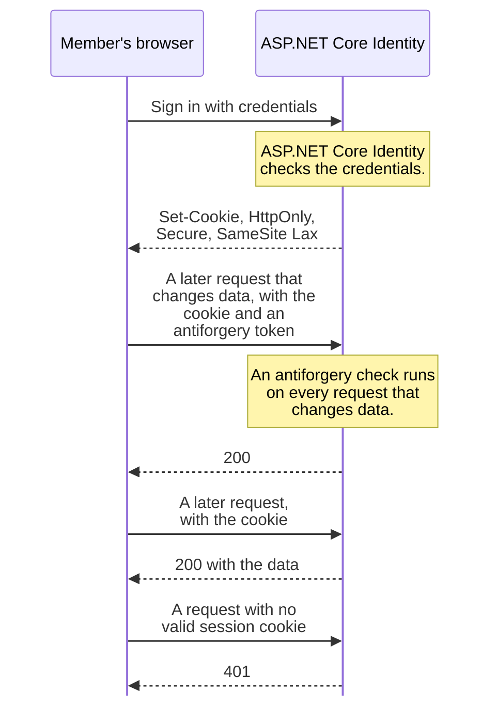
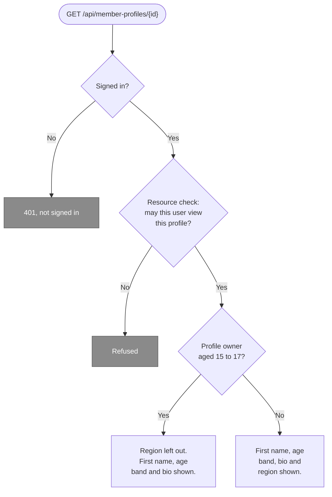
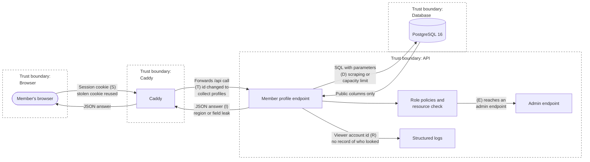

# Security and access fundamentals: applied to Young Amstelland Connect

## Table of Contents

- [1. Introduction](#1-introduction)
- [2. Terms and identifiers used](#2-terms-and-identifiers-used)
- [3. Security and access fundamentals applied to Connect](#3-security-and-access-fundamentals-applied-to-connect)
- [4. OWASP Top 10 against Connect](#4-owasp-top-10-against-connect)
- [5. Acceptance criteria](#5-acceptance-criteria)
- [6. Is this enough for sprint 1](#6-is-this-enough-for-sprint-1)
- [7. Planning](#7-planning)
- [References](#references)
- [AI use declaration](#ai-use-declaration)

## 1. Introduction

This document is the security half of my evidence for the Security & Architecture datapoint of sprint 1, whose content the course's level 3 datapoint sheet gives as security & access fundamentals and design patterns. The architecture half is my document *Architecture of Young Amstelland Connect: structure, C4 model, patterns and decisions*, from here on my architecture document. On 6 October 2026 the repository holds only an example solution structure for authentication in `api/`, added on 2 October, and no slice of Connect yet, so everything below is design.

## 2. Terms and identifiers used

This section explains every requirement code, acceptance criterion, GitLab issue number and abbreviation in this document. In the text, a code or issue number carries its short meaning in brackets, and an abbreviation is spelled out where it first appears. An abbreviation that appears only in a diagram, a quotation, a heading or a reference title is explained here only.

| Term or code | Meaning | Source |
| --- | --- | --- |
| NFR | Non-functional requirement | Requirements document |
| NFR1 | Authentication and authorization | Requirements document |
| AC | Acceptance criterion, a check this document sets for itself | This document, section 5 |
| AC1 | Seven fundamentals explained and applied | This document, section 5 |
| AC2 | Threats tied to controls | This document, section 5 |
| AC3 | Role design tied to the minors' data rule | This document, section 5 |
| AC4 | Fundamentals proven in running code | This document, section 5 |
| AC5 | Code reviewed for insecure patterns | This document, section 5 |
| Issue 10 | A personal server login per team member | GitLab issues |
| Issue 21 | A personal data inventory per module | GitLab issues |
| Issue 22 | Stopping building blocks with known security holes | GitLab issues |
| Issue 46 | Google login | GitLab issues |
| Issue 49 | Facebook login | GitLab issues |
| Issue 255 | Recording the .NET 10 choice | GitLab issues |
| Issue 306 | Checking every module's authenticity and resistance | GitLab issues |
| Issue 337 | Confirming the role table | GitLab issues |
| Issue 343 | Viewing another member's public profile | GitLab issues |
| A01 to A10 | The ten category numbers of the OWASP Top 10, 2021 edition | Cited reference (OWASP Foundation) |
| API | Application programming interface | This document |
| BoKSA | Body of Knowledge, Skills and Attitudes, the knowledge base of the course | Course material |
| CI/CD | Continuous integration and continuous delivery | This document |
| DOM | Document Object Model | Cited reference (React) |
| EF Core | Entity Framework Core | Cited reference (Microsoft) |
| HTML | HyperText Markup Language | Cited reference (React) |
| HTTPS | Hypertext Transfer Protocol Secure, HTTP over an encrypted connection | This document |
| JSON | JavaScript Object Notation | This document |
| JSX | JavaScript XML, the syntax React components are written in | Cited reference (React) |
| JWT | JSON Web Token | This document |
| LINQ | Language Integrated Query | This document |
| OAuth | Open Authorization, a standard for delegated access | Cited reference (Microsoft) |
| OWASP | Open Worldwide Application Security Project | Cited reference (OWASP Foundation) |
| PBKDF2 | Password-Based Key Derivation Function 2 | Cited reference (Microsoft) |
| SPA | Single-page application | Cited reference (Microsoft) |
| SQL | Structured Query Language | This document |
| SSRF | Server-side request forgery | Cited reference (OWASP Foundation) |
| STRIDE | Spoofing (S), tampering (T), repudiation (R), information disclosure (I), denial of service (D) and elevation of privilege (E) | Cited reference (Microsoft) |
| TBD | To be decided | This document |
| TLS | Transport Layer Security | This document |
| uuid | Universally unique identifier | This document |
| WS-Federation | Web Services Federation, a sign-in protocol | Cited reference (Microsoft) |
| XSS | Cross-site scripting | This document |

## 3. Security and access fundamentals applied to Connect

Each subsection follows one Key Point of the BoKSA (Body of Knowledge, Skills and Attitudes) article Security & Access Fundamentals (Hogeschool van Amsterdam, n.d.-d). I explain the concept in my own words, apply it to Connect and give my advice where the team has not decided. Most of these choices belong to the NFR1 (authentication and authorization) design of Kelvin van Voorst.

### 3.1 Authentication versus authorization

Authentication answers who you are. Authorization answers what you may do. BoKSA calls these two separate questions (Hogeschool van Amsterdam, n.d.-a). This means a login proves the first and says nothing about the second.

Issue 343 (viewing another member's public profile) shows the difference. The login guard checks that the caller is logged in. That is authentication. Then the rule for minors decides what this caller may see of this specific profile: for a member aged 15 to 17, another member never sees the region. That is authorization, and it depends on the resource, not on the login. A member who opens a 16 year old's profile sees the first name, the age band and the bio, never the region. The first principle of the security workshop is server-side authorization, because client-side checks help usability but do not protect data (Hogeschool van Amsterdam, n.d.-e). So every rule is designed to run in the API (application programming interface). The React app may hide a button, but hiding is not a check.

### 3.2 Session versus token

With a session, the browser holds a cookie that it sends with every request, and the server checks it. With a token such as a JWT (JSON Web Token), the client holds a signed token with claims and an expiry and sends it in a header, and the server checks the signature (Hogeschool van Amsterdam, n.d.-a).

**My advice is cookie authentication with ASP.NET Core Identity, with an HttpOnly, Secure and SameSite cookie.** The reasons:

- The React app and the API share one origin behind Caddy, and, for production, behind Traefik inside k3s as well, so a cookie needs no extra setup.
- A token in browser storage can be read by any script on the page, because local storage is always accessible by JavaScript (OWASP Foundation, n.d.-d). An HttpOnly cookie cannot be read by script, because the attribute tells the browser not to let scripts access it (OWASP Foundation, n.d.-g).
- Microsoft says the same for single page apps: "We recommend using cookies for browser-based applications, because, by default, the browser automatically handles them without exposing them to JavaScript." (Microsoft, 2026d).
- Since ASP.NET Core 10, API endpoints no longer redirect to a login page under cookie authentication (Microsoft, 2025b). The API is designed to answer 401, which the acceptance criteria of issue 343 (viewing another member's public profile) ask for.
- Kelvin van Voorst has ASP.NET Identity experience, per the team's tech stack document.

A browser includes cookies in its requests automatically, and that is what lets cross-site request forgery work (OWASP Foundation, n.d.-b). The default SameSite mode is Lax (Microsoft, 2025b).

**My advice is Lax, not Strict.** The GitLab issues plan Google login (issue 46) and Facebook login (issue 49), and a person new to Connect returns to Connect through a cross-site redirect after signing in at the provider. In my own reasoning a cookie marked Strict would not travel on a cross-site return of that kind. Microsoft's own guidance confirms that the Lax setting works for most application cookies and that most OAuth (Open Authorization) logins are not affected by the SameSite restrictions that disable the attribute for other protocols such as OpenID Connect and WS-Federation (Microsoft, 2025c). I keep the protection Strict was meant to give with an antiforgery check on every request that changes data, rather than with the cookie's own SameSite value. Kelvin van Voorst decides this in the NFR1 (authentication and authorization) design, due at the sprint 1 review.

This sequence diagram draws my advice above as one flow: signing in, the cookie Identity sets, the antiforgery check on a request that changes data, and the 401 a request without a session gets. My advice, not yet decided by Kelvin van Voorst.

Key: a solid arrow is a call, a dashed arrow is an answer.

### 3.3 Hashing and salting passwords

My starting point is that a stored password must never be readable, not even by us. So we store a hash, the result of a one-way function that cannot be turned back into the password (OWASP Foundation, n.d.-f). A salt is a unique, random value added to each password while hashing (OWASP Foundation, n.d.-f). Two equal passwords then get different hashes, and precomputed lookup tables such as rainbow tables become useless (OWASP Foundation, n.d.-f). A good password hash is also slow on purpose, which makes guessing more difficult, expensive and time-consuming for an attacker (OWASP Foundation, n.d.-f).

BoKSA names bcrypt and Argon2 (Hogeschool van Amsterdam, n.d.-a). ASP.NET Core Identity uses PBKDF2 (Password-Based Key Derivation Function 2), and its option IterationCount is "The number of iterations used when hashing passwords using PBKDF2." (Microsoft, 2026a). Microsoft's own PBKDF2 example takes the password, a random salt of 128 bits and an iteration count, and warns not to use that low-level call for stored passwords: "New apps should use the PasswordHasher class." (Microsoft, 2026c).

This means we write no hashing code ourselves. In my design Identity stores the hash, and our code never handles a stored password. My advice adds two points for the NFR1 (authentication and authorization) design: never log a password or a login request body, and turn on Identity's lockout after repeated failed sign-ins.

### 3.4 Role-based access control

With role-based access control, a user belongs to one or more roles, and the roles reflect what the user may access and do (Microsoft, 2026h). In my design the code asks whether the role may do something, not whether this person may.

My proposed starting set for Connect's roles is Visitor, Member, Organisation and Admin, which the team confirms in issue 337 (confirming the role table). Per issue 337 (confirming the role table), the role table lists per module what each role may do, with a column for minors, and the team confirms it row by row. One rule is already fixed in issue 343 (viewing another member's public profile): for a member aged 15 to 17, another member never sees the region.

In my assessment a role alone cannot carry that rule, because every member has the role Member. So I advise two layers:

- **Policies for the role.** "An ASP.NET Core authorization policy is a set of one or more authorization requirements that the framework evaluates to decide whether a user is allowed to access a resource." (Microsoft, 2026e). Every endpoint requires a signed in user unless it is on the open list. That is the secure default the security workshop asks for, where something stays private until it is deliberately shared (Hogeschool van Amsterdam, n.d.-e). Admin endpoints require the Admin role.
- **A resource check for the profile.** The endpoint loads the profile and asks IAuthorizationService whether this user may view it, and a handler evaluates the requirement against that specific resource (Microsoft, 2026g). This is ViewMemberProfileHandler in section 6.4 of my architecture document.

The field rule stays in ProfileVisibility in Domain, next to the role table. Both layers follow least privilege, the principle of giving users only the minimum privileges they need for their job (OWASP Foundation, n.d.-a). In my design a role gets only what the role table gives it. Both layers run in the API. That is server-side authorization, the first principle of the security workshop (Hogeschool van Amsterdam, n.d.-e).

What the rule for minors means for each role, until the team confirms the role table:

- **Visitor.** Issue 343 (viewing another member's public profile) opens a profile to logged in members only, so a visitor sees no profile at all.
- **Member.** For a member aged 15 to 17, another member never sees the region. The first name, the age band and the bio stay visible.
- **Organisation.** Not decided. Whether an organisation may open a minor's profile at all is the open question of section 3.8, owned by Kelvin van Voorst.
- **Admin.** Not decided, and no team document or issue says it yet. In my view it belongs to the same open point of NFR1 (authentication and authorization), owned by Kelvin van Voorst and due at the latest at the sprint 1 review. My proposal is that an admin sees no more of a minor's profile than a member does, unless the role table gives the Admin column more. That follows least privilege.

This flowchart draws the authentication then the authorization of issue 343 (viewing another member's public profile): signed in or 401, the resource check above, and the rule for minors for a profile owner aged 15 to 17. My design.

Key: a diamond is a decision, the grey boxes end the request.

### 3.5 Allow-list validation on the server

OWASP (Open Worldwide Application Security Project) lists deny-listing, or cleaning input, as a common pitfall and asks for an acceptance rule per field instead, such as exact membership of an allowed set for fixed choices (OWASP Foundation, n.d.-e). In my words: a deny-list blocks input known to be bad and misses the case nobody thought of. An allow-list accepts only input known to be good, so it is safer. Validation must happen on the server, even when the browser checks the same fields, because client-side validation can be bypassed (OWASP Foundation, n.d.-e). As I see it, anyone can call the API without our React app.

My advice for Connect:

- **The endpoint is designed to check the shape.** The acceptance criteria of issue 343 (viewing another member's public profile) ask that only a valid uuid (universally unique identifier) passes.
- **The command handler checks the rules.** An age band must be one of the three values, and a bio has a maximum length the team sets.
- **The React app checks for convenience only.** It warns the user early, and the API never trusts it.

### 3.6 Parameterised queries against SQL injection

SQL (Structured Query Language) injection works when a query is built by pasting user input into its text, so an attacker can enter SQL code that the database then runs (OWASP Foundation, n.d.-h). A parameterised query defines all SQL code first and passes each value in later, so the database always tells code and data apart, whatever the user typed (OWASP Foundation, n.d.-h).

In my design all data in Connect goes through EF Core (Entity Framework Core), the data access decision of 24 September 2026. When a LINQ (Language Integrated Query) query takes a value from a variable, EF Core sends it as a SQL parameter (Microsoft, 2025a). For raw SQL, "The FromSql and FromSqlInterpolated methods are safe against SQL injection, and always integrate parameter data as a separate SQL parameter." But "the FromSqlRaw method can be vulnerable to SQL injection attacks, if improperly used." (Microsoft, 2022). My proposal for the code conventions: raw SQL only through FromSql, never FromSqlRaw with user input, checked in every merge request. The database user of section 3.9 limits the damage if something slips through.

### 3.7 XSS and output encoding

Cross-site scripting lets an attacker place client-side scripts in web pages, and when other users load those pages, the scripts run (Microsoft, 2026f). For Connect that means a bio with a script in it would run in every visitor's browser. Output encoding changes characters such as the less-than sign into a safe form before they are shown (Microsoft, 2026f), so the browser treats them as text and not as code (OWASP Foundation, n.d.-c).

In my reading of the requirements document, Connect shows a lot of user text, from profiles to showcased work. React encodes by default: "By default, React DOM escapes any values embedded in JSX before rendering them." (React, n.d.-b). The way around it is dangerouslySetInnerHTML, and React warns: "If the HTML inside isn't trusted (for example, if it's based on user data), you risk introducing an XSS vulnerability." (React, n.d.-a). My advice is that Connect never uses it for user content and that a reviewer checks for it. The HttpOnly cookie limits the damage of an XSS (cross-site scripting) bug, because a script cannot read the session cookie (OWASP Foundation, n.d.-g). A Content Security Policy header at Caddy is my proposal for one more layer.

### 3.8 A mini threat model for viewing a member's profile

The security workshop asks for a mini threat model: the assets, 3 to 5 threats, the controls and one open question (Hogeschool van Amsterdam, n.d.-e). I do it for issue 343 (viewing another member's public profile) and sort the threats by STRIDE (spoofing, tampering, repudiation, information disclosure, denial of service and elevation of privilege), the model Microsoft uses to categorize types of threats (Microsoft, 2017).

**Assets.** The region of a member aged 15 to 17, the private fields of every profile, the session cookie and the availability of the page. **Actors.** A member using the page as meant, a curious member who changes the id, someone without an account, and someone with a stolen cookie.

| STRIDE | Threat | Control in the design | Residual risk |
| --- | --- | --- | --- |
| Spoofing | Someone uses another member's session | HttpOnly, Secure, SameSite cookie with an expiry, sign out on the server | A shared computer left signed in |
| Tampering | A member changes the id to collect profiles or more fields | Random uuids, and every answer passes the same projection and ProfileVisibility | Any member can view any public profile, as intended |
| Repudiation | Nobody can tell who looked at a minor's profile | Structured logs of profile reads with the viewer's account id, never passwords or cookies | What to log, and for how long, is not decided |
| Information disclosure | A minor's region or a private field leaks in the JSON (JavaScript Object Notation) or an error | Public columns only, no region key for From15To17, ProblemDetails without internals, a test that the JSON never holds email, account id, id, created date or a password field | Other modules can leak the same data |
| Denial of service | Scraping, or a database that runs out of capacity | A rate limit (my proposal), a plain 503, health checks | One server, one database |
| Elevation of privilege | A member reaches an admin endpoint, or an organisation sees more of a minor than allowed | Signed in by default, role policies, the resource check of section 6.4 of my architecture document | NFR1 (authentication and authorization) is open and the role table is not confirmed |

This flowchart draws the table above as a data flow, with the browser, Caddy, the API and the database as trust boundaries and the parenthesised STRIDE letter from the table on each flow it threatens. My design.

Key: dashed frames are trust boundaries, the parenthesised letter is the STRIDE category from the table above.

**Open question.** May an organisation open a minor's profile at all? This is the open point of NFR1 (authentication and authorization), owned by Kelvin van Voorst. Per the team's delivery plan, his full threat model, a data flow diagram plus STRIDE for at least one feature, lands in the weeks of 19 and 26 October 2026. Issue 21 (a personal data inventory per module) adds his inventory of the personal data per module.

**The rule for minors.** For a member aged 15 to 17, another member never sees the region. The controls in the table hold it for members, and section 3.4 says what it means for the other roles.

Issue 306 (checking every module's authenticity and resistance) asks for this kind of check on every module before the first young person signs up. This section does it for one module, the member profile, and section 4 does it for Connect as a whole.

### 3.9 Security in the deployment

- **TLS (Transport Layer Security) at the front door.** In a reverse proxy configuration the proxy handles the connection security (Microsoft, 2026b). In my design the Caddy front door gets a real certificate that renews itself, and TLS ends there for every visit, before the request is forwarded into the server. Records 8.8 and 8.11 of my architecture document add that for production, Caddy forwards the request to Traefik inside k3s, which stays closed to the internet and only routes it to the pod, my design for the monitored production deployment the course's own DevOps document asks for (Hogeschool van Amsterdam, 2026a).
- **Secrets out of the repository.** Connection strings and service credentials never go in the repository. Locally ASP.NET Core's user-secrets hold them, on the server environment variables or a secret store, as the team's infrastructure document proposes.
- **A least-privilege database user.** My proposal: the API may read and write Connect's tables and nothing else, and migrations run with a separate user during a deploy.
- **A login per team member.** Issue 10 (a personal server login per team member) gives everyone a personal key and keeps guessed passwords out. Per the team's onboarding guide (`docs/team/onboarding.md`, section 10), the firewall lets in only the secure login and web traffic, and repeated failed logins are blocked. The personal logins are still open work.
- **A known-vulnerable dependency stopped.** Issue 22 (stopping building blocks with known security holes) asks for this. My proposal is a scan stage that runs `dotnet package list --vulnerable` and `npm audit` and fails above a severity the team sets, plus the weekly re-check issue 22 (stopping building blocks with known security holes) asks for. This feeds the DevOps & Testing datapoint, which the team's workshop coverage document places in sprint 2. Manual checking is the other option, but no team document compares it with a scan stage. The comparison the infrastructure document does make is with GitLab's own dependency scanning. That lost because it needs GitLab's paid Ultimate tier, while the two commands are free and come with the tools the team already installs.
- **Runtime secrets as a Kubernetes Secret.** Record 8.11 of my architecture document runs Connect's one image in k3s with a Secret beside the Deployment and the Service, holding the database credentials and the other config the container reads at runtime, rather than in the image or the repository. My design for the production deployment the course's own DevOps document asks for (Hogeschool van Amsterdam, 2026a).
- **Container scanning in the pipeline.** Record 8.11 of my architecture document plans GitLab CI with a build, test, scan and deploy stage, the container scan running before the image reaches k3s. My proposal for the pipeline the course's own DevOps document asks a monitored production deployment to run (Hogeschool van Amsterdam, 2026a), alongside the dependency scan above.
- **A rollback.** Record 8.11 of my architecture document asks for a rollback shown live that recovers the previous image when a new one breaks. My proposal for the rolled-back-if-needed deployment the course's own DevOps document asks for (Hogeschool van Amsterdam, 2026a), rehearsed in the sprint 2 live demo.

This shows the security workshop's principles at server level (Hogeschool van Amsterdam, n.d.-e). Server-side authorization holds because Caddy only handles the certificate and the routing to Traefik and the app, and every check of section 3.4 runs in the API. The deployment adds least privilege in the database user and the logins, secure defaults in the firewall, defense in depth in the extra layers, and design for response in logs, health checks and a rollback path.

## 4. OWASP Top 10 against Connect

I use the 2021 edition of the OWASP Top 10 and its category names as OWASP lists them (OWASP Foundation, 2021). OWASP has since published a 2025 edition that reorders and renames several categories (OWASP Foundation, 2025).

The table below is my assessment of which categories apply to Connect, the control in this design and the sprint in which each control lands. Together with the threat model of section 3.8, it is my start on issue 306 (checking every module's authenticity and resistance).

| Category | Applies | Control in this design | Sprint |
| --- | --- | --- | --- |
| A01 Broken Access Control | Yes, the largest risk with minors' data | Signed in by default, role policies, resource checks, ProfileVisibility | 2 |
| A02 Cryptographic Failures | Yes | TLS at Caddy, Identity's password hashing, secrets out of the repository | 1 and 2 |
| A03 Injection | Yes | EF Core parameters, no FromSqlRaw with user input, React's encoding | 2 |
| A04 Insecure Design | Yes | This design, the mini threat model, the role table, Kelvin's threat model | 1 and 2 |
| A05 Security Misconfiguration | Yes | Default deny firewall, containers closed to the outside, errors without internals | 1 and 2 |
| A06 Vulnerable and Outdated Components | Yes | .NET 10 support dates in issue 255 (recording the .NET 10 choice), a scan stage and weekly check in issue 22 (stopping building blocks with known security holes) | 1 and 2 |
| A07 Identification and Authentication Failures | Yes | ASP.NET Core Identity, lockout, a session cookie with an expiry | 2 |
| A08 Software and Data Integrity Failures | Partly | Deploys only from the pipeline, lock files in the repository | 2 |
| A09 Security Logging and Monitoring Failures | Yes | Structured logs, health checks, no secrets in a log | 2 and 3 |
| A10 Server-Side Request Forgery (SSRF) | Barely | The API calls only configured services, never an address a user types | 3 |

## 5. Acceptance criteria

These are my acceptance criteria for the security half of this datapoint, and I check each one before I show this document.

| ID | Criterion | How I check it | BoKSA level 3 outcome | BoKSA article |
| --- | --- | --- | --- | --- |
| AC1 | **Seven fundamentals explained and applied.** Sections 3.1 to 3.7 explain each of the seven Key Points of Security & Access Fundamentals in my own words and apply each one to Connect. Every choice that is not decided yet is my advice, with its owner and the moment it is decided. | I tick each Key Point against its subsection: the explanation, the Connect example and, for an open choice, the owner and the moment. The feedback of the learning group teacher on 6 October 2026 tells me whether my explanations hold, and my architecture document records it under its feedback criterion. | OR2, relevant standards and methods | Security & access fundamentals (Hogeschool van Amsterdam, n.d.-d): the seven Key Points, from the difference between authentication and authorization to how output encoding prevents XSS |
| AC2 | **Threats tied to controls.** Section 3.8 models viewing a member's profile with its assets, a threat per STRIDE category, the control against it and the risk that remains. Section 4 gives each of the ten OWASP Top 10 categories a control in Connect and the sprint it lands in. | I check that every threat in 3.8 has a control and a remaining risk, that every row of section 4 has a control and a sprint, and that each control matches the design in section 3 and in sections 5 to 7 of my architecture document. Sections 3.4 and 3.9 also have to show the workshop's principles: server-side authorization, least privilege, secure defaults, defense in depth and design for response. | AA4, well-founded advice | Security threat basics (Hogeschool van Amsterdam, n.d.-f): analyse a web app feature with a simple threat-modelling approach, map the findings to the OWASP Top 10 and suggest practical, developer-level mitigations |
| AC3 | **Role design tied to the minors' data rule.** Section 3.4 gives the four roles of the role table, Visitor, Member, Organisation and Admin, with signed in as the secure default. Sections 3.1, 3.4 and 3.8, and section 6.4 of my architecture document, keep a minor's region and private fields out of what others see, and the document says what this means for a minor and for the members and organisations who view a minor's profile. | I check that the rule for minors reads the same in 3.1, 3.4 and 3.8 and in section 6.4 of my architecture document, and that its effect on each role is written down. The rule is only final once the team confirms the role table and Kelvin van Voorst decides the NFR1 (authentication and authorization) design at the sprint 1 review. Until then 3.4 writes the effect on Organisation and Admin down as open, with its owner. | OR5, impact on end users and society, and AA3, societal and ethical consequences | Secure coding practices (Hogeschool van Amsterdam, n.d.-c): apply Privacy by Design in architectural decisions, minimising data collection, enforcing least privilege and documenting sensitive data flows |
| AC4 | **Fundamentals proven in running code.** Only possible in the demo project or the sprint 2 slice, because no code exists yet. Cookie authentication through ASP.NET Core Identity, one role policy and the resource rule for minors run, and a test proves that a minor's private fields never leave the API. | An automated test asks for a minor's profile as each role the rule excludes, and fails when the answer holds the region or any field outside the public columns of section 6.4 of my architecture document. A second test checks that a request without a session gets a 401 (not signed in). Both pass in the pipeline, and I show them in a demo to the learning group teacher. | OR4, systematic validation | Authentication & authorization basics (Hogeschool van Amsterdam, n.d.-a): define at least two roles and enforce role-based access on selected routes, so only authorised users can perform sensitive actions |
| AC5 | **Code reviewed for insecure patterns.** Only possible from the demo project or sprint 2 on. The code holds no SQL built from strings, no FromSqlRaw and no dangerouslySetInnerHTML, and every endpoint checks its input against the allow-list of 3.5. | I review the code against 3.5 to 3.7, search it for FromSqlRaw and dangerouslySetInnerHTML, and record every finding with its fix in the merge request. | OR4, systematic validation | Input validation & secure coding (Hogeschool van Amsterdam, n.d.-b): review code for common insecure patterns (unsanitised input, string-built SQL, unsafe HTML (HyperText Markup Language) injection) and propose concrete, secure replacements |

### 5.1 What the datapoint asks, and where

The asks come from the datapoint sheet, the Security for Software Engineers workshop (Hogeschool van Amsterdam, n.d.-e) and the seven Key Points of the BoKSA page Security & Access Fundamentals (Hogeschool van Amsterdam, n.d.-d).

| Ask | Section | Criterion |
| --- | --- | --- |
| Sheet: Security & Access Fundamentals | 3, 4 | AC1 (seven fundamentals explained and applied) |
| Security workshop: confidentiality, integrity, availability, accountability | 3.8, 4 | AC2 (threats tied to controls) |
| Security workshop: the six risk categories, from access control to dependencies | 3, 4 | AC2 (threats tied to controls) |
| Security workshop: server-side authorization, least privilege, secure defaults, defense in depth, design for response | 3.4, 3.9 | AC2 (threats tied to controls) |
| Security workshop: a mini threat model | 3.8 | AC2 (threats tied to controls) |
| Key Point 1: authentication versus authorization | 3.1 | AC1 (seven fundamentals explained and applied) |
| Key Point 2: session-based versus token-based authentication | 3.2 | AC1 (seven fundamentals explained and applied) |
| Key Point 3: why passwords are hashed and salted | 3.3 | AC1 (seven fundamentals explained and applied) |
| Key Point 4: role-based access control | 3.4 | AC1 (seven fundamentals explained and applied), AC3 (role design tied to the minors' data rule) |
| Key Point 5: allow-list versus deny-list, and server-side validation | 3.5 | AC1 (seven fundamentals explained and applied), AC5 (code reviewed for insecure patterns) |
| Key Point 6: parameterised queries against SQL injection | 3.6 | AC1 (seven fundamentals explained and applied), AC5 (code reviewed for insecure patterns) |
| Key Point 7: XSS and output encoding | 3.7 | AC1 (seven fundamentals explained and applied), AC5 (code reviewed for insecure patterns) |
| The fundamentals in running code | Not yet, section 6 | AC4 (fundamentals proven in running code) |

## 6. Is this enough for sprint 1

| Ask | Status | Reason |
| --- | --- | --- |
| Understand and explain the security and access fundamentals | Covered | Section 3 explains all seven Key Points in my words, each with a Connect example |
| Apply the security and access fundamentals | Partly covered | Applied in the design of issue 343 (viewing another member's public profile), the threat model and the OWASP table. Not realised in code, because no slice of Connect exists in the repository yet |
| Security workshop: properties, risks, principles, mini threat model | Covered | Sections 3.8, 3.9 and 4, for one feature |
| Authorization design for NFR1 (authentication and authorization) | Not yet, not mine to decide | Owned by Kelvin van Voorst, due at the sprint 1 review. My advice is in sections 3.2 and 3.4 |
| Feedback from the learning group teacher | Not yet | Comes on 6 October 2026 |

Understanding and explanation are covered. Application is designed but not yet realised in code, because no slice of Connect exists in the repository yet. The smallest step that shows application at or soon after the learning group is a small demo project of my own, which the learning group teacher's message to our group allows, since it names a small own project as a valid way to show CI/CD (continuous integration and continuous delivery) and other subjects. The demo project would hold an ASP.NET Core Minimal API with cookie authentication through Identity, one role policy and one resource rule: a minor's region left out of the answer, with a test that proves it. That is section 6.4 of my architecture document in miniature, and the team needs the same code in sprint 2.

My main advice is cookie authentication with ASP.NET Core Identity, signed in by default, with role policies and a resource check for minors' profiles. Kelvin van Voorst decides it in the NFR1 (authentication and authorization) design.

## 7. Planning

The dates come from the course schedule and the team's delivery plan.

| Sprint | Dates | Work | Owner |
| --- | --- | --- | --- |
| 1 | Weeks of 21 September to 5 October 2026, review deadline 9 October | This document and my architecture document, shown in the learning group of 6 October | Wesley Oerlemans |
| 1 | Week of 5 October 2026 | The authorization design for NFR1 (authentication and authorization) and issue 337 (confirming the role table) | Kelvin van Voorst |
| None | 12 to 17 October 2026 | Autumn break | None |
| 2 | Weeks of 19 October to 2 November 2026, review 5 November | The first slice in code: cookie authentication, the role policy, the endpoint of issue 343 (viewing another member's public profile) and a test that a minor's private fields never leave the API. Feeds DevOps & Testing | Wesley Oerlemans, with the issue owners the team assigns |
| 2 | Date TBD (to be decided) | The dependency scan stage of issue 22 (stopping building blocks with known security holes) | TBD, owner of the date Wesley Oerlemans |
| 2 | Weeks of 19 and 26 October 2026 | The full threat model, a data flow diagram plus STRIDE | Kelvin van Voorst |
| 4 | Weeks of 7 and 14 December 2026, review deadline 8 January 2027 | The Review of Security & Testing datapoint | Wesley Oerlemans |

## References

Hogeschool van Amsterdam. (n.d.-a). *Authentication & authorization basics*. BoKSA. Retrieved October 5, 2026, from https://boksa.hbo-ict-hva.nl/profiles/full-stack-developer/design-and-realise/authentication-and-authorization-basics/

Hogeschool van Amsterdam. (n.d.-b). *Input validation & secure coding*. BoKSA. Retrieved October 6, 2026, from https://boksa.hbo-ict-hva.nl/profiles/full-stack-developer/design-and-realise/input-validation-and-secure-coding/

Hogeschool van Amsterdam. (n.d.-c). *Secure coding practices*. BoKSA. Retrieved October 6, 2026, from https://boksa.hbo-ict-hva.nl/profiles/full-stack-developer/design-and-realise/secure-coding-practices/

Hogeschool van Amsterdam. (n.d.-d). *Security & access fundamentals*. BoKSA. Retrieved October 5, 2026, from https://boksa.hbo-ict-hva.nl/profiles/full-stack-developer/knowledge/security-and-access-fundamentals/

Hogeschool van Amsterdam. (n.d.-e). *Security for software engineers: An introductory, practical session on building safer software* [Course document]. Hogeschool van Amsterdam.

Hogeschool van Amsterdam. (n.d.-f). *Security threat basics*. BoKSA. Retrieved October 6, 2026, from https://boksa.hbo-ict-hva.nl/profiles/full-stack-developer/analyse-and-advice/security-threat-basics/

Hogeschool van Amsterdam. (2026a). *Full production DevOps: From commit to a monitored, rolled-back-if-needed production deployment* [Course document].

Microsoft. (2017, August 17). *Microsoft Threat Modeling Tool threats*. Microsoft Learn. https://learn.microsoft.com/en-us/azure/security/develop/threat-modeling-tool-threats

Microsoft. (2022, September 19). *SQL queries*. Microsoft Learn. https://learn.microsoft.com/en-us/ef/core/querying/sql-queries

Microsoft. (2025a, November 21). *Advanced performance topics*. Microsoft Learn. https://learn.microsoft.com/en-us/ef/core/performance/advanced-performance-topics

Microsoft. (2025b, September 12). *Use cookie authentication without ASP.NET Core Identity*. Microsoft Learn. https://learn.microsoft.com/en-us/aspnet/core/security/authentication/cookie

Microsoft. (2025c, July 30). *Work with SameSite cookies in ASP.NET Core*. Microsoft Learn. https://learn.microsoft.com/en-us/aspnet/core/security/samesite

Microsoft. (2026a, September 18). *Configure ASP.NET Core Identity*. Microsoft Learn. https://learn.microsoft.com/en-us/aspnet/core/security/authentication/identity-configuration

Microsoft. (2026b, September 24). *Enforce HTTPS in ASP.NET Core*. Microsoft Learn. https://learn.microsoft.com/en-us/aspnet/core/security/enforcing-ssl

Microsoft. (2026c, May 15). *Hash passwords in ASP.NET Core*. Microsoft Learn. https://learn.microsoft.com/en-us/aspnet/core/security/data-protection/consumer-apis/password-hashing

Microsoft. (2026d, March 23). *How to use Identity to secure a Web API backend for SPAs*. Microsoft Learn. https://learn.microsoft.com/en-us/aspnet/core/security/authentication/identity-api-authorization

Microsoft. (2026e, September 18). *Policy-based authorization in ASP.NET Core*. Microsoft Learn. https://learn.microsoft.com/en-us/aspnet/core/security/authorization/policies

Microsoft. (2026f, May 13). *Prevent cross-site scripting (XSS) in ASP.NET Core*. Microsoft Learn. https://learn.microsoft.com/en-us/aspnet/core/security/cross-site-scripting

Microsoft. (2026g, July 21). *Resource-based authorization in ASP.NET Core*. Microsoft Learn. https://learn.microsoft.com/en-us/aspnet/core/security/authorization/resourcebased

Microsoft. (2026h, April 7). *Role-based authorization in ASP.NET Core*. Microsoft Learn. https://learn.microsoft.com/en-us/aspnet/core/security/authorization/roles

OWASP Foundation. (n.d.-a). *Authorization cheat sheet*. OWASP Cheat Sheet Series. Retrieved October 5, 2026, from https://cheatsheetseries.owasp.org/cheatsheets/Authorization_Cheat_Sheet.html

OWASP Foundation. (n.d.-b). *Cross-site request forgery prevention cheat sheet*. OWASP Cheat Sheet Series. Retrieved October 5, 2026, from https://cheatsheetseries.owasp.org/cheatsheets/Cross-Site_Request_Forgery_Prevention_Cheat_Sheet.html

OWASP Foundation. (n.d.-c). *Cross site scripting prevention cheat sheet*. OWASP Cheat Sheet Series. Retrieved October 5, 2026, from https://cheatsheetseries.owasp.org/cheatsheets/Cross_Site_Scripting_Prevention_Cheat_Sheet.html

OWASP Foundation. (n.d.-d). *HTML5 security cheat sheet*. OWASP Cheat Sheet Series. Retrieved October 5, 2026, from https://cheatsheetseries.owasp.org/cheatsheets/HTML5_Security_Cheat_Sheet.html

OWASP Foundation. (n.d.-e). *Input validation cheat sheet*. OWASP Cheat Sheet Series. Retrieved October 5, 2026, from https://cheatsheetseries.owasp.org/cheatsheets/Input_Validation_Cheat_Sheet.html

OWASP Foundation. (n.d.-f). *Password storage cheat sheet*. OWASP Cheat Sheet Series. Retrieved October 5, 2026, from https://cheatsheetseries.owasp.org/cheatsheets/Password_Storage_Cheat_Sheet.html

OWASP Foundation. (n.d.-g). *Session management cheat sheet*. OWASP Cheat Sheet Series. Retrieved October 5, 2026, from https://cheatsheetseries.owasp.org/cheatsheets/Session_Management_Cheat_Sheet.html

OWASP Foundation. (n.d.-h). *SQL injection prevention cheat sheet*. OWASP Cheat Sheet Series. Retrieved October 5, 2026, from https://cheatsheetseries.owasp.org/cheatsheets/SQL_Injection_Prevention_Cheat_Sheet.html

OWASP Foundation. (2021). *OWASP Top 10:2021*. https://owasp.org/Top10/2021/

OWASP Foundation. (2025). *OWASP Top 10:2025*. https://owasp.org/Top10/2025/

React. (n.d.-a). *Common components (e.g. `
`)*. Retrieved October 5, 2026, from https://react.dev/reference/react-dom/components/common

React. (n.d.-b). *Introducing JSX*. https://legacy.reactjs.org/docs/introducing-jsx.html

## AI use declaration

AI was used as a writing support tool while working on this document. We used AI to improve the formulation of sentences, the structure of wording, readability, and clarity of text that we had written. The content itself, including our experiences, reflections, learning goals, decisions, self-assessments, and conclusions, is our own. We reviewed the suggested changes and decided as a team which improvements to include.
